# Architecture

> **Status:** Draft v0.1 (2026-11-13). Built from accepted decisions [D-006 … D-011](decisions.md).
> Anything not covered by a decision is marked **🟡 OPEN** or **CANDIDATE**, and links to the open question or research it depends on. Module names and boundaries are **candidates** until the PRD is written after the center meeting ([D-004](decisions.md)).

**Legend used in diagrams**

| Style | Meaning |
|---|---|
| Solid box / line | Decided |
| Dashed box / line | Later, or 🟡 open |

---

## 1. At a glance

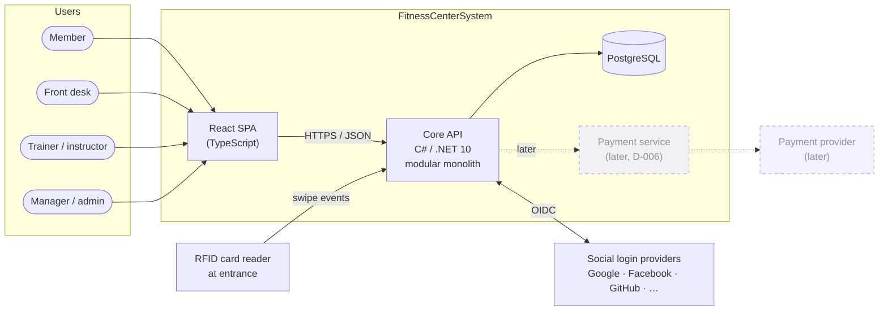

| Decision | What it fixes |
|---|---|
| [D-007](decisions.md) | React + TS frontend, C#/.NET 10 API and logic, PostgreSQL |
| [D-018](decisions.md) | Frontend libraries and tooling from the acme-corp starter; generated API client kept |
| [D-024](decisions.md) | Backend stays C# / .NET (D-007 confirmed after the acme-corp comparison) |
| [D-026](decisions.md) | Own login: ASP.NET Core Identity in the core, Google as external provider |
| [D-027](decisions.md) | Scaffold starts from the official `aspire-ts-cs-starter` template |
| [D-028](decisions.md) | Rules 1–3 and 6, CI gate and protected acceptance tests are enforced checks; rules 4–5 by review |
| [D-029](decisions.md) | MSTest for C# tests |
| [D-030](decisions.md) | ArchUnitNET for architecture tests |
| [D-031](decisions.md) | Two projects per module: Contracts + one project with layer folders |
| [D-008](decisions.md) | **One deployed core application** (modular monolith), modules by business area, boundaries enforced by architecture tests; payment as a separate deployable later |
| [D-009](decisions.md) | Aspire for local development |
| [D-006](decisions.md) | No payment integration for now |
| [D-003](decisions.md) | RFID card swipe registers attendance (gym, class or PT) |
| [D-010](decisions.md) | Unit, integration, E2E and all other automatable tests run in CI |
| [D-011](decisions.md) | Social login + local email/password |

---

## 2. System context (C4 level 1)

Who and what the system interacts with.

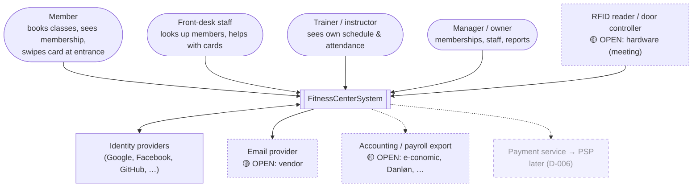

The personas come from [research/fitness-domain-operations.md](research/fitness-domain-operations.md) (candidate personas). The final list is pending the interview ([stakeholder-interview-guide.md](stakeholder-interview-guide.md)).

---

## 3. Containers (C4 level 2)

What gets deployed, and what talks to what.

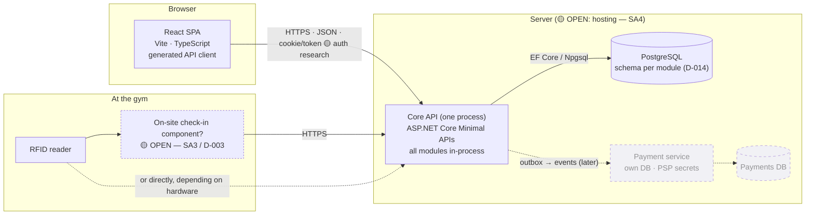

| Container | Technology | Deployed as | Status |
|---|---|---|---|
| React SPA | React + TypeScript (Vite), TanStack Router, Tailwind v4, shadcn/ui (Radix), i18next | Static files | Decided (D-007, D-018) |
| Core API | C#/.NET 10, ASP.NET Core Minimal APIs | One process | Decided (D-007, D-008); Minimal APIs is the research recommendation, see S2 |
| PostgreSQL | PostgreSQL + EF Core/Npgsql + NodaTime | One database, schema per module | Decided (D-007, D-014) |
| Payment service | C#/.NET | Separate process | Later (D-006, D-008) |
| On-site check-in | ? | ? | 🟡 Open until hardware is known (D-003) |

---

## 4. Inside the core: modules

### 4.1 Candidate modules

Modules are **business areas**, not technical layers ([D-008](decisions.md)). This list is a **candidate** derived from the domain research and will be confirmed in the PRD.

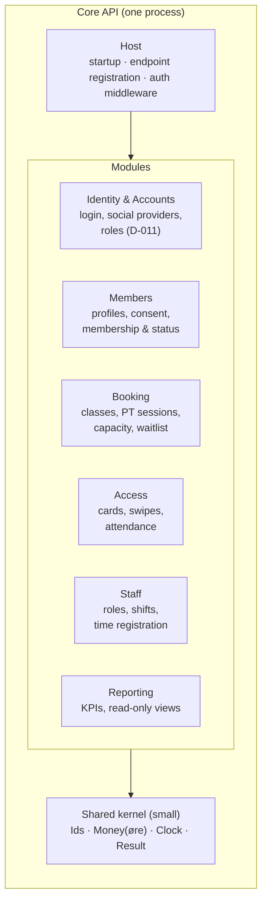

| Module | Owns (candidate) | Source |
|---|---|---|
| Identity & Accounts | User accounts, external logins, passwords, roles | D-011; research/authentication.md |
| Members | Member profile, consents, membership type and status, payment records and paid-until date (D-020) | research/fitness-domain-operations.md, research/domain-modeling.md |
| Booking | Class schedule, sessions, bookings, waitlists, PT appointments | research/domain-modeling.md §bookings |
| Access | RFID cards, swipe events, attendance records. Refuses check-in with a warning when a payment is missing. MVP: simulated reader, no hardware | D-003, D-020, D-021 |
| Staff | Employees, roles, shifts, time entries (Danish working-time registration is mandatory) | research/compliance-legal-security.md §4 |
| Reporting | KPI read models across modules | research/fitness-domain-operations.md KPI table |
| *(later, separate deployable)* Payments | 6 subscription types and one-time PT payments; sends payment confirmations to the core. No amounts owed or billing module in the core | D-006, D-008, D-019 |

### 4.2 Allowed dependencies between modules

Modules may only talk to each other through the other module's **public contract**: a small `*.Contracts` project with interfaces, DTOs and integration events. **Nothing else is visible across modules.**

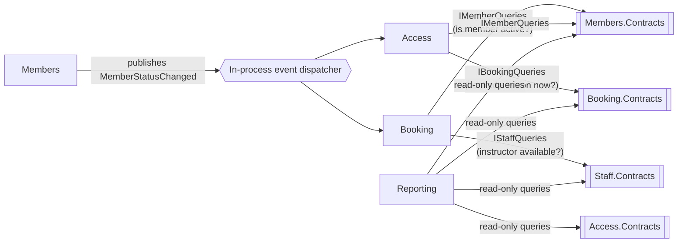

> The arrows above are **examples** of the pattern. Concrete contracts get designed per feature.

**Rules** (enforced, see §5):

| # | Rule |
|---|---|
| R1 | A module may reference another module's `*.Contracts` project only, never its internals |
| R2 | A module's `Domain` layer references nothing outside its own module except the shared kernel |
| R3 | No module reads or writes another module's tables directly. Cross-module FKs are allowed (D-014), and one transaction may span modules (D-015) |
| R4 | Cross-module side effects go through **integration events** (in-process now; the same shape the payment service will use later) |
| R5 | The shared kernel stays tiny: value types and abstractions only, no business rules |
| R6 | The frontend only talks to the API via the generated client (no hand-written fetch calls to endpoints) |

### 4.3 Inside one module

Each module has the same internal layering. **This is where the "API → logic → data" chain lives**: as layers *inside* the module and inside one process, not as separate services ([D-008](decisions.md), [research/service-architecture.md](research/service-architecture.md) §2.1).

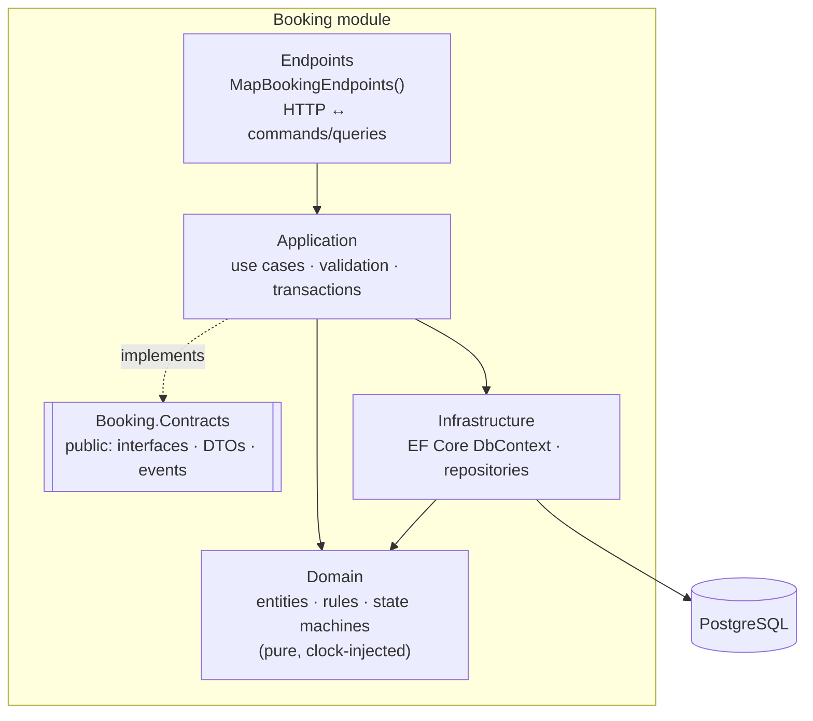

| Layer | Allowed to depend on | Must not |
|---|---|---|
| Endpoints | Application, Contracts | Touch the DbContext |
| Application | Domain, Infrastructure abstractions, other modules' Contracts | Contain HTTP concerns |
| Domain | Shared kernel only | Use I/O, `DateTime.Now`, EF attributes |
| Infrastructure | Domain, EF Core, Npgsql | Contain business rules |

The "pure, clock-injected domain" follows the testing research: the riskiest logic (dates, notice periods, attendance rules, pay) must be unit, property and mutation testable without a database ([research/testing-strategy.md](research/testing-strategy.md) §2.5, §4; open question Q1).

---

## 5. How boundaries are enforced

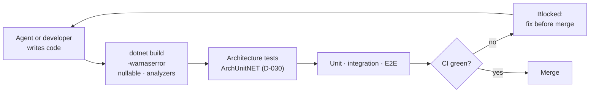

| Layer of defence | Catches | Source |
|---|---|---|
| Project references (`.csproj`) | Compile-time: a module can't even *see* another module's internals unless referenced | research/tech-stack.md §2.3 |
| `internal` visibility | Types inside a module are not public | research/tech-stack.md §2.3 |
| Architecture tests in CI | Rules R1–R3 as executable tests | D-008; research/service-architecture.md |
| Per-module DB schema (D-014) + optional role (🟡 DB3) | Makes ownership visible; roles would enforce R3 at the database level | research/database-schemas.md |
| Compiler/analyzer settings | Nullable, warnings-as-errors | research/tech-stack.md §2.9 |
| OpenAPI client regeneration check | Rule R6: frontend/backend contract drift becomes a TypeScript error | research/tech-stack.md §2.10 |

---

## 6. Key flows

### 6.1 Member books a class

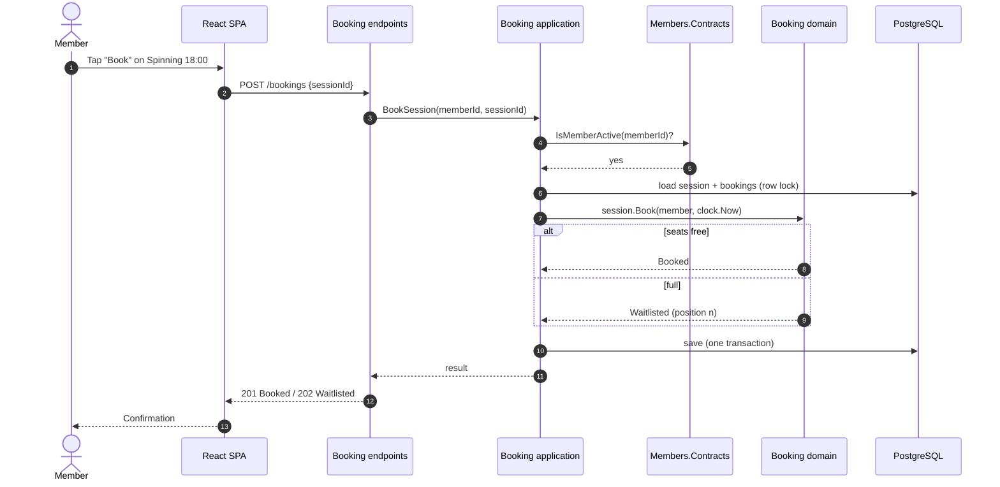

The overbooking protection (row lock or serializable transaction with retry) follows [research/domain-modeling.md](research/domain-modeling.md) (bookings section). Waitlist rules are 🟡 open (U4/D16).

### 6.2 Member swipes RFID card at the entrance

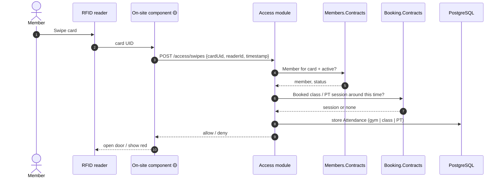

🟡 **Open, to be answered in the meeting / RFID research** ([D-003](decisions.md), SA3):
- Does the reader talk to us directly, or through a controller or on-site component?
- Does our system decide whether the door opens, or only log attendance?
- How is a swipe attributed to a class or PT session versus gym entry? The diagram shows one candidate: matching against bookings around the swipe time.
- What happens when the internet is down?

### 6.3 Cross-module side effect: a membership ends

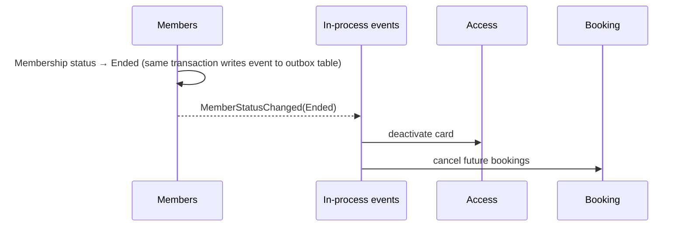

The outbox/in-process choice for v1 is 🟡 open. Using the same event shape now makes the later payment service a configuration change rather than a redesign ([research/service-architecture.md](research/service-architecture.md) §5, Shape B).

---

## 7. Data

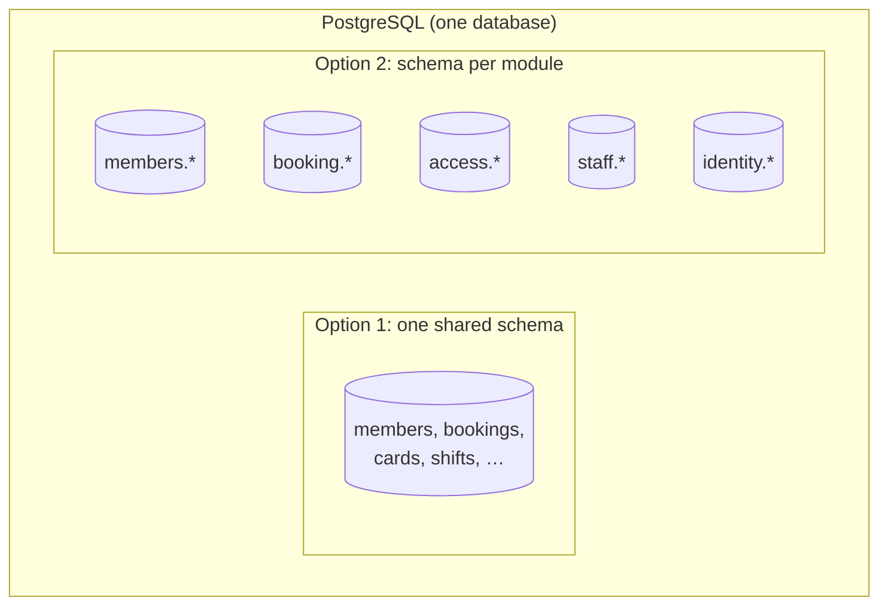

✅ **Decided ([D-014](decisions.md)): Option 2 — one schema per module, foreign keys allowed between modules.** Migrations run Identity → Members/Staff → Booking/Access. The draft tables are in [data-model.md](data-model.md). Transactions may span modules ([D-015](decisions.md)), so per-module DB roles are out for v1. Still open: reporting (DB5).

**Conventions** (from research, apply whichever option is chosen):

| Concern | Convention | Source |
|---|---|---|
| Money | Integer **øre** (`long`), never floating point; a `Money` value type in the shared kernel | research/domain-modeling.md |
| Time | Store instants in UTC (`timestamptz`); business rules in **Europe/Copenhagen** via NodaTime; inject the clock | research/tech-stack.md §4, research/testing-strategy.md §2.5 |
| History | Financial/legal records immutable; CRUD + audit log rather than event sourcing (🟡 D17) | research/domain-modeling.md |
| Personal data | Minimise; health data only if justified (🟡 M5); erasure design per GDPR (🟡 D18) | research/compliance-legal-security.md |
| Migrations | EF Core migrations, applied by a deploy step, not at app startup (🟡 to confirm) | research/database-schemas.md |

---

## 8. Authentication (placement)

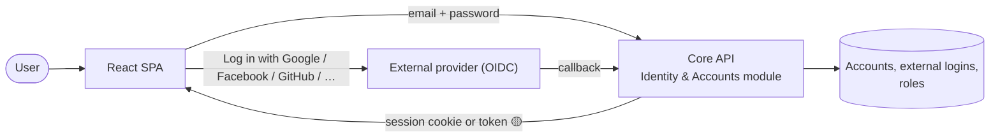

Decided ([D-011](decisions.md)): social login **and** local email/password.
🟡 Open, research done in [research/authentication.md](research/authentication.md). Its leaning (not a decision): ASP.NET Core Identity with external providers and a BFF/cookie pattern (RFC 10017). Pending questions AU1–AU8:
- exact providers
- ASP.NET Core Identity vs self-hosted or hosted identity provider
- BFF cookie vs tokens in the browser
- account linking
- MFA for staff

**Authorisation (candidate):** role-based (Member, Front desk, Trainer, Manager, Admin) with per-resource checks, for example a trainer sees only their own sessions (open question D13).

---

## 9. Repository layout (candidate)

From [research/service-architecture.md](research/service-architecture.md) §4 (Shapes A/B), adapted to React.

```
FitnessCenterSystem/
├── docs/                              planning docs, research, decisions
├── frontend/                          React + TS (Vite)
│   └── src/api/                       ← generated OpenAPI client (never hand-edited)
├── src/
│   ├── FitnessCenter.AppHost/         Aspire orchestration (dev only)        D-009
│   ├── FitnessCenter.Api/             host: startup, endpoint registration; service defaults (OpenTelemetry, health) in Extensions.cs  D-027
│   ├── BuildingBlocks/                shared kernel (Money, Clock, Ids, Result)
│   └── Modules/                       2 projects per module (D-031); BannedSymbols.txt bans the system clock
│       ├── Identity/   {Identity.Contracts, Identity}
│       ├── Members/    {Members.Contracts, Members}
│       ├── Booking/    {Booking.Contracts, Booking}
│       ├── Access/     {Access.Contracts, Access}
│       ├── Staff/      {Staff.Contracts, Staff}
│       └── Reporting/  {Reporting}
│   └── (later) Payments/ {Payments.Api, Payments.Contracts}               D-006
├── tests/
│   ├── Unit/                          per module, domain + application
│   ├── FitnessCenter.ArchitectureTests/  boundary rules R1–R3 (ArchUnitNET, D-030)
│   ├── IntegrationTests/              WebApplicationFactory + Testcontainers
│   └── E2E/                           Playwright
├── CLAUDE.md                          agent instructions (to be written)
└── .github/workflows/                 CI
```

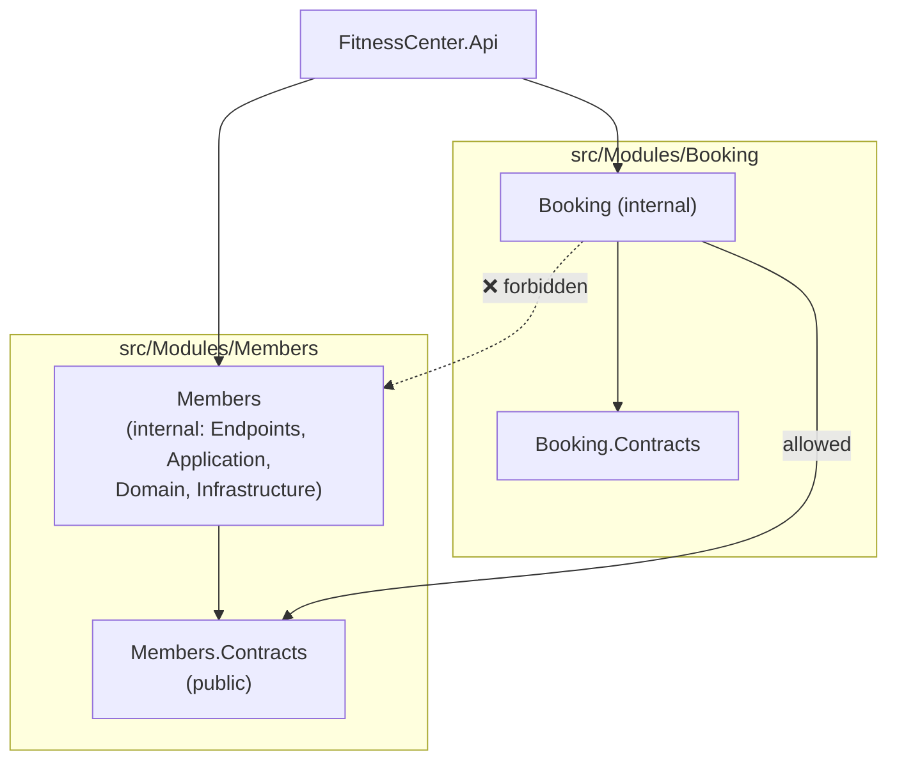

Decided (D-031): two projects per module, `<Module>.Contracts` and `<Module>` with layer folders `Domain/`, `Application/`, `Infrastructure/`, `Endpoints/`.

---

## 10. Local development (Aspire)

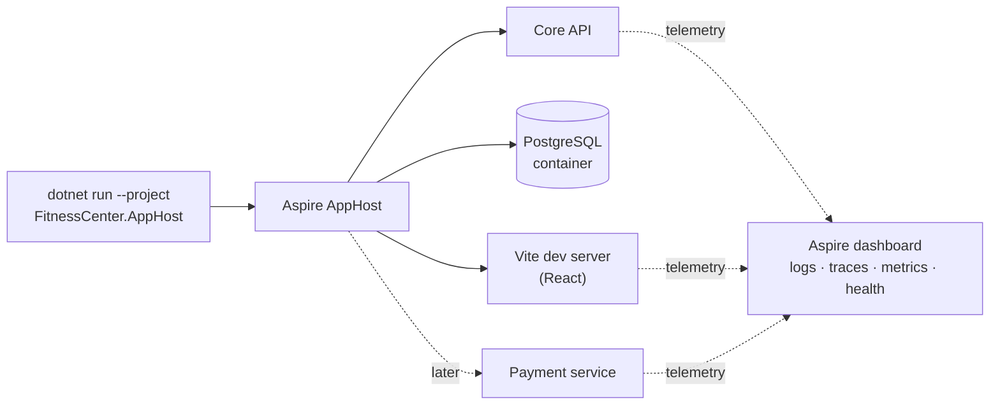

- One command starts everything ([D-009](decisions.md)). Aspire is dev-time only, not a production runtime.
- A container runtime is required (Docker; Podman support on Arch is **UNVERIFIED**).
- The dashboard shows per-request, per-HTTP-call and per-database-call timings. Per-layer timing needs explicit `ActivitySource` spans at module boundaries (D-009 caveat, **UNVERIFIED**).

---

## 11. Testing and CI pipeline

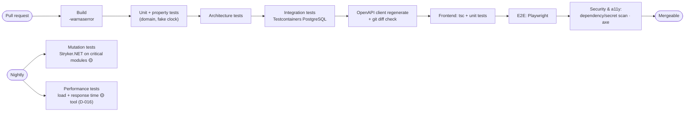

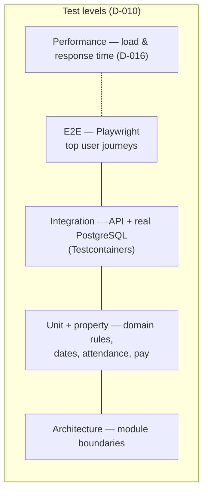

Stage order and tool candidates come from [research/tech-stack.md](research/tech-stack.md) §5.3 and §2.8. Framework (S11), coverage, mutation gate and test-protection policies are 🟡 open (Q2–Q7). The full plan will live in `testing.md`.

---

## 12. Deployment (🟡 open: SA4, expected from the meeting)

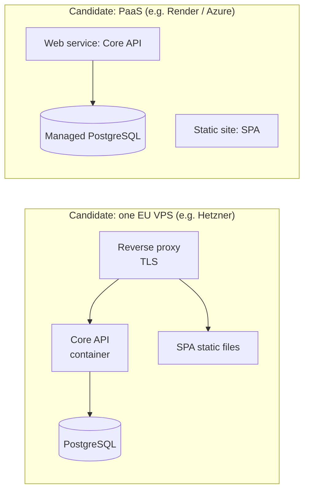

| Option | Monthly price snapshot | Ops burden | Source |
|---|---|---|---|
| Hetzner VPS + Compose (Aspire can generate it) | ≈ €11–13 + backups | Highest: you patch, back up, monitor | research/tech-stack.md §5.1; research/service-architecture.md §2.8 |
| Render | ≈ $13–15 | Low | research/tech-stack.md §5.1 |
| Fly.io | ≈ $46 | Low–medium | research/tech-stack.md §5.1 |
| Azure | **UNVERIFIED** for EU | Low | research/tech-stack.md §5.1 |

Requirement from compliance research: EU/EEA hosting and processors with DPAs (🟡 T3).

---

## 13. Later: payment service

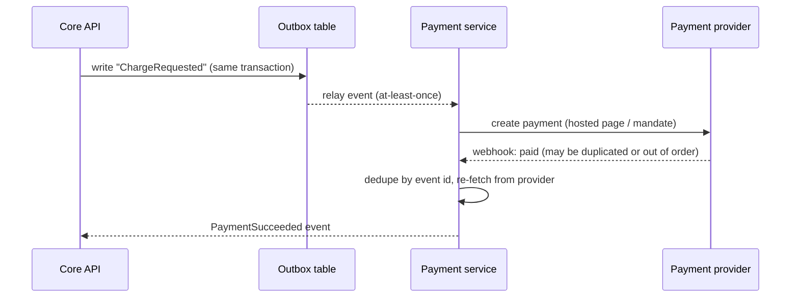

This is not built now ([D-006](decisions.md)). It is shown so that the core's event shape (§6.3) is designed to fit. Webhook handling follows [research/domain-modeling.md](research/domain-modeling.md) and [research/testing-strategy.md](research/testing-strategy.md) §2.6.

---

## 14. Open items affecting this document

| Item | Question / research | Blocks |
|---|---|---|
| DB details | DB2–DB8 (layout decided in D-014) | §7, §5 |
| Auth implementation | AU1–AU8 → research/authentication.md | §8 |
| Hosting | SA4 (meeting) | §12 |
| RFID hardware and offline behaviour | D-003, SA3 (meeting, then RFID research) | §3, §6.2 |
| Final module list | PRD after meeting (D-004) | §4 |
| Test framework and policies | S11, Q2–Q7 | §11 |
| Minimal APIs vs controllers | S2 (research recommends Minimal APIs) | §3 |
| Projects per module | Ceremony vs compile-time strength | §9 |
