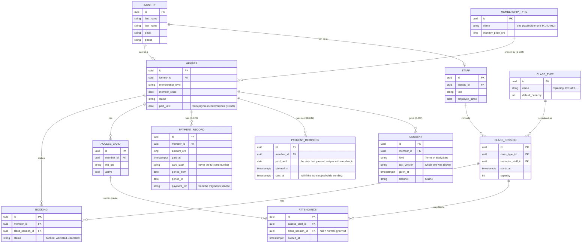
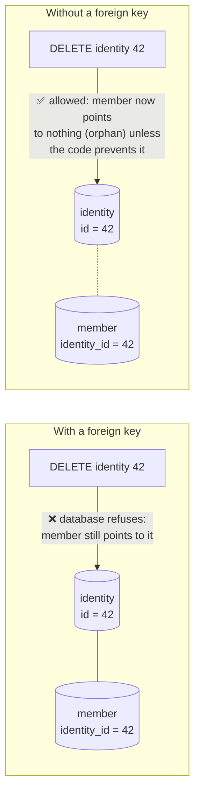
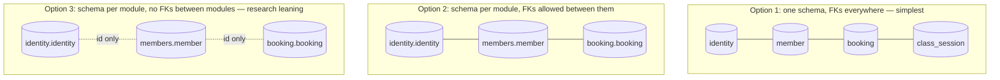
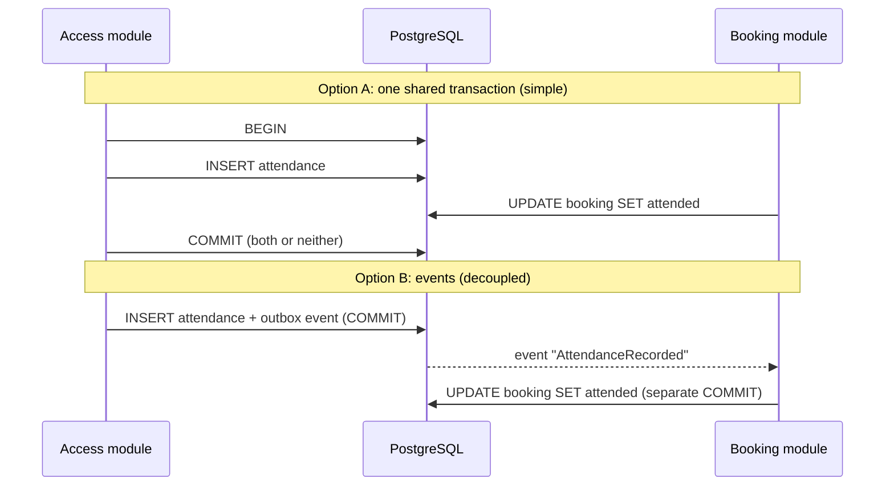

# Data Model (draft)

> **Status:** Draft v0.1 (2026-11-13). A **starting sketch** built from the owner's idea of the tables (identities, members, classes, staff). It is **not final**: the full model needs the center meeting ([D-004](decisions.md)).
> Background: [research/database-schemas.md](research/database-schemas.md) and [research/domain-modeling.md](research/domain-modeling.md).

---

## 1. The owner's starting idea

| Table | Holds (owner's words) |
|---|---|
| identities | names, emails, phone numbers, … |
| members | subscription level, classes signed up to, … |
| classes | (the classes offered) |
| staff | title, classes responsible for |

This maps well onto the candidate modules in [architecture.md](architecture.md) §4. Two small adjustments make it work in a relational database, both explained below:

1. **"Classes signed up to" becomes its own table (`bookings`).** A member signs up to many classes, and a class has many members. That is a *many-to-many* relationship, and databases model it with a table in between.
2. **"A class" splits into the class *type* and each *occurrence*.** "Spinning" is a type. "Spinning, Tuesday 18:00" is one session people book. Otherwise every Tuesday would need a new "class".

---

## 2. Draft model

Notes:
- **One person, several roles.** `IDENTITY` holds the person; `MEMBER` and `STAFF` say what they are. A trainer who also trains as a member has one identity and both rows. This matches the owner's idea of a separate identities table. Login data (password hash, Google link, MFA) would sit next to identity in the Identity module (D-011, D-013).
- **Payment reminders** (FIT-45, D-042): one row per missing payment, keyed by member and the paid-until date that passed. The reminder job saves the row before it sends the email, so the email never goes out twice, even after a restart. A later missing payment has a later paid-until date and gets its own row. Placeholder until the center answers D11.
- **Attendance** comes from RFID swipes (D-003); in the MVP from a simulated reader (D-021). It optionally links to a class session; how a swipe gets that link is open (meeting). Only accepted swipes are stored: a swipe refused for a missing payment (D-020) or an unknown card leaves no row.
- **Deliberately left out for now:** memberships over time, prices, PT appointments, shifts and time registration, certifications, health data. Payments themselves stay in the later Payments service (D-006); the core keeps only a copy of each payment record (`PAYMENT_RECORD`, D-020). These are all questions for the meeting. See [research/domain-modeling.md](research/domain-modeling.md) for what they could look like later.

---

## 3. What a foreign key is, and why it matters here (DB1)

A **foreign key (FK)** is a rule in the database: "`member.identity_id` must point to an existing row in `identity`". The database then refuses bad data, for example deleting an identity that still has a member.

The debate in the research is only about FKs **between modules**, e.g. `booking` (Booking module) → `member` (Members module). FKs **inside** a module (e.g. `class_session` → `class_type`) are always fine.

| | Allow FKs between modules | Forbid FKs between modules |
|---|---|---|
| **Data safety** | ✅ The database guarantees no orphans | ⚠️ The code must guarantee it, and tests must check |
| **Simplicity** | ✅ Normal, standard database design | ⚠️ More rules to remember (store IDs only) |
| **Deleting a person (GDPR)** | ⚠️ Must delete or anonymise in the right order across modules | ⚠️ Each module must react to "person deleted", usually via an event |
| **Migrations** | ⚠️ Module migrations must run in a fixed order | ✅ Each module migrates independently |
| **Moving a module out later** | ⚠️ The FK must be removed first | ✅ Already independent |
| **Source** | [database-schemas.md](research/database-schemas.md) §4, §8, §12 | Same; Grzybek and Jovanović (practitioner opinion) |

**Why "moving a module out later" matters less here:** the only part planned to run separately is the payment service ([D-008](decisions.md)), and the research suggests it gets its own database anyway (open question DB7). Nothing in the core is planned to be extracted.

---

## 4. Three ways to lay this out

| | Option 1 | Option 2 | Option 3 |
|---|---|---|---|
| Matches "not too complicated" | ✅✅ | ✅ | ⚠️ |
| Tables grouped by module (easy to see who owns what) | ❌ | ✅ | ✅ |
| Database protects relationships | ✅ | ✅ | ❌ (code + tests) |
| Can add per-module DB permissions later | ❌ | ✅ | ✅ |
| Easy to tighten later (Option 2 → 3) | Harder: tables must be moved | ✅ Drop FKs when needed | — |
| Runtime cost | none | none | none |

Schemas themselves have no measurable runtime cost ([database-schemas.md](research/database-schemas.md) §11).

**Orchestrator's recommendation (not a decision): Option 2.**
- **Simple:** it keeps normal foreign keys, matching the wish for a database that isn't too complicated.
- **Organised:** it groups tables by module, so ownership stays visible.
- **Reversible:** it can be tightened to Option 3 later by dropping specific FKs.
- **Reasoning:** the main benefit of Option 3 is easier extraction of modules, and nothing in the core is planned to be extracted.
- **Cost:** module migrations need a fixed order. Identity first, then Members/Staff, then Booking/Access.

---

## 5. Transactions across modules (DB2)

A **transaction** means "all of these changes happen, or none do". Example: a swipe creates an attendance row *and* marks the booking as attended.

- **Option A:** simple and always consistent. It works because all modules share one database and process (D-008). EF Core supports it when both modules use the same connection. It rules out separate database users per module.
- **Option B:** each module stays independent, but there is a short moment where one change is saved and the other isn't. That needs more code.
- **Orchestrator's recommendation (not a decision): Option A** for v1. It fits "not too complicated", and the architecture already plans events where they are needed: cross-module side effects and the later payment service ([architecture.md](architecture.md) §6.3).

Source: [database-schemas.md](research/database-schemas.md) §5, §9.

---

## 6. Open

| # | Question |
|---|---|
| DB1 | ✅ Decided: Option 2 ([D-014](decisions.md)) |
| DB2 | ✅ Decided: shared transactions allowed ([D-015](decisions.md)) |
| — | Everything listed under "deliberately left out", to be filled in after the meeting |

> **Built so far (FIT-47 signup slice, 2026-11-19):** the `identity` schema has ASP.NET Core Identity's tables. Its account (`AspNetUsers`) holds first name, last name and email. The `members` schema has `members`, `membership_types` (one seeded placeholder) and `consents`. `members.AccountId` has a foreign key to `identity.AspNetUsers` for integrity only (D-014). Column names follow EF Core's defaults (PascalCase).
>
> **Built so far (FIT-48 classes slice, 2026-11-23):** the `booking` schema has `class_types` (two seeded: Spinning, CrossFit), `class_sessions` (class type, instructor name as plain text, start, end, capacity) and `bookings` (class session, account, status Booked/Cancelled, booked at, cancelled at). A booking belongs to the Identity account, not to the member (D-039): `bookings.AccountId` has a foreign key to `identity.AspNetUsers` for integrity only (D-014). A filtered unique index allows one active booking per account and class. Cancelled bookings are kept with their status.
