# Decisions Log

Medium-to-large project decisions. Each entry is made only on documented reasoning — no guesses.
Entries are append-only; a superseded decision is marked `Superseded by D-NNN`, not deleted.

## Template

```
## D-NNN: <short title>
- **Date:** YYYY-MM-DD
- **Status:** Proposed | Accepted | Superseded by D-NNN
- **Decided by:** <owner / orchestrator with owner approval>

### Problem statement
<What needs deciding and why now.>

### Options considered
1. <Option> — pros / cons
2. <Option> — pros / cons

### Decision
<The chosen option.>

### Reasoning
<Why, tied to evidence.>

### Sources
- [docs/research/<file>.md](research/<file>.md) — <section>
- <external URL>
```

---


## D-001: Project purpose and scope anchor
- **Date:** 2026-11-12
- **Status:** Accepted
- **Decided by:** Owner

### Problem statement
Almost every research file flagged that requirements, legal obligations and architecture depend on whether the system serves a real center, a hypothetical one, or many centers, and in which country (see open questions F1, F2, F4).

### Decision
The system is built for **one real, single-site fitness center in Denmark** that has requested it, and is **also a learning project** for the owner. The priority is a **functioning end product**; learning is secondary (owner, 2026-11-13). The center has about 10 staff (member count unknown).

### Reasoning
Owner-provided fact. Consequences drawn from research:
- Danish law applies: consumer contract rules (cancellation after 5 months with 1 month's notice), employee working-time registration (mandatory since 1 July 2024), bookkeeping law, GDPR enforced by Datatilsynet, Danish fitness VAT changes from 1 Jan 2026.
- With ~10 staff the center is likely below the EU Accessibility Act microenterprise threshold (<10 staff and ≤€2m turnover) — borderline, needs confirmation of exact headcount and turnover.
- Multi-tenancy is **not** decided by this; it remains an open question (selling to other centers later would change bookkeeping-registration and controller/processor roles).

### Sources
- [research/compliance-legal-security.md](research/compliance-legal-security.md) — §4 Denmark working time, §6 consumer law, §7 bookkeeping, accessibility section; Errata items 3, 6
- [research/domain-modeling.md](research/domain-modeling.md) — Danish VAT 2026 findings
- [research/fitness-domain-operations.md](research/fitness-domain-operations.md) — center types and how needs differ

## D-002: Wearables and fitness-tracking integrations are out of scope
- **Date:** 2026-11-12
- **Status:** Accepted
- **Decided by:** Owner

### Problem statement
The integrations research listed wearable/fitness-platform integrations as a possible feature (open question M8 / R5).

### Decision
Wearables and fitness-data integrations are **not in the plan**.

### Reasoning
Owner decision. Independently supported by the fact-check: the Fitbit Web API was turned off on 2 Nov 2026, Garmin has paused new developer approvals since spring 2026, and Google Health API onboarding status is unknown — so the feature would be costly or impossible to deliver anyway.

### Sources
- [research/verification-report-wave1.md](research/verification-report-wave1.md) — claims I-22, I-23, I-24
- [research/integrations-and-architecture.md](research/integrations-and-architecture.md) — Errata item 2

## D-003: Attendance and entry via RFID access card
- **Date:** 2026-11-12
- **Status:** Accepted (mechanism); details open
- **Decided by:** Owner

### Problem statement
Access control options ranged from staffed reception to QR codes, wallet passes, PIN, and biometrics (face/fingerprint), with very different legal risk and hardware needs (open questions A1, A3, U3).

### Decision
Members use an **RFID access card** swiped at the entrance. A swipe registers attendance, which can be **normal gym entry or attendance for a class / personal-training session**. Biometric entry is therefore not part of the plan.

### Reasoning
Owner-stated requirement. Research consequences:
- Avoiding biometrics removes the highest-risk GDPR item (Datatilsynet 2024 required explicit consent plus a free equivalent alternative for face recognition) and the EU AI Act biometric question.
- Reader-to-controller protocol matters for security: OSDP is encrypted, Wiegand is not.
- **Still open** (to ask the center): existing reader/door hardware make and model, card technology, whether the door is unlocked by the system or only logs attendance, unstaffed hours, offline behaviour (fail open / closed / cached list), and how a single swipe is attributed to a class or PT session versus plain gym entry.

### Sources
- [research/compliance-legal-security.md](research/compliance-legal-security.md) — biometrics / Datatilsynet 2024
- [research/integrations-and-architecture.md](research/integrations-and-architecture.md) — access-control hardware and protocols (Wiegand/OSDP, Salto, Paxton)
- [research/ux-patterns.md](research/ux-patterns.md) — check-in patterns

## D-004: Gather requirements from the center before writing the PRD
- **Date:** 2026-11-12
- **Status:** Superseded by D-047
- **Decided by:** Owner (need), orchestrator (method)

### Problem statement
The MVP scope (open question F6) and most domain questions (memberships, billing, pay rules, scheduling) cannot be answered by the owner without the center's staff/management.

### Decision
Hold a structured stakeholder conversation with the center's management and staff, using [stakeholder-interview-guide.md](stakeholder-interview-guide.md), before writing `prd.md`. Research that does not depend on those answers may continue.

### Reasoning
The domain research shows requirements diverge sharply by center type and operating model, and this center is mixed (open gym + classes such as spinning and CrossFit + PT). The interview guide is built from the de-duplicated open questions so every answer maps back to a question ID.

### Sources
- [research/fitness-domain-operations.md](research/fitness-domain-operations.md) — center types; open questions
- [open-questions.md](open-questions.md)

## D-005: AI token budget constrains the workflow
- **Date:** 2026-11-12
- **Status:** Proposed — pending owner confirmation
- **Decided by:** Orchestrator, from owner-stated constraint

### Problem statement
The owner can spend about **half of the weekly token allowance of a Claude Pro subscription**. Research shows multi-agent setups are expensive (open questions W1, W6).

### Decision (proposed)
1. Prefer a lightweight, mostly single-agent workflow over heavyweight multi-agent/parallel-worktree workflows.
2. Run independent verification passes only on research that feeds decisions (methodology option B), not on every file.
3. Run future research rounds with few, narrowly briefed agents.

### Reasoning
Anthropic's multi-agent research system used ~15x the tokens of a chat, and agent teams ~7x a normal session; Anthropic also notes coding parallelises less well than research. A Pro allowance cannot sustain that routinely. Review time, not agent throughput, is also the documented bottleneck for a solo developer.

### Sources
- [research/agent-research-methodology.md](research/agent-research-methodology.md) — token cost; §2.1 options A/B
- [research/agentic-workflows.md](research/agentic-workflows.md) — cost and review-bottleneck findings; workflow options

## D-006: Payment services are out of scope for now
- **Date:** 2026-11-12
- **Status:** Accepted
- **Decided by:** Owner

### Problem statement
Payment-provider choice (cards, Betalingsservice, MobilePay Recurring, Stripe/Frisbii/GoCardless) was one of the largest open areas (open questions P1, P2, D3, Q8), and it blocked several billing and testing decisions.

### Decision
**Ignore all payment services for now.** Payment integration will come later as its own separate component (the "payment service" in [D-008](#d-008-architecture-modular-monolith-with-enforced-boundaries)).

### Reasoning
Owner decision. Consequences drawn from research:
- The questions about payment provider choice, PSP sandbox tests in CI and who owns the billing schedule are **deferred**, not answered.
- **Still open:** whether v1 tracks memberships and amounts owed without moving money (manual or external payment), or has no billing at all. See open question B3.
- Keeping payments behind a separate boundary also keeps card-security (PCI) scope small later. A hosted payment page gives the smallest scope.

### Sources
- [research/integrations-and-architecture.md](research/integrations-and-architecture.md) — payment provider catalog
- [research/compliance-legal-security.md](research/compliance-legal-security.md) — §5.1 PCI scope reduction
- [research/domain-modeling.md](research/domain-modeling.md) — billing ownership (open question 4)

## D-007: React frontend and C# API
- **Date:** 2026-11-12
- **Status:** Accepted
- **Decided by:** Owner

### Problem statement
The stack research ranked .NET 10 + PostgreSQL + Vue (1) and .NET 10 + PostgreSQL + React (2) as close candidates. It left the choice to the owner's review comfort and learning goals (open questions S1, S4).

### Decision
- **Frontend:** React (with TypeScript, per the stack research).
- **API and backend logic:** C#/.NET. The research gives .NET 10 LTS as the current long-term support release, supported to Nov 2028.
- **Database:** PostgreSQL.

### Reasoning
Owner decision. It is consistent with the evidence:
- The owner works professionally in C#.
- React has the somewhat stronger agent-tooling evidence: shadcn/ui's official MCP server, and the Next.js agent evals.
- Npgsql recommends PostgreSQL with NodaTime for date/time-heavy domains like billing periods and the Copenhagen time zone.

The Vue-vs-React spike (S5) is no longer needed.

### Sources
- [research/tech-stack.md](research/tech-stack.md) — candidate stacks and ranking
- [research/ux-patterns.md](research/ux-patterns.md) — design-system / shadcn evidence

## D-008: Architecture: modular monolith with enforced boundaries
- **Date:** 2026-11-13
- **Status:** Accepted
- **Decided by:** Owner, based on [research/service-architecture.md](research/service-architecture.md)

### Problem statement
The owner wanted the system "as much as possible as independent services", sketched as Frontend (React) → API (C#) → backend logic (C#) → PostgreSQL, plus a payment service later. It was undecided whether these parts are separately deployed services or separate code modules inside one deployed app.

### Options considered
1. **Shape A: plain modular monolith.** One deployable with strict module boundaries. Lowest effort and cost; one compile unit for agents.
2. **Shape B: modular monolith + Aspire + payment as a separate deployable later**, connected via outbox. Ranked 1st by the research.
3. **Shape C: separate services**, either per business capability or per layer. Highest cost: sagas, contract drift, GDPR erasure across stores, N× hosting. The layer-per-process variant was the weakest, because it pays the network-call cost without gaining domain independence.

### Decision
**Shape B.**
- **Core:** one deployed C#/.NET application, built as a modular monolith.
  - Modules are split by business area (e.g. Members, Booking, Access/Check-in, Staff), not by layer.
  - Each module is its own C# project(s) with API, logic and data-access layers inside it.
  - Boundaries are **enforced by architecture tests in CI** (NetArchTest or ArchUnitNET; library choice open).
- **Frontend:** React SPA, deployed separately (D-007).
- **Database:** a single PostgreSQL database (D-007). One schema per module vs one shared schema is still open (SA6).
- **Payment service:** a separately deployed service when payments are reopened (D-006). The outbox/broker details are decided then.
- **Local development:** Aspire (D-009).

### Reasoning
- **Owner's requirements:** "as modular as possible" **without impacting performance**. The priority is a working end product, not learning distributed systems (owner, answers to SA1/SA2).
- **Performance:** splitting layers into processes turns in-process calls into remote calls that are "orders of magnitude slower" and can fail (Fowler, "don't distribute your objects"). Modules inside one process keep calls in-process, including on the check-in path.
- **Modularity:** separate projects plus architecture tests make a boundary violation fail CI. That gives enforced independence without the cost of distribution.
- **Cost:** the benefits of Shape C (independent scaling, team autonomy) mostly don't apply to one developer and one site. Its costs (sagas, outbox, contract drift, GDPR erasure across stores, per-service hosting) all do, and they also strain the token budget (D-005).
- **Payment is the one justified separate service:** isolation of PSP secrets and webhooks, and a smaller PCI scope.
- **Outages:** keeping check-in working when the server or internet is down is **not** solved by any of these shapes. It needs an on-site/offline design, which is open until the access-hardware research after the center meeting (D-003, SA3).

### Sources
- [research/service-architecture.md](research/service-architecture.md) — §2.1 layers vs tiers vs microservices; §3 comparison table; §4 Shape B diagram and repo layout; §5 ranking; §6 risks
- [research/integrations-and-architecture.md](research/integrations-and-architecture.md) — §3.1 (Fowler, MonolithFirst / MicroservicePremium)
- https://martinfowler.com/bliki/MonolithFirst.html
- https://martinfowler.com/bliki/MicroservicePremium.html

## D-009: Use Aspire for local development from the start
- **Date:** 2026-11-13
- **Status:** Accepted
- **Decided by:** Owner

### Problem statement
Should Aspire (formerly .NET Aspire) be used as the local development orchestrator and telemetry dashboard from the start, or added later when a second deployable (the payment service) arrives? (Open question SA5.)

### Options considered
1. **Aspire from the start.** One command starts the API, PostgreSQL and later services. Its dashboard shows logs, traces and health in one place, and it can publish a Docker Compose file for a VPS. Cons: little gain while there is only one API; the tooling is changing (docs moved to aspire.dev, product renamed); it adds AppHost and ServiceDefaults projects; Arch/Podman support is UNVERIFIED.
2. **Plain `dotnet run` + docker compose; add Aspire later.** Simplest setup, but no unified dashboard and more manual wiring once payment arrives. Research: the option without Aspire "loses little against B until payments arrive, and can grow into B".

### Decision
Use **Aspire for local development from the start**. The AppHost wires the C# API and PostgreSQL now, and the payment service when it is added. Aspire is **not** a production runtime. Production deployment remains a separate decision, possibly a Compose file generated by Aspire for a single EU VPS (open question SA4).

### Reasoning
- One dashboard for logs, traces and health supports building a working product. Learning value is secondary: the owner stated on 2026-11-13 that a functioning end product is the priority.
- It prepares for the planned separate payment service (D-006).

Caveats recorded at decision time:
- Within one process, Aspire/OpenTelemetry shows time per request, per outgoing HTTP call and per database call. It does **not** show time per internal layer unless spans (`ActivitySource`) are added at layer or module boundaries. This came from the orchestrator's own knowledge and is **UNVERIFIED** against official docs.
- Aspire's API churn is a known risk. Pin versions.

### Sources
- [research/service-architecture.md](research/service-architecture.md) — §2.7 local dev (Aspire [A7], publish to Compose [A8]), §3 comparison table, §6 risks ("Aspire churn")
- https://aspire.dev/get-started/what-is-aspire/
- https://aspire.dev/deployment/deploy-with-aspire/

## D-010: Automated testing at every level, run in CI
- **Date:** 2026-11-13
- **Status:** Accepted (scope); tool choices open
- **Decided by:** Owner

### Problem statement
Which kinds of tests the project requires, and where they run (open questions W16, Q-series).

### Decision
The project uses **unit tests, integration tests, end-to-end tests and any other test type that can be automated**. All of them **run in CI** (GitHub Actions is the working assumption from research; hosting the repo is open, W3).

**Open:** the test framework (xUnit v3 vs TUnit vs NUnit, S11) and the policies for mutation testing, coverage and test protection (Q2–Q7).

### Reasoning
Owner requirement. It matches the research:
- Agents need pass/fail checks they can run themselves.
- Rules that must always hold belong in CI, hooks and deny rules, not in prompts.
- Agents have been documented editing or deleting tests to make them pass, so protection must be deterministic.

Research toolchain mapping for .NET:
- Testcontainers + WebApplicationFactory for integration tests
- Playwright for E2E
- `FakeTimeProvider` / NodaTime `FakeClock` for time
- Stryker.NET for mutation testing
- FsCheck/CsCheck for property tests
- NetArchTest/ArchUnitNET for architecture rules (D-008)
- axe for accessibility
- SAST/dependency/secret scanning

### Sources
- [research/testing-strategy.md](research/testing-strategy.md) — §2.2 agents gaming tests, §2.3 mutation, §2.7 E2E as definition of done, §5 draft testing.md skeleton
- [research/tech-stack.md](research/tech-stack.md) — §2.8 .NET testing toolchain, §5.3 CI on GitHub Actions
- [research/agentic-workflows.md](research/agentic-workflows.md) — verification and CI gates

## D-011: Login with social providers and local email/password accounts
- **Date:** 2026-11-13
- **Status:** Accepted (requirement); provider list and implementation pending [research/authentication.md](research/authentication.md)
- **Decided by:** Owner

### Problem statement
How should members (and staff) create accounts and log in? (Open question S6.)

### Decision
Offer a **standard login like most popular sites**:
- **Social login:** account creation and login via Google, Facebook, GitHub, and other regularly used providers.
- **Local accounts:** email + password, created in the system.

**Open:**
- which providers exactly
- own login (ASP.NET Core Identity + external providers) vs a self-hosted or hosted identity provider
- account linking
- MFA for staff/admin

### Reasoning
Owner requirement. The implementation choice will be recorded once the authentication research is done.

### Sources
- [research/tech-stack.md](research/tech-stack.md) — §2.7 authentication
- [research/authentication.md](research/authentication.md)

## D-012: Native mobile app, staff-first
- **Date:** 2026-11-13
- **Status:** Accepted (direction); technology open
- **Decided by:** Owner

### Problem statement
Is a native iOS/Android app planned? This affects App Store login rules and the frontend tech (open questions AU1, M6, S10).

### Decision
A **native phone app is planned**. Its **first delivery is for staff**, mainly to check their appointments (classes, PT sessions, shifts). Member features in the app come later.

### Reasoning
Owner decision. Consequences from research:
- **App Store guideline 4.8:** if the iOS app offers a third-party social login (e.g. Google) as the primary account login, it must also offer Sign in with Apple or an equivalent privacy-preserving option. Exemptions include apps that use only their own account system, and a government eID (MitID). Whether a staff-only app qualifies for the "enterprise/business account" exemption is **UNVERIFIED**. Check this before building the app.
- **Technology:** React Native (Expo) is one candidate that matches the React decision (D-007), but it has not been researched in depth (one row in integrations research). The app technology is **open**.
- The app consumes the same Core API (D-008). No separate backend.

### Sources
- [research/authentication.md](research/authentication.md) — finding 2, risk R6, source [A4] (Apple App Store Review Guidelines §4.8)
- [research/integrations-and-architecture.md](research/integrations-and-architecture.md) — §3.3 mobile options (React Native/Expo, Flutter, PWA)

## D-013: Login providers and MFA policy
- **Date:** 2026-11-13
- **Status:** Accepted
- **Decided by:** Owner
- **Refines:** D-011

### Problem statement
Which social providers to offer, and when MFA is required (open questions AU2, AU8).

### Decision
- **Facebook Login is not offered.**
- **MFA is mandatory for staff accounts.**
- **MFA is optional for members**: they can choose to turn it on.
- Still offered (from D-011): Google and local email + password.
- Still to confirm:
  - GitHub/Microsoft (AU3)
  - Apple (required in practice once the iOS app offers social login, D-012)
  - implementation: own ASP.NET Core Identity vs hosted IdP (AU5)

### Reasoning
- **Facebook:** Meta requires business verification and ongoing review. Transfers rely on the EU-US Data Privacy Framework, which is under appeal (CJEU C-703/25 P). Usage evidence is weaker than for Google and Apple (22% vs 49% / 44% in the one audit found).
- **Staff MFA:** staff accounts can access personal data about many members and employees. The research recommends stronger authentication for privileged users (ASVS L2 for staff/admin).

### Sources
- [research/authentication.md](research/authentication.md) — findings 3, provider table, ASVS section, open questions 2 and 8

## D-014: Database layout: one schema per module, foreign keys allowed between modules
- **Date:** 2026-11-13
- **Status:** Accepted
- **Decided by:** Owner, on the orchestrator's recommendation in [data-model.md](data-model.md) §4

### Problem statement
How to lay out the tables of the modular monolith (D-008) in its single PostgreSQL database, and whether foreign keys may cross module boundaries (open questions SA6, DB1). The owner wants the database not too complicated to start with.

### Options considered
1. **One shared schema with FKs everywhere.** Simplest, but no grouping by module, and moving to per-module permissions later means relocating tables.
2. **One PostgreSQL schema per module (e.g. `identity`, `members`, `booking`, `access`, `staff`), FKs allowed between modules.** Normal database integrity, tables grouped by owner, and can be tightened later.
3. **Schema per module, no FKs between modules (IDs only).** The research's leaning. Easiest module extraction, but integrity moves to code and tests, with more rules.

### Decision
**Option 2.**
- Each module owns a PostgreSQL schema, with its own EF Core `DbContext` (`HasDefaultSchema`) and migrations history table.
- **Foreign keys between modules are allowed.**
- Module migrations run in dependency order: **Identity → Members / Staff → Booking / Access**. Reporting comes later.
- Rule R3 in [architecture.md](architecture.md) §4.2 still applies: no module *reads or writes* another module's tables through code. FKs are database integrity only, not a shortcut for queries.

### Reasoning
- **Simplicity and data safety:** the database itself prevents orphaned rows, which matches the owner's "not too complicated" requirement.
- **Visible ownership:** schemas group tables by module at no measurable runtime cost.
- **Option 3's benefit doesn't apply here:** its main gain is easy extraction of a module into a separate service. The only planned separate service is payments (D-008), which is expected to get its own database regardless (DB7). No core module is planned for extraction.
- **Reversible:** individual FKs can be dropped later to move to Option 3. Going from Option 1 to 2 would require moving tables.
- **Known costs:**
  - migrations must run in a fixed order
  - deleting or anonymising a person (GDPR) must respect FK order across modules
  - per-module database roles (DB3) would need REFERENCES privileges for cross-schema FKs (UNVERIFIED detail)

### Sources
- [data-model.md](data-model.md) — §3 foreign keys explained, §4 options and recommendation
- [research/database-schemas.md](research/database-schemas.md) — §2 what a schema is, §4 cross-module FKs, §6 EF Core specifics, §8 GDPR erasure, §11 performance, §12 extraction, §15 recommendation

## D-015: Transactions may span modules
- **Date:** 2026-11-13
- **Status:** Accepted
- **Decided by:** Owner, on the orchestrator's recommendation in [data-model.md](data-model.md) §5

### Problem statement
When one action changes data in two modules, should both changes be saved in one database transaction (both or neither), or should the modules be decoupled with events? Example: an RFID swipe records attendance (Access) and marks the booking as attended (Booking). (Open question DB2.)

### Options considered
- **A. Shared transaction:** both modules' changes commit together on one connection. Simple, always consistent.
- **B. Events/outbox:** each module commits separately and reacts to the other's events. More decoupled and extraction-ready, but more code and brief inconsistency.

### Decision
**A.** A single database transaction **may span two (or more) modules** in the core.
- The DbContexts involved share one connection and transaction. Implementation details are verified in a spike: EF Core supports a shared transaction across contexts that use the same connection.
- Events stay in use where the architecture already plans them: cross-module side effects that need not be atomic ([architecture.md](architecture.md) §6.3), and the future payment service, which is a separate deployable with its own database and cannot share a transaction.

### Reasoning
- **Simplicity:** this matches the owner's "not too complicated" requirement.
- **It's possible here:** all core modules run in one process with one database (D-008, D-014).
- **Consistency:** shared transactions avoid the partial-failure states that events/outbox must handle.
- **Trade-off accepted:** this rules out separate database users (roles) per module, because a shared transaction needs one connection. DB3 is therefore effectively "not in v1".

### Sources
- [data-model.md](data-model.md) — §5 transactions explained
- [research/database-schemas.md](research/database-schemas.md) — §5 transactions across modules, §9 per-module roles
- https://learn.microsoft.com/en-us/ef/core/saving/transactions

## D-016: Performance testing is part of the test suite
- **Date:** 2026-11-13
- **Status:** Accepted (requirement); tool and thresholds open
- **Decided by:** Owner
- **Extends:** D-010

### Problem statement
D-010 covers unit, integration, E2E and other automated tests. Performance testing was not explicitly included, and the earlier testing research did not cover it.

### Decision
The project **includes automated performance tests**: load and response-time tests that can run on demand and in CI.
- **Tool:** open. The owner knows of JMeter but has not used it. Candidates have not been researched yet.
- **Open:** targets (e.g. RFID check-in response time, booking under concurrent load), when they run (every PR, nightly, or before release), and which environment they run against.

### Reasoning
Owner requirement. It fits the research principle that quality gates must be automated checks rather than prompts. The concrete design needs research, because no project research covers performance tools yet.

### Sources
- [research/testing-strategy.md](research/testing-strategy.md) — performance testing is not covered (gap)
- [research/agentic-workflows.md](research/agentic-workflows.md) — automated CI gates

## D-017: Linear is the task tracker; docs/ stays the source of truth
- **Date:** 2026-11-13
- **Status:** Accepted
- **Decided by:** Owner

### Problem statement
Where are tasks tracked, and how do agents get their instructions? (Open questions W11, W12.) The owner has created a Linear workspace and team, both named **FitnessCenterSystem**, connected to the GitHub repo `Gafion/FitnessCenterSystem`, and connected the Linear MCP server to Claude Code.

### Decision
- **Linear holds every task:** both tasks agents can pick up and tasks for the owner. **If it is a task, it has a Linear ticket**, even when that is redundant, for process tracking and history.
- **Every sub-agent gets its instructions from a Linear ticket** that the orchestrator creates first. The ticket holds the full brief. The agent is pointed at the ticket and reports back by commenting on it.
- **Decisions and requirements stay in `docs/`** (`decisions.md`, `open-questions.md`, PRD, etc.). Tickets link to docs; they do not replace them.

### Reasoning
Owner decision. It is consistent with the research:
- Issue-tracker-driven agent work and PR-linked tickets give an auditable history of what each agent was asked to do.
- Keeping specs in the repo keeps them versioned alongside the code.

### Sources
- [research/agentic-workflows.md](research/agentic-workflows.md) — issue-tracker-driven agents, tracker options
- [research/agentic-project-planning.md](research/agentic-project-planning.md) — task-tracking formats, docs as source of truth

## D-018: Frontend libraries and tooling follow the acme-corp starter
- **Date:** 2026-11-13
- **Status:** Accepted (the UI library part, "shadcn/ui on Radix", is superseded by D-056)
- **Decided by:** Owner
- **Extends:** D-007

### Problem statement
D-007 fixed React + TypeScript (Vite) but left the router, styling, UI kit and frontend tooling open (open question U10, frontend part of S11). The owner was recommended the [acme-corp](https://github.com/Pallepadehat/acme-corp) starter by its author, a fellow student who works with frontend in his apprenticeship. The comparison (FIT-40) found its frontend choices fit D-007 unchanged, while its backend does not fit D-007, D-008, D-013 or D-014.

### Options considered
1. **Keep D-007 as is, choose frontend libraries later.** No change now, but the open slots stay open.
2. **Adopt acme-corp entirely (frontend and TypeScript backend).** Supersedes D-007's backend part; module boundaries, staff MFA and schema per module need custom work; Drizzle and PGlite are pre-1.0.
3. **Hybrid: adopt acme-corp's frontend choices, keep the C# backend.** Fits D-007; fills the open frontend slots with a set that is known to work together; Aspire can host the Vite app.

### Decision
Option 3. In `frontend/`:
- **Libraries:** React 19, Vite, **TanStack Router**, **Tailwind CSS v4**, **shadcn/ui on Radix** (as in the template), **i18next** (the library only; whether Danish + English is required stays open as U5).
- **Tooling:** Vitest (unit and component tests), Playwright (E2E), Biome (lint and format), Knip (unused code), Bun as package manager and script runner.
- **Not adopted:** the template's hand-written `fetch` wrapper and shared Zod contract. Rule 6 stands: the frontend calls the API only through the generated OpenAPI client. Better Auth, Fastify, Drizzle, BullMQ/Redis and Turborepo are not adopted; the backend stays as D-007 to D-016 decide.

Exact versions are pinned at scaffold time (FIT-31), not here.

### Reasoning
Owner decision. The owner trusts the author's frontend judgement. It is consistent with the evidence:
- Every adopted piece fits D-007 as it stands, and shadcn/ui was already the UI-library candidate.
- Aspire hosts Vite apps (`AddViteApp`) and supports Bun (`WithBun`), so D-009 is unaffected.
- The backend gaps (no architecture tests, staff MFA needs custom hooks, `timestamp` without time zone, pre-1.0 ORM) are avoided by keeping the C# backend.

Noted risk: shadcn/ui's default primitives switched to Base UI in July 2026; Radix is chosen here to match the template.

### Sources
- [research/stack-comparison-acme-corp.md](research/stack-comparison-acme-corp.md) — §3.5, §4, §5 option 3a/3b; ACME-005, ACME-014, ACME-060, ACME-061
- [research/ux-patterns.md](research/ux-patterns.md) — §10 (shadcn/ui, Base UI default)
- https://aspire.dev/integrations/frameworks/javascript/

## D-019: Payments are subscriptions and one-time PT payments; the core keeps no amounts owed
- **Date:** 2026-11-13
- **Status:** Accepted
- **Decided by:** Owner
- **Answers:** B3. Extends D-006 and D-008.

### Problem statement
With payments out of scope for now (D-006), open question B3 asked whether v1 still tracks memberships and amounts owed, or has no billing at all. The architecture listed "Billing / Payments" as one later item, so it was unclear whether the core needs a billing module.

### Options considered
1. **The core tracks amounts owed** (a billing module with charges and balances). Needed if the system owns the billing schedule; brings invoice, VAT and bookkeeping logic into the core.
2. **No amounts owed in the core; the payment service only reports payment confirmations.** The core stays free of billing logic.

### Decision
Option 2, as stated by the owner:
- Members pay through **6 different subscription types** (the membership types).
- **Personal-training (PT) appointments** can be paid as a **one-time payment**.
- The core keeps **no "amounts owed"**. The payment service (separate deployable, D-008) sends **payment confirmations** to the core.
- There is **no Billing module in the core**. The planned modules are Identity & Accounts, Members, Booking, Access, Staff, Reporting, plus the separate Payments service.

D-006 still applies: the payment service is built later.

### Reasoning
Owner decision. It fits the architecture: the payment service already reports to the core through events (architecture.md §13, `PaymentSucceeded`). It also keeps billing schedules, card data and PCI scope out of the core (D-006 reasoning).

**Still open, not decided here:** which 6 subscription types (M1); who runs the subscription schedule, the payment provider or our service (D3); what the core does when a confirmation does not arrive, e.g. whether door access is blocked (D11); VAT on PT for members aged 30+ (D1, D2); and how payments reach a bookkeeping system (P3, compliance research §7).

### Sources
- [architecture.md](architecture.md) — §4.1 module table, §13 payment service
- [research/domain-modeling.md](research/domain-modeling.md) — billing ownership (D3), dunning (D11)
- [research/compliance-legal-security.md](research/compliance-legal-security.md) — §7 bookkeeping, §5.1 PCI scope

## D-020: Payment records in the core; a missing payment blocks check-in and emails the member
- **Date:** 2026-11-13
- **Status:** Accepted
- **Decided by:** Owner
- **Extends:** D-019. Partly answers D11.

### Problem statement
D-019 kept "amounts owed" out of the core. The owner now wants members to see their payments, and wants a rule for missing payments. Payment records could live only in the Payments service's database, or also as a copy in the core.

### Options considered
1. **Copy in the core.** Each payment confirmation event also writes a payment record into the core. The account page and check-in read only the core, so they work when the Payments service is down, and in the MVP with simulated payments (D-021). Cost: the same data is stored twice.
2. **Only in the Payments service.** One copy. The account page and check-in call the Payments service over the network, so check-in depends on a second running service, and nothing works until it exists.

### Decision
Option 1.
- **Every payment is saved** in the core with **amount** (øre, `Money`), **date** (`timestamptz`) and the **last four digits of the card**. The confirmation also carries the period it covers, so the core knows each membership's **paid-until date**. Owner: **Members** module, which already owns membership and status.
- The **member's account page** shows the payment history.
- **A subscription payment is missing** when the paid-until date has passed. Then:
  - the member gets an **email**;
  - at **check-in**, the member sees a **warning** and the **check-in is refused**. Access asks Members through `Members.Contracts`, as in architecture.md §4.2.
- **Never store** the full card number, CVV or stripe data. Only the last four digits and provider references.

**Still open:**
- Grace period before a payment counts as missing, and whether reminder emails repeat (D11, for the center).
- Whether an unpaid one-time PT payment has any effect.
- Non-card methods (MobilePay, Betalingsservice) have no card digits, so what is shown then depends on P1.
- The transactional email provider (integrations research, row 8).
- How long payment records are kept. Bookkeeping retention is 5 years in the research, and how that applies to this copy is unverified.

### Reasoning
Owner decision on the requirement; option 1 chosen by the owner from the orchestrator's recommendation.
- The compliance research's data inventory already lists "last 4 digits" with payment tokens in the Members area, under the contract basis, and forbids storing the full card number.
- Domain research warns that access and billing are separate timelines, and that "subscription active" alone is not enough for access control. A paid-until date from confirmations avoids that.
- Keeping check-in independent of the Payments service matters because check-in is the most time-critical flow.

### Sources
- [research/compliance-legal-security.md](research/compliance-legal-security.md) — §5.1 (never store PAN/CVV), data inventory row 3 (last 4 digits, 5-year bookkeeping retention)
- [research/domain-modeling.md](research/domain-modeling.md) — §2.10 dunning; executive summary item 3 (access and billing as separate timelines)
- [research/integrations-and-architecture.md](research/integrations-and-architecture.md) — row 8, transactional email
- [architecture.md](architecture.md) — §4.2 contracts, §13 payment service

## D-021: The MVP simulates RFID hardware and payments
- **Date:** 2026-11-13
- **Status:** Accepted
- **Decided by:** Owner
- **Extends:** D-003, D-006

### Problem statement
The MVP needs check-in (D-003) and payment confirmations (D-019, D-020) to work, but the RFID hardware is unknown until the center meeting, and the Payments service is out of scope (D-006).

### Options considered
1. **Simulate both.** A simulated card reader sends swipes; a test tool sends payment confirmations, and can skip one to trigger a missing payment. The core code is the same as with real hardware and payments later.
2. **Staff register payments manually.** Usable at the center before payments exist, but adds a staff screen that may be thrown away later.
3. **Build the real integrations now.** Supersedes D-006 and needs the RFID hardware details and the payment provider choice first.

### Decision
Option 1, for both RFID and payments.
- **RFID:** no hardware module in the MVP. A **simulated reader** sends a card UID to the same check-in logic the real reader will use later.
- **Payments:** a **simulated payment source** sends the same payment confirmation events the Payments service will send later. It can skip a payment, so the missing-payment rule from D-020 can be tested.
- Both use **synthetic data only**.

**Still open:** whether the simulators exist only in development and tests, or also in a demo for the center (and if so, who may use them).

### Reasoning
Owner decision for RFID; option 1 for payments chosen by the owner from the orchestrator's recommendation. It keeps the real integrations behind the same boundary they would have anyway: card swipes into Access, and events from the Payments service (architecture.md §13). That way, building the real versions later does not change the core. RFID research (FIT-33) is no longer needed for the MVP.

### Sources
- [decisions.md](decisions.md) — D-003, D-006, D-019, D-020
- [architecture.md](architecture.md) — §13 payment service event shape

## D-022: MVP scope: six pages
- **Date:** 2026-11-13
- **Status:** Accepted
- **Decided by:** Owner
- **Relates to:** D-004 (the PRD still follows the center meeting), D-020, D-021

### Problem statement
The owner wants a concrete starting point before the full PRD. Which pages make up the MVP?

### Options considered
For the classes page:
1. **View and book.** Schedule, book a spot, cancel. Exercises Booking end to end.
2. **View only.** Smaller, but Booking stays untested.
3. **View, book and waitlist.** Adds waitlist promotion rules to the MVP.

For check-in:
1. **Add a simulated check-in page.** Shows the D-020 missing-payment rule in the MVP.
2. **No check-in page.** The check-in rule waits until after the MVP.

### Decision
The MVP has six pages:

| # | Page | What it does | Modules |
|---|---|---|---|
| 1 | Landing page | Public front page of the center | (frontend only) |
| 2 | Login / signup | Google or email/password (D-011); MFA optional for members (D-013) | Identity |
| 3 | Classes | View the schedule, book a spot, cancel a booking. No waitlist | Booking, Members |
| 4 | User account | Profile and payment history (D-020) | Members |
| 5 | Simulated payment | Sends fake payment confirmations, can skip one (D-021) | Members (via payment events) |
| 6 | Simulated check-in | Acts as the card reader; shows welcome or the missing-payment warning and refuses check-in (D-020, D-021) | Access, Members |

Classes options 1 and check-in option 1 were chosen by the owner from the orchestrator's recommendations.

**Not in the MVP (open):** staff screens, including creating classes. Classes would come from synthetic seed data. The missing-payment email (D-020) is in the MVP but has no page. Who may open the two simulated pages is open (D-021).

### Reasoning
Owner decision. The six pages touch every MVP rule decided so far (login, booking, payment records, missing payment at check-in) with the smallest number of screens. The final module list and features still come from the PRD after the center meeting (D-004).

### Sources
- [decisions.md](decisions.md) — D-004, D-011, D-013, D-020, D-021
- [architecture.md](architecture.md) — §4.1 module table

## D-023: Scaffolding approach and slice order
- **Date:** 2026-11-19
- **Status:** Accepted (partly: template, dev login and enforced checks are still open in FIT-50)
- **Decided by:** Owner
- **Relates to:** D-007, D-022, FIT-49, FIT-50

### Problem statement
Should the owner build the project's structure and first feature before agents work on it, and which feature should be the first, "golden" slice that agents copy?

### Options considered
Who writes the walking skeleton and golden slice ([scaffolding-for-agents.md](research/scaffolding-for-agents.md)):
1. **Owner types it by hand.** Most control, slowest.
2. **An agent writes it in small steps, the owner reviews.** Both OpenAI and Anthropic work this way; the human designs, reviews and enforces it with checks.
3. **Start from a trimmed template.** Fastest; depends on the backend language (FIT-41).

Golden slice: the orchestrator suggested "book + cancel a class".

### Decision
- **An agent writes the scaffold in small steps** (option 2). The owner reviews each step.
- **Slice order:**
  1. **Signup for the general gym membership** (golden slice).
  2. **Booking and cancelling classes.**
  3. **PT.**

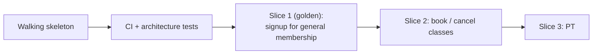

**Still open (FIT-50):** which template, if any (depends on FIT-41); whether a dev-only fake login is used; which rules become enforced checks. Whether a template is used together with option 2 is not decided.

### Reasoning
Owner decision. The research found no study that tests hand-written scaffolds against agent-written ones; it found that agents copy the patterns already in the repo and that enforced checks matter more than written instructions ([scaffolding-for-agents.md](research/scaffolding-for-agents.md)). The owner's review of each step is what keeps the first slice clean.

**Consequences (orchestrator notes, not owner decisions):**
- Signup is part of login, so slice 1 needs the login implementation (AU5) decided first. A dev-only fake login (FIT-50 question 4) no longer helps the golden slice.
- Signup for a membership touches Identity and Members, and probably the simulated payment (D-021). That makes the golden slice cross several modules, which shows the boundary rules early but makes it larger.
- PT is not one of the six D-022 pages. Whether PT is in the MVP or comes right after it is open.

### Sources
- [research/scaffolding-for-agents.md](research/scaffolding-for-agents.md)
- [decisions.md](decisions.md) — D-011, D-021, D-022
- [open-questions.md](open-questions.md) — AU5

## D-024: The backend stays C# / .NET
- **Date:** 2026-11-19
- **Status:** Accepted
- **Decided by:** Owner
- **Relates to:** D-007 (confirmed, not superseded), D-018, FIT-41

### Problem statement
After the acme-corp comparison, should the backend move to TypeScript (one language everywhere, as the owner's frontend colleague prefers) or stay C# / .NET as decided in D-007?

### Options considered
From [stack-comparison-acme-corp.md](research/stack-comparison-acme-corp.md) §5:
1. **Keep C# / .NET** (D-007). Frontend follows acme-corp (D-018).
2. **Move the backend to TypeScript** (acme-corp: Fastify, Better Auth, Drizzle). One language everywhere.

### Decision
**Option 1.** The backend stays C# / .NET 10, ASP.NET Core, as a modular monolith. D-007 and D-008 stand unchanged. The frontend stays as decided in D-018.

### Reasoning
Owner's reason: .NET runs request handling on a multithreaded runtime, while JavaScript runs on a single-threaded event loop.

Background (orchestrator note):
- In Node.js, JavaScript runs on one event-loop thread per process. CPU-heavy work blocks every other request on that thread.
- Node.js can use more cores through worker threads or several processes.
- ASP.NET Core spreads requests over the .NET thread pool.

No performance comparison has been measured for this app (UNVERIFIED either way). The performance tests from D-016 will show whether the backend meets its targets.

### Sources
- [research/stack-comparison-acme-corp.md](research/stack-comparison-acme-corp.md)
- https://nodejs.org/en/learn/asynchronous-work/dont-block-the-event-loop (UNVERIFIED: not re-fetched in this session)
- https://nodejs.org/api/worker_threads.html (UNVERIFIED: not re-fetched in this session)
- https://learn.microsoft.com/en-us/dotnet/standard/threading/the-managed-thread-pool (UNVERIFIED: not re-fetched in this session)

## D-025: PT is not in the MVP
- **Date:** 2026-11-19
- **Status:** Accepted
- **Decided by:** Owner
- **Relates to:** D-019, D-022, D-023

### Problem statement
D-023 puts PT third in the slice order, but PT is not one of the six MVP pages in D-022. Is PT part of the MVP?

### Options considered
1. **PT is in the MVP.** Adds a seventh page and the one-time PT payment (D-019).
2. **PT comes after the MVP.**

### Decision
**Option 2.** The MVP is the six pages in D-022. The MVP builds slices 1 and 2 from D-023. PT (slice 3) comes after the MVP.

### Reasoning
Owner decision.

### Sources
- [decisions.md](decisions.md) — D-019, D-022, D-023

## D-026: Own login with ASP.NET Core Identity
- **Date:** 2026-11-19
- **Status:** Accepted
- **Decided by:** Owner
- **Relates to:** D-011, D-013, D-023 (signup is the golden slice), AU5

### Problem statement
Which implementation do we use for login: our own (ASP.NET Core Identity, data in our database) or a hosted identity provider (AU5)?

### Options considered
From [authentication.md](research/authentication.md) (options table):
1. **ASP.NET Core Identity + Google as an external provider.**
   - Costs €0, and all data stays in our own PostgreSQL.
   - The browser holds only a same-origin cookie, which is equivalent to the recommended BFF pattern.
   - Lock-in is low.
   - Security-sensitive flows are ours to build and test.
2. **Hosted provider** (Auth0, Entra External ID, Clerk and others):
   - Less code to write.
   - Adds an extra data processor and a DPA.
   - Lock-in is high, and EU residency is unclear for several of them.
3. **Self-hosted identity server** (Keycloak, Duende, OpenIddict):
   - Adds an extra service, or a paid licence (Duende).

### Decision
**Option 1.** Login is built with ASP.NET Core Identity inside the core, with its data in our PostgreSQL. Google is added as an external login provider (D-011). MFA stays mandatory for staff and optional for members (D-013).

The EU-residency part of AU5 is no longer needed, because no external identity store is used. Google login still sends sign-in data to Google.

### Reasoning
Owner decision. It keeps all data in our database, costs nothing and avoids an extra data processor ([authentication.md](research/authentication.md)).

Known follow-ups:
- Passkey UI ships only with the Blazor template, so a React SPA needs its own WebAuthn work if passkeys are wanted ([authentication.md](research/authentication.md) finding 6).
- Built-in hashing, lockout and TOTP 2FA are marked UNVERIFIED in that research and must be checked when building the signup slice.

### Sources
- [research/authentication.md](research/authentication.md)
- [decisions.md](decisions.md) — D-011, D-013

## D-027: Start from the official Aspire starter template
- **Date:** 2026-11-19
- **Status:** Accepted
- **Decided by:** Owner
- **Relates to:** D-009, D-023, D-024, FIT-50 (Q3)

### Problem statement
Which template, if any, should the agent start the scaffold from?

### Options considered
From [scaffolding-for-agents.md](research/scaffolding-for-agents.md) §3.7:
1. **`aspire new aspire-ts-cs-starter`** (official). AppHost, ServiceDefaults, a minimal API and a React frontend. It has no modules.
2. **`ardalis/modulith`.** A modular-monolith layout with one architecture test per module. Small community.
3. **`jasontaylordev/CleanArchitecture`.** React, PostgreSQL and Aspire options; clean architecture, not modules.
4. **No template.**

### Decision
**Option 1.** The agent starts from `aspire-ts-cs-starter` and adds the module layout (architecture.md §4.2), the architecture tests and the D-018 frontend tools on top, in small reviewed steps (D-023).

### Reasoning
Owner decision. It is the official template, and it matches D-009 (Aspire for local dev) and D-024 (C# backend). The module structure and architecture tests that it lacks have to be added by the agent.

### Sources
- [research/scaffolding-for-agents.md](research/scaffolding-for-agents.md) — SCAF-060
- https://aspire.dev/reference/cli/commands/aspire-new/

## D-028: Which rules are enforced by checks
- **Date:** 2026-11-19
- **Status:** Accepted
- **Decided by:** Owner
- **Relates to:** D-010, D-023, architecture.md §4.2, FIT-50 (Q5)

### Problem statement
Which project rules become automated checks that fail the build, and which stay as instructions in CLAUDE.md, checked only by review?

### Options considered
For each rule: an **enforced check** (CI or agent setting; strongest evidence, [scaffolding-for-agents.md](research/scaffolding-for-agents.md) finding 4) or a **CLAUDE.md line + review** (small or no measured benefit, SCAF-020). Anthropic warns against too many enforced checks (SCAF-022).

### Decision

| Rule | Kept by |
|---|---|
| Rule 1: modules use only another module's `*.Contracts` | **Enforced:** architecture test |
| Rule 2: `Domain` has no I/O and does not read system time | **Enforced:** architecture test + banned-API analyzer (tool choice UNVERIFIED, e.g. Microsoft BannedApiAnalyzers) |
| Rule 3: no module touches another module's tables | **Enforced:** architecture test |
| Rule 6: frontend uses only the generated API client | **Enforced:** CI regenerates the client and fails on a diff |
| Build (`-warnaserror`), tests, lint and format pass | **Enforced:** CI gate |
| Agents may not edit acceptance tests | **Enforced:** agent permission setting (deny edits on those paths) |
| Rule 4: non-atomic cross-module side effects use integration events | CLAUDE.md + review |
| Rule 5: the shared kernel stays tiny | CLAUDE.md + review |
| Money in øre (`long`), never floating point | CLAUDE.md + review |
| Synthetic data only | CLAUDE.md + review |
| Danish law (cancellation, GDPR, bookkeeping) | CLAUDE.md + review |

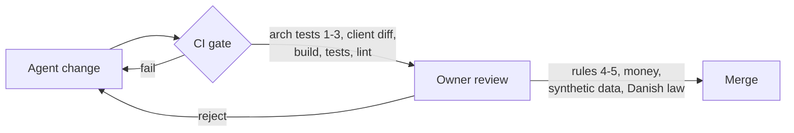

### Reasoning
Owner accepted the orchestrator's recommendation. Rules that a tool can check reliably are enforced. Rules that need judgement stay with review, which keeps the enforced set small (SCAF-022).

### Sources
- [research/scaffolding-for-agents.md](research/scaffolding-for-agents.md) — findings 4, SCAF-020, SCAF-022, SCAF-030–033
- [architecture.md](architecture.md) — §4.2

## D-029: MSTest for C# tests
- **Date:** 2026-11-19
- **Status:** Accepted
- **Decided by:** Owner
- **Relates to:** D-010, D-018 (Vitest for the frontend), S11, FIT-32

### Problem statement
Which test framework do the C# projects use (S11, backend part)?

### Options considered
From [tech-stack.md](research/tech-stack.md) (unit test framework row): xUnit v3, TUnit, NUnit and MSTest. All four run on Microsoft.Testing.Platform. TUnit's speed benchmarks are self-published and some of its parts are beta.

### Decision
**MSTest** for all C# unit, integration and architecture tests.

### Reasoning
Owner decision. ArchUnitNET, an architecture-test library, supports MSTest ([service-architecture.md](research/service-architecture.md) [A16]). The architecture-test library itself is still open.

### Sources
- [research/tech-stack.md](research/tech-stack.md) — T13, T14
- [research/service-architecture.md](research/service-architecture.md) — A15, A16

## D-030: ArchUnitNET for architecture tests
- **Date:** 2026-11-19
- **Status:** Accepted
- **Decided by:** Owner
- **Relates to:** D-028, D-029, S11, FIT-32

### Problem statement
Which library do the architecture tests use to enforce module boundary rules 1–3 (D-028)?

### Options considered
1. **ArchUnitNET.** Supports MSTest [A16]. `ardalis/modulith` uses it for its per-module isolation test (SCAF-061).
2. **NetArchTest.** Smaller API for rules like `ShouldNot().HaveDependencyOn(...)` [A15].

The maintenance status of both is UNVERIFIED [A15][A16].

### Decision
**ArchUnitNET**, run from MSTest test projects (D-029).

### Reasoning
Owner accepted the orchestrator's recommendation: MSTest support and a modular-monolith example that uses it.

### Sources
- [research/service-architecture.md](research/service-architecture.md) — A15, A16
- [research/scaffolding-for-agents.md](research/scaffolding-for-agents.md) — SCAF-061

## D-031: Two projects per module
- **Date:** 2026-11-19
- **Status:** Accepted
- **Decided by:** Owner
- **Relates to:** D-008, D-028, D-030, architecture.md §4.3 and §9

### Problem statement
Is each module one project with folders for its layers, or several projects per layer (architecture.md §9, open item)?

### Options considered
1. **Two projects per module:** `Members.Contracts` (public) and `Members` (Domain, Application, Infrastructure and Endpoints as folders).
   - The compiler hides `internal` types across modules.
   - Architecture tests enforce the layer rules inside a module.
   - This is the common .NET layout ([tech-stack.md](research/tech-stack.md) §2.3).
2. **Five projects per module,** one per layer.
   - The compiler enforces the layer rules too.
   - About 30 projects for 6 modules.
3. **Three projects per module:** Contracts, Domain, and the rest.
   - The compiler keeps Domain pure.

### Decision
**Option 1.** The layout is `src/Modules/<Module>/<Module>.Contracts` plus `src/Modules/<Module>/<Module>`, with layer folders `Domain/`, `Application/`, `Infrastructure/` and `Endpoints/`.

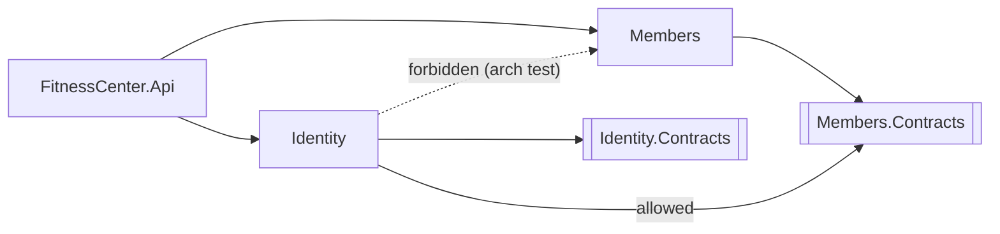

### Reasoning
Owner accepted the orchestrator's recommendation. It means fewer projects for agents to copy, while the ArchUnitNET tests (D-030) still enforce the rules inside a module (D-028).

### Sources
- [research/tech-stack.md](research/tech-stack.md) §2.3
- [architecture.md](architecture.md) §4.3, §9

## D-032: Scope of the signup golden slice
- **Date:** 2026-11-19
- **Status:** Accepted
- **Decided by:** Owner
- **Relates to:** D-011, D-013, D-021, D-022, D-023, D-026, M1, M3, M4, U5, FIT-47

### Problem statement
The first, "golden" slice is signup for the general gym membership (D-023). Several details have no decision yet: which data to collect, which login methods, which membership type, and how to handle the 14-day withdrawal right.

### Options considered
For each question, the orchestrator offered options with a recommendation:
- **Data:**
  1. Name, email and password (recommended).
  2. Add date of birth.
  3. Add date of birth and phone.
- **Login methods:**
  1. Email/password only (recommended).
  2. Email/password + Google.
  3. Email/password + email verification.
- **Membership:**
  1. One placeholder type (recommended).
  2. Placeholder + simulated first payment.
  3. All 6 types as placeholders.
- **Withdrawal:**
  1. Record consent now (recommended).
  2. Only accept terms.
  3. Leave it out.

### Decision
| Question | Decision |
|---|---|
| Data collected | **Name, email, password.** Date of birth and phone wait for M4. |
| Login | **Email/password and Google** in this slice. No email verification yet: no email provider is chosen (D-020 open items). |
| Membership | **One placeholder type**, "General membership", monthly, with a synthetic price in øre. After signup the membership is **awaiting first payment**; the simulated payment page (FIT-43) confirms it later. The real types follow M1. |
| Withdrawal and consent | **Record consent now.** A required "accept the terms" checkbox and an optional "start my membership now" (express request). Store the text version accepted, the time and the channel (online). Real legal wording waits for U5. |

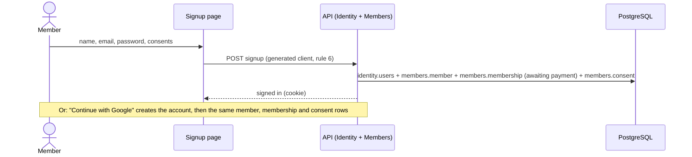

### Reasoning
Owner decision. This collects the minimum data (CLAUDE.md, personal data). The consent record follows the Consumer Rights Directive's 14-day withdrawal right and its "express request" for an early start ([compliance-legal-security.md](research/compliance-legal-security.md) §6.1, Art. 9 and Art. 7(3)/8(8)). Because every later signup copies this pattern, it is built now.

### Sources
- [research/compliance-legal-security.md](research/compliance-legal-security.md) §6.1
- [decisions.md](decisions.md) — D-011, D-013, D-020, D-021, D-023, D-026

## D-033: openapi-typescript + openapi-fetch for the generated API client
- **Date:** 2026-11-19
- **Status:** Accepted
- **Decided by:** Owner
- **Relates to:** D-018, D-028 (rule 6 diff check), FIT-47

### Problem statement
Rule 6 says the frontend calls the API only through a client generated from the API's OpenAPI description. Which generator?

### Options considered
From [tech-stack.md](research/tech-stack.md) §2.10:
1. **openapi-typescript + openapi-fetch.** Types only, in one file, plus a small typed fetch wrapper. Fastest in one benchmark [T24].
2. **Hey API (`@hey-api/openapi-ts`).** An SDK of functions; the successor to openapi-typescript-codegen.
3. **Orval.** TanStack Query hooks, Zod and mocks; much larger output.

### Decision
**Option 1.** The generated types live in `frontend/src/api/` (never hand-edited, rule 6). CI regenerates them and fails on a diff (D-028).

### Reasoning
Owner accepted the orchestrator's recommendation. It produces the smallest output, which is easy to review and to diff in CI, and it needs no extra data-fetching library.

### Sources
- [research/tech-stack.md](research/tech-stack.md) §2.10, [T24]

## D-034: The Members module owns signup
- **Date:** 2026-11-19
- **Status:** Accepted
- **Decided by:** Owner
- **Relates to:** D-015, D-031, D-032, architecture.md §4.2

### Problem statement
Signup creates a login account (Identity) and a member with a membership and consents (Members). Which module owns the signup endpoint?

### Options considered
1. **Members**, calling `Identity.Contracts` to create the account, all in one database transaction.
2. **Identity**, calling `Members.Contracts` to create the member.
3. **Two steps:** create the account first, then a separate "join" call.

### Decision
**Option 1.**

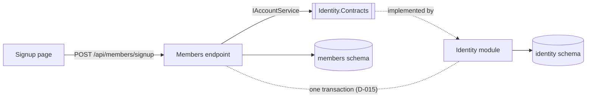

### Reasoning
Owner accepted the orchestrator's recommendation. Signing up for a membership is Members' business, and Identity stays a generic login module. One transaction means a failed signup leaves no account without a member (D-015 allows a transaction to span modules).

### Sources
- [decisions.md](decisions.md) — D-015, D-032
- [architecture.md](architecture.md) §4.2

## D-035: Passwords need at least 8 characters
- **Date:** 2026-11-19
- **Status:** Accepted
- **Decided by:** Owner
- **Relates to:** D-013, D-026, AU7, FIT-47

### Problem statement
What is the minimum password length for email/password accounts, given that MFA is optional for members (D-013)?

### Options considered
From [authentication.md](research/authentication.md), finding 8 and the ASVS table:
1. **8 characters, no composition rules.** OWASP ASVS L1 6.2.1 and 6.2.5.
2. **15 characters when there is no MFA.** NIST SP 800-63B-4 §3.1.1.2 for password-only authentication [A3].

### Decision
**Option 1.** At least 8 characters, no composition rules, no rotation. Implemented in `IdentityModule` (FIT-47 slice A).

### Reasoning
Owner decision: keep the minimum at 8. The rest of the ASVS L1 password list (blocklist, allowing paste) is not covered by this decision. The ASVS level itself is still open (AU7).

### Sources
- [research/authentication.md](research/authentication.md) — finding 8, ASVS L1 table, [A3]

## D-036: CsCheck for property-based tests in C#
- **Date:** 2026-11-20
- **Status:** Accepted
- **Decided by:** Owner
- **Relates to:** D-016, D-029, FIT-31

### Problem statement
CLAUDE.md requires property tests for domain logic (dates, notice periods, attendance, pay). Which library generates the inputs, and how does it fit MSTest (D-029)?

### Options considered
1. **CsCheck 5.0.1.** Written in C#, no dependencies, targets net10.0. Any test framework works: a failing `Sample` throws. Composed generators shrink automatically, with no Arb classes needed. A failure prints a seed to replay. It also offers model-based (`SampleModelBased`), linearizability (`SampleParallel`) and performance (`Faster`) testing. Its community is small.
2. **FsCheck 3.6.0.** QuickCheck port in F#, larger community, depends on FSharp.Core. Official integrations are for xUnit and NUnit only. MSTest needs `Check.QuickThrowOnFailure` inside a plain test. A generator wrapped with `Arb.fromGen` does not shrink unless you write a shrinker.

### Decision
**Option 1, CsCheck.** The package is added with the first domain logic that needs property tests, such as notice periods or booking windows. NodaTime generators (`LocalDate`, `Instant`) are written in the test projects.

### Reasoning
Owner decision on a recommendation. CsCheck runs inside `[TestMethod]` without an adapter, and it shrinks custom date generators for free. `SampleParallel` can test concurrent class bookings later. The cost is fewer examples and one main maintainer.

### Sources
- https://github.com/AnthonyLloyd/CsCheck (README: framework-agnostic, automatic shrinking, seeds, `SampleModelBased`, `SampleParallel`, `Faster`)
- https://www.nuget.org/packages/CsCheck (5.0.1; net10.0/net11.0; no dependencies; the date shown is UNVERIFIED)
- https://fscheck.github.io/FsCheck/RunningTests.html (xUnit/NUnit integrations, `QuickThrowOnFailure`, `Arb.fromGen` does not shrink)
- https://www.nuget.org/packages/FsCheck (3.6.0; FSharp.Core dependency)

## D-037: Google never links to an existing account by email
- **Date:** 2026-11-23
- **Status:** Accepted
- **Decided by:** Owner
- **Relates to:** D-011, D-026, D-032, FIT-47, FIT-51

### Problem statement
Someone logs in with Google, and the email Google gives us already belongs to a member who signed up with a password. Do we log them into that account?

### Options considered
From [research/authentication.md](research/authentication.md) §4:
1. **Refuse, and ask them to log in first.** They log in with their password and connect Google from the account page. Accounts are matched by (provider, subject), never by email alone (ASVS 6.8.1 [A5]).
2. **Link automatically** when Google says the email is verified. Smoother, but trusts Google's email check with access to the account. Auto-linking on email match is a known account-takeover route (UNVERIFIED in the research).

### Decision
**Option 1.** Built in FIT-47 slice D:

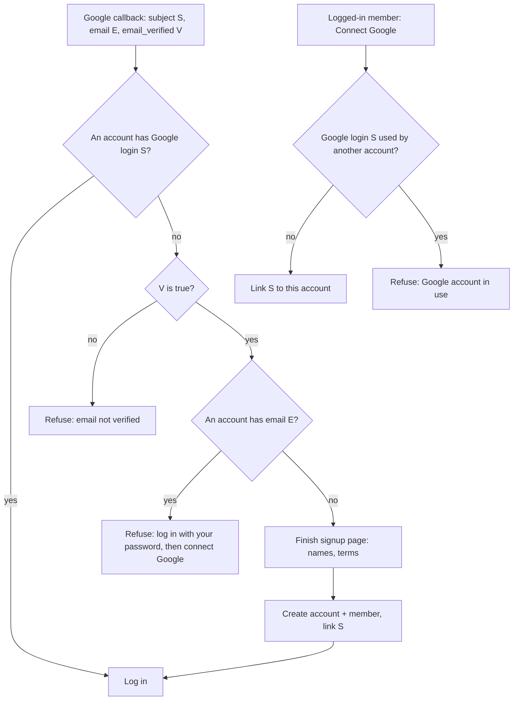

A new account takes its email from Google only when `email_verified` is true. Otherwise someone could claim an address they don't own.

### Reasoning
Owner decision on a recommendation. Logging in proves control of the existing account, which is what the research asks for before linking. Connecting from the account page also lets a member use a Google account with a different email.

### Sources
- [research/authentication.md](research/authentication.md) §4, risk R3, [A5] ASVS 6.8.1

## D-038: Members confirm their email before they can log in
- **Date:** 2026-11-23
- **Status:** Accepted
- **Decided by:** Owner
- **Relates to:** D-011, D-026, D-032, D-037, FIT-47, AU9

### Problem statement
Anyone could sign up with an email address they don't own. When does a password member have to prove they control their email, and how do emails get sent before a provider is chosen?

### Options considered
From [research/authentication.md](research/authentication.md) §4 ("email verification: required before local accounts are active"):
1. **No login until the email is confirmed.** A link in an email confirms it. Built into ASP.NET Core Identity (`SignIn.RequireConfirmedEmail`).
2. **Log in at once, limited until confirmed**, e.g. no booking. Smoother, but every feature must check "confirmed?".

Sending: the provider is open ([research/integrations-and-architecture.md](research/integrations-and-architecture.md) row 8: Amazon SES, Postmark, Resend; prices and EU hosting **UNVERIFIED**). Until one is chosen, development uses a local test mailbox.

### Decision
**Option 1**, with **Mailpit** as the local test mailbox. Built in FIT-47:

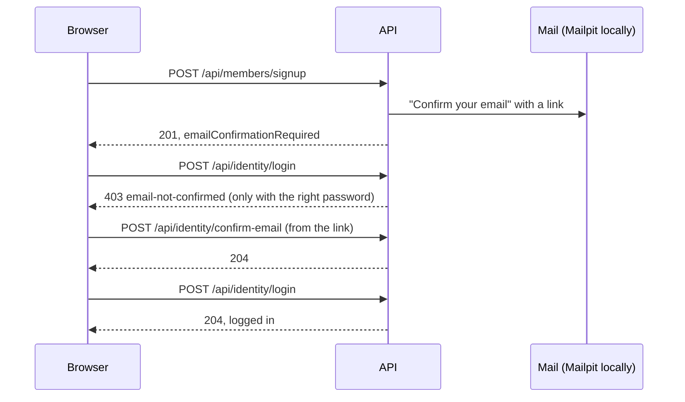

- **Google signups** are confirmed at once, because Google verified the address (D-037).
- **The "confirm your email" answer** is given only after the right password. Otherwise the login answers 401, as for an unknown email. Wrong passwords for an unconfirmed account count towards lockout.
- **A new link** can be requested from the login and "check your email" pages. The answer is the same whether or not the email has an account.
- **Mailpit** runs in a container that the AppHost starts. It catches every email, and its web page (linked from the Aspire dashboard) shows them. The integration tests send to a Mailpit container too.

### Reasoning
Owner decision. Option 1 is what the research asks for, and it is the simplest to keep correct. Building with Mailpit lets the whole flow work and be tested now. The provider choice needs facts we don't have yet: what the center uses, EU hosting, and price (AU9).

### Sources
- [research/authentication.md](research/authentication.md) §4
- [research/integrations-and-architecture.md](research/integrations-and-architecture.md) row 8, [S34]
- Mailpit: https://github.com/axllent/mailpit (image `axllent/mailpit`; HTTP API used by the tests, checked against v1.33.1)

## D-039: Class booking: who books, the booking window and cancelling
- **Date:** 2026-11-23
- **Status:** Accepted
- **Decided by:** Owner
- **Relates to:** D-014, D-022, D-038, FIT-48

### Problem statement
The classes page (one of the six MVP pages, D-022) needs booking rules before the center has answered its own policy (fitness-domain-operations questions 35–36: capacity, waitlists, late-cancel window, no-show penalties). Who may book, how far ahead, and until when can a booking be cancelled?

### Options considered
1. **Booking belongs to the member** (needs a gym membership). Matches centers where classes are part of the plan, but locks out people who only come for classes.
2. **Booking belongs to the Identity account** (any logged-in account). Class booking needs no gym plan; the booking points at `identity.AspNetUsers`.

For the cancellation cut-off there is no answer from the center yet; any value is a placeholder.

### Decision
**Option 2**, with these rules (placeholders until the center answers questions 35–36):

- **Who books:** any logged-in account (email confirmed, D-038). No gym membership needed. A booking references the account, with a foreign key to `identity.AspNetUsers` for integrity only (D-014).
- **Schedule and booking window:** the next **14 days**. A class can be booked until it **starts**.
- **Cancelling:** closes **12 hours** before the start.
- **Instructor:** the name as plain text until a Staff module exists.
- **No waitlist and no penalties** (D-022).
- **Capacity is never exceeded:** the class row is locked (`SELECT … FOR UPDATE`) while a booking is made, so two requests for the last spot take turns.

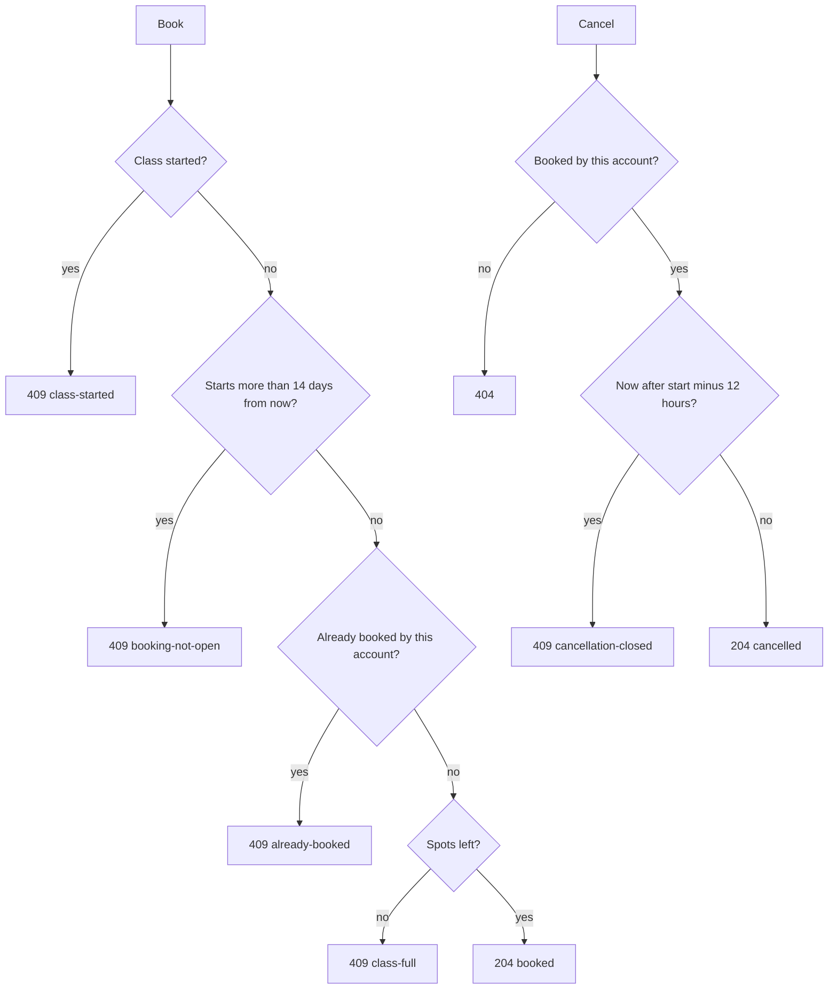

The classes page (`/classes`) shows the schedule grouped by day in Europe/Copenhagen time, with spots left, a Book button (visitors who aren't logged in go to login), and a Cancel button with the "cancel until" time for the account's own bookings.

### Reasoning
Owner decision (FIT-48). The owner's reasoning for option 2: class booking needs no gym plan, so tying it to the member would block class-only customers. The 14-day window and the 12-hour cut-off are placeholders that keep the slice buildable; they live in one place (`BookingPolicy`) so the center's answers change one constant. The row lock is needed: with it removed, the integration test `Simultaneous_bookings_never_overfill_a_class` failed in 3 of 3 runs, with all 12 simultaneous bookings accepted for 3 spots (FIT-48, 2026-11-23).

### Sources
- [research/fitness-domain-operations.md](research/fitness-domain-operations.md) questions 35–36 (open)
- D-022 (MVP scope: no waitlist, no penalties), D-014 (cross-module foreign keys), D-038 (email confirmation)
- PostgreSQL row locks: https://www.postgresql.org/docs/current/explicit-locking.html#LOCKING-ROWS

## D-040: The orchestrator only orchestrates; sub-agents do every task
- **Date:** 2026-11-23
- **Status:** Accepted
- **Decided by:** Owner
- **Relates to:** D-005, D-017, FIT-27, FIT-61. Partly answers W17.

### Problem statement
Who does the work, the orchestrator or sub-agents? The CLAUDE.md working rule said "Prefer one agent. Spawn sub-agents only when asked." And who checks a sub-agent's PR before it is merged?

### Options considered
1. **The orchestrator does small tasks itself** and spawns agents only when asked (the old rule). Fewer tokens, because no agent starts cold. But the orchestrator's context fills with implementation detail.
2. **The orchestrator only orchestrates.** Every task goes to a sub-agent briefed through a Linear ticket (D-017). The orchestrator reviews and summarises. Costs more tokens, because each agent starts cold and re-reads context.

### Decision
**Option 2.** Every assignment or task the owner gives is done by a sub-agent, briefed through a Linear ticket. The agent comments its result on the ticket, and the orchestrator summarises the result for the owner. Briefs stay narrow and carry a tool-call budget.

Every PR a sub-agent opens goes through these steps:
1. The orchestrator waits for CI to pass.
2. The orchestrator reviews the PR against its brief and the CLAUDE.md rules, including that no test was weakened and that there is no AI attribution.
3. If the review finds problems, a new agent fixes them, and the review starts again.
4. The orchestrator tells the owner, with its review findings.
5. The owner does a manual review and merges.

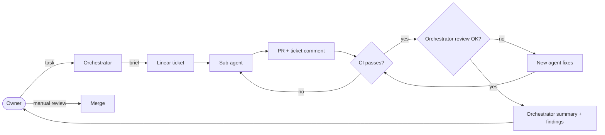

**Override for 2026-11-23 only** (owner): the token budget (D-005) is set aside for the day, up to 3 agents run in parallel on the MVP project, and the orchestrator merges PRs itself once CI and its own review pass, without the owner's manual review. From 2026-11-24 the normal rule applies again: the owner reviews manually and merges.

### Reasoning
The owner's instruction. The trade-off is tokens: agents start cold and re-read context, so they use more than inline work would, against a tight budget (D-005, proposed). Narrow briefs and tool-call budgets limit that. The review steps keep the owner's rules (protected tests, no AI attribution) checked twice before a merge.

### Sources
- The owner's instruction, 2026-11-23 (FIT-61 and its comments)
- D-005 (token budget), D-017 (Linear, sub-agents briefed via tickets)

## D-041: Simulated payment and card-reader pages: any logged-in account, behind a setting
- **Date:** 2026-11-23
- **Status:** Accepted
- **Decided by:** Owner
- **Relates to:** D-021, D-022, FIT-55, FIT-42, FIT-43. Answers the open point in D-021 and D-022.

### Problem statement
The simulated payment page can mark a membership paid or unpaid, and the simulated card reader can check anyone in (D-021, D-022). Who may open them, and in which builds?

### Options considered
1. **Development and tests only**, not in a demo build. Safest, but the center can't try the flows in a demo.
2. **Staff accounts only.** Needs a first staff role in Identity (AU6, AU8) before the pages can ship.
3. **Any logged-in account, behind a setting**, with a clear "Simulation" banner. Works in a demo without a staff role; the setting turns it off for a real launch.

### Decision
**Option 3.**
- The simulated payment page and the simulated card reader exist only when the setting **`Simulation:Enabled`** is `true`: on locally and in the demo, off for a real launch.
- When it is off, their endpoints answer **404** and the frontend hides them.
- Any **logged-in account** may use them.
- Each simulated page shows a clear **"Simulation"** banner.
- A simulated page acts on the **logged-in member's own** membership and card. The card reader may also take **any card UID**.

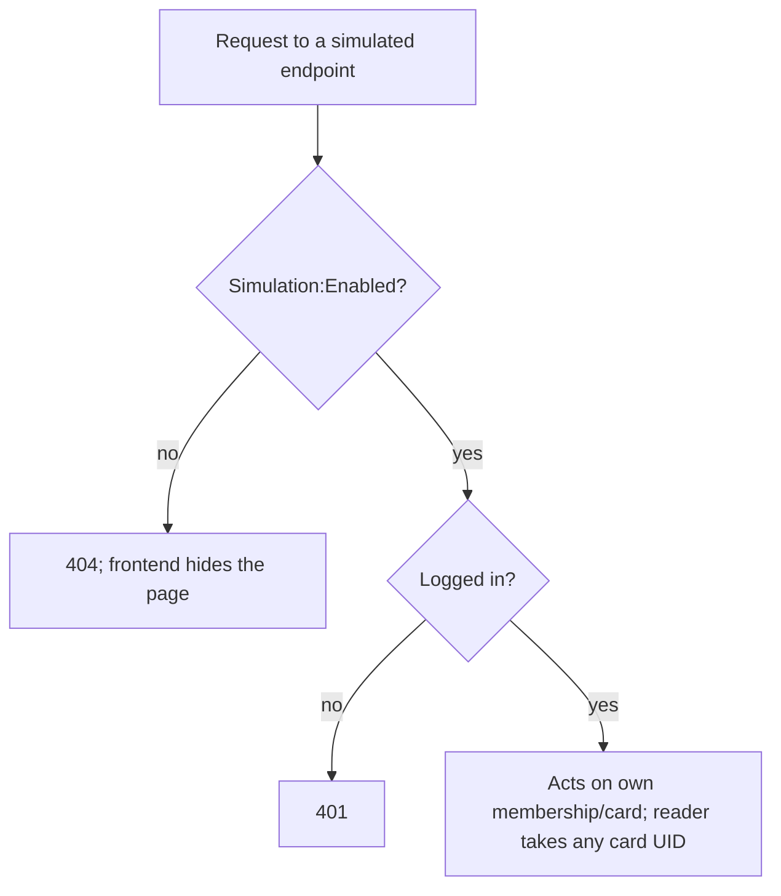

### Reasoning
Owner decision. A demo for the center needs the pages, and a staff role does not exist yet, so option 2 would block FIT-42 and FIT-43. Limiting the payment page to the member's own membership keeps one account from changing another's payment state. The setting gives one switch that removes the pages for a real launch.

### Sources
- D-021 (simulation, "Still open"), D-022 (MVP pages 5 and 6)
- FIT-55 (options as listed by the owner)

## D-042: Missing payment: no grace period, one reminder email (placeholder for D11)
- **Date:** 2026-11-23
- **Status:** Accepted (placeholder until the center answers D11)
- **Decided by:** Owner
- **Relates to:** D-020, FIT-45. Partly answers D11.

### Problem statement
D-020 refuses check-in and emails the member when a payment is missing, but left open the grace period and whether reminders repeat (D11). The MVP needs a value now.

### Options considered
1. **No grace period, one email.** Simplest rule to build and test.
2. **3 days' grace, one email.**
3. **7 days' grace, two emails.**

### Decision
**Option 1**, as a placeholder:
- Check-in is refused from the **first Europe/Copenhagen calendar day after the paid-until date**.
- **One reminder email** is sent on that day.

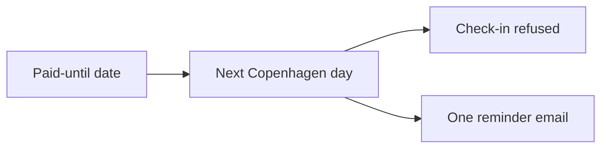

D11 stays open for the center's real policy (grace period, repeat reminders, late fees).

### Reasoning
Owner decision. With no answer from the center, the simplest rule keeps FIT-45 buildable. The rule lives in one place, so the center's answer changes one value. Using the Copenhagen calendar day follows the time convention in CLAUDE.md (business rules in Europe/Copenhagen).

### Sources
- D-020 ("Still open"), D11 in [open-questions.md](open-questions.md)
- FIT-45

## D-043: A few full-stack E2E flows run in CI
- **Date:** 2026-11-23
- **Status:** Accepted
- **Decided by:** Owner
- **Relates to:** D-010, D-018, D-038, FIT-59. Partly answers Q6.

### Problem statement
The Playwright tests run against the built frontend with the API mocked. Each endpoint has real integration tests, but nothing in CI clicks through the frontend against the real API and database; that has only been done by hand (FIT-59).

### Options considered
1. **Keep the mocked E2E tests and the manual real-stack checks.** CI stays fast and simple, but a frontend/backend mismatch is found only by hand.
2. **Add a few full-stack Playwright runs in CI**, with the API, PostgreSQL and Mailpit started in the job. Catches mismatches, but CI gets slower and more complex.

### Decision
**Option 2**, for a few key flows:
- signup → confirm email (via Mailpit) → login → book a class;
- check-in.

They run against the real API, PostgreSQL and Mailpit in CI. The mocked Playwright tests stay.

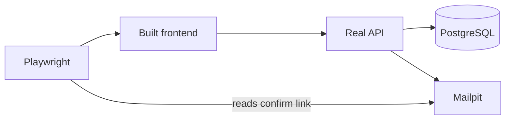

### Reasoning
Owner decision. D-010 asks for E2E tests in CI; the mocked runs can't catch a mismatch between the frontend and the real API. The trade-off is a slower CI; keeping the set to a few key flows limits it.

### Sources
- FIT-59 (options as listed by the owner)
- D-010 (all automatable tests in CI), D-018 (Playwright), D-038 (Mailpit)

## D-044: Landing page now, with placeholder content
- **Date:** 2026-11-23
- **Status:** Accepted
- **Decided by:** Owner
- **Relates to:** D-022, FIT-46, FIT-26, U10

### Problem statement
The landing page is one of the six MVP pages (D-022), but the center's texts, brand and logo are unknown until the meeting (U10, FIT-26). Build it now or wait?

### Options considered
1. **Build the structure now with placeholder content.** The MVP is complete as a demo; texts are replaced later.
2. **Wait for the center's content.** No throwaway text, but the MVP lacks its front page until after the meeting.

### Decision
**Option 1.** Build the page structure now: hero, classes teaser, membership price, signup/login. Use clearly marked placeholder texts and **no logo**. Replace them after the center meeting (U10, FIT-26).

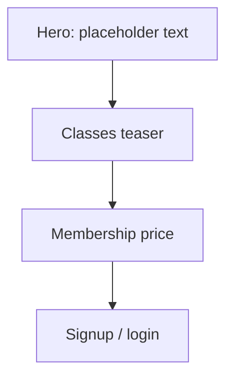

### Reasoning
Owner decision. It keeps the MVP slice whole without guessing at the center's brand; marking the texts as placeholders keeps them from being mistaken for the center's own.

### Sources
- D-022 (MVP page 1: landing page)
- U10 in [open-questions.md](open-questions.md), FIT-26 (center meeting), FIT-46

## D-045: CI skips the tests when a PR changes only `.md` files
- **Date:** 2026-11-23
- **Status:** Accepted
- **Decided by:** Owner
- **Relates to:** D-010, D-028, FIT-62

### Problem statement
Every PR runs the full backend and frontend jobs (D-010, D-028), even one that only edits documentation. That costs runner time and waiting for changes that cannot break code. Both jobs are required by branch protection on `main`, so any skip must still let docs-only PRs merge.

### Options considered
1. **A. A "changes" job plus `if:` on the required jobs.** The first job checks whether every changed file is `*.md`; the two required jobs `needs:` it and are skipped for docs-only PRs. Pros: one workflow, same job names; GitHub reports a job skipped by a condition as passing, so required checks are satisfied. Cons: one extra short job on every run.
2. **B. A second no-op workflow with the same job names** that runs only for `.md` changes. Pros: the main workflow is unchanged. Cons: two copies of the job names must be kept in sync, or merges stall.
3. **Workflow-level `paths-ignore: ['**.md']`.** Pros: simplest. Cons: the workflow never starts for docs-only PRs, so the required checks never report and the PR stays blocked.

### Decision
**Option A.** A `changes` job diffs the PR's merge commit against its base (`git diff HEAD^1 HEAD`). If every changed file ends in `.md`, the backend and frontend jobs are skipped; anything else runs everything. Pushes to `main` always run everything. If the `changes` job fails or the diff is empty, the tests run.

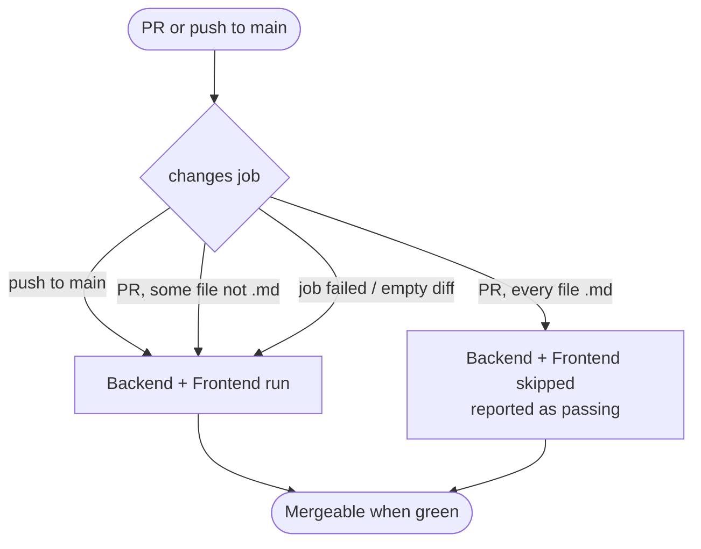

### Reasoning
Owner decision. Option A keeps one source of truth for the required job names. `paths-ignore` is ruled out because GitHub documents that a workflow skipped by path filtering leaves its required checks "Pending" and the PR cannot merge. GitHub also documents that a job skipped by a conditional reports "Success" for required checks; FIT-62 proves this in this repo with a throwaway docs-only PR (linked on the ticket). Running everything on `main` keeps the branch fully checked after each merge.

### Sources
- https://docs.github.com/en/repositories/configuring-branches-and-merges-in-your-repository/managing-protected-branches/troubleshooting-required-status-checks#handling-skipped-but-required-checks (path filtering leaves required checks pending; skipped-by-conditional jobs report success)
- https://docs.github.com/en/actions/using-jobs/using-conditions-to-control-job-execution
- FIT-62 (implementation and the docs-only PR test)

## D-046: A member who has never paid is refused at check-in
- **Date:** 2026-11-24
- **Status:** Accepted
- **Decided by:** Owner
- **Relates to:** D-020, D-032, D-042, FIT-45. Partly answers D11.

### Problem statement
D-020 and D-042 refuse check-in when a payment is missing, meaning the paid-until date has passed. They don't say what happens to a member who signed up but has never paid (`AwaitingFirstPayment`, D-032), who has no paid-until date at all. FIT-45 left this as a marked seam that let them in.

### Options considered
1. **Let them in until the first payment.** Nothing changes for new members, but anyone can sign up and use the center without paying.
2. **Refuse them like a missing payment.** The door shows the same "Payment missing" warning until the first payment arrives.

### Decision
**Option 2.** A member who has never paid is refused at check-in with the same `payment-missing` outcome and warning as a missing payment, and nothing is recorded.

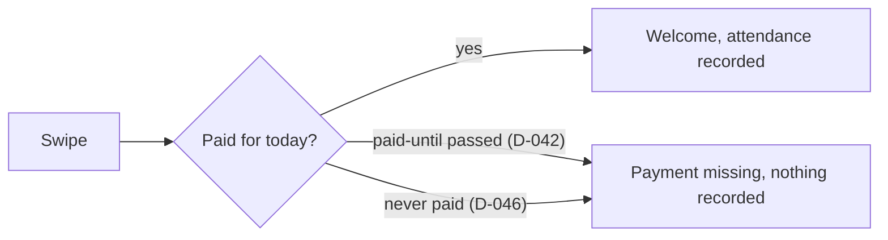

**Still open:** whether a member who has never paid gets a reminder email. For now they get none; the reminder job (D-042) covers only a paid-until date that passed. D11 (grace period and reminders) stays open.

### Reasoning
Owner decision. Access to the center follows payment, so a sign-up alone doesn't open the door. Reusing the missing-payment outcome keeps one warning on the door screen and no new wording.

### Sources
- D-020, D-032, D-042; D11 in [open-questions.md](open-questions.md)
- FIT-45 (orchestrator review of PR #26, 2026-11-24)

## D-047: Build our own product without waiting for the center
- **Date:** 2026-11-24
- **Status:** Accepted
- **Decided by:** Owner
- **Supersedes:** D-004
- **Relates to:** D-001, D-022, D-039, D-042, D-044, D-046, FIT-64

### Problem statement
D-004 made the PRD and most domain questions (memberships, billing, pay rules, scheduling) wait for a meeting with the center's management and staff. The meeting will not happen within reasonable time, while a working product is the priority (D-001). Many placeholders (D-039, D-042, D-044) and open questions say "until the center answers". Who answers them now?

### Options considered
1. **Keep waiting for the center (D-004).** Requirements fit one real center. Cons: the PRD and every center question stay blocked for an unknown time.
2. **Build our own product; the owner decides the requirements.** Pros: work continues; each question gets an answer. Cons: the product may not match that center's practice, and later input from a real center may change things.

### Decision
**Option 2.** We build our own fitness-center system and decide the requirements ourselves, without designing for that center's needs.

- **What stays:** the system is still for a **single-site Danish fitness center**, so Danish law and Europe/Copenhagen time still apply (D-001). Every other accepted decision stays as it is.
- **What changes:** a question that waited on the center now goes to the **owner**, who decides it from a **recommended default**. The list is in [open-questions.md](open-questions.md), section "Owner decides (D-047)". Placeholders that said "until the center answers" (D-039, D-042, D-044, D-046) now last until the owner decides.
- The [stakeholder interview guide](stakeholder-interview-guide.md) is kept, on hold.

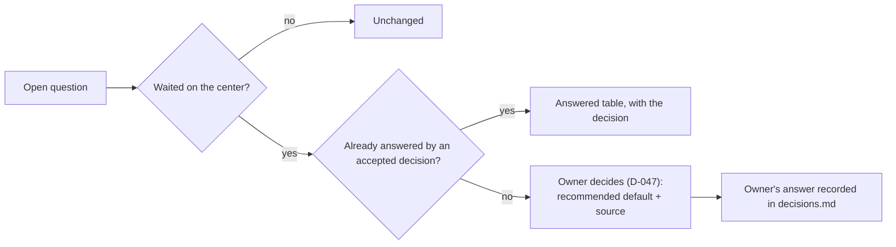

### Reasoning
Owner decision. The meeting will not happen within reasonable time, and a working product is the priority (D-001). The research already describes how centers work and what Danish law requires, so each question can get a sourced default instead of waiting.

### Sources
- D-001, D-004
- [open-questions.md](open-questions.md) — "Owner decides (D-047)"
- FIT-64

---

## D-048: Monthly rolling membership with no binding; one month's notice to month-end
- **Date:** 2026-11-24
- **Status:** Accepted
- **Decided by:** Owner
- **Relates to:** D-019, D-032, D-047, FIT-65. Answers "Owner decides" rows 1 and 2 (M1, M2, D8, U2).

### Problem statement
Under D-047 the owner decides the questions that waited on the center. The next features after the MVP need to know which membership types exist (M1; D-019 says six, none named) and how binding, notice and cancellation work (M2, D8, U2).

### Options considered
1. **Recommended default ("Owner decides" rows 1–2):** monthly rolling membership with no binding; more types one at a time as features need them; one month's notice to the end of a month; members cancel online themselves; access lasts until the effective date; no "save" step. Pros: avoids the binding rules Danish law limits; matches the legal notice and cancellation-medium rules. Cons: no binding-period revenue.
2. **Name all six types now, with binding periods.** Pros: matches D-019's count at once. Cons: binding and price rules for types no feature uses yet; binding is limited by Danish law.

### Decision
**Option 1**, as recommended.

- **Membership types:** one monthly rolling membership with no binding. More types are added one at a time as features need them. Until then the signup slice keeps "General membership" (D-032).
- **Notice:** one month's notice to the end of a month.
- **Cancellation:** members cancel online themselves. There is no "save" or retention step before the cancellation.
- **Access:** the member keeps access until the date the cancellation takes effect.

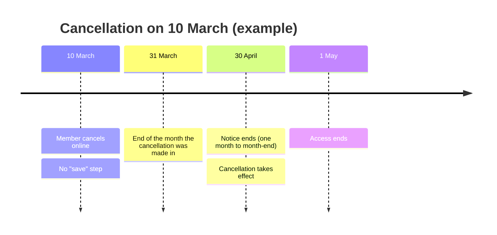

### Reasoning
Owner decision, as recommended. Danish law limits binding to about 5 months plus 1 month's notice and requires cancellation on the same medium the contract was made on, so a rolling membership with online cancellation stays inside the rules. A retention step before cancelling is legally risky.

### Sources
- [research/compliance-legal-security.md](research/compliance-legal-security.md) — §6.2
- [research/fitness-domain-operations.md](research/fitness-domain-operations.md) — §3.3
- [research/ux-patterns.md](research/ux-patterns.md) — §3.4
- [open-questions.md](open-questions.md) — "Owner decides (D-047)" rows 1–2 (moved to Answered)

---

## D-049: Four staff roles; instructors see only their own classes
- **Date:** 2026-11-24
- **Status:** Accepted
- **Decided by:** Owner
- **Relates to:** D-047, FIT-65. Answers "Owner decides" row 3 (D13, E1).

### Problem statement
Staff features need to know which roles exist and what each may see (D13, E1).

### Options considered
1. **Recommended default (row 3):** role-based access with four roles: admin, manager, front desk, instructor. Instructors see only their own classes. Pros: RBAC is the baseline in the compliance checklist; single site, so no site scopes. Cons: finer permissions need a later change.
2. **Fine-grained per-user permissions.** Pros: flexible. Cons: more to build and review for ~10 staff.

### Decision
**Option 1**, as recommended. Four roles: **admin, manager, front desk, instructor**. Instructors see only their own classes. No site scopes (single site, D-001).

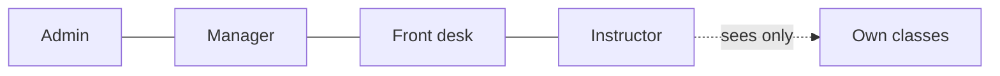

### Reasoning
Owner decision, as recommended. RBAC is the baseline in the compliance checklist, and one site needs no site scoping.

### Sources
- [research/domain-modeling.md](research/domain-modeling.md) — §3.1
- [research/compliance-legal-security.md](research/compliance-legal-security.md) — §10.2
- [open-questions.md](open-questions.md) — "Owner decides (D-047)" row 3 (moved to Answered)

---

## D-050: No paid hosting; the owner's laptop if hosting is needed during development
- **Date:** 2026-11-24
- **Status:** Accepted
- **Decided by:** Owner
- **Relates to:** D-009, D-047, FIT-57, FIT-65. Answers "Owner decides" row 5 (SA4, S8, T2, T3) and the FIT-57 question.

### Problem statement
Where does the system run once it needs to run somewhere other than `aspire run` on a developer machine (SA4, S8), and what may it cost (T2)? architecture.md §12 listed a Hetzner VPS, Render, Fly.io and Azure as candidates.

### Options considered
1. **Recommended default (row 5):** one EU VPS with Docker Compose and PostgreSQL with backups. Pros: cheapest paid option. Cons: a monthly cost (≈ €11–13 plus backups, **UNVERIFIED** prices) and the owner patches and backs up.
2. **PaaS (Render, Fly.io, Azure).** Pros: low ops. Cons: higher monthly cost.
3. **No paid hosting; the owner's own laptop when hosting is needed.** Pros: no cost. Cons: the laptop is not always on; reaching it from outside is a separate question; not a production setup.

### Decision
**Option 3**, the owner's own answer (not the recommendation).

- The owner will not pay for hosting. There is **no paid VPS** and no PaaS.
- While development is ongoing, the owner **may** run the system on a laptop in their own apartment, if hosting is needed at all.
- **How the laptop is reached from outside is still open** (local network only, a free tunnel such as Cloudflare Tunnel, or opening a port on the router). It is an "Owner decides" row in [open-questions.md](open-questions.md).
- Production hosting for real members is not decided here; it comes back when the system is to serve real members.

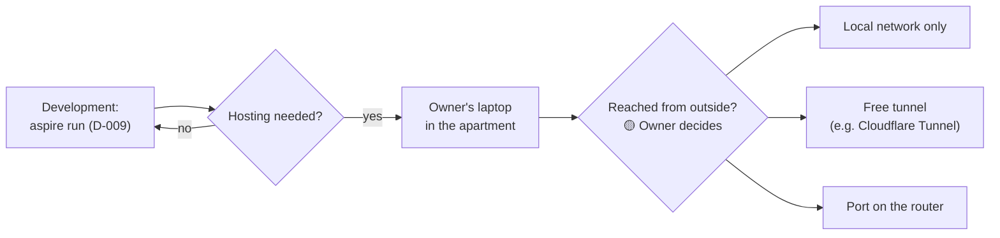

### Reasoning
Owner decision: no money is spent on hosting. During development there are no real members, so the EU data-residency need for member data (T3) does not yet apply to the laptop (synthetic data only, CLAUDE.md).

### Sources
- [research/integrations-and-architecture.md](research/integrations-and-architecture.md) — §3.5 (**UNVERIFIED** prices)
- [architecture.md](architecture.md) — §12
- [open-questions.md](open-questions.md) — "Owner decides (D-047)" row 5 (moved to Answered)
- FIT-57

---

## D-051: Waitlist after the MVP: offer with expiry, no no-show penalties
- **Date:** 2026-11-24
- **Status:** Accepted
- **Decided by:** Owner
- **Relates to:** D-022, D-039, D-047, FIT-65. Answers "Owner decides" row 7 (U4, D10).

### Problem statement
The MVP has no waitlist (D-022, D-039). After the MVP, what happens when a full class frees a spot, and are no-shows penalised (U4, D10)?

### Options considered
1. **Auto-promotion:** the next person is booked automatically. Pros: common. Cons: causes unwanted no-shows.
2. **Offer with expiry (recommended, row 7):** the freed spot is offered to the next person for a set time, then to the person after them. Pros: avoids unwanted no-shows. Cons: one more step for the member.
3. **Auto-promote outside the late-cancel window, offer-only inside it.** Pros: mixes both. Cons: two rules to explain.

### Decision
**Option 2**, as recommended. When a spot frees up, it is offered to the next person on the waitlist for a set time. If they don't accept in time, it goes to the next person. **No penalties for not showing up** yet. **How long the offer lasts is open**: an "Owner decides" row in [open-questions.md](open-questions.md).

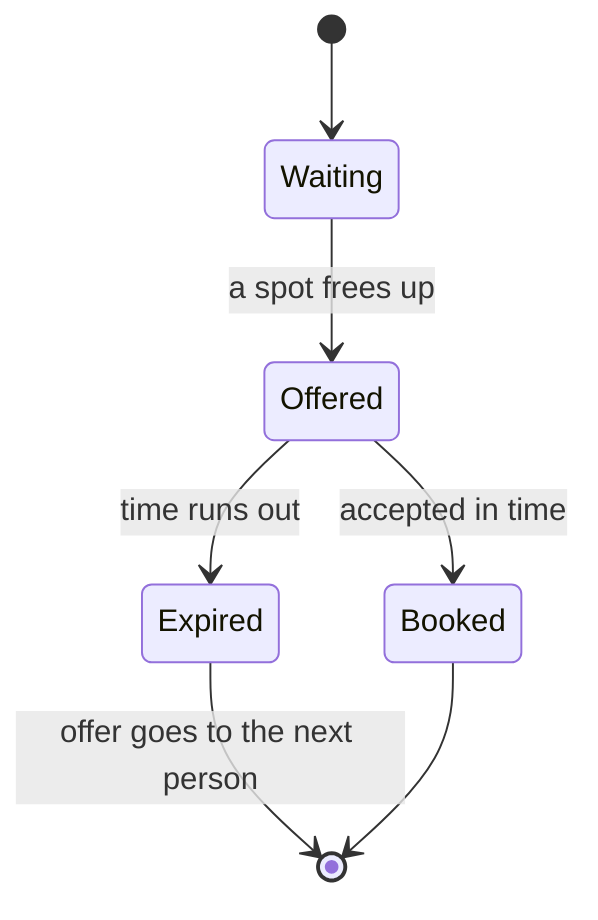

### Reasoning
Owner decision, as recommended. Auto-promotion is common but causes unwanted no-shows; an offer with expiry avoids that.

### Sources
- [research/domain-modeling.md](research/domain-modeling.md) — §4.3, §7.11
- [open-questions.md](open-questions.md) — "Owner decides (D-047)" row 7 (moved to Answered)

---

## D-052: Members must be 18 or older; date of birth collected at signup
- **Date:** 2026-11-24
- **Status:** Accepted
- **Decided by:** Owner
- **Relates to:** D-032, D-047, FIT-65. Answers "Owner decides" row 9 (M4). Adds date of birth to D-032's signup data.

### Problem statement
May minors become members (M4)? D-032's signup collects name, email and password only, so the system cannot tell a member's age.

### Options considered
1. **18 or older only; collect date of birth at signup (recommended, row 9).** Pros: avoids the open questions on minors. Cons: excludes younger members; one more field at signup.
2. **Accept members from 15.** Pros: wider market. Cons: minors' contract capacity is unresearched, and classes for under-15s may need a børneattest.

### Decision
**Option 1**, as recommended. Members must be **18 or older** for now. **Date of birth is collected at signup**, which adds a field to D-032's signup data.

### Reasoning
Owner decision, as recommended. Danish consent age is 15, minors' contract capacity is unresearched, and classes for under-15s may need a børneattest. An 18+ rule avoids all three until they are researched.

### Sources
- [research/compliance-legal-security.md](research/compliance-legal-security.md) — §8
- [open-questions.md](open-questions.md) — "Owner decides (D-047)" row 9 (moved to Answered)

---

## D-053: Collect no health data
- **Date:** 2026-11-24
- **Status:** Accepted
- **Decided by:** Owner
- **Relates to:** D-047, FIT-65. Answers "Owner decides" row 10 (M5).

### Problem statement
CLAUDE.md says health data needs an explicit decision first (M5). Does the system store health declarations, injury records or trainer notes?

### Options considered
1. **Collect none (recommended, row 10).** Pros: no special-category data to protect. Cons: no health declaration in the system.
2. **Collect health declarations or notes.** Pros: trainers have the information. Cons: special-category data under GDPR, with stricter rules.

### Decision
**Option 1**, as recommended. The system collects **no health data**: no health declaration, no injury records, no trainer notes.

### Reasoning
Owner decision, as recommended. Health data is special-category data, and the research says to ask whether it is needed at all; it is not.

### Sources
- [research/compliance-legal-security.md](research/compliance-legal-security.md) — §3.2
- [open-questions.md](open-questions.md) — "Owner decides (D-047)" row 10 (moved to Answered)

---

## D-054: Google signups give their date of birth on the completion page
- **Date:** 2026-11-24
- **Status:** Accepted
- **Decided by:** Owner, 2026-11-24
- **Relates to:** D-032, D-037, D-052, FIT-68

### Problem statement
D-052 requires members to be 18 or older and collects the date of birth at signup. A Google signup (D-037) skips our signup form: the email and login come from Google, so it had no date of birth and the 18+ rule was not checked.

### Options considered
1. **A: ask for the date of birth on the Google signup completion page (recommended).** The page where a new Google user confirms their name and accepts the terms also asks for the date of birth, and the API applies the same 18+ rule as the password signup. Pros: no member is created without a checked age; one rule for both signups; no new page. Cons: one more field for Google users.
2. **B: let Google signups in and ask later on the account page.** Pros: the quickest Google signup. Cons: an under-18 could use the system until they answer, and the age rule would need a second place to enforce it.
3. **C: turn off Google signup.** Pros: only one signup path to check. Cons: members lose the convenience of Google (D-011).

### Decision
**Option A.** The Google signup completion page (`frontend/src/routes/signup_.google.tsx`) asks for the date of birth. The 18+ rule applies exactly as for the password signup, and the account and member are created only if the person is 18 or older on the signup date (Copenhagen time). Existing members, including Google members, are not asked for a date of birth now.

```mermaid
flowchart TD
    G[Log in with Google] --> P{Known Google account?}
    P -- yes --> Acc[Account page]
    P -- no --> C[Completion page: name, date of birth, terms]
    C --> V{"18 or older on the signup date? (D-052)"}
    V -- no --> E[Error next to the date of birth; nothing is created]
    E --> C
    V -- yes --> M[Account, member and card created in one transaction] --> Acc
```

### Reasoning
Owner decision. B was rejected because an under-18 could use the system in the meantime, which D-052 forbids. C was rejected because members lose the convenience of Google login. A reuses the existing validation in `SignupHandler`, so both signups share one rule.

### Sources
- [D-052](#d-052-members-must-be-18-or-older-date-of-birth-collected-at-signup) — 18+ and date of birth at signup
- [D-037](#d-037-google-never-links-to-an-existing-account-by-email) — the Google signup flow
- Linear FIT-68 — "Owner decision (2026-11-24): option A"

---

## D-055: After a cancellation: no booking past the effective date; undo allowed; confirmation email
- **Date:** 2026-11-24
- **Status:** Accepted
- **Decided by:** Owner, 2026-11-24
- **Relates to:** D-020, D-039, D-048, FIT-71, FIT-95. Answers the revocation part of D8.

### Problem statement
D-048 says a member keeps access until the cancellation takes effect. It left three things open:
(a) may a member with a pending cancellation book classes that start after the effective date,
(b) may a member undo a pending cancellation (D8: "may a member revoke it?"), and
(c) does cancelling send a confirmation email?

### Options considered
**(a) Booking after the effective date**
1. **A: no booking.** Booking refuses a class that starts on a Copenhagen day after the effective date, with a clear reason, and the classes page shows why. Pros: the member is never booked into a class they can't get into; spots stay free for others. Cons: Booking must ask Members for the effective date.
2. **B: booking allowed, refused at the door.** Pros: nothing to build in Booking. Cons: the member holds a spot they can't use, and learns only at the door.

**(b) Undo**
1. **Undo allowed** while the cancellation is pending. Pros: a member who changes their mind keeps their membership without signing up again. Cons: one more flow to build.
2. **No undo.** Pros: nothing to build. Cons: the member must sign up again after the effective date.

**(c) Email**
1. **Confirmation email** when the member cancels. Pros: the member has a record with the effective date. Cons: one more email template. Whether Danish law requires it is **UNVERIFIED**.
2. **No email.** Pros: nothing to build. Cons: the member has only the account page as a record.

### Decision
- **(a) Option A.** A member with a pending cancellation can't book classes that start after the effective date. A class on the effective date itself can still be booked. Check-in is refused from the Copenhagen day after the effective date. Existing bookings after the effective date are not changed by FIT-71; what happens to them is an open point.
- **(b)** A member can undo a pending cancellation.
- **(c)** Cancelling sends a confirmation email.

(a) is built in FIT-71. (b) and (c) are built in FIT-95.

```mermaid
timeline
  title Cancellation on 10 March 2027 (D-048's example)
  10 March : Member cancels : Confirmation email (c) : Undo possible until 30 April (b)
  30 April : Effective date : Check-in works : Classes on this day can be booked
  1 May : Check-in refused : Classes from this day can't be booked (a)
```

```mermaid
flowchart TD
  B[Member books a class] --> P{Pending cancellation?}
  P -- no --> OK[Normal booking rules, D-039]
  P -- yes --> D{"Class starts after the effective date? (Copenhagen day)"}
  D -- no --> OK
  D -- yes --> R["Refused: after-membership-ends"]
```

### Reasoning
Owner decision. Option B for (a) was rejected because the member would hold a spot they can't use and would find out only at the door. Booking asks Members through `Members.Contracts` (`IMemberDirectory`), as Access does (D-020), so neither module reads the other's tables (architecture.md §4.2).

### Sources
- [D-048](#d-048-monthly-rolling-membership-with-no-binding-one-months-notice-to-month-end) — access until the effective date
- [D-020](#d-020-payment-records-in-the-core-a-missing-payment-blocks-check-in-and-emails-the-member) and [architecture.md](architecture.md) §4.2 — cross-module reads through Contracts
- [open-questions.md](open-questions.md) — D8 (revocation part moved to Answered)
- Linear FIT-71 — "Owner decision (2026-11-24, option A)" and "Orchestrator notes (2026-11-24)"

### Amendment (owner, 2026-11-24, FIT-95)
- **(b) and (c) together:** undoing a cancellation also sends a confirmation email saying the membership continues. Both emails are sent after the change is saved; a failed send does not reverse the cancellation or the undo. Source: Linear FIT-95, "Email on undo (owner, 2026-11-24)".
- As built in FIT-95: undo is allowed up to and including the effective date (Copenhagen). Undoing clears the member's cancellation fields, and the cancellation stays in a history table (`members.cancellations`) with the instant it was undone. Undoing with nothing pending changes nothing.

### Amendment (owner, 2026-11-24, FIT-97)
- **Bookings after the effective date:** when a member cancels, their class bookings in classes that start on a Copenhagen day after the effective date are cancelled, so the spots go to other members. Bookings on or before the effective date stay. This closes the open point in (a). The 12-hour cut-off (D-039) does not apply: it limits what members do themselves, and here the system frees the spots.
- **Same transaction (option A):** Members calls `Booking.Contracts.IMemberBookings` inside the cancellation's transaction (D-015, [D-057](#d-057-module-to-module-side-effects-use-direct-contract-calls-in-the-same-transaction)). If either part fails, both roll back. Booking locks the affected class rows with `FOR UPDATE`, as when booking (D-039).
- **Undo** does not restore cancelled bookings; the member books again. The account page says so next to the undo button.
- **Email:** the cancellation email states how many bookings were cancelled and lists them (class name, Copenhagen date and time). With none cancelled, the email doesn't mention bookings.
- As built: today the booking window (14 days, D-039) is shorter than the notice (at least one month, D-048), so a member can't hold a booking after the effective date when they cancel. The rule takes effect if the window or the notice changes; the integration tests put such bookings in directly.
- Source: Linear FIT-97, "Owner decision (2026-11-24): option A, same transaction", and the options comment on FIT-97.

## D-056: Fjord visual direction; UI SDK replaces shadcn/ui
- **Date:** 2026-11-24
- **Status:** Accepted
- **Decided by:** Owner, 2026-11-24
- **Supersedes:** the UI library part of D-018

### Problem statement
The app had no visual identity: default shadcn greys, no header, logo or navigation, 32 px buttons and no hierarchy (FIT-96, "Why today's app feels undefined"). The owner wanted a clean, professional, Nordic look in light and dark, based on `docs/design.md`, and chose the component library to build it on.

### Options considered
1. **A · Fjord.** Cool steel blue accent (#2B5876 light, #8FB6D4 dark) on near-white and blue-black canvases; Inter. Most readable light mode for a phone in a bright gym.
2. **B · Birch & Pine.** Warm sand canvas, pine accent, Geist. Friendlier, but the sand reads less crisp on cheap screens and the pine sits close to the success green.
3. **C · Polar Night.** Dark-first, frost teal accent, Inter. Closest to design.md's dark canvas, but dark-first is a weaker default in bright light.

All three passed WCAG AA for every text/background pair in light and dark (FIT-96 contrast table).

### Decision
**A · Fjord**, in light and dark (the page follows the device's colour-scheme setting).
- **Rules source:** `docs/design.md`, with FIT-96's Nordic changes: the lavender primary becomes the Fjord accent; the near-black canvas becomes a tinted Nordic canvas; there is a light mode as well as dark; input borders use the subtle text colour (≥3:1, WCAG 1.4.11) instead of the hairline (about 1.6:1); a muted danger red joins the success green.
- **Component library:** **UI SDK** (`@ui-sdk/react` and `@ui-sdk/core`, pinned to `0.1.0-beta.16`) **replaces shadcn/ui and Radix**. Its components are unstyled; we style them with Tailwind using the Fjord tokens. Pieces UI SDK has no component for (card, badge) are plain elements in `frontend/src/components/ui/`.
- **Logo:** the placeholder logo stays a hand-drawn SVG, and the name "FitnessCenter" stays a placeholder (D-044).

```mermaid
flowchart LR
  T["Fjord tokens<br/>(index.css, light + dark)"] --> TW[Tailwind v4 theme]
  TW --> UI["components/ui<br/>Button, Input, Label, Checkbox: UI SDK<br/>Card, Badge: plain elements"]
  UI --> SH["App shell<br/>header, UI SDK Menu on phones, footer"]
  UI --> P[Pages]
  SH --> P
```

### Reasoning
Owner decision on FIT-96's recommendation. Fjord is the most "clean and professional" of the three, uses Inter (design.md's recommended substitute) and has the most readable light mode. UI SDK supports React 19 (peer dependency `react >=19`) and is unstyled, so it works with Tailwind v4 without a second styling system. It is in beta (0.1.0-beta.16), so the version is pinned exactly and upgrades are deliberate.

### Sources
- [design.md](design.md) — colours, typography, spacing, radius, elevation
- Linear FIT-96 — result comment (directions, contrast table, screenshots); FIT-98 — the owner's brief, including "UI SDK replaces shadcn (owner, 2026-11-24)"
- https://ui-sdk.dev/docs/react/installation — React 19 requirement, unstyled components, Tailwind styling
- https://ui-sdk.dev/docs/react/components — component list (Button, Input, Label, Checkbox, Menu; no card or badge)
- https://www.w3.org/WAI/WCAG22/Understanding/non-text-contrast.html — 3:1 for input borders

## D-057: Module-to-module side effects use direct contract calls in the same transaction
- **Date:** 2026-11-24
- **Status:** Accepted
- **Decided by:** Owner, 2026-11-24 (FIT-97)
- **Relates to:** D-008, D-015, D-055, architecture.md §4.2 (rule 4) and §6.3

### Problem statement
Cancelling a membership must cancel the member's bookings after the effective date (D-055 amendment). The two live in different modules. architecture.md §6.3 sketches in-process integration events with an outbox for such side effects, but left the v1 choice open, and no event mechanism exists in the code.

### Options considered
1. **A: direct contract call in the same transaction.** Members calls an interface in `Booking.Contracts` inside its own transaction over the shared connection (D-015), as signup already calls `Access.Contracts.IAccessCards`. Pros: smallest change; atomic, so a crash can't leave bookings behind; the caller gets a result back (the email's booking count). Cons: Members knows Booking exists; every caller waits for the side effect.
2. **B: in-process integration events, no outbox.** A small event and handler pair in the shared kernel, dispatched after commit. Pros: follows rule 4 and the §6.3 shape; more subscribers later. Cons: a new building block in the shared kernel (rule 5); a side effect is lost if the process dies after commit; the handler's result doesn't flow back to the publisher.
3. **C: events with a transactional outbox and a background relay.** Pros: reliable at-least-once delivery; the shape the payment service will need (D-006). Cons: the largest option (table, migration, worker, idempotent handlers); eventually consistent; no result at send time.

### Decision
**Option A.** Module-to-module side effects use direct calls to the other module's Contracts, inside the caller's transaction, until a real need for events appears (for example a second subscriber to the same fact, or the payment service as a separate deployable, D-006). Rule 1 still holds: only `*.Contracts` are referenced.

```mermaid
sequenceDiagram
  participant MEM as Members (MembershipHandler)
  participant BK as Booking (IMemberBookings)
  participant DB as PostgreSQL (shared connection)

  MEM->>DB: begin TransactionScope
  MEM->>DB: save cancellation (members schema)
  MEM->>BK: CancelBookingsAfterAsync(account, last day, now)
  BK->>DB: lock class rows FOR UPDATE, cancel bookings (booking schema)
  BK-->>MEM: cancelled bookings
  MEM->>DB: commit (or roll back both on any failure)
  MEM-->>MEM: after commit: confirmation email with the bookings
```

### Reasoning
Owner decision on FIT-97's options comment. A is atomic, has a precedent in signup, and gives the email its count. B and C stay available; the event shape in architecture.md §6.3 is kept as the target when events are needed.

### Sources
- Linear FIT-97: options comment (A, B, C) and "Owner decision (2026-11-24): option A, same transaction"
- [D-015](#d-015-transactions-may-span-modules) and architecture.md §4.2 — one transaction may span modules; Contracts only
- [research/service-architecture.md](research/service-architecture.md) §5 — event shape for the later payment service (cited in architecture.md §6.3)

---

## D-058: Staff accounts are created by an admin invite by email
- **Date:** 2026-11-24
- **Status:** Accepted; partly superseded by D-063 (managers invite too) and D-064 (invites to existing accounts)
- **Decided by:** Owner, 2026-11-24 (FIT-75)
- **Relates to:** D-013, D-026, D-038, D-049. Open points: AU10, AU11.

### Problem statement
D-049 names the four staff roles, but not how a staff account comes to exist, nor who may give which role. Until now the only staff accounts are synthetic development seeds.

### Options considered
1. **Invite by email.** An admin enters an email and a role; the person follows a one-time link, gives their name and a password, and gets a staff account with that role. Pros: the person proves they own the address; staff never need a member account; the admin chooses the role up front. Cons: an invite table, an email and a link page to build; links must expire and be single-use.
2. **Promote an existing account.** The person signs up (as a member today), and an admin gives the account a role. Pros: no new flow. Cons: staff need a member-style signup first, with its terms and date of birth; staff and member data mix in one account.

### Decision
**Option 1, invite by email.** Option 2 was rejected.

- **Only an admin invites**, and picks one of the four roles. Whether managers may invite too is open (AU10).
- The link is **random, one-time and expires after 7 days**. 7 days is a default, **UNVERIFIED** as the right length. Only a SHA-256 hash of the link's code is stored.
- Accepting **sets the name and password** and creates the account with **its email confirmed**, because following the emailed link proves the address (as in D-038).
- An email that already has an account (for example a member) **can't be invited**; the answer is 409 `account-exists`. Whether one person may be both member and staff is open (AU11).
- Before the account can use any staff endpoint, it must also set up the authenticator app (D-013, FIT-74). That gate is built in FIT-74, not here.

```mermaid
sequenceDiagram
  actor AD as Admin
  participant API as API (Identity)
  participant M as Mail (Mailpit locally)
  actor P as Invited person
  AD->>API: POST /api/identity/staff-invites {email, role}
  Note over API: Admin policy only; 409 if the email has an account
  API->>M: "You're invited" with /accept-invite?invite=…&code=…
  M-->>P: email
  P->>API: POST /api/identity/staff-invites/accept {invite, code, names, password}
  alt code wrong
    API-->>P: 400 invalid-invite
  else already used
    API-->>P: 409 invite-used
  else 7 days passed
    API-->>P: 410 invite-expired
  else ok
    API-->>P: 204, account with the role, email confirmed
  end
  P->>API: POST /api/identity/login
```

### Reasoning
Owner decision on FIT-75. Invites keep staff accounts apart from member signup and let the admin choose the role before the account exists. OWASP ASVS 5.0 V6 asks for random, expiring initial secrets (6.4.1) and no default accounts (6.3.2), which a single-use, expiring link meets.

### Sources
- Linear FIT-75: "Owner decision (2026-11-24): invite by email" and "Brief"
- [research/authentication.md](research/authentication.md) — §5, ASVS 5.0 V6 L1 (6.3.2, 6.4.1)
- [D-013](#d-013-login-providers-and-mfa-policy) — MFA mandatory for staff
- [D-049](#d-049-four-staff-roles-instructors-see-only-their-own-classes) — the four roles

## D-059: Staff MFA uses an authenticator app (TOTP)
- **Date:** 2026-11-24
- **Status:** Accepted
- **Decided by:** Owner, 2026-11-24 (FIT-74)
- **Relates to:** D-013, D-026, D-049, D-058. Open point: AU12.

### Problem statement
D-013 makes MFA mandatory for staff and optional for members, but doesn't say which second factor. D-058 leaves the "set up MFA before staff endpoints" gate to FIT-74. The MVP had no MFA method yet, so one had to be chosen.

### Options considered
1. **Authenticator app with time-based one-time codes (TOTP).** Pros: an open standard (RFC 6238), so any app works (Google Authenticator, Microsoft Authenticator, 1Password); built into ASP.NET Core Identity (D-026); no cost and no extra data processor. Cons: the person needs an app; a lost phone needs recovery codes or an admin reset (AU12).
2. **SMS code.** Pros: no app. Cons: Microsoft's ASP.NET Core MFA docs say SMS "is no longer recommended" as a second factor; needs a paid SMS provider (a new data processor); ASVS 5.0 puts SMS/out-of-band codes under extra rules (6.6.1–6.6.3); phone numbers are extra personal data.
3. **Email code.** Pros: no app, Mailpit already catches mail locally (D-038). Cons: the email inbox is usually what a password reset also uses, so it adds little as a second factor (**UNVERIFIED** as a formal finding; judgement).

### Decision
**Option 1, authenticator app (TOTP)**, through ASP.NET Core Identity's built-in authenticator token provider.

- **Only standard pieces**: a QR code of the `otpauth://totp/FitnessCenter:<email>?secret=…&issuer=FitnessCenter&digits=6` key URI, and the same Base32 setup key in groups of four for typing by hand. Nothing app-specific, so 1Password works as well as Google Authenticator (owner's requirement).
- The QR code is drawn **in the browser** (npm `qrcode` 1.5.4), so the key never goes to a QR service.
- **Setup:** scan or type the key, confirm one code, then see **10 recovery codes once**. Each recovery code logs in once.
- **Login:** password first; if the account has the authenticator on, the API answers 403 `two-factor-required` and the code goes to `POST /api/identity/login/two-factor`. Google logins go to the same code step. Wrong codes count towards lockout, as wrong passwords do.
- **Staff gate:** every staff policy (D-049) also requires the authenticator to be on, read from the database on each request. A new staff member (D-058) can log in with the password alone, but only to set up the app; staff endpoints answer 403 until then. The SPA sends them to the setup page.
- **Members:** may turn it on from the account page; then they need a code at each login too. It stays optional (D-013). Turning it off again and admin resets are not built yet (AU12).

```mermaid
sequenceDiagram
  actor S as Staff member
  participant SPA
  participant API as API (Identity)
  S->>SPA: email + password
  SPA->>API: POST /api/identity/login
  alt authenticator on
    API-->>SPA: 403 two-factor-required
    S->>SPA: 6-digit code (or recovery code)
    SPA->>API: POST /api/identity/login/two-factor
    API-->>SPA: 204, logged in
  else not set up yet (new staff)
    API-->>SPA: 204, logged in
    SPA->>API: GET /api/identity/me → mustSetUpAuthenticator
    SPA->>S: setup page: QR code + setup key
    S->>SPA: code from the app
    SPA->>API: POST /api/identity/authenticator
    API-->>SPA: 200, recovery codes (shown once)
  end
  Note over API: Staff endpoints refuse (403) until the authenticator is on
```

### Reasoning
Owner decision on FIT-74. TOTP is the standard every authenticator app implements (RFC 6238), and ASP.NET Core Identity already has it, so no new service, cost or data processor is added. This also settles D-026's UNVERIFIED note on Identity's TOTP support: the integration tests (`AuthenticatorTests`) generate codes with a separate RFC 6238 implementation from the setup key the API shows, and Identity accepts them.

### Sources
- Linear FIT-74: "Owner decision (2026-11-24): authenticator app (TOTP)"
- https://datatracker.ietf.org/doc/html/rfc6238 — TOTP: Time-Based One-Time Password Algorithm
- https://learn.microsoft.com/en-us/aspnet/core/security/authentication/identity-enable-qrcodes — Identity supports authenticator apps (TOTP); the QR code is built from the authenticator URI, and the templates leave QR generation to the app (hence the `qrcode` package)
- https://learn.microsoft.com/en-us/aspnet/core/security/authentication/mfa — TOTP MFA "is supported by default when using ASP.NET Core Identity"; SMS "is no longer recommended"
- https://github.com/google/google-authenticator/wiki/Key-Uri-Format — the `otpauth://TYPE/LABEL?PARAMETERS` format with `secret`, `issuer` and `digits` (an archived wiki page, not a formal spec, but the format apps read)
- [research/authentication.md](research/authentication.md) — ASVS L2 table (6.3.3 MFA, 6.4.4 MFA-loss re-proofing, 6.5.x OTP/TOTP, 6.6.x SMS/OOB) and open question 8
- [D-013](#d-013-login-providers-and-mfa-policy), [D-026](#d-026-own-login-with-aspnet-core-identity), [D-058](#d-058-staff-accounts-are-created-by-an-admin-invite-by-email)

## D-065: Danish by default, English available
- **Date:** 2026-11-24
- **Status:** Accepted
- **Decided by:** Owner, 2026-11-24 (FIT-83)
- **Answers:** U5, "Owner decides" row 6 (D-047)

### Problem statement
The app was English only (D-018 left Danish open as U5). The center is in Denmark (D-047), Danish conventions for dates and times differ from English ones, and the research says legally required cancel and withdrawal wording is Danish. The owner had to choose the languages and the formats.

### Options considered
1. **Danish first, English second, Danish formats** (recommended default in "Owner decides" row 6). Fits Danish members and the Danish legal wording; English stays for members and staff who don't read Danish. Every text needs two versions.
2. **English only.** No translation work, but Danish members read a foreign language, and cancellation wording would not be Danish.
3. **Danish only.** One version of every text, but members and staff who don't read Danish are left out.

### Decision
**Option 1.** Danish is the default language and English is available.
- **Formats in Danish:** 24-hour time, Monday-first weeks, `dd.mm.yyyy` dates and `kr.` amounts. The app formats through `Intl` with the `da-DK` locale in Europe/Copenhagen, which writes times as `18.00` and dates as `23.11.2026`.
- **Formats in English:** British English (`en-GB`): 24-hour time and the day before the month (`23 Nov 2026`). Amounts stay `299,00 kr.` in both languages.
- **Switch:** a DA/EN switch in the header and in the phone menu (UI SDK SegmentedControl and Menu radio items, D-056). The choice is kept in the browser's localStorage; a first visit is Danish.
- **Legal-ish texts:** the Danish terms, early-start consent and cancellation texts are **UNVERIFIED** translations for the owner to check (`frontend/src/i18n/locales/README.md`; real terms wording is FIT-53).
- **Out of scope for now:** emails and other texts that come from the backend (terms text, membership type name) stay English.

```mermaid
flowchart LR
  V[First visit] --> DA[Danish]
  S["DA/EN switch<br/>header or phone menu"] --> LS[(localStorage 'language')]
  LS --> L{Stored choice}
  L -- da or none --> DA
  L -- en --> EN[English]
  DA --> F1["da-DK: 18.00, 23.11.2026, 299,00 kr."]
  EN --> F2["en-GB: 18:00, 23 Nov 2026, 299,00 kr."]
```

### Reasoning
Owner decision on the recommended default. Danish dates are traditionally DD.MM.YYYY, written time is almost always 24-hour, and weeks start on Monday (ux-patterns.md §2.3). Cancel and withdrawal buttons need exact Danish wording, which is why those translations are marked for the owner to check. Keeping `kr.` in English too shows one currency format for one Danish currency.

### Sources
- [research/ux-patterns.md](research/ux-patterns.md) — §2.3 Danish/English localisation
- [open-questions.md](open-questions.md) — "Owner decides" row 6 (U5)
- Linear FIT-83 — "Owner decision (2026-11-24)" and "Brief"
- https://developer.mozilla.org/en-US/docs/Web/JavaScript/Reference/Global_Objects/Intl/DateTimeFormat — locale-aware date and time formatting

### Amendment (FIT-101, 2026-11-25): backend texts in Danish
Lifts "Out of scope for now" above. As built, following the recommendation in FIT-101's brief:
- **Each account has a preferred language** (`identity.AspNetUsers.PreferredLanguage`, `da` or `en`). Accounts from before this are Danish.
- **Where it comes from:** the frontend sends its current language as `Accept-Language` on every API call. A signup (password or Google) stores that language. A new staff account gets the language its invite was accepted in. The account page has a Dansk/English control that changes it (`PUT /api/identity/me/language`). The header DA/EN switch changes only the browser, as before.
- **Emails go out in the account's language:** signup confirmation, payment reminder, cancellation and undo. A staff invite to an email with an account uses that account's language; an invite to a new email has no account yet, so it uses the inviter's language. Danish emails use the Danish formats: `30.04.2027` and `18.00`. English emails keep their wording and formats.
- **The API answers in the requested language:** the signup terms, the early-start text and the membership type name follow `Accept-Language` (the supported language with the highest weight); a missing header or one naming neither gives Danish.
- **Consents stay exact:** each language has its own text version (`terms-placeholder-v1-da` next to `terms-placeholder-v1`), so a stored consent also says which language the person read. Signup accepts the current version in either language.
- **UNVERIFIED Danish wording:** the Danish terms and early-start placeholders and the cancellation and undo emails are the developer's translations for the owner to check, listed in `frontend/src/i18n/locales/README.md` (real terms wording is FIT-53).

```mermaid
flowchart LR
  FE["Frontend language<br/>(header switch)"] -- Accept-Language --> API
  API -- signup / accept invite --> PL[(Account.PreferredLanguage)]
  AP["Account page<br/>Dansk / English"] -- PUT /me/language --> PL
  PL --> EM["Emails: da or en"]
  API -- Accept-Language --> TX["Terms, early-start text,<br/>membership name"]
```

Sources: Linear FIT-101 ("What to build"); D-065 above.

### Amendment (FIT-76, 2026-11-25): the inviter picks the invite's language
Owner decision on FIT-76, recorded in FIT-105. Changes "an invite to a new email … uses the inviter's language" in the FIT-101 amendment above. As built in PR #50:
- **The person sending a staff invite picks the email's language**, `da` or `en`, on the invite screen (`language` in `POST /api/identity/staff-invites`). It defaults to the language the inviter uses the app in (`Accept-Language`). Any other value is refused with 400.
- **An email that already has an account keeps that account's own language**, whatever the inviter picked.

```mermaid
flowchart LR
  I["Inviter picks da / en<br/>(default: app language)"] --> Q{Email has an account?}
  Q -- no --> P[Email in the picked language]
  Q -- yes --> A["Email in the account's<br/>PreferredLanguage"]
```

Sources: Linear FIT-105 ("What to build"), FIT-76; `InviteStaffRequest` in `src/Modules/Identity/Identity/Endpoints/StaffInviteEndpoints.cs`; `StaffInviteTests.Invite_to_a_new_email_is_in_the_language_the_inviter_picked` and `Invite_with_an_unknown_language_is_refused`.

---

## D-062: Staff roles stack, except Instructor
- **Date:** 2026-11-24
- **Status:** Accepted
- **Decided by:** Owner, 2026-11-24 (FIT-100)
- **Relates to:** D-049, D-059. Changes the "no hierarchy" rule in `StaffPolicies` (FIT-73).

### Problem statement
D-049 names four staff roles but no order between them, so each role's policy admitted that role only: an admin was refused by the Manager policy. A staff feature for managers would then have to list Admin too, every time.

### Options considered
1. **No hierarchy (as built).** Pros: each role is explicit. Cons: every endpoint must list all the roles that may use it; easy to forget Admin.
2. **Roles stack: Admin ⊃ Manager ⊃ Front desk; Instructor separate.** Pros: an endpoint names the lowest role that may use it; matches how a center's staff work. Cons: a manager can do everything front desk can, with no way to say otherwise.
3. **All four in one line, Instructor at the bottom.** Pros: simplest. Cons: makes every admin, manager and front desk worker an instructor, which D-049's "instructors see only their own classes" doesn't fit.

### Decision
**Option 2.**

- The **Manager** policy admits Manager and Admin. The **FrontDesk** policy admits Front desk, Manager and Admin.
- The **Instructor** policy admits Instructor only. An admin or manager is not an instructor unless they have that role too.
- **Admin** and **AnyStaff** don't change. Every staff policy still needs the authenticator app (D-059).

```mermaid
flowchart BT
  F[Front desk] --> M[Manager] --> A[Admin]
  I[Instructor]
  classDef apart stroke-dasharray: 4 4
  class I apart
```

An arrow points to the role that includes the one below it. Instructor stands apart.

| Role \ policy | Admin | Manager | FrontDesk | Instructor | AnyStaff |
|---|---|---|---|---|---|
| Admin | ✅ | ✅ | ✅ | ❌ | ✅ |
| Manager | ❌ | ✅ | ✅ | ❌ | ✅ |
| Front desk | ❌ | ❌ | ✅ | ❌ | ✅ |
| Instructor | ❌ | ❌ | ❌ | ✅ | ✅ |

### Reasoning
Owner decision on FIT-100. ASP.NET Core's role policies admit a user who has any of the listed roles, so stacking is the list of the role and the roles above it (`StaffRoleRules.AdmittedBy`). The matrix above is tested role by role in `StaffRoleTests`.

### Sources
- Linear FIT-100: "Owner decisions", item 1
- https://learn.microsoft.com/en-us/aspnet/core/security/authorization/roles — `RequireRole` with several roles admits a user in any one of them
- [D-049](#d-049-four-staff-roles-instructors-see-only-their-own-classes) — the four roles

---

## D-063: Managers may invite front desk and instructors
- **Date:** 2026-11-24
- **Status:** Accepted
- **Decided by:** Owner, 2026-11-24 (FIT-100)
- **Relates to:** D-058, D-062. Answers AU10. Supersedes D-058's "only an admin invites".

### Problem statement
D-058 lets only an admin invite staff and left open whether managers may invite too, and which roles they may give (AU10).

### Options considered
1. **Only admins invite (as built).** Pros: one person controls every staff account. Cons: the admin must handle every new front desk worker and instructor.
2. **Managers invite, but only to Front desk and Instructor.** Pros: day-to-day hiring doesn't wait for the admin; a manager can't create another manager or an admin. Cons: one more rule to test.
3. **Managers invite to any role.** Pros: simplest. Cons: a manager could make new admins.

### Decision
**Option 2.**

- The invite endpoint needs the **Manager** policy, which admits admins too (D-062).
- An **admin** may give any of the four roles. A **manager** may give **Front desk** or **Instructor**; asking for Manager or Admin answers 403 `role-not-allowed` and sends no email.

```mermaid
flowchart LR
  A[Admin] -->|any role| INV[Invite]
  M[Manager] -->|Front desk or Instructor| INV
  M -.->|Manager or Admin: 403 role-not-allowed| X[Refused]
```

### Reasoning
Owner decision on FIT-100. The rule is `StaffRoleRules.MayGive`, tested in `StaffInviteTests` for both allowed and refused roles.

### Sources
- Linear FIT-100: "Owner decisions", item 2
- [D-058](#d-058-staff-accounts-are-created-by-an-admin-invite-by-email) — invites
- [open-questions.md](open-questions.md) — AU10 (moved to Answered)

---

## D-064: One account can be both member and staff
- **Date:** 2026-11-24
- **Status:** Accepted
- **Decided by:** Owner, 2026-11-24 (FIT-100)
- **Relates to:** D-013, D-058, D-059, AU6. Answers AU11. Supersedes D-058's "an email that already has an account can't be invited".

### Problem statement
D-058 refused (409 `account-exists`) an invite to an email that already had an account, so a member who also works at the center needed a second email (AU11).

### Options considered
1. **Refuse, two emails (as built).** Pros: staff and member data stay apart. Cons: the person juggles two logins.
2. **The invite adds the role to the existing account.** Pros: one login; the person keeps their membership. Cons: a member account becomes subject to staff rules, so the staff MFA gate must hold for it too.

### Decision
**Option 2.**

- An invite to an email that has an account is **sent**, not refused. The email asks the person to log in and follow the link; the link carries `account=existing`.
- The person **logs in to that account and accepts** (`POST /api/identity/staff-invites/accept-existing` with the invite and code). No new password, no new name. The role is added; **the membership is untouched**.
- The invite must be for the **logged-in account's email**; otherwise 403 `invite-for-another-account`.
- Accepting with a name and password (the new-account form) for such an email still answers 409 `account-exists`.
- An invite to an account that **already has that role** answers 409 `already-has-role`.
- **Staff rules apply**: the account needs the authenticator app before any staff endpoint (D-059). As a member, MFA stays optional (D-013).

```mermaid
sequenceDiagram
  actor IN as Admin or manager
  participant API as API (Identity)
  actor P as Member
  IN->>API: POST /api/identity/staff-invites {email, role}
  API-->>P: email: log in, then follow the link (account=existing)
  P->>API: POST /api/identity/login
  P->>API: POST /api/identity/staff-invites/accept-existing {invite, code}
  alt invite for another email
    API-->>P: 403 invite-for-another-account
  else ok
    API-->>P: 204, role added, login cookie renewed
  end
  Note over API: Staff endpoints answer 403 until the authenticator is on (D-059)
```

### Reasoning
Owner decision on FIT-100. Identity already keeps one account per email (`RequireUniqueEmail`), and roles are separate rows, so adding a role leaves the account and its membership as they are. Logging in first proves the person owns the account, and the code proves they got the email. The cookie carries the roles, so it is renewed after accepting.

### Sources
- Linear FIT-100: "Owner decisions", item 3
- [D-058](#d-058-staff-accounts-are-created-by-an-admin-invite-by-email), [D-059](#d-059-staff-mfa-uses-an-authenticator-app-totp)
- [open-questions.md](open-questions.md) — AU11 (moved to Answered)

## D-066: Resend free plan, without a domain, for the proof of concept
- **Date:** 2026-11-25
- **Status:** Accepted
- **Decided by:** Owner, 2026-11-25 (FIT-52)
- **Relates to:** D-038, D-050. Answers AU9, and O1/O2 of the email-provider research.

### Problem statement
The app sends real email (confirmation links now; booking confirmations, receipts and missing-payment emails later). Locally Mailpit catches everything (D-038), but no provider sends to real inboxes (AU9). The research found that every candidate needs a domain we control (O1) and that only SES keeps data in the EU (O2).

### Options considered
1. **Resend, free plan** — pros: free (3,000 a month, 100 a day), plain SMTP relay, the owner already has an account. Cons: data stored in the US; real delivery needs a verified domain.
2. **Amazon SES in an EU region** — pros: EU data, cheap at volume. Cons: sandbox and production-access request; needs a domain for DMARC alignment.
3. **Postmark** — pros: strong deliverability. Cons: no free plan beyond a test allowance; US hosting.

### Decision
**Option 1: Resend, through the owner's existing account, free plan, over SMTP.**

- **No domain is bought.** The project is a non-commercial, very thorough proof of concept: built as if commercial, but the owner spends nothing (D-050).
- **EU data storage is not required** for the proof of concept. It is **needed if it ever goes commercial** (Resend stores data in the US).
- `SmtpEmailSender` reads `Email:Smtp:Host/Port/Username/Password/UseTls` and `Email:From:Address/Name`. A login always means STARTTLS. Credentials live in user-secrets or the environment, never in git, appsettings or logs.
- **Mailpit stays the default** locally and in CI. Resend is switched on per machine (`Email:UseMailpit=false` in the AppHost's user-secrets, the Resend settings in the API's); see `CLAUDE.md`, Commands.

```mermaid
flowchart LR
  API[API: SmtpEmailSender] -->|default, plain SMTP| MP[Mailpit test mailbox]
  API -->|"Email:UseMailpit=false, STARTTLS :587, user resend + API key"| RS[smtp.resend.com]
  RS -->|From onboarding@resend.dev| OWN[Resend account owner's inbox only]
  RS -.->|any other recipient: refused| X[403 / send fails]
```

### Consequences (from the research, section 9)
- Without a verified domain the sender is `onboarding@resend.dev`, and Resend delivers **only to the email address of the Resend account** [EM-309][EM-310]. Every other recipient is refused, so a real signup with another email can't get its confirmation email through Resend.
- Whether plus-addresses (`owner+x@...`) count as the owner's address is **UNVERIFIED**; Resend's docs don't say.
- Free-plan limits: 100 emails a day, 3,000 a month [EM-302].
- Going commercial needs a domain (a yearly cost) and an EU-data review (SES is the verified EU option).

### Reasoning
Owner decision on FIT-52. Resend was the research's labelled recommendation for the MVP; it costs nothing and the owner already has an account. Without a domain it can only prove real delivery to the owner's own inbox, which is enough for a proof of concept; Mailpit covers every other flow and all tests.

### Sources
- Linear FIT-52: "Owner decision (2026-11-25)"
- [docs/research/email-provider.md](research/email-provider.md) — sections 2.3, 7 and 9 (EM-302, EM-303, EM-308 to EM-311)
- https://resend.com/docs/send-with-smtp
- https://resend.com/docs/knowledge-base/403-error-resend-dev-domain
- https://resend.com/docs/api-reference/errors
- [open-questions.md](open-questions.md) — AU9 (moved to Answered)

---

## D-067: A waitlist offer lasts 2 hours, never past the cancel deadline; email plus account notice
- **Date:** 2026-11-25
- **Status:** Accepted
- **Decided by:** Owner, 2026-11-25 (FIT-78)
- **Relates to:** D-039, D-051, D-066, FIT-79. Answers "Owner decides" row 2.

### Problem statement
D-051 offers a freed spot to the next person on the waitlist "for a set time", but left the length open. The member must also learn that they have an offer, or it runs out unseen.

### Options considered
1. **2 hours, but never past the 12-hour cancel deadline (D-039); then the next person (recommended, row 2).** Pros: spots free up only before the cancel deadline, so a short hold gives several people a chance. Cons: a member who doesn't check email for 2 hours loses the offer.
2. **A longer hold (e.g. until the cancel deadline).** Pros: more time to answer. Cons: one slow member can block the spot for everyone behind them.

How the member is told: **email** (the only channel the system sends today, D-066) **plus a notice on the account page**, so a member who opens the app sees the offer even if the email is missed.

### Decision
**Option 1, as recommended.**

- An offer lasts **2 hours** from when it is made, but **never past the cancel deadline** (12 hours before the class, D-039). Whichever comes first ends it.
- When an offer ends unanswered, the spot goes to the **next person** in the queue (D-051).
- The member is told by **email** (Mailpit locally, Resend when switched on, D-066) **and** by a **notice on their account page**.
- The queue is first come, first served. FIT-79 builds joining and leaving it; making and expiring offers is the next issue in the Waitlist project.

```mermaid
flowchart LR
  F[A spot frees up] --> O["Offer to the first in the queue<br/>ends at min(now + 2 h, start − 12 h)"]
  O -->|email + account notice| M[Member]
  M -->|accepts in time| B[Booked]
  O -->|time runs out| N[Offer to the next in the queue]
  N --> O
```

### Reasoning
Owner decision on FIT-78, as recommended. The research names "offer with expiry" but gives no length, so the 2-hour value is a product choice, not a researched figure (**UNVERIFIED** as an industry norm). Capping at the cancel deadline follows from D-039: after it, members can no longer cancel, so no hold should run past it.

### Sources
- Linear FIT-78: "Owner answer (2026-11-25): as recommended"
- [research/domain-modeling.md](research/domain-modeling.md) — §4.3
- D-039 (cancel deadline), D-051 (offer with expiry), D-066 (email provider)
- [open-questions.md](open-questions.md) — "Owner decides (D-047)" row 2 (moved to Answered)
