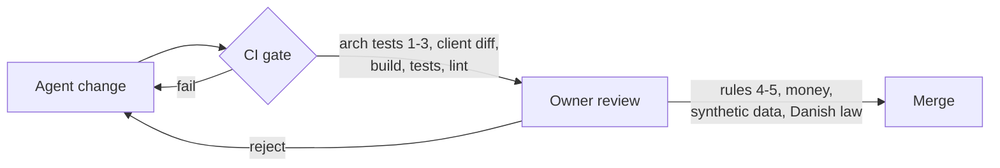
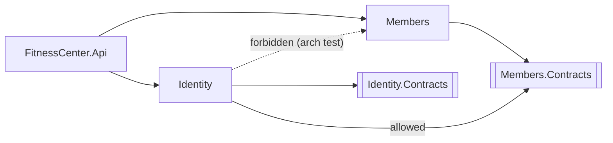
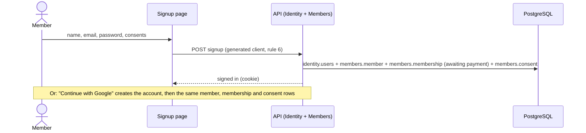
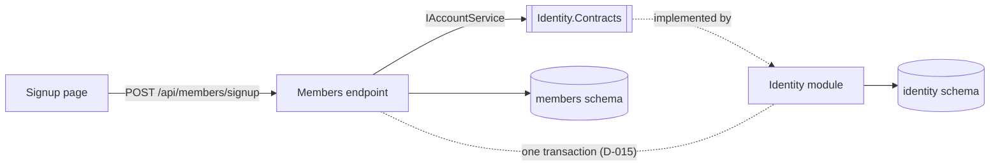

# Decisions Log

Medium-to-large project decisions. Each entry is made only on documented reasoning — no guesses.
Entries are append-only; a superseded decision is marked `Superseded by D-NNN`, not deleted.

## Template

```
## D-NNN: <short title>
- **Date:** YYYY-MM-DD
- **Status:** Proposed | Accepted | Superseded by D-NNN
- **Decided by:** <owner / orchestrator with owner approval>

### Problem statement
<What needs deciding and why now.>

### Options considered
1. <Option> — pros / cons
2. <Option> — pros / cons

### Decision
<The chosen option.>

### Reasoning
<Why, tied to evidence.>

### Sources
- [docs/research/<file>.md](research/<file>.md) — <section>
- <external URL>
```

---


## D-001: Project purpose and scope anchor
- **Date:** 2026-11-12
- **Status:** Accepted
- **Decided by:** Owner

### Problem statement
Almost every research file flagged that requirements, legal obligations and architecture depend on whether the system serves a real center, a hypothetical one, or many centers, and in which country (see open questions F1, F2, F4).

### Decision
The system is built for **one real, single-site fitness center in Denmark** that has requested it, and is **also a learning project** for the owner. The priority is a **functioning end product**; learning is secondary (owner, 2026-11-13). The center has about 10 staff (member count unknown).

### Reasoning
Owner-provided fact. Consequences drawn from research:
- Danish law applies: consumer contract rules (cancellation after 5 months with 1 month's notice), employee working-time registration (mandatory since 1 July 2024), bookkeeping law, GDPR enforced by Datatilsynet, Danish fitness VAT changes from 1 Jan 2026.
- With ~10 staff the center is likely below the EU Accessibility Act microenterprise threshold (<10 staff and ≤€2m turnover) — borderline, needs confirmation of exact headcount and turnover.
- Multi-tenancy is **not** decided by this; it remains an open question (selling to other centers later would change bookkeeping-registration and controller/processor roles).

### Sources
- [research/compliance-legal-security.md](research/compliance-legal-security.md) — §4 Denmark working time, §6 consumer law, §7 bookkeeping, accessibility section; Errata items 3, 6
- [research/domain-modeling.md](research/domain-modeling.md) — Danish VAT 2026 findings
- [research/fitness-domain-operations.md](research/fitness-domain-operations.md) — center types and how needs differ

## D-002: Wearables and fitness-tracking integrations are out of scope
- **Date:** 2026-11-12
- **Status:** Accepted
- **Decided by:** Owner

### Problem statement
The integrations research listed wearable/fitness-platform integrations as a possible feature (open question M8 / R5).

### Decision
Wearables and fitness-data integrations are **not in the plan**.

### Reasoning
Owner decision. Independently supported by the fact-check: the Fitbit Web API was turned off on 2 Nov 2026, Garmin has paused new developer approvals since spring 2026, and Google Health API onboarding status is unknown — so the feature would be costly or impossible to deliver anyway.

### Sources
- [research/verification-report-wave1.md](research/verification-report-wave1.md) — claims I-22, I-23, I-24
- [research/integrations-and-architecture.md](research/integrations-and-architecture.md) — Errata item 2

## D-003: Attendance and entry via RFID access card
- **Date:** 2026-11-12
- **Status:** Accepted (mechanism); details open
- **Decided by:** Owner

### Problem statement
Access control options ranged from staffed reception to QR codes, wallet passes, PIN, and biometrics (face/fingerprint), with very different legal risk and hardware needs (open questions A1, A3, U3).

### Decision
Members use an **RFID access card** swiped at the entrance. A swipe registers attendance, which can be **normal gym entry or attendance for a class / personal-training session**. Biometric entry is therefore not part of the plan.

### Reasoning
Owner-stated requirement. Research consequences:
- Avoiding biometrics removes the highest-risk GDPR item (Datatilsynet 2024 required explicit consent plus a free equivalent alternative for face recognition) and the EU AI Act biometric question.
- Reader-to-controller protocol matters for security: OSDP is encrypted, Wiegand is not.
- **Still open** (to ask the center): existing reader/door hardware make and model, card technology, whether the door is unlocked by the system or only logs attendance, unstaffed hours, offline behaviour (fail open / closed / cached list), and how a single swipe is attributed to a class or PT session versus plain gym entry.

### Sources
- [research/compliance-legal-security.md](research/compliance-legal-security.md) — biometrics / Datatilsynet 2024
- [research/integrations-and-architecture.md](research/integrations-and-architecture.md) — access-control hardware and protocols (Wiegand/OSDP, Salto, Paxton)
- [research/ux-patterns.md](research/ux-patterns.md) — check-in patterns

## D-004: Gather requirements from the center before writing the PRD
- **Date:** 2026-11-12
- **Status:** Accepted
- **Decided by:** Owner (need), orchestrator (method)

### Problem statement
The MVP scope (open question F6) and most domain questions (memberships, billing, pay rules, scheduling) cannot be answered by the owner without the center's staff/management.

### Decision
Hold a structured stakeholder conversation with the center's management and staff, using [stakeholder-interview-guide.md](stakeholder-interview-guide.md), before writing `prd.md`. Research that does not depend on those answers may continue.

### Reasoning
The domain research shows requirements diverge sharply by center type and operating model, and this center is mixed (open gym + classes such as spinning and CrossFit + PT). The interview guide is built from the de-duplicated open questions so every answer maps back to a question ID.

### Sources
- [research/fitness-domain-operations.md](research/fitness-domain-operations.md) — center types; open questions
- [open-questions.md](open-questions.md)

## D-005: AI token budget constrains the workflow
- **Date:** 2026-11-12
- **Status:** Proposed — pending owner confirmation
- **Decided by:** Orchestrator, from owner-stated constraint

### Problem statement
The owner can spend about **half of the weekly token allowance of a Claude Pro subscription**. Research shows multi-agent setups are expensive (open questions W1, W6).

### Decision (proposed)
1. Prefer a lightweight, mostly single-agent workflow over heavyweight multi-agent/parallel-worktree workflows.
2. Run independent verification passes only on research that feeds decisions (methodology option B), not on every file.
3. Run future research rounds with few, narrowly briefed agents.

### Reasoning
Anthropic's multi-agent research system used ~15x the tokens of a chat, and agent teams ~7x a normal session; Anthropic also notes coding parallelises less well than research. A Pro allowance cannot sustain that routinely. Review time, not agent throughput, is also the documented bottleneck for a solo developer.

### Sources
- [research/agent-research-methodology.md](research/agent-research-methodology.md) — token cost; §2.1 options A/B
- [research/agentic-workflows.md](research/agentic-workflows.md) — cost and review-bottleneck findings; workflow options

## D-006: Payment services are out of scope for now
- **Date:** 2026-11-12
- **Status:** Accepted
- **Decided by:** Owner

### Problem statement
Payment-provider choice (cards, Betalingsservice, MobilePay Recurring, Stripe/Frisbii/GoCardless) was one of the largest open areas (open questions P1, P2, D3, Q8), and it blocked several billing and testing decisions.

### Decision
**Ignore all payment services for now.** Payment integration will come later as its own separate component (the "payment service" in [D-008](#d-008-architecture-modular-monolith-with-enforced-boundaries)).

### Reasoning
Owner decision. Consequences drawn from research:
- The questions about payment provider choice, PSP sandbox tests in CI and who owns the billing schedule are **deferred**, not answered.
- **Still open:** whether v1 tracks memberships and amounts owed without moving money (manual or external payment), or has no billing at all. See open question B3.
- Keeping payments behind a separate boundary also keeps card-security (PCI) scope small later. A hosted payment page gives the smallest scope.

### Sources
- [research/integrations-and-architecture.md](research/integrations-and-architecture.md) — payment provider catalog
- [research/compliance-legal-security.md](research/compliance-legal-security.md) — §5.1 PCI scope reduction
- [research/domain-modeling.md](research/domain-modeling.md) — billing ownership (open question 4)

## D-007: React frontend and C# API
- **Date:** 2026-11-12
- **Status:** Accepted
- **Decided by:** Owner

### Problem statement
The stack research ranked .NET 10 + PostgreSQL + Vue (1) and .NET 10 + PostgreSQL + React (2) as close candidates. It left the choice to the owner's review comfort and learning goals (open questions S1, S4).

### Decision
- **Frontend:** React (with TypeScript, per the stack research).
- **API and backend logic:** C#/.NET. The research gives .NET 10 LTS as the current long-term support release, supported to Nov 2028.
- **Database:** PostgreSQL.

### Reasoning
Owner decision. It is consistent with the evidence:
- The owner works professionally in C#.
- React has the somewhat stronger agent-tooling evidence: shadcn/ui's official MCP server, and the Next.js agent evals.
- Npgsql recommends PostgreSQL with NodaTime for date/time-heavy domains like billing periods and the Copenhagen time zone.

The Vue-vs-React spike (S5) is no longer needed.

### Sources
- [research/tech-stack.md](research/tech-stack.md) — candidate stacks and ranking
- [research/ux-patterns.md](research/ux-patterns.md) — design-system / shadcn evidence

## D-008: Architecture: modular monolith with enforced boundaries
- **Date:** 2026-11-13
- **Status:** Accepted
- **Decided by:** Owner, based on [research/service-architecture.md](research/service-architecture.md)

### Problem statement
The owner wanted the system "as much as possible as independent services", sketched as Frontend (React) → API (C#) → backend logic (C#) → PostgreSQL, plus a payment service later. It was undecided whether these parts are separately deployed services or separate code modules inside one deployed app.

### Options considered
1. **Shape A: plain modular monolith.** One deployable with strict module boundaries. Lowest effort and cost; one compile unit for agents.
2. **Shape B: modular monolith + Aspire + payment as a separate deployable later**, connected via outbox. Ranked 1st by the research.
3. **Shape C: separate services**, either per business capability or per layer. Highest cost: sagas, contract drift, GDPR erasure across stores, N× hosting. The layer-per-process variant was the weakest, because it pays the network-call cost without gaining domain independence.

### Decision
**Shape B.**
- **Core:** one deployed C#/.NET application, built as a modular monolith.
  - Modules are split by business area (e.g. Members, Booking, Access/Check-in, Staff), not by layer.
  - Each module is its own C# project(s) with API, logic and data-access layers inside it.
  - Boundaries are **enforced by architecture tests in CI** (NetArchTest or ArchUnitNET; library choice open).
- **Frontend:** React SPA, deployed separately (D-007).
- **Database:** a single PostgreSQL database (D-007). One schema per module vs one shared schema is still open (SA6).
- **Payment service:** a separately deployed service when payments are reopened (D-006). The outbox/broker details are decided then.
- **Local development:** Aspire (D-009).

### Reasoning
- **Owner's requirements:** "as modular as possible" **without impacting performance**. The priority is a working end product, not learning distributed systems (owner, answers to SA1/SA2).
- **Performance:** splitting layers into processes turns in-process calls into remote calls that are "orders of magnitude slower" and can fail (Fowler, "don't distribute your objects"). Modules inside one process keep calls in-process, including on the check-in path.
- **Modularity:** separate projects plus architecture tests make a boundary violation fail CI. That gives enforced independence without the cost of distribution.
- **Cost:** the benefits of Shape C (independent scaling, team autonomy) mostly don't apply to one developer and one site. Its costs (sagas, outbox, contract drift, GDPR erasure across stores, per-service hosting) all do, and they also strain the token budget (D-005).
- **Payment is the one justified separate service:** isolation of PSP secrets and webhooks, and a smaller PCI scope.
- **Outages:** keeping check-in working when the server or internet is down is **not** solved by any of these shapes. It needs an on-site/offline design, which is open until the access-hardware research after the center meeting (D-003, SA3).

### Sources
- [research/service-architecture.md](research/service-architecture.md) — §2.1 layers vs tiers vs microservices; §3 comparison table; §4 Shape B diagram and repo layout; §5 ranking; §6 risks
- [research/integrations-and-architecture.md](research/integrations-and-architecture.md) — §3.1 (Fowler, MonolithFirst / MicroservicePremium)
- https://martinfowler.com/bliki/MonolithFirst.html
- https://martinfowler.com/bliki/MicroservicePremium.html

## D-009: Use Aspire for local development from the start
- **Date:** 2026-11-13
- **Status:** Accepted
- **Decided by:** Owner

### Problem statement
Should Aspire (formerly .NET Aspire) be used as the local development orchestrator and telemetry dashboard from the start, or added later when a second deployable (the payment service) arrives? (Open question SA5.)

### Options considered
1. **Aspire from the start.** One command starts the API, PostgreSQL and later services. Its dashboard shows logs, traces and health in one place, and it can publish a Docker Compose file for a VPS. Cons: little gain while there is only one API; the tooling is changing (docs moved to aspire.dev, product renamed); it adds AppHost and ServiceDefaults projects; Arch/Podman support is UNVERIFIED.
2. **Plain `dotnet run` + docker compose; add Aspire later.** Simplest setup, but no unified dashboard and more manual wiring once payment arrives. Research: the option without Aspire "loses little against B until payments arrive, and can grow into B".

### Decision
Use **Aspire for local development from the start**. The AppHost wires the C# API and PostgreSQL now, and the payment service when it is added. Aspire is **not** a production runtime. Production deployment remains a separate decision, possibly a Compose file generated by Aspire for a single EU VPS (open question SA4).

### Reasoning
- One dashboard for logs, traces and health supports building a working product. Learning value is secondary: the owner stated on 2026-11-13 that a functioning end product is the priority.
- It prepares for the planned separate payment service (D-006).

Caveats recorded at decision time:
- Within one process, Aspire/OpenTelemetry shows time per request, per outgoing HTTP call and per database call. It does **not** show time per internal layer unless spans (`ActivitySource`) are added at layer or module boundaries. This came from the orchestrator's own knowledge and is **UNVERIFIED** against official docs.
- Aspire's API churn is a known risk. Pin versions.

### Sources
- [research/service-architecture.md](research/service-architecture.md) — §2.7 local dev (Aspire [A7], publish to Compose [A8]), §3 comparison table, §6 risks ("Aspire churn")
- https://aspire.dev/get-started/what-is-aspire/
- https://aspire.dev/deployment/deploy-with-aspire/

## D-010: Automated testing at every level, run in CI
- **Date:** 2026-11-13
- **Status:** Accepted (scope); tool choices open
- **Decided by:** Owner

### Problem statement
Which kinds of tests the project requires, and where they run (open questions W16, Q-series).

### Decision
The project uses **unit tests, integration tests, end-to-end tests and any other test type that can be automated**. All of them **run in CI** (GitHub Actions is the working assumption from research; hosting the repo is open, W3).

**Open:** the test framework (xUnit v3 vs TUnit vs NUnit, S11) and the policies for mutation testing, coverage and test protection (Q2–Q7).

### Reasoning
Owner requirement. It matches the research:
- Agents need pass/fail checks they can run themselves.
- Rules that must always hold belong in CI, hooks and deny rules, not in prompts.
- Agents have been documented editing or deleting tests to make them pass, so protection must be deterministic.

Research toolchain mapping for .NET:
- Testcontainers + WebApplicationFactory for integration tests
- Playwright for E2E
- `FakeTimeProvider` / NodaTime `FakeClock` for time
- Stryker.NET for mutation testing
- FsCheck/CsCheck for property tests
- NetArchTest/ArchUnitNET for architecture rules (D-008)
- axe for accessibility
- SAST/dependency/secret scanning

### Sources
- [research/testing-strategy.md](research/testing-strategy.md) — §2.2 agents gaming tests, §2.3 mutation, §2.7 E2E as definition of done, §5 draft testing.md skeleton
- [research/tech-stack.md](research/tech-stack.md) — §2.8 .NET testing toolchain, §5.3 CI on GitHub Actions
- [research/agentic-workflows.md](research/agentic-workflows.md) — verification and CI gates

## D-011: Login with social providers and local email/password accounts
- **Date:** 2026-11-13
- **Status:** Accepted (requirement); provider list and implementation pending [research/authentication.md](research/authentication.md)
- **Decided by:** Owner

### Problem statement
How should members (and staff) create accounts and log in? (Open question S6.)

### Decision
Offer a **standard login like most popular sites**:
- **Social login:** account creation and login via Google, Facebook, GitHub, and other regularly used providers.
- **Local accounts:** email + password, created in the system.

**Open:**
- which providers exactly
- own login (ASP.NET Core Identity + external providers) vs a self-hosted or hosted identity provider
- account linking
- MFA for staff/admin

### Reasoning
Owner requirement. The implementation choice will be recorded once the authentication research is done.

### Sources
- [research/tech-stack.md](research/tech-stack.md) — §2.7 authentication
- [research/authentication.md](research/authentication.md)

## D-012: Native mobile app, staff-first
- **Date:** 2026-11-13
- **Status:** Accepted (direction); technology open
- **Decided by:** Owner

### Problem statement
Is a native iOS/Android app planned? This affects App Store login rules and the frontend tech (open questions AU1, M6, S10).

### Decision
A **native phone app is planned**. Its **first delivery is for staff**, mainly to check their appointments (classes, PT sessions, shifts). Member features in the app come later.

### Reasoning
Owner decision. Consequences from research:
- **App Store guideline 4.8:** if the iOS app offers a third-party social login (e.g. Google) as the primary account login, it must also offer Sign in with Apple or an equivalent privacy-preserving option. Exemptions include apps that use only their own account system, and a government eID (MitID). Whether a staff-only app qualifies for the "enterprise/business account" exemption is **UNVERIFIED**. Check this before building the app.
- **Technology:** React Native (Expo) is one candidate that matches the React decision (D-007), but it has not been researched in depth (one row in integrations research). The app technology is **open**.
- The app consumes the same Core API (D-008). No separate backend.

### Sources
- [research/authentication.md](research/authentication.md) — finding 2, risk R6, source [A4] (Apple App Store Review Guidelines §4.8)
- [research/integrations-and-architecture.md](research/integrations-and-architecture.md) — §3.3 mobile options (React Native/Expo, Flutter, PWA)

## D-013: Login providers and MFA policy
- **Date:** 2026-11-13
- **Status:** Accepted
- **Decided by:** Owner
- **Refines:** D-011

### Problem statement
Which social providers to offer, and when MFA is required (open questions AU2, AU8).

### Decision
- **Facebook Login is not offered.**
- **MFA is mandatory for staff accounts.**
- **MFA is optional for members**: they can choose to turn it on.
- Still offered (from D-011): Google and local email + password.
- Still to confirm:
  - GitHub/Microsoft (AU3)
  - Apple (required in practice once the iOS app offers social login, D-012)
  - implementation: own ASP.NET Core Identity vs hosted IdP (AU5)

### Reasoning
- **Facebook:** Meta requires business verification and ongoing review. Transfers rely on the EU-US Data Privacy Framework, which is under appeal (CJEU C-703/25 P). Usage evidence is weaker than for Google and Apple (22% vs 49% / 44% in the one audit found).
- **Staff MFA:** staff accounts can access personal data about many members and employees. The research recommends stronger authentication for privileged users (ASVS L2 for staff/admin).

### Sources
- [research/authentication.md](research/authentication.md) — findings 3, provider table, ASVS section, open questions 2 and 8

## D-014: Database layout: one schema per module, foreign keys allowed between modules
- **Date:** 2026-11-13
- **Status:** Accepted
- **Decided by:** Owner, on the orchestrator's recommendation in [data-model.md](data-model.md) §4

### Problem statement
How to lay out the tables of the modular monolith (D-008) in its single PostgreSQL database, and whether foreign keys may cross module boundaries (open questions SA6, DB1). The owner wants the database not too complicated to start with.

### Options considered
1. **One shared schema with FKs everywhere.** Simplest, but no grouping by module, and moving to per-module permissions later means relocating tables.
2. **One PostgreSQL schema per module (e.g. `identity`, `members`, `booking`, `access`, `staff`), FKs allowed between modules.** Normal database integrity, tables grouped by owner, and can be tightened later.
3. **Schema per module, no FKs between modules (IDs only).** The research's leaning. Easiest module extraction, but integrity moves to code and tests, with more rules.

### Decision
**Option 2.**
- Each module owns a PostgreSQL schema, with its own EF Core `DbContext` (`HasDefaultSchema`) and migrations history table.
- **Foreign keys between modules are allowed.**
- Module migrations run in dependency order: **Identity → Members / Staff → Booking / Access**. Reporting comes later.
- Rule R3 in [architecture.md](architecture.md) §4.2 still applies: no module *reads or writes* another module's tables through code. FKs are database integrity only, not a shortcut for queries.

### Reasoning
- **Simplicity and data safety:** the database itself prevents orphaned rows, which matches the owner's "not too complicated" requirement.
- **Visible ownership:** schemas group tables by module at no measurable runtime cost.
- **Option 3's benefit doesn't apply here:** its main gain is easy extraction of a module into a separate service. The only planned separate service is payments (D-008), which is expected to get its own database regardless (DB7). No core module is planned for extraction.
- **Reversible:** individual FKs can be dropped later to move to Option 3. Going from Option 1 to 2 would require moving tables.
- **Known costs:**
  - migrations must run in a fixed order
  - deleting or anonymising a person (GDPR) must respect FK order across modules
  - per-module database roles (DB3) would need REFERENCES privileges for cross-schema FKs (UNVERIFIED detail)

### Sources
- [data-model.md](data-model.md) — §3 foreign keys explained, §4 options and recommendation
- [research/database-schemas.md](research/database-schemas.md) — §2 what a schema is, §4 cross-module FKs, §6 EF Core specifics, §8 GDPR erasure, §11 performance, §12 extraction, §15 recommendation

## D-015: Transactions may span modules
- **Date:** 2026-11-13
- **Status:** Accepted
- **Decided by:** Owner, on the orchestrator's recommendation in [data-model.md](data-model.md) §5

### Problem statement
When one action changes data in two modules, should both changes be saved in one database transaction (both or neither), or should the modules be decoupled with events? Example: an RFID swipe records attendance (Access) and marks the booking as attended (Booking). (Open question DB2.)

### Options considered
- **A. Shared transaction:** both modules' changes commit together on one connection. Simple, always consistent.
- **B. Events/outbox:** each module commits separately and reacts to the other's events. More decoupled and extraction-ready, but more code and brief inconsistency.

### Decision
**A.** A single database transaction **may span two (or more) modules** in the core.
- The DbContexts involved share one connection and transaction. Implementation details are verified in a spike: EF Core supports a shared transaction across contexts that use the same connection.
- Events stay in use where the architecture already plans them: cross-module side effects that need not be atomic ([architecture.md](architecture.md) §6.3), and the future payment service, which is a separate deployable with its own database and cannot share a transaction.

### Reasoning
- **Simplicity:** this matches the owner's "not too complicated" requirement.
- **It's possible here:** all core modules run in one process with one database (D-008, D-014).
- **Consistency:** shared transactions avoid the partial-failure states that events/outbox must handle.
- **Trade-off accepted:** this rules out separate database users (roles) per module, because a shared transaction needs one connection. DB3 is therefore effectively "not in v1".

### Sources
- [data-model.md](data-model.md) — §5 transactions explained
- [research/database-schemas.md](research/database-schemas.md) — §5 transactions across modules, §9 per-module roles
- https://learn.microsoft.com/en-us/ef/core/saving/transactions

## D-016: Performance testing is part of the test suite
- **Date:** 2026-11-13
- **Status:** Accepted (requirement); tool and thresholds open
- **Decided by:** Owner
- **Extends:** D-010

### Problem statement
D-010 covers unit, integration, E2E and other automated tests. Performance testing was not explicitly included, and the earlier testing research did not cover it.

### Decision
The project **includes automated performance tests**: load and response-time tests that can run on demand and in CI.
- **Tool:** open. The owner knows of JMeter but has not used it. Candidates have not been researched yet.
- **Open:** targets (e.g. RFID check-in response time, booking under concurrent load), when they run (every PR, nightly, or before release), and which environment they run against.

### Reasoning
Owner requirement. It fits the research principle that quality gates must be automated checks rather than prompts. The concrete design needs research, because no project research covers performance tools yet.

### Sources
- [research/testing-strategy.md](research/testing-strategy.md) — performance testing is not covered (gap)
- [research/agentic-workflows.md](research/agentic-workflows.md) — automated CI gates

## D-017: Linear is the task tracker; docs/ stays the source of truth
- **Date:** 2026-11-13
- **Status:** Accepted
- **Decided by:** Owner

### Problem statement
Where are tasks tracked, and how do agents get their instructions? (Open questions W11, W12.) The owner has created a Linear workspace and team, both named **FitnessCenterSystem**, connected to the GitHub repo `Gafion/FitnessCenterSystem`, and connected the Linear MCP server to Claude Code.

### Decision
- **Linear holds every task:** both tasks agents can pick up and tasks for the owner. **If it is a task, it has a Linear ticket**, even when that is redundant, for process tracking and history.
- **Every sub-agent gets its instructions from a Linear ticket** that the orchestrator creates first. The ticket holds the full brief. The agent is pointed at the ticket and reports back by commenting on it.
- **Decisions and requirements stay in `docs/`** (`decisions.md`, `open-questions.md`, PRD, etc.). Tickets link to docs; they do not replace them.

### Reasoning
Owner decision. It is consistent with the research:
- Issue-tracker-driven agent work and PR-linked tickets give an auditable history of what each agent was asked to do.
- Keeping specs in the repo keeps them versioned alongside the code.

### Sources
- [research/agentic-workflows.md](research/agentic-workflows.md) — issue-tracker-driven agents, tracker options
- [research/agentic-project-planning.md](research/agentic-project-planning.md) — task-tracking formats, docs as source of truth

## D-018: Frontend libraries and tooling follow the acme-corp starter
- **Date:** 2026-11-13
- **Status:** Accepted
- **Decided by:** Owner
- **Extends:** D-007

### Problem statement
D-007 fixed React + TypeScript (Vite) but left the router, styling, UI kit and frontend tooling open (open question U10, frontend part of S11). The owner was recommended the [acme-corp](https://github.com/Pallepadehat/acme-corp) starter by its author, a fellow student who works with frontend in his apprenticeship. The comparison (FIT-40) found its frontend choices fit D-007 unchanged, while its backend does not fit D-007, D-008, D-013 or D-014.

### Options considered
1. **Keep D-007 as is, choose frontend libraries later.** No change now, but the open slots stay open.
2. **Adopt acme-corp entirely (frontend and TypeScript backend).** Supersedes D-007's backend part; module boundaries, staff MFA and schema per module need custom work; Drizzle and PGlite are pre-1.0.
3. **Hybrid: adopt acme-corp's frontend choices, keep the C# backend.** Fits D-007; fills the open frontend slots with a set that is known to work together; Aspire can host the Vite app.

### Decision
Option 3. In `frontend/`:
- **Libraries:** React 19, Vite, **TanStack Router**, **Tailwind CSS v4**, **shadcn/ui on Radix** (as in the template), **i18next** (the library only; whether Danish + English is required stays open as U5).
- **Tooling:** Vitest (unit and component tests), Playwright (E2E), Biome (lint and format), Knip (unused code), Bun as package manager and script runner.
- **Not adopted:** the template's hand-written `fetch` wrapper and shared Zod contract. Rule 6 stands: the frontend calls the API only through the generated OpenAPI client. Better Auth, Fastify, Drizzle, BullMQ/Redis and Turborepo are not adopted; the backend stays as D-007 to D-016 decide.

Exact versions are pinned at scaffold time (FIT-31), not here.

### Reasoning
Owner decision. The owner trusts the author's frontend judgement. It is consistent with the evidence:
- Every adopted piece fits D-007 as it stands, and shadcn/ui was already the UI-library candidate.
- Aspire hosts Vite apps (`AddViteApp`) and supports Bun (`WithBun`), so D-009 is unaffected.
- The backend gaps (no architecture tests, staff MFA needs custom hooks, `timestamp` without time zone, pre-1.0 ORM) are avoided by keeping the C# backend.

Noted risk: shadcn/ui's default primitives switched to Base UI in July 2026; Radix is chosen here to match the template.

### Sources
- [research/stack-comparison-acme-corp.md](research/stack-comparison-acme-corp.md) — §3.5, §4, §5 option 3a/3b; ACME-005, ACME-014, ACME-060, ACME-061
- [research/ux-patterns.md](research/ux-patterns.md) — §10 (shadcn/ui, Base UI default)
- https://aspire.dev/integrations/frameworks/javascript/

## D-019: Payments are subscriptions and one-time PT payments; the core keeps no amounts owed
- **Date:** 2026-11-13
- **Status:** Accepted
- **Decided by:** Owner
- **Answers:** B3. Extends D-006 and D-008.

### Problem statement
With payments out of scope for now (D-006), open question B3 asked whether v1 still tracks memberships and amounts owed, or has no billing at all. The architecture listed "Billing / Payments" as one later item, so it was unclear whether the core needs a billing module.

### Options considered
1. **The core tracks amounts owed** (a billing module with charges and balances). Needed if the system owns the billing schedule; brings invoice, VAT and bookkeeping logic into the core.
2. **No amounts owed in the core; the payment service only reports payment confirmations.** The core stays free of billing logic.

### Decision
Option 2, as stated by the owner:
- Members pay through **6 different subscription types** (the membership types).
- **Personal-training (PT) appointments** can be paid as a **one-time payment**.
- The core keeps **no "amounts owed"**. The payment service (separate deployable, D-008) sends **payment confirmations** to the core.
- There is **no Billing module in the core**. The planned modules are Identity & Accounts, Members, Booking, Access, Staff, Reporting, plus the separate Payments service.

D-006 still applies: the payment service is built later.

### Reasoning
Owner decision. It fits the architecture: the payment service already reports to the core through events (architecture.md §13, `PaymentSucceeded`). It also keeps billing schedules, card data and PCI scope out of the core (D-006 reasoning).

**Still open, not decided here:** which 6 subscription types (M1); who runs the subscription schedule, the payment provider or our service (D3); what the core does when a confirmation does not arrive, e.g. whether door access is blocked (D11); VAT on PT for members aged 30+ (D1, D2); and how payments reach a bookkeeping system (P3, compliance research §7).

### Sources
- [architecture.md](architecture.md) — §4.1 module table, §13 payment service
- [research/domain-modeling.md](research/domain-modeling.md) — billing ownership (D3), dunning (D11)
- [research/compliance-legal-security.md](research/compliance-legal-security.md) — §7 bookkeeping, §5.1 PCI scope

## D-020: Payment records in the core; a missing payment blocks check-in and emails the member
- **Date:** 2026-11-13
- **Status:** Accepted
- **Decided by:** Owner
- **Extends:** D-019. Partly answers D11.

### Problem statement
D-019 kept "amounts owed" out of the core. The owner now wants members to see their payments, and wants a rule for missing payments. Payment records could live only in the Payments service's database, or also as a copy in the core.

### Options considered
1. **Copy in the core.** Each payment confirmation event also writes a payment record into the core. The account page and check-in read only the core, so they work when the Payments service is down, and in the MVP with simulated payments (D-021). Cost: the same data is stored twice.
2. **Only in the Payments service.** One copy. The account page and check-in call the Payments service over the network, so check-in depends on a second running service, and nothing works until it exists.

### Decision
Option 1.
- **Every payment is saved** in the core with **amount** (øre, `Money`), **date** (`timestamptz`) and the **last four digits of the card**. The confirmation also carries the period it covers, so the core knows each membership's **paid-until date**. Owner: **Members** module, which already owns membership and status.
- The **member's account page** shows the payment history.
- **A subscription payment is missing** when the paid-until date has passed. Then:
  - the member gets an **email**;
  - at **check-in**, the member sees a **warning** and the **check-in is refused**. Access asks Members through `Members.Contracts`, as in architecture.md §4.2.
- **Never store** the full card number, CVV or stripe data. Only the last four digits and provider references.

**Still open:**
- Grace period before a payment counts as missing, and whether reminder emails repeat (D11, for the center).
- Whether an unpaid one-time PT payment has any effect.
- Non-card methods (MobilePay, Betalingsservice) have no card digits, so what is shown then depends on P1.
- The transactional email provider (integrations research, row 8).
- How long payment records are kept. Bookkeeping retention is 5 years in the research, and how that applies to this copy is unverified.

### Reasoning
Owner decision on the requirement; option 1 chosen by the owner from the orchestrator's recommendation.
- The compliance research's data inventory already lists "last 4 digits" with payment tokens in the Members area, under the contract basis, and forbids storing the full card number.
- Domain research warns that access and billing are separate timelines, and that "subscription active" alone is not enough for access control. A paid-until date from confirmations avoids that.
- Keeping check-in independent of the Payments service matters because check-in is the most time-critical flow.

### Sources
- [research/compliance-legal-security.md](research/compliance-legal-security.md) — §5.1 (never store PAN/CVV), data inventory row 3 (last 4 digits, 5-year bookkeeping retention)
- [research/domain-modeling.md](research/domain-modeling.md) — §2.10 dunning; executive summary item 3 (access and billing as separate timelines)
- [research/integrations-and-architecture.md](research/integrations-and-architecture.md) — row 8, transactional email
- [architecture.md](architecture.md) — §4.2 contracts, §13 payment service

## D-021: The MVP simulates RFID hardware and payments
- **Date:** 2026-11-13
- **Status:** Accepted
- **Decided by:** Owner
- **Extends:** D-003, D-006

### Problem statement
The MVP needs check-in (D-003) and payment confirmations (D-019, D-020) to work, but the RFID hardware is unknown until the center meeting, and the Payments service is out of scope (D-006).

### Options considered
1. **Simulate both.** A simulated card reader sends swipes; a test tool sends payment confirmations, and can skip one to trigger a missing payment. The core code is the same as with real hardware and payments later.
2. **Staff register payments manually.** Usable at the center before payments exist, but adds a staff screen that may be thrown away later.
3. **Build the real integrations now.** Supersedes D-006 and needs the RFID hardware details and the payment provider choice first.

### Decision
Option 1, for both RFID and payments.
- **RFID:** no hardware module in the MVP. A **simulated reader** sends a card UID to the same check-in logic the real reader will use later.
- **Payments:** a **simulated payment source** sends the same payment confirmation events the Payments service will send later. It can skip a payment, so the missing-payment rule from D-020 can be tested.
- Both use **synthetic data only**.

**Still open:** whether the simulators exist only in development and tests, or also in a demo for the center (and if so, who may use them).

### Reasoning
Owner decision for RFID; option 1 for payments chosen by the owner from the orchestrator's recommendation. It keeps the real integrations behind the same boundary they would have anyway: card swipes into Access, and events from the Payments service (architecture.md §13). That way, building the real versions later does not change the core. RFID research (FIT-33) is no longer needed for the MVP.

### Sources
- [decisions.md](decisions.md) — D-003, D-006, D-019, D-020
- [architecture.md](architecture.md) — §13 payment service event shape

## D-022: MVP scope: six pages
- **Date:** 2026-11-13
- **Status:** Accepted
- **Decided by:** Owner
- **Relates to:** D-004 (the PRD still follows the center meeting), D-020, D-021

### Problem statement
The owner wants a concrete starting point before the full PRD. Which pages make up the MVP?

### Options considered
For the classes page:
1. **View and book.** Schedule, book a spot, cancel. Exercises Booking end to end.
2. **View only.** Smaller, but Booking stays untested.
3. **View, book and waitlist.** Adds waitlist promotion rules to the MVP.

For check-in:
1. **Add a simulated check-in page.** Shows the D-020 missing-payment rule in the MVP.
2. **No check-in page.** The check-in rule waits until after the MVP.

### Decision
The MVP has six pages:

| # | Page | What it does | Modules |
|---|---|---|---|
| 1 | Landing page | Public front page of the center | (frontend only) |
| 2 | Login / signup | Google or email/password (D-011); MFA optional for members (D-013) | Identity |
| 3 | Classes | View the schedule, book a spot, cancel a booking. No waitlist | Booking, Members |
| 4 | User account | Profile and payment history (D-020) | Members |
| 5 | Simulated payment | Sends fake payment confirmations, can skip one (D-021) | Members (via payment events) |
| 6 | Simulated check-in | Acts as the card reader; shows welcome or the missing-payment warning and refuses check-in (D-020, D-021) | Access, Members |

Classes options 1 and check-in option 1 were chosen by the owner from the orchestrator's recommendations.

**Not in the MVP (open):** staff screens, including creating classes. Classes would come from synthetic seed data. The missing-payment email (D-020) is in the MVP but has no page. Who may open the two simulated pages is open (D-021).

### Reasoning
Owner decision. The six pages touch every MVP rule decided so far (login, booking, payment records, missing payment at check-in) with the smallest number of screens. The final module list and features still come from the PRD after the center meeting (D-004).

### Sources
- [decisions.md](decisions.md) — D-004, D-011, D-013, D-020, D-021
- [architecture.md](architecture.md) — §4.1 module table

## D-023: Scaffolding approach and slice order
- **Date:** 2026-11-19
- **Status:** Accepted (partly: template, dev login and enforced checks are still open in FIT-50)
- **Decided by:** Owner
- **Relates to:** D-007, D-022, FIT-49, FIT-50

### Problem statement
Should the owner build the project's structure and first feature before agents work on it, and which feature should be the first, "golden" slice that agents copy?

### Options considered
Who writes the walking skeleton and golden slice ([scaffolding-for-agents.md](research/scaffolding-for-agents.md)):
1. **Owner types it by hand.** Most control, slowest.
2. **An agent writes it in small steps, the owner reviews.** Both OpenAI and Anthropic work this way; the human designs, reviews and enforces it with checks.
3. **Start from a trimmed template.** Fastest; depends on the backend language (FIT-41).

Golden slice: the orchestrator suggested "book + cancel a class".

### Decision
- **An agent writes the scaffold in small steps** (option 2). The owner reviews each step.
- **Slice order:**
  1. **Signup for the general gym membership** (golden slice).
  2. **Booking and cancelling classes.**
  3. **PT.**


**Still open (FIT-50):** which template, if any (depends on FIT-41); whether a dev-only fake login is used; which rules become enforced checks. Whether a template is used together with option 2 is not decided.

### Reasoning
Owner decision. The research found no study that tests hand-written scaffolds against agent-written ones; it found that agents copy the patterns already in the repo and that enforced checks matter more than written instructions ([scaffolding-for-agents.md](research/scaffolding-for-agents.md)). The owner's review of each step is what keeps the first slice clean.

**Consequences (orchestrator notes, not owner decisions):**
- Signup is part of login, so slice 1 needs the login implementation (AU5) decided first. A dev-only fake login (FIT-50 question 4) no longer helps the golden slice.
- Signup for a membership touches Identity and Members, and probably the simulated payment (D-021). That makes the golden slice cross several modules, which shows the boundary rules early but makes it larger.
- PT is not one of the six D-022 pages. Whether PT is in the MVP or comes right after it is open.

### Sources
- [research/scaffolding-for-agents.md](research/scaffolding-for-agents.md)
- [decisions.md](decisions.md) — D-011, D-021, D-022
- [open-questions.md](open-questions.md) — AU5

## D-024: The backend stays C# / .NET
- **Date:** 2026-11-19
- **Status:** Accepted
- **Decided by:** Owner
- **Relates to:** D-007 (confirmed, not superseded), D-018, FIT-41

### Problem statement
After the acme-corp comparison, should the backend move to TypeScript (one language everywhere, as the owner's frontend colleague prefers) or stay C# / .NET as decided in D-007?

### Options considered
From [stack-comparison-acme-corp.md](research/stack-comparison-acme-corp.md) §5:
1. **Keep C# / .NET** (D-007). Frontend follows acme-corp (D-018).
2. **Move the backend to TypeScript** (acme-corp: Fastify, Better Auth, Drizzle). One language everywhere.

### Decision
**Option 1.** The backend stays C# / .NET 10, ASP.NET Core, as a modular monolith. D-007 and D-008 stand unchanged. The frontend stays as decided in D-018.

### Reasoning
Owner's reason: .NET runs request handling on a multithreaded runtime, while JavaScript runs on a single-threaded event loop.

Background (orchestrator note):
- In Node.js, JavaScript runs on one event-loop thread per process. CPU-heavy work blocks every other request on that thread.
- Node.js can use more cores through worker threads or several processes.
- ASP.NET Core spreads requests over the .NET thread pool.

No performance comparison has been measured for this app (UNVERIFIED either way). The performance tests from D-016 will show whether the backend meets its targets.

### Sources
- [research/stack-comparison-acme-corp.md](research/stack-comparison-acme-corp.md)
- https://nodejs.org/en/learn/asynchronous-work/dont-block-the-event-loop (UNVERIFIED: not re-fetched in this session)
- https://nodejs.org/api/worker_threads.html (UNVERIFIED: not re-fetched in this session)
- https://learn.microsoft.com/en-us/dotnet/standard/threading/the-managed-thread-pool (UNVERIFIED: not re-fetched in this session)

## D-025: PT is not in the MVP
- **Date:** 2026-11-19
- **Status:** Accepted
- **Decided by:** Owner
- **Relates to:** D-019, D-022, D-023

### Problem statement
D-023 puts PT third in the slice order, but PT is not one of the six MVP pages in D-022. Is PT part of the MVP?

### Options considered
1. **PT is in the MVP.** Adds a seventh page and the one-time PT payment (D-019).
2. **PT comes after the MVP.**

### Decision
**Option 2.** The MVP is the six pages in D-022. The MVP builds slices 1 and 2 from D-023. PT (slice 3) comes after the MVP.

### Reasoning
Owner decision.

### Sources
- [decisions.md](decisions.md) — D-019, D-022, D-023

## D-026: Own login with ASP.NET Core Identity
- **Date:** 2026-11-19
- **Status:** Accepted
- **Decided by:** Owner
- **Relates to:** D-011, D-013, D-023 (signup is the golden slice), AU5

### Problem statement
Which implementation do we use for login: our own (ASP.NET Core Identity, data in our database) or a hosted identity provider (AU5)?

### Options considered
From [authentication.md](research/authentication.md) (options table):
1. **ASP.NET Core Identity + Google as an external provider.**
   - Costs €0, and all data stays in our own PostgreSQL.
   - The browser holds only a same-origin cookie, which is equivalent to the recommended BFF pattern.
   - Lock-in is low.
   - Security-sensitive flows are ours to build and test.
2. **Hosted provider** (Auth0, Entra External ID, Clerk and others):
   - Less code to write.
   - Adds an extra data processor and a DPA.
   - Lock-in is high, and EU residency is unclear for several of them.
3. **Self-hosted identity server** (Keycloak, Duende, OpenIddict):
   - Adds an extra service, or a paid licence (Duende).

### Decision
**Option 1.** Login is built with ASP.NET Core Identity inside the core, with its data in our PostgreSQL. Google is added as an external login provider (D-011). MFA stays mandatory for staff and optional for members (D-013).

The EU-residency part of AU5 is no longer needed, because no external identity store is used. Google login still sends sign-in data to Google.

### Reasoning
Owner decision. It keeps all data in our database, costs nothing and avoids an extra data processor ([authentication.md](research/authentication.md)).

Known follow-ups:
- Passkey UI ships only with the Blazor template, so a React SPA needs its own WebAuthn work if passkeys are wanted ([authentication.md](research/authentication.md) finding 6).
- Built-in hashing, lockout and TOTP 2FA are marked UNVERIFIED in that research and must be checked when building the signup slice.

### Sources
- [research/authentication.md](research/authentication.md)
- [decisions.md](decisions.md) — D-011, D-013

## D-027: Start from the official Aspire starter template
- **Date:** 2026-11-19
- **Status:** Accepted
- **Decided by:** Owner
- **Relates to:** D-009, D-023, D-024, FIT-50 (Q3)

### Problem statement
Which template, if any, should the agent start the scaffold from?

### Options considered
From [scaffolding-for-agents.md](research/scaffolding-for-agents.md) §3.7:
1. **`aspire new aspire-ts-cs-starter`** (official). AppHost, ServiceDefaults, a minimal API and a React frontend. It has no modules.
2. **`ardalis/modulith`.** A modular-monolith layout with one architecture test per module. Small community.
3. **`jasontaylordev/CleanArchitecture`.** React, PostgreSQL and Aspire options; clean architecture, not modules.
4. **No template.**

### Decision
**Option 1.** The agent starts from `aspire-ts-cs-starter` and adds the module layout (architecture.md §4.2), the architecture tests and the D-018 frontend tools on top, in small reviewed steps (D-023).

### Reasoning
Owner decision. It is the official template, and it matches D-009 (Aspire for local dev) and D-024 (C# backend). The module structure and architecture tests that it lacks have to be added by the agent.

### Sources
- [research/scaffolding-for-agents.md](research/scaffolding-for-agents.md) — SCAF-060
- https://aspire.dev/reference/cli/commands/aspire-new/

## D-028: Which rules are enforced by checks
- **Date:** 2026-11-19
- **Status:** Accepted
- **Decided by:** Owner
- **Relates to:** D-010, D-023, architecture.md §4.2, FIT-50 (Q5)

### Problem statement
Which project rules become automated checks that fail the build, and which stay as instructions in CLAUDE.md, checked only by review?

### Options considered
For each rule: an **enforced check** (CI or agent setting; strongest evidence, [scaffolding-for-agents.md](research/scaffolding-for-agents.md) finding 4) or a **CLAUDE.md line + review** (small or no measured benefit, SCAF-020). Anthropic warns against too many enforced checks (SCAF-022).

### Decision

| Rule | Kept by |
|---|---|
| Rule 1: modules use only another module's `*.Contracts` | **Enforced:** architecture test |
| Rule 2: `Domain` has no I/O and does not read system time | **Enforced:** architecture test + banned-API analyzer (tool choice UNVERIFIED, e.g. Microsoft BannedApiAnalyzers) |
| Rule 3: no module touches another module's tables | **Enforced:** architecture test |
| Rule 6: frontend uses only the generated API client | **Enforced:** CI regenerates the client and fails on a diff |
| Build (`-warnaserror`), tests, lint and format pass | **Enforced:** CI gate |
| Agents may not edit acceptance tests | **Enforced:** agent permission setting (deny edits on those paths) |
| Rule 4: non-atomic cross-module side effects use integration events | CLAUDE.md + review |
| Rule 5: the shared kernel stays tiny | CLAUDE.md + review |
| Money in øre (`long`), never floating point | CLAUDE.md + review |
| Synthetic data only | CLAUDE.md + review |
| Danish law (cancellation, GDPR, bookkeeping) | CLAUDE.md + review |



### Reasoning
Owner accepted the orchestrator's recommendation. Rules that a tool can check reliably are enforced. Rules that need judgement stay with review, which keeps the enforced set small (SCAF-022).

### Sources
- [research/scaffolding-for-agents.md](research/scaffolding-for-agents.md) — findings 4, SCAF-020, SCAF-022, SCAF-030–033
- [architecture.md](architecture.md) — §4.2

## D-029: MSTest for C# tests
- **Date:** 2026-11-19
- **Status:** Accepted
- **Decided by:** Owner
- **Relates to:** D-010, D-018 (Vitest for the frontend), S11, FIT-32

### Problem statement
Which test framework do the C# projects use (S11, backend part)?

### Options considered
From [tech-stack.md](research/tech-stack.md) (unit test framework row): xUnit v3, TUnit, NUnit and MSTest. All four run on Microsoft.Testing.Platform. TUnit's speed benchmarks are self-published and some of its parts are beta.

### Decision
**MSTest** for all C# unit, integration and architecture tests.

### Reasoning
Owner decision. ArchUnitNET, an architecture-test library, supports MSTest ([service-architecture.md](research/service-architecture.md) [A16]). The architecture-test library itself is still open.

### Sources
- [research/tech-stack.md](research/tech-stack.md) — T13, T14
- [research/service-architecture.md](research/service-architecture.md) — A15, A16

## D-030: ArchUnitNET for architecture tests
- **Date:** 2026-11-19
- **Status:** Accepted
- **Decided by:** Owner
- **Relates to:** D-028, D-029, S11, FIT-32

### Problem statement
Which library do the architecture tests use to enforce module boundary rules 1–3 (D-028)?

### Options considered
1. **ArchUnitNET.** Supports MSTest [A16]. `ardalis/modulith` uses it for its per-module isolation test (SCAF-061).
2. **NetArchTest.** Smaller API for rules like `ShouldNot().HaveDependencyOn(...)` [A15].

The maintenance status of both is UNVERIFIED [A15][A16].

### Decision
**ArchUnitNET**, run from MSTest test projects (D-029).

### Reasoning
Owner accepted the orchestrator's recommendation: MSTest support and a modular-monolith example that uses it.

### Sources
- [research/service-architecture.md](research/service-architecture.md) — A15, A16
- [research/scaffolding-for-agents.md](research/scaffolding-for-agents.md) — SCAF-061

## D-031: Two projects per module
- **Date:** 2026-11-19
- **Status:** Accepted
- **Decided by:** Owner
- **Relates to:** D-008, D-028, D-030, architecture.md §4.3 and §9

### Problem statement
Is each module one project with folders for its layers, or several projects per layer (architecture.md §9, open item)?

### Options considered
1. **Two projects per module:** `Members.Contracts` (public) and `Members` (Domain, Application, Infrastructure and Endpoints as folders).
   - The compiler hides `internal` types across modules.
   - Architecture tests enforce the layer rules inside a module.
   - This is the common .NET layout ([tech-stack.md](research/tech-stack.md) §2.3).
2. **Five projects per module,** one per layer.
   - The compiler enforces the layer rules too.
   - About 30 projects for 6 modules.
3. **Three projects per module:** Contracts, Domain, and the rest.
   - The compiler keeps Domain pure.

### Decision
**Option 1.** The layout is `src/Modules/<Module>/<Module>.Contracts` plus `src/Modules/<Module>/<Module>`, with layer folders `Domain/`, `Application/`, `Infrastructure/` and `Endpoints/`.



### Reasoning
Owner accepted the orchestrator's recommendation. It means fewer projects for agents to copy, while the ArchUnitNET tests (D-030) still enforce the rules inside a module (D-028).

### Sources
- [research/tech-stack.md](research/tech-stack.md) §2.3
- [architecture.md](architecture.md) §4.3, §9

## D-032: Scope of the signup golden slice
- **Date:** 2026-11-19
- **Status:** Accepted
- **Decided by:** Owner
- **Relates to:** D-011, D-013, D-021, D-022, D-023, D-026, M1, M3, M4, U5, FIT-47

### Problem statement
The first, "golden" slice is signup for the general gym membership (D-023). Several details have no decision yet: which data to collect, which login methods, which membership type, and how to handle the 14-day withdrawal right.

### Options considered
For each question, the orchestrator offered options with a recommendation:
- **Data:**
  1. Name, email and password (recommended).
  2. Add date of birth.
  3. Add date of birth and phone.
- **Login methods:**
  1. Email/password only (recommended).
  2. Email/password + Google.
  3. Email/password + email verification.
- **Membership:**
  1. One placeholder type (recommended).
  2. Placeholder + simulated first payment.
  3. All 6 types as placeholders.
- **Withdrawal:**
  1. Record consent now (recommended).
  2. Only accept terms.
  3. Leave it out.

### Decision
| Question | Decision |
|---|---|
| Data collected | **Name, email, password.** Date of birth and phone wait for M4. |
| Login | **Email/password and Google** in this slice. No email verification yet: no email provider is chosen (D-020 open items). |
| Membership | **One placeholder type**, "General membership", monthly, with a synthetic price in øre. After signup the membership is **awaiting first payment**; the simulated payment page (FIT-43) confirms it later. The real types follow M1. |
| Withdrawal and consent | **Record consent now.** A required "accept the terms" checkbox and an optional "start my membership now" (express request). Store the text version accepted, the time and the channel (online). Real legal wording waits for U5. |



### Reasoning
Owner decision. This collects the minimum data (CLAUDE.md, personal data). The consent record follows the Consumer Rights Directive's 14-day withdrawal right and its "express request" for an early start ([compliance-legal-security.md](research/compliance-legal-security.md) §6.1, Art. 9 and Art. 7(3)/8(8)). Because every later signup copies this pattern, it is built now.

### Sources
- [research/compliance-legal-security.md](research/compliance-legal-security.md) §6.1
- [decisions.md](decisions.md) — D-011, D-013, D-020, D-021, D-023, D-026

## D-033: openapi-typescript + openapi-fetch for the generated API client
- **Date:** 2026-11-19
- **Status:** Accepted
- **Decided by:** Owner
- **Relates to:** D-018, D-028 (rule 6 diff check), FIT-47

### Problem statement
Rule 6 says the frontend calls the API only through a client generated from the API's OpenAPI description. Which generator?

### Options considered
From [tech-stack.md](research/tech-stack.md) §2.10:
1. **openapi-typescript + openapi-fetch.** Types only, in one file, plus a small typed fetch wrapper. Fastest in one benchmark [T24].
2. **Hey API (`@hey-api/openapi-ts`).** An SDK of functions; the successor to openapi-typescript-codegen.
3. **Orval.** TanStack Query hooks, Zod and mocks; much larger output.

### Decision
**Option 1.** The generated types live in `frontend/src/api/` (never hand-edited, rule 6). CI regenerates them and fails on a diff (D-028).

### Reasoning
Owner accepted the orchestrator's recommendation. It produces the smallest output, which is easy to review and to diff in CI, and it needs no extra data-fetching library.

### Sources
- [research/tech-stack.md](research/tech-stack.md) §2.10, [T24]

## D-034: The Members module owns signup
- **Date:** 2026-11-19
- **Status:** Accepted
- **Decided by:** Owner
- **Relates to:** D-015, D-031, D-032, architecture.md §4.2

### Problem statement
Signup creates a login account (Identity) and a member with a membership and consents (Members). Which module owns the signup endpoint?

### Options considered
1. **Members**, calling `Identity.Contracts` to create the account, all in one database transaction.
2. **Identity**, calling `Members.Contracts` to create the member.
3. **Two steps:** create the account first, then a separate "join" call.

### Decision
**Option 1.**



### Reasoning
Owner accepted the orchestrator's recommendation. Signing up for a membership is Members' business, and Identity stays a generic login module. One transaction means a failed signup leaves no account without a member (D-015 allows a transaction to span modules).

### Sources
- [decisions.md](decisions.md) — D-015, D-032
- [architecture.md](architecture.md) §4.2

## D-035: Passwords need at least 8 characters
- **Date:** 2026-11-19
- **Status:** Accepted
- **Decided by:** Owner
- **Relates to:** D-013, D-026, AU7, FIT-47

### Problem statement
What is the minimum password length for email/password accounts, given that MFA is optional for members (D-013)?

### Options considered
From [authentication.md](research/authentication.md), finding 8 and the ASVS table:
1. **8 characters, no composition rules.** OWASP ASVS L1 6.2.1 and 6.2.5.
2. **15 characters when there is no MFA.** NIST SP 800-63B-4 §3.1.1.2 for password-only authentication [A3].

### Decision
**Option 1.** At least 8 characters, no composition rules, no rotation. Implemented in `IdentityModule` (FIT-47 slice A).

### Reasoning
Owner decision: keep the minimum at 8. The rest of the ASVS L1 password list (blocklist, allowing paste) is not covered by this decision. The ASVS level itself is still open (AU7).

### Sources
- [research/authentication.md](research/authentication.md) — finding 8, ASVS L1 table, [A3]

## D-036: CsCheck for property-based tests in C#
- **Date:** 2026-11-20
- **Status:** Accepted
- **Decided by:** Owner
- **Relates to:** D-016, D-029, FIT-31

### Problem statement
CLAUDE.md requires property tests for domain logic (dates, notice periods, attendance, pay). Which library generates the inputs, and how does it fit MSTest (D-029)?

### Options considered
1. **CsCheck 5.0.1.** Written in C#, no dependencies, targets net10.0. Any test framework works: a failing `Sample` throws. Composed generators shrink automatically, with no Arb classes needed. A failure prints a seed to replay. It also offers model-based (`SampleModelBased`), linearizability (`SampleParallel`) and performance (`Faster`) testing. Its community is small.
2. **FsCheck 3.6.0.** QuickCheck port in F#, larger community, depends on FSharp.Core. Official integrations are for xUnit and NUnit only. MSTest needs `Check.QuickThrowOnFailure` inside a plain test. A generator wrapped with `Arb.fromGen` does not shrink unless you write a shrinker.

### Decision
**Option 1, CsCheck.** The package is added with the first domain logic that needs property tests, such as notice periods or booking windows. NodaTime generators (`LocalDate`, `Instant`) are written in the test projects.

### Reasoning
Owner decision on a recommendation. CsCheck runs inside `[TestMethod]` without an adapter, and it shrinks custom date generators for free. `SampleParallel` can test concurrent class bookings later. The cost is fewer examples and one main maintainer.

### Sources
- https://github.com/AnthonyLloyd/CsCheck (README: framework-agnostic, automatic shrinking, seeds, `SampleModelBased`, `SampleParallel`, `Faster`)
- https://www.nuget.org/packages/CsCheck (5.0.1; net10.0/net11.0; no dependencies; the date shown is UNVERIFIED)
- https://fscheck.github.io/FsCheck/RunningTests.html (xUnit/NUnit integrations, `QuickThrowOnFailure`, `Arb.fromGen` does not shrink)
- https://www.nuget.org/packages/FsCheck (3.6.0; FSharp.Core dependency)
