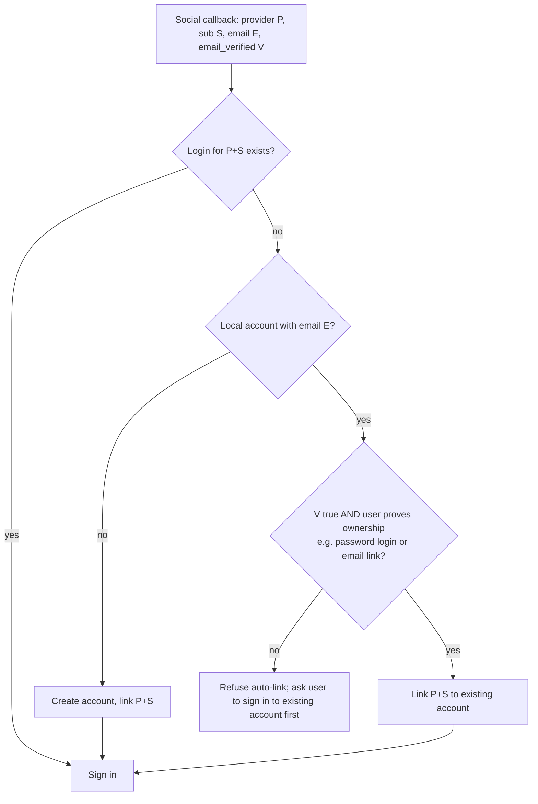
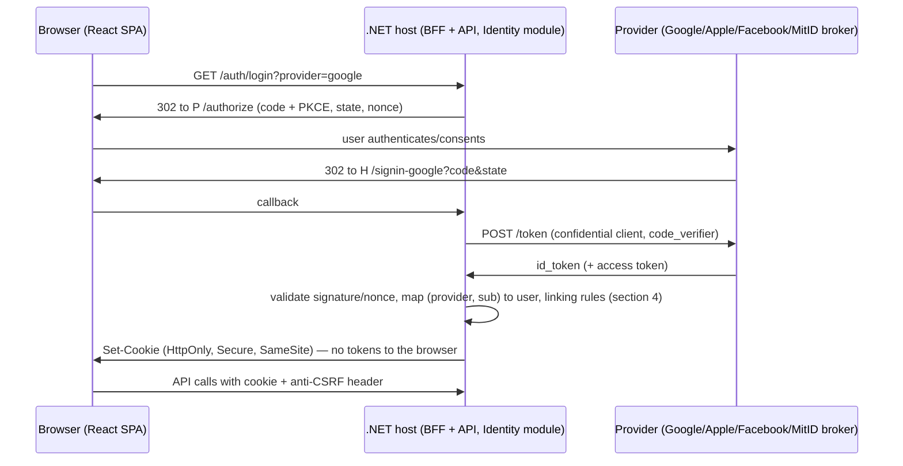
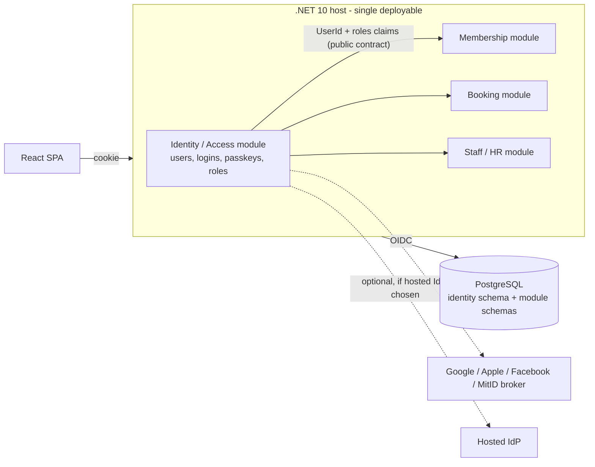

# Authentication & Login — Research

**Date:** 2026-11-13 · **Status:** research input, **not a decision** · **Scope:** member + staff login for one Danish fitness center (D-001), React+TS SPA + .NET 10 API + PostgreSQL (D-007), modular monolith (D-008), Aspire local dev (D-009).
**Builds on (not repeated):** [tech-stack.md §2.7](tech-stack.md), [integrations-and-architecture.md §3.6 + Errata 3](integrations-and-architecture.md), [compliance-legal-security.md SEC-03/05/16 + Errata](compliance-legal-security.md), [verification-report-wave1.md](verification-report-wave1.md) (I-33, I-34, C-28).

**Evidence rules used here:** every claim has a source ID [Ax]. *Anecdote* = forum/community/self-published post. **UNVERIFIED** = not confirmed against a primary source in this pass. Budget was ~20 tool calls, so several vendor facts were only seen in search snippets; they are labelled.

---

## 1. Executive summary

1. **No Danish or fitness-specific usage data for social login was found.** The only prevalence data is a self-published audit of 289 apps: email 72.7%, Google 48.8%, Apple 43.6%, Facebook 22.1% [A14] (*anecdote-grade, small sample*). A web-tech tracker counts Facebook Login on most sites that embed any social login [A15], but it measures embedding, not user preference. Danish competitors seen (SATS, PureGym) document username/password login; no social or MitID login was found for them [A16][A17] (absence of evidence, not proof).
2. **Google + Apple + email/password is the evidence-supported core set.** Apple matters only if a native iOS app ever exists. Then App Store guideline 4.8 requires an equivalent privacy-preserving login option whenever a third-party social login is the primary account login. Exemptions include apps that use only their own account system and apps that use a government eID [A4].
3. **Facebook Login carries the most friction.** Meta's docs (search snippets) say Advanced Access needs Business Verification, and that consumer apps get `email`/`public_profile` automatically, with Ongoing Review to keep access [A6][A7]. A community post reports 10+ days stuck in business verification [A8] (*anecdote*). Meta is a US recipient, so transfers rely on the EU-US Data Privacy Framework (DPF). The General Court upheld the DPF on 3 Sep 2025 (T-553/23), and an appeal is pending at the CJEU (C-703/25 P) [A9][A10]. **The DPF can still fall.**
4. **GitHub has no evidence of relevance to gym members.** It is listed in no consumer-app audit found. Its only plausible use is developer/staff convenience (UNVERIFIED need).
5. **MitID (via a broker such as Idura) is not a "social login".** It is useful when the center must *know* who the person is or their age (e.g. minors' memberships, contract signing). Idura costs €0.037 per MitID authentication plus €67/€220/€400 per month (1k/5k/10k logins), excl. VAT. Onboarding fees "may apply" [A12]. Idura can return `birthdate`/`age`, and CPR only when enabled, plus an age-verification flow (`acr_values=urn:age-verification`) [A13]. MitID-only login also satisfies Apple's 4.8 eID exemption [A4].
6. **Passkeys are built into ASP.NET Core Identity in .NET 10.** They support passwordless signup and sign-in, but **only the Blazor template ships the UI**. Passkeys are a primary factor, not 2FA, and attestation is not validated by default [A1]. A React SPA must build its own WebAuthn UI and endpoints.
7. **SPA pattern: BFF (cookies; no tokens in the browser).** The IETF browser-based-apps work is now **RFC 10017 / BCP 212 (Aug 2026)**, formerly draft-ietf-oauth-browser-based-apps-27. It "strongly recommend[s]" BFF for "business applications, sensitive applications" [A2]. A single-origin .NET app with cookie auth is effectively that pattern.
8. **Password policy (NIST SP 800-63B-4):**
   - At least 15 characters if the password is the only factor; at least 8 if used within MFA.
   - Allow at least 64 characters.
   - No composition rules and no periodic rotation.
   - Check against a blocklist and allow password managers.
   - At most 100 consecutive failed attempts per authenticator [A3].
   - ASVS 5.0 V6 (L1) asks for a minimum of 8 characters (15 recommended) and a check against the top 3,000 passwords; L2 adds a breached-password check [A5].
9. **Cost at our scale is ~€0 for most options.** Hosted free tiers are well above one center's likely member count (Entra External ID core free to 50k MAU [A18]; Supabase 50k MAU; Firebase/Identity Platform 50k MAU; Zitadel 100 DAU free (verify) [A19]). The exception is **Duende IdentityServer**: Lite is $480/month billed annually (≈$5,760/yr) and the Community Edition is only "for qualifying startups and non-profits" [A11].
10. **EU residency:**
    - In-process ASP.NET Identity keeps everything in our own Postgres.
    - Zitadel Cloud lists EU residency [A19].
    - Auth0 supports EU tenants per forum posts (*anecdote*, UNVERIFIED for the free plan) [A20].
    - **Clerk states it offers no regional data residency (US-hosted, DPF)** [A21].
    - Entra External ID EU tenant location: UNVERIFIED [A18].

---

## 2. Providers (question 1)

### 2.1 Provider table

| Provider | Usage evidence | Setup requirements | Cost | Data returned | GDPR notes |
|---|---|---|---|---|---|
| **Email + password (local)** | On 72.7% of 289 audited apps [A14] (*anecdote-grade*) | None external; needs email delivery for verification/reset | Email-sending cost only | What we collect | Data stays in our DB |
| **Google** | 48.8% of audited apps [A14] | Google Cloud OAuth client + consent screen. Brand/verification review for basic scopes: **UNVERIFIED** (not fetched) | Free (UNVERIFIED, not fetched) | OIDC `sub`, `email`, `email_verified`, name, picture (standard OIDC; Google-specific confirmation **UNVERIFIED**) | US controller/recipient; transfer basis = DPF (pending CJEU) [A9][A10] |
| **Apple (Sign in with Apple)** | 43.6% of audited apps; tracks Google closely, likely because of guideline 4.8 [A14] | Apple Developer Program membership (fee and web-only setup **UNVERIFIED**, not fetched) | Developer Program fee (UNVERIFIED) | Name and email, with the option to hide the email (relay) — this is the 4.8 standard [A4] | Same DPF caveat |
| **Facebook / Meta** | 22.1% of audited apps [A14]; top in a site tracker that counts embeds [A15] | Meta app. Business Verification is needed for Advanced Access. Consumer apps get `email` + `public_profile` automatically. Ongoing Review [A6][A7]. Verification delays of 10+ days reported [A8] (*anecdote*) | Free (UNVERIFIED) | `public_profile`, `email` [A7] | Highest privacy/reputational exposure (UNVERIFIED as legal risk); DPF caveat [A9][A10] |
| **Microsoft (personal accounts)** | No data found | Entra app registration (UNVERIFIED) | Free (UNVERIFIED) | OIDC standard claims (UNVERIFIED) | DPF caveat |
| **GitHub** | Not found in any consumer audit | OAuth app (UNVERIFIED) | Free (UNVERIFIED) | Not OIDC; email may be private (UNVERIFIED) | Little member relevance found |
| **MitID (via Idura)** | Danish national eID; no fitness-login usage found [A16][A17] | Idura account. Registration and "basic requirements" before production [A12] | €0.037/auth + €67–400/month; onboarding fee possible [A12] | `birthdate`, `age`; CPR only if enabled; age-verification flow [A13] | Broker is an EU processor (Idura, DK — UNVERIFIED domicile). CPR is a national ID number with its own DK rules (see compliance file; specific rule UNVERIFIED here) |
| **Passkeys** | No consumer usage data found in this pass | Built into ASP.NET Core Identity .NET 10 [A1] | Free | Public-key credential only | No third party involved. NIST allows syncable authenticators at AAL1/AAL2, not AAL3 [A3] |

### 2.2 When MitID is legally useful
- **Age:** the compliance file's member data includes guardians and minors. MitID age verification gives a broker-attested age [A13]. Whether any Danish rule *requires* age verification for gym membership: **UNVERIFIED** (open question).
- **Bookkeeping:** "MitID validation" in BEK 811/2026 applies to *registered bookkeeping systems*, not member login (compliance Errata 6). It is not a reason for MitID login.
- **Apple 4.8:** an app that logs in *only* with a government eID is exempt from offering Sign in with Apple [A4].

---

## 3. Implementation options in .NET 10 (question 2)

**SPA integration patterns (RFC 10017, ex-draft-27) [A2], in decreasing order of security:**
1. **BFF:** the server is a confidential client and the browser holds only a cookie.
2. **Token-mediating backend:** the browser receives access tokens; refresh tokens stay on the server.
3. **Browser-only public client:** the SPA does the whole OAuth flow and holds its own tokens.

BFF is "strongly recommended for business applications, sensitive applications" (§6.1.4.3).

| Option | Effort (single dev + agents) | Cost at our scale | EU residency | SPA pattern | Lock-in | Agent-friendliness |
|---|---|---|---|---|---|---|
| **ASP.NET Core Identity + external providers (+ passkeys)** | Medium. Built-in hashing, lockout and 2FA (TOTP) (UNVERIFIED in this pass; see tech-stack T3). Passkey **UI is Blazor-only**, so React needs custom WebAuthn work [A1] | €0 | Full (our Postgres) | Same-origin cookie = BFF-equivalent [A2] | Low (open source, our schema) | High: plain C#, heavily documented. *Judgement:* agents also write security-sensitive flows (UNVERIFIED claim, owner's risk) |
| **Keycloak (self-hosted)** | Medium–high: an extra JVM service + its own DB (tech-stack §2.7) | €0 licence (Apache-2.0: **UNVERIFIED**, not fetched) + hosting | Full (self-hosted) | OIDC; pair with a BFF in .NET | Medium (standard OIDC, Keycloak-specific config/themes) | Medium: config is UI/JSON realm export, less code-checkable |
| **Duende IdentityServer** | High: you build an IdP on top of Identity | Lite ≈$5,760/yr; Standard ≈$12,504/yr; Community only for "qualifying startups and non-profits" [A11] | Full | Duende BFF included (2 frontends on Lite) [A11] | High (commercial licence) | High (C#) |
| **OpenIddict** | High: low-level OIDC server framework | €0 (Apache-2.0: **UNVERIFIED**) | Full | OIDC + BFF | Low–medium | Medium (fewer examples: UNVERIFIED) |
| **Auth0** | Low | Free to 25k MAU (tech-stack T10; verification report said not checked against vendor: **UNVERIFIED**) | EU tenant possible per forum [A20] (*anecdote*); free-plan EU **UNVERIFIED** | Hosted login + BFF | High (rules/actions, user export) | Medium |
| **Entra External ID** | Low–medium | Core free to 50k MAU [A18] | EU tenant location **UNVERIFIED** [A18] | OIDC + BFF | High | Medium |
| **Clerk** | Low (React-first) | Free to 50k MRU (I-33) | **No regional residency; US + DPF** [A21] | Primarily browser-SDK (pattern detail UNVERIFIED) | High | Medium |
| **Firebase Auth / Identity Platform** | Low | First 50k MAU free (third-party summaries, UNVERIFIED) [A22] | UNVERIFIED | Browser SDK tokens (ID tokens to API) — not BFF (UNVERIFIED) | High (Google) | Medium |
| **Supabase Auth** | Low–medium; tied to the Supabase platform (integrations §3.6) | 50k MAU free (third-party, UNVERIFIED) [A22] | EU regions for Supabase projects: UNVERIFIED | Browser tokens (UNVERIFIED) | High | Medium |
| **Zitadel Cloud** | Low–medium | Free tier 100 DAU; Pro $100/month (search summary of the vendor page; verify) [A19] | EU listed on the pricing page [A19] | OIDC + BFF | Medium (OSS self-host exit path: UNVERIFIED licence) | Medium |

**Hosted IdPs and our processors:** every hosted IdP becomes a processor with a DPA (compliance file). US-owned vendors add DPF/transfer exposure [A9][A10].

---

## 4. Account linking, verification, policy (question 3)

- **Identity key:**
  - Identify external users by **(provider, subject)**, never by email alone. This is ASVS 6.8.1 (L2) [A5].
  - Link a social login to an existing local account only when the provider says the email is verified (`email_verified`, OIDC standard; provider guarantees **UNVERIFIED**) **and** the user proves control of the existing account (logs in or clicks a verification email).
  - Auto-linking on email match is a known account-takeover vector (general practice; no source fetched: **UNVERIFIED**).
- **Email verification:** required before local accounts are active. ASVS L3 6.3.6 says email must not be an authentication factor [A5]. A magic link would only be acceptable at L1/L2 (inference).
- **Password policy:**
  - NIST 800-63B-4 §3.1.1.2: at least 15 characters (password-only) or 8 (with MFA); allow 64+; Unicode; no composition rules; no rotation; blocklist; allow paste and password managers [A3].
  - ASVS 6.2.1–6.2.12 [A5].
- **MFA for staff/admin:**
  - ASVS 6.3.3 (L2) requires MFA [A5]. The compliance file has SEC-03.
  - Options: passkey (phishing-resistant), or TOTP.
  - .NET 10 passkeys are a primary factor, not 2FA [A1]. So "staff must use passkey" is a policy we enforce in code.
  - SMS OTP only with validated numbers and disclosed risk (ASVS 6.6.1) [A5].
- **Brute force:**
  - At most 100 consecutive failures per NIST [A3].
  - Document controls that don't enable malicious lockout (ASVS 6.1.1, 6.3.1) [A5].
  - Add rate limiting (SEC-16).
- **Recovery:**
  - No secret questions (ASVS 6.4.2; NIST item 8) [A3][A5].
  - Reset must not bypass MFA (6.4.3).
  - Lost MFA → re-proofing (6.4.4). For staff, this is in-person proofing by the owner (inference).
  - A passkey-only account needs a backup method; the .NET template forces one [A1].
- **Staff vs members — one store or two:**
  - **One store with roles** is simplest. Staff get MFA enforced by role.
  - **Two stores** isolate admin from the public signup surface.
  - No source compared the two for this scale. *Judgement, not evidence.*



---

## 5. Security baseline — OWASP ASVS 5.0 V6 (question 4)

ASVS 5.0.0 was released May 2025 (C-28). The requirement list below comes from the official GitHub `0x15-V6-Authentication.md` [A5].

| Level | Requirements relevant here |
|---|---|
| **L1** | 6.1.1 document anti-brute-force without malicious lockout · 6.2.1 at least 8 chars (15 recommended) · 6.2.2/6.2.3 change password with current password · 6.2.4 top-3,000 blocklist · 6.2.5 no composition rules · 6.2.6 masked input · 6.2.7 allow paste/password managers · 6.2.8 no truncation · 6.3.1 brute-force controls · 6.3.2 no default accounts · 6.4.1 random, expiring initial secrets · 6.4.2 no hints/secret questions |
| **L2** | 6.1.2/6.2.11 context word list · 6.1.3 document all auth pathways · 6.2.9 allow 64+ chars · 6.2.10 no forced rotation · 6.2.12 breached-password check · 6.3.3 MFA · 6.3.4 no undocumented pathways · 6.4.3 reset can't bypass MFA · 6.4.4 MFA-loss re-proofing · 6.5.1–6.5.5 OTP/TOTP hygiene · 6.6.1–6.6.3 SMS/OOB rules · 6.8.1 IdP+user ID · 6.8.2 validate signatures · 6.8.4 check `acr`/`amr`/`auth_time` |

Which level applies is open. The compliance file's mapping of levels is UNVERIFIED (SEC-03). *Suggestion for the owner to decide:* L2 for staff/admin paths.

---

## 6. Diagrams

### 6.1 Social OIDC login via BFF (same-origin .NET host)


### 6.2 Local email/password login
```mermaid
sequenceDiagram
  participant B as Browser (React SPA)
  participant H as .NET host (Identity module)
  participant DB as PostgreSQL (identity schema)
  B->>H: POST /auth/login {email, password}
  H->>H: rate limit / lockout check (NIST max 100; ASVS 6.3.1)
  H->>DB: load user + password hash
  H->>H: verify hash; email confirmed?
  alt staff role or MFA enabled
    H->>B: 200 "second factor required"
    B->>H: POST /auth/mfa {TOTP or passkey assertion}
  end
  H->>B: Set-Cookie (session)
```

### 6.3 Placement inside the modular monolith (D-008)

Other modules depend only on a `UserId` and role claims. A later switch from Identity to a hosted IdP then touches only the Identity module (design inference, not sourced).

---

## 7. Evidence-weighted ranking — NOT A DECISION

The ranking weighs the owner's requirement, cost at our scale, EU residency, the SPA pattern in RFC 10017, and lock-in. **The owner decides.**

**Implementation**
1. **ASP.NET Core Identity in-process + external providers + passkeys, served as a same-origin BFF.** Evidence: €0, data in our DB, BFF-equivalent [A2], passkeys built in [A1]. Main cost: custom React passkey UI; we own the security surface.
2. **Zitadel Cloud (EU) or Auth0 (EU tenant) behind a .NET BFF.** Evidence: free at our scale, EU listed/possible [A19][A20]. Cost: a processor DPA and lock-in. Auth0 EU-on-free is anecdote.
3. **Keycloak self-hosted.** Free but an extra service to operate.
- Lower: Entra External ID (EU residency unverified), Firebase/Supabase (browser tokens, platform tie-in; unverified), Clerk (no EU residency [A21]), Duende (≈$5.8k+/yr [A11]), OpenIddict (most build effort).

**Providers**
1. Email/password + passkeys.
2. Google.
3. Apple (mandatory-ish only with a native iOS app [A4]).
4. MitID only if age/identity is needed.
5. Facebook (business verification friction [A6][A8], DPF risk).
6. Microsoft and GitHub (no member evidence).

---

## 8. Risks

| # | Risk | Source |
|---|---|---|
| R1 | The DPF is struck down by the CJEU (C-703/25 P), which affects Google/Apple/Meta and any US-hosted IdP (Clerk) | [A9][A10][A21] |
| R2 | Meta business verification or Ongoing Review blocks or removes Facebook Login | [A6][A7][A8] |
| R3 | Account takeover through naive email-based auto-linking | ASVS 6.8.1 [A5]; practice UNVERIFIED |
| R4 | Self-owned auth code written by agents contains security bugs (we own the surface) | tech-stack §2.7; judgement |
| R5 | .NET passkey UI is Blazor-only, so the React WebAuthn work is custom; attestation is not validated by default | [A1] |
| R6 | Adding a native iOS app later triggers guideline 4.8 (must add Apple or an equivalent) | [A4] |
| R7 | Hosted-IdP price, tier or residency changes (several figures here are third-party/unverified) | [A19][A20][A22] |
| R8 | MitID costs scale per login if used for every login rather than once at signup | [A12] |
| R9 | Duende licence cost if chosen, or if the Community eligibility is misread | [A11] |

---

## 9. Sources

- [A1] Microsoft Learn — Enable WebAuthn passkeys in ASP.NET Core (aspnetcore-10.0, updated 2026-10-31) — https://learn.microsoft.com/en-us/aspnet/core/security/authentication/passkeys/?view=aspnetcore-10.0
- [A2] IETF — OAuth 2.0 for Browser-Based Applications, RFC 10017 / BCP 212 (Aug 2026; ex-draft-ietf-oauth-browser-based-apps-27) — https://datatracker.ietf.org/doc/draft-ietf-oauth-browser-based-apps/ *(RFC number as reported by the datatracker page fetch; RFC page itself not opened)*
- [A3] NIST SP 800-63B-4 (Rev. 4) — https://pages.nist.gov/800-63-4/sp800-63b.html (§3.1.1.2, §3.2.2, §2.3.2)
- [A4] Apple App Store Review Guidelines §4.8 Login Services — https://developer.apple.com/app-store/review/guidelines/#login-services
- [A5] OWASP ASVS 5.0 V6 Authentication — https://github.com/OWASP/ASVS/blob/master/5.0/en/0x15-V6-Authentication.md
- [A6] Meta — Graph API access levels (search snippet only) — https://developers.facebook.com/documentation/development/graph-api/overview/access-levels
- [A7] Meta — App Review submission guide / Facebook Login for Business (search snippets only) — https://developers.facebook.com/docs/resp-plat-initiatives/individual-processes/app-review/submission-guide ; https://developers.facebook.com/docs/facebook-login/facebook-login-for-business/
- [A8] *Anecdote:* Meta community forum, business verification 10+ days — https://communityforums.atmeta.com/questions-and-discussions-26/business-verification-in-review-10-days-blocking-app-review-submission-177498
- [A9] WilmerHale — CJEU to review DPF challenge (1 Dec 2025) — https://www.wilmerhale.com/en/insights/blogs/wilmerhale-privacy-and-cybersecurity-law/20251201-european-court-of-justice-to-review-challenge-to-eu-us-data-privacy-framework
- [A10] Digital Policy Alert — Latombe appeal C-703/25 P — https://digitalpolicyalert.org/event/35459-latombe-filed-appeal-against-general-court-dismissal-of-challenge-to-european-unionunited-states-data-protection-framework-adequacy-decision-in-latombe-v-commission ; Microsoft intervention (28 Jun 2026) — https://ieu-monitoring.com/editorial/microsoft-backs-eu-commission-in-eu-court-case-on-transatlantic-data-flows-and-privacy/1244467/
- [A11] Duende pricing — https://duendesoftware.com/pricing ; product/add-ons — https://duendesoftware.com/products/identityserver
- [A12] Idura Verify pricing — https://idura.eu/pricing/verify
- [A13] Idura docs — token contents, age verification, Danish MitID — https://docs.idura.app/verify/reference/token-contents/ ; https://docs.idura.app/verify/guides/age-verification/ ; https://docs.idura.app/verify/e-ids/danish-mitid/ *(search snippets)*
- [A14] *Self-published audit (anecdote-grade):* Lazyweb, "What percentage of apps offer Sign in with Apple vs Google vs Email" (Jul 2026, n=289) — https://experiments.lazyweb.com/research/sign-in-with-apple-vs-google-vs-email-prevalence.md
- [A15] aguko — social login usage (Denmark page) — https://www.aguko.com/cat/social-logins/dk *(snippet; embed counts, not preference)*
- [A16] SATS app terms/privacy — https://www.sats.dk/legal/terms-and-conditions-for-the-sats-app-english ; https://www.sats.dk/legal/privacy-policy-english-version
- [A17] PureGym DK member terms (2020) — https://mit.puregym.dk/media/Medlemsbetingelser/PureGym-medlemsbetingelser-10062020-en.pdf
- [A18] Microsoft — Entra External ID pricing — https://learn.microsoft.com/en-gb/entra/external-id/external-identities-pricing ; https://azure.microsoft.com/en-gb/pricing/details/microsoft-entra-external-id
- [A19] Zitadel pricing — https://zitadel.com/pricing *(search summary, not fetched)*
- [A20] *Anecdote:* Auth0 community — tenant data locations — https://community.auth0.com/t/customer-data-locations/104690 ; https://community.auth0.com/t/replace-my-only-free-us-5-tenant-with-an-eu-tenant-confirmation-before-deletion/204243
- [A21] Clerk security page — https://clerk.com/security *(search summary)*
- [A22] Third-party pricing summaries (UNVERIFIED vs vendor): https://supertokens.com/blog/firebase-pricing ; https://www.casdoor.com/blog/supabase-auth-pricing

---

## 10. Open questions for the project owner

1. Is a **native iOS/Android app** planned? If yes, App Store 4.8 makes Sign in with Apple (or equivalent) effectively mandatory alongside Google/Facebook.
2. Is **Facebook Login** worth Meta Business Verification + Ongoing Review and DPF exposure, given the weaker evidence of use?
3. Is **GitHub/Microsoft** login wanted for members, or only for staff?
4. Must the center **verify age or identity** (minors, guardian consent, contracts)? If so, MitID via a broker (~€0.037/login + €67+/month) at signup only?
5. **Own login (ASP.NET Identity, data in our DB) or hosted IdP** (extra processor + DPA, lock-in)? Is EU-only data residency a hard requirement?
6. **One identity store with roles** for staff and members, or separate stores?
7. Target **ASVS level**: L1 for members and L2 for staff/admin?
8. Is MFA **mandatory for staff** (passkey or TOTP)? Optional for members?
