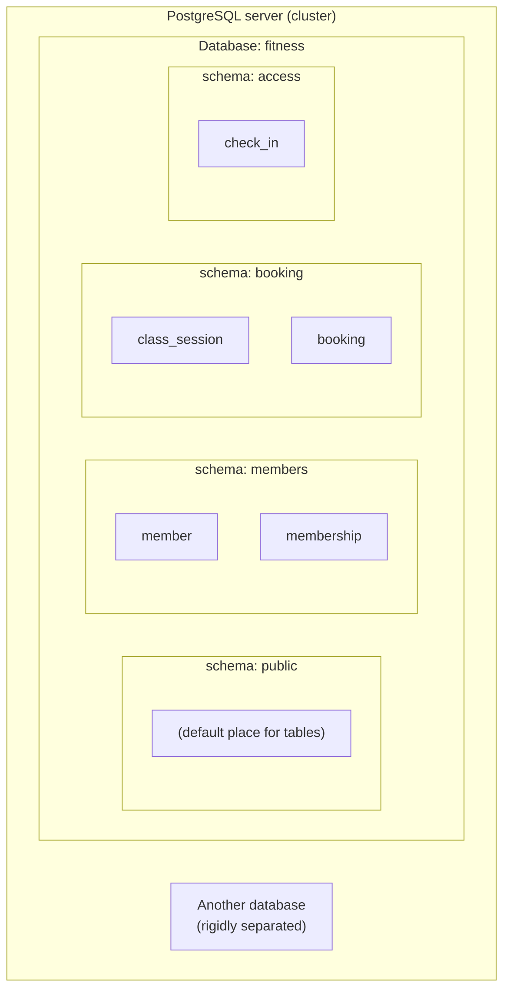
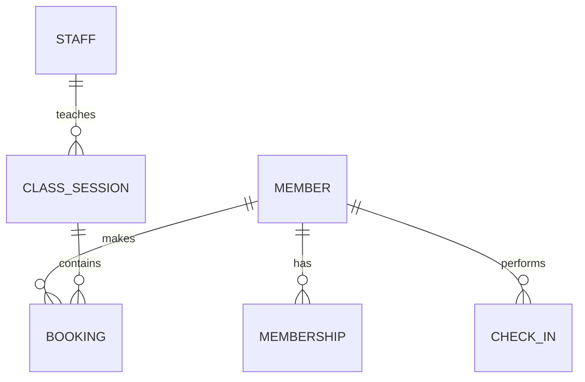
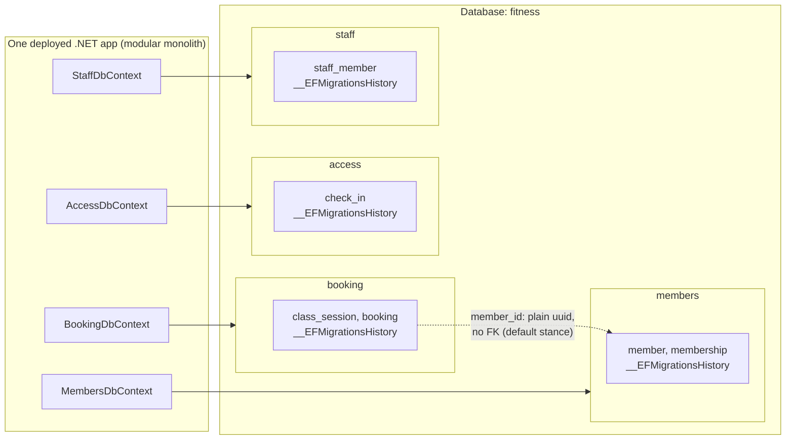
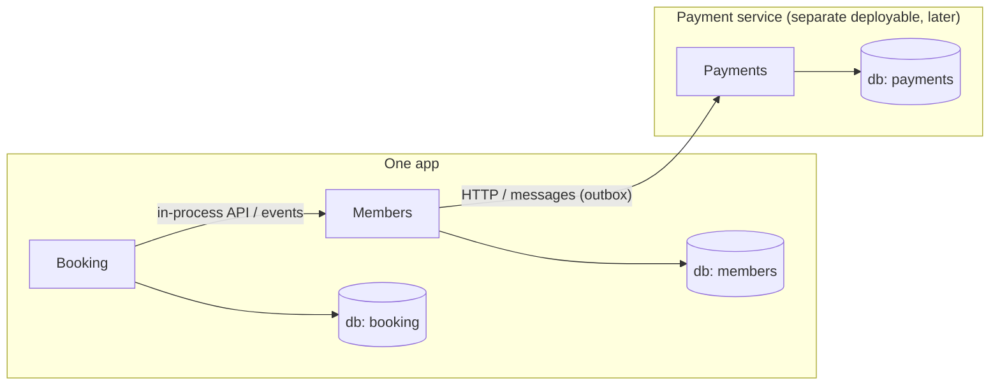
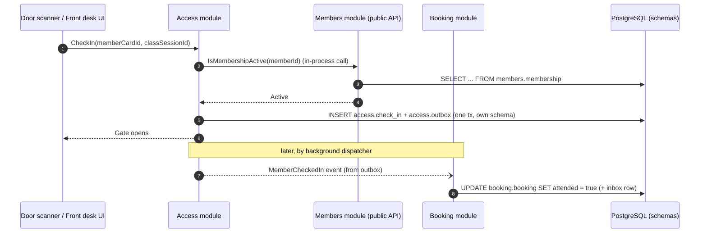
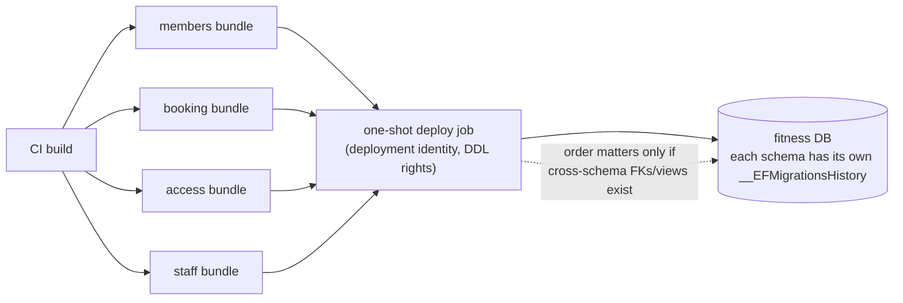
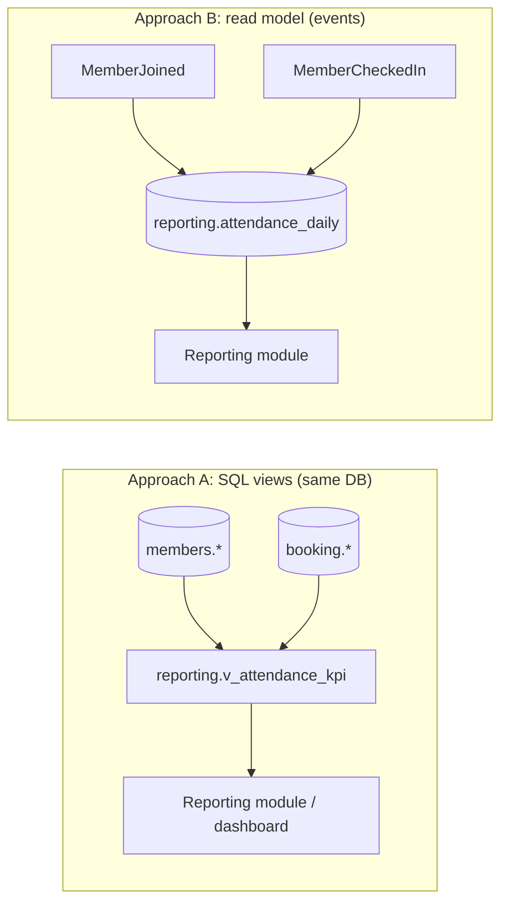
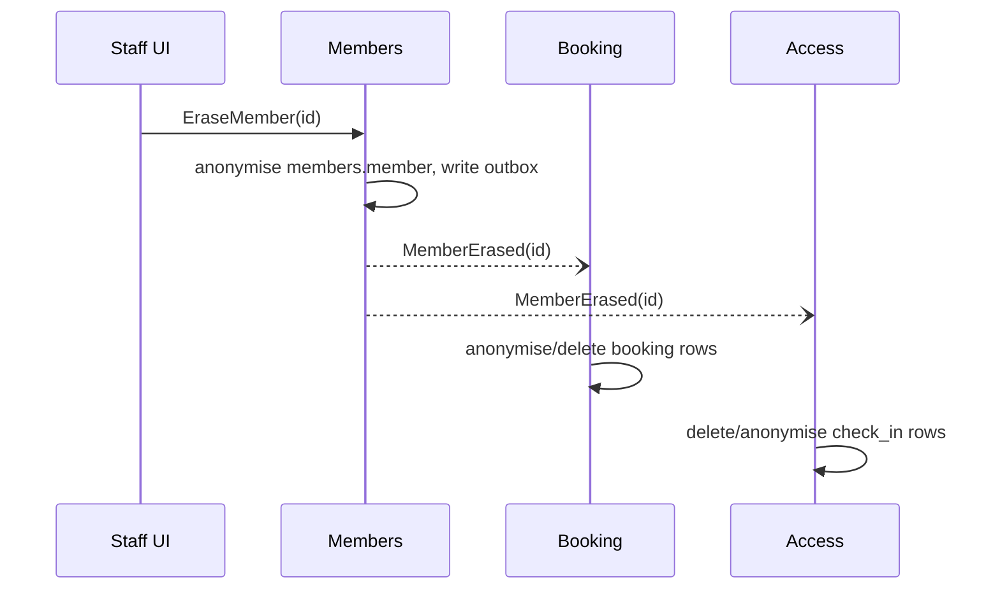
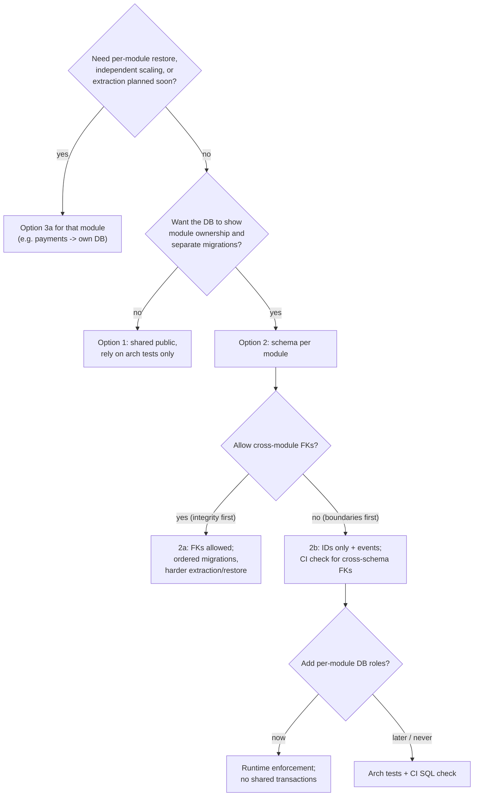

# Database schema options for the modular monolith (SA6)

- **Date:** 2026-11-13
- **Status:** Research. **This is not a decision.** It feeds open question SA6 (see [decisions.md](../decisions.md), D-007, D-008, D-009).
- **Scope:** one PostgreSQL database, EF Core on .NET 10, modules Members, Booking, Access/Check-in and Staff, plus a payment service that will be deployed separately later.
- **Evidence rules:** every claim has a source in brackets, for example [S1]. **UNVERIFIED** marks a claim that I did not confirm in a source during this research. **Inference** marks my own reasoning from sourced facts. **Practitioner opinion** marks blog or sample-repo views, which are not official documentation.

> **Verification (FIT-36, 2026-11-24).** The owner decided D-014 (schema per module, FKs allowed) and D-015 (transactions may span modules), and the code now implements both. FIT-36 checked each UNVERIFIED item below against the code, a new integration test or an official doc page (open question DB8). This section takes precedence over the text further down, which is left as originally written.

## Verification (FIT-36)

The new tests are in [`tests/FitnessCenter.IntegrationTests/ModuleSchemaTests.cs`](../../tests/FitnessCenter.IntegrationTests/ModuleSchemaTests.cs). They run against PostgreSQL 18 in Testcontainers, like the other integration tests.

| # | Item (section) | Result | Evidence |
|---|---|---|---|
| V1 | `UseNpgsql(..., npgsql => npgsql.MigrationsHistoryTable("__EFMigrationsHistory", schema))` overload shape (§3) | **Verified** | Compiles and runs in all four modules, e.g. `src/Modules/Members/Members/MembersModule.cs`. Test `Every_module_context_keeps_its_tables_and_history_in_its_own_schema` checks every registered DbContext's history-table schema and finds `__EFMigrationsHistory` in exactly the module schemas. The method is EF Core's relational API [S2]. The Npgsql EF docs (https://www.npgsql.org/efcore/) do not mention it. |
| V2 | `HasDefaultSchema` puts every table in the module's schema; a context that forgets it would use `public` (§6 pitfall) | **Verified** | Same test: every entity of every context maps to its context's schema, no two contexts share a schema, and the migrated database has no tables in `public`. A new context without a schema fails this test. |
| V3 | EF Core emits schema-qualified SQL, so `search_path` is not consulted (§11) | **Verified** | Test `Queries_name_the_schema_and_do_not_depend_on_the_search_path`: the generated query contains the provider's delimited `schema.table` name, and queries succeed on a connection whose `search_path` does not include the module schemas. |
| V4 | One transaction across module DbContexts (§5) | **Verified** for the pattern the code uses | The code shares one `NpgsqlConnection` per request (`src/FitnessCenter.Api/Database/DatabaseExtensions.cs`) and wraps cross-module writes in a `TransactionScope` (`src/Modules/Members/Members/Application/SignupHandler.cs`). Test `A_rolled_back_transaction_across_two_modules_leaves_both_schemas_untouched` writes through the Booking and Members contexts, sees both rows from the other context inside the scope, and finds neither after a rollback. Existing test `SignupTests.Failure_after_the_account_is_created_leaves_no_account_behind` covers the same rollback through the real signup. The §5 code sample (`BeginTransaction` + `UseTransaction`) is not used and not tested. |
| V5 | Whether Npgsql escalates `TransactionScope` to a distributed transaction (§5) | **Verified for one shared connection; two separate connections stay UNVERIFIED** | The rollback test asserts `DistributedIdentifier` is empty, so no escalation happens with the shared connection. The Npgsql transactions page (https://www.npgsql.org/doc/transactions.html) returned 404, so the two-connection case was not checked. The code never opens a second connection inside a scope. |
| V6 | `--context` flag of `dotnet ef` (§6) | **Verified** | CI runs `dotnet ef migrations has-pending-model-changes --context "${module}DbContext"` per module (`.github/workflows/ci.yml`, step "Migrations are up to date"), and CLAUDE.md's `migrations add` command uses it. |
| V7 | Future tables need `ALTER DEFAULT PRIVILEGES` (§9) | **Verified** (docs); not used | "`ALTER DEFAULT PRIVILEGES` allows you to set the privileges that will be applied to objects created in the future. (It does not affect privileges assigned to already-existing objects.)" It applies to objects "created by the *target_role*, or the current role if unspecified" (https://www.postgresql.org/docs/current/sql-alterdefaultprivileges.html). The GRANT page does not say in so many words that `ALL TABLES IN SCHEMA` covers existing tables only (https://www.postgresql.org/docs/current/sql-grant.html); that part is inference from the quote above. Not used: there is one database role, because D-015 rules out per-module roles in v1. |
| V8 | A cross-schema FK needs the REFERENCES privilege (§4, §13; also D-014 "Known costs") | **Verified** (docs); not used | REFERENCES "Allows creation of a foreign key constraint referencing a table, or specific column(s) of a table" (https://www.postgresql.org/docs/current/ddl-priv.html). Matters only if per-module roles come later (DB3). |
| V9 | `pg_constraint` columns in the cross-schema-FK query (§13) | **Verified** (docs); query not used | `contype` `f` = foreign key, `conrelid` = the table the constraint is on, `confrelid` = the referenced table (https://www.postgresql.org/docs/current/catalog-pg-constraint.html); `pg_class.relnamespace` = the schema (https://www.postgresql.org/docs/current/catalog-pg-class.html). D-014 allows cross-module FKs, so the CI check that would use this query is not needed. |
| V10 | `postgres_fdw` (§4) and the mailing-list quotes (§11) | **Still UNVERIFIED** | Out of scope: D-014 keeps one database, and V3 makes `search_path` length irrelevant to EF's queries. |

---

## 1. Executive summary (plain language)

- A PostgreSQL **schema** is a **folder for tables inside one database**. It does not mean "the table design". Putting each module's tables in its own folder (`members.*`, `booking.*`) costs almost nothing. It makes ownership visible, and it lets each module run its own EF Core migrations [S1][S3][S4].
- Schemas **do not stop** cross-module queries on their own. PostgreSQL lets any query reach any schema the user has rights to [S1]. Real enforcement comes from three things: architecture tests, review of migrations, and optionally a separate database login (role) per module [S1][S8].
- The main trade-off is **referential integrity versus independence**. A foreign key from `booking` to `members` protects the data, but it ties the two modules together. Migrations then have to run in order, per-schema restores can fail, and extracting a module gets harder [S10] (inference).
- **Performance:** no source shows a meaningful runtime cost from using a handful of schemas. The only documented costs involve long `search_path` lists or many schemas in that path [S1][S11][S12]. EF Core can schema-qualify every table, which avoids the issue [S3] (see §11).
- **Database-per-module or per-service** gives the strongest isolation. But it rules out joins and transactions across modules, and it adds operations work [S9]. Two practitioners recommend starting with schema-per-module [S8][S9] (practitioner opinion).
- **Leaning (not a decision):** schema-per-module, one DbContext and one migrations-history table per module, no foreign keys or joins across modules by default, and architecture tests from day one. Per-module database roles can be added later. Section 14 lists the trade-offs the owner has to settle.

---

## 2. What is a PostgreSQL "schema"?

There are two different meanings of the word:

| Term | Meaning |
|---|---|
| **"The database schema"** (everyday usage) | The design of the data: tables, columns, keys. EF Core "migrations" change *this*. |
| **A PostgreSQL schema** (`CREATE SCHEMA`) | A **named namespace inside one database**. It holds tables, views, sequences, types and functions. |

From the PostgreSQL manual, §5.10 [S1]:

> "A database contains one or more named *schemas*, which in turn contain tables. Schemas also contain other kinds of named objects, including data types, functions, and operators."
>
> "Schemas are analogous to directories at the operating system level, except that schemas cannot be nested."
>
> "Unlike databases, schemas are not rigidly separated: a user can access objects in any of the schemas in the database they are connected to, if they have privileges to do so."



Key mechanics [S1]:

- **Qualified names:** `schema.table` "works anywhere a table name is expected". That means a single query can join `members.member` with `booking.booking`.
- **`search_path`:** when a name is not qualified, PostgreSQL searches a list of schemas. The default is `"$user", public`. New tables go in the first schema of the path.
- **Privileges:** "By default, users cannot access any objects in schemas they do not own." Access requires `USAGE` on the schema. Creating objects in it requires `CREATE`.
- **`public` in PostgreSQL 15 and later:** everyone no longer gets the `CREATE` privilege on `public`, unless the database was upgraded from version 14 or earlier.

---

## 3. The options

### Option 1: one shared schema (`public`) and one DbContext



All tables sit in `public` and belong to one model. EF Core creates real foreign keys wherever a navigation property exists. Module boundaries exist only in C# (projects and architecture tests). The database cannot tell which module owns which table (inference from [S1][S3]).

### Option 2: one schema per module, each with its own DbContext and migrations history



```csharp
public sealed class BookingDbContext(DbContextOptions<BookingDbContext> options) : DbContext(options)
{
    public DbSet<ClassSession> ClassSessions => Set<ClassSession>();
    public DbSet<Booking> Bookings => Set<Booking>();

    protected override void OnModelCreating(ModelBuilder b)
    {
        b.HasDefaultSchema("booking");          // [S3] also moves sequences into "booking"
        b.Entity<Booking>().Property(x => x.MemberId); // Guid only, no navigation to Member
    }
}

// Registration (Npgsql provider). The history table goes in the module's own schema [S2][S8]
builder.Services.AddDbContext<BookingDbContext>(o => o.UseNpgsql(
    connectionString,
    npgsql => npgsql.MigrationsHistoryTable("__EFMigrationsHistory", "booking")));
```

> The `MigrationsHistoryTable(name, schema)` API is documented with a SQL Server example [S2]. Milan Jovanović shows the same call for Npgsql [S8]. In the code above, the `UseNpgsql` overload shape is **UNVERIFIED** against the Npgsql docs.

### Option 3 (reference only): database-per-module and database-per-service



- **Database-per-module:** still one app, but every module has its own PostgreSQL database. "There's no way to accidentally join across module boundaries" [S9] (practitioner opinion). Cross-module transactions "are impossible by construction", so you need outbox or saga patterns [S9].
- **Database-per-service:** the same isolation, plus a network between the parts. D-008 already plans this for the future payment service.

---

## 4. Cross-module foreign keys and joins

| | Option 1: shared `public` | Option 2: schema per module | Option 3: database per module or service |
|---|---|---|---|
| Cross-module FK possible? | Yes, and EF creates one by default from navigations | Yes, technically: qualified names work "anywhere a table name is expected" [S1] | No. Schemas "are not rigidly separated" but databases are [S1] |
| Cross-module SQL join possible? | Yes | Yes [S1] | No, not with plain SQL. Extensions such as `postgres_fdw` exist (**UNVERIFIED**, not checked) |
| Grzybek's sample | n/a | "Each Module has its own data in a separate schema - shared data is not allowed" [S5] (practitioner) | "could be moved into separate databases if desired" [S5] |

**Consequences of allowing a cross-schema FK** (for example `booking.booking.member_id → members.member.id`). These are inferences based on [S1][S6][S10]:

1. Migrations become ordered. The Booking migration fails if the Members table does not exist yet.
2. Deleting a member is blocked, or cascades into another module's table. That couples GDPR erasure to the database (§8).
3. Per-schema dumps cannot be restored on their own. The `pg_dump -n` docs warn that there is "no guarantee" of this [S10].
4. Extraction needs the FK dropped first.
5. To model the FK in EF, the Booking context must also map `Member`. The documented way is to mark that table `ExcludeFromMigrations()` so only Members' migrations create it [S3]. That leaks the Member type into Booking's model.

**Referential integrity vs boundary enforcement.** Without the FK, the database no longer guarantees that `member_id` exists. The application has to guarantee it instead: Booking checks with Members through its public API when a booking is created, and it reacts to a `MemberDeleted` or `MemberErased` event (inference). Grzybek's sample accepts this trade-off. Its modules "don't share data" and communicate "only asynchronously using Events Bus" [S5] (practitioner opinion).

```sql
-- If the owner does allow a cross-schema FK, it looks like this:
ALTER TABLE booking.booking
  ADD CONSTRAINT fk_booking_member
  FOREIGN KEY (member_id) REFERENCES members.member (id);
-- The connecting role needs the REFERENCES privilege on members.member (UNVERIFIED, from memory of GRANT docs).
```

---

## 5. Transactions across modules

Within **one database**, a single transaction can span tables in many schemas. EF Core can share that transaction across **different DbContext instances**, but only if they "share both a `DbConnection` and a `DbTransaction`" [S6]:

```csharp
await using var conn = dataSource.CreateConnection();      // one NpgsqlConnection
var bookingOpts = new DbContextOptionsBuilder<BookingDbContext>().UseNpgsql(conn).Options;
var accessOpts  = new DbContextOptionsBuilder<AccessDbContext>().UseNpgsql(conn).Options;

await using var booking = new BookingDbContext(bookingOpts);
await using var tx = await booking.Database.BeginTransactionAsync();

await using var access = new AccessDbContext(accessOpts);
await access.Database.UseTransactionAsync(tx.GetDbTransaction());   // [S6]
// ... write booking.attendance + access.check_in ...
await booking.SaveChangesAsync();
await access.SaveChangesAsync();
await tx.CommitAsync();
```

Caveats:
- If you control transactions manually, that "is incompatible with implicitly invoked retrying execution strategies" [S6].
- `TransactionScope` across **two separate connections** escalates to a distributed transaction. .NET supports those "for Windows only" [S6]. Whether Npgsql escalates in exactly this case is **UNVERIFIED**.
- **Per-module roles (§9) and shared transactions conflict.** Different logins mean different connections, so the transaction cannot be shared (inference from [S6][S8]).
- Practitioner views: Jovanović calls cross-module transactions with schemas "Possible, but discouraged ... an escape hatch, not a feature" [S9]. Grzybek says spanning modules is "not possible nor desirable" [S5]. Both are practitioner opinion.

### Sequence: "member checks in to a class" (Option 2, no shared transaction)



The outbox and inbox follow Grzybek's sample, which uses "two SQL tables and a background worker for each module" and gives at-least-once delivery [S5]. The simpler alternative is a shared-connection transaction (code above), which keeps both writes atomic but couples the two modules.

---

## 6. EF Core specifics and pitfalls

| Topic | What the docs say | Source |
|---|---|---|
| `HasDefaultSchema("x")` | Puts every table of the model in `x`. It "will also affect other database objects, such as sequences." | [S3] |
| Per-table schema | `ToTable("booking", schema: "booking")` | [S3] |
| History table per schema | `MigrationsHistoryTable("__EFMigrationsHistory", "booking")`. **Pitfall:** "If you customize the Migrations history table *after* applying migrations, you are responsible for updating the existing table." Set it before the first migration. | [S2] |
| Same entity in several contexts | `ToTable("...", t => t.ExcludeFromMigrations())`, intended for bounded contexts | [S3] |
| Views | `ToView(...)`: "EF will assume that the referenced view already exists". Create it with `migrationBuilder.Sql`. | [S3] |
| Production apply | Bundle for automation, SQL script when review is needed. "Use a separate identity for deployment that has permission to change the schema." | [S4] |
| Aspire | Use the Aspire EF Core migrations integration (`AddEFMigrations`, `PublishAsMigrationBundle`, `PublishAsMigrationScript`) | [S4] |
| Locking | EF Core 9+ takes a "database-wide lock" when it migrates, including with bundles. SQL scripts do not. | [S4] |
| Pending changes | EF 9+ `Migrate()` throws if the model has unmigrated changes. CI check: `dotnet ef migrations has-pending-model-changes` | [S4] |
| Do not combine | `EnsureCreatedAsync()` before `MigrateAsync()` causes `MigrateAsync()` to fail. Wrapping `MigrateAsync` in an explicit transaction is not supported. | [S4] |

Per-context commands (the `--context` flag is from the EF CLI reference [S7], not re-checked in this session, **UNVERIFIED**):

```bash
dotnet ef migrations add AddBooking --context BookingDbContext --output-dir Migrations
dotnet ef migrations bundle      --context BookingDbContext --output artifacts/booking-efbundle
```



Pitfalls specific to Option 2 (inference unless cited):
- **Forgotten schema.** A new DbContext without `HasDefaultSchema` silently creates its tables in `public`. A test can assert that every table of every context has a schema.
- **Ordering.** Views or FKs across schemas create a dependency between bundles. Run them in a fixed order, or move cross-module views into a final "reporting" step.
- **Several history tables.** "What version is the database?" now has four answers, one per schema.

---

## 7. Reporting and KPI queries that span modules



- **Views:** Jovanović creates a view that joins two module schemas and grants `SELECT` on it to a reporting role. Consumers "cannot access the underlying tables directly". If the database is ever split, the view "will have to be replaced with a service call" [S8] (practitioner opinion). EF can map a keyless entity to the view [S3].
- **Read model:** a projection kept up to date by module events. It survives extraction, but adds code and lag (inference).
- With Option 3 views across modules are impossible, so a read model is the only route (inference from [S1][S9]).

```sql
CREATE SCHEMA reporting;
CREATE VIEW reporting.v_class_attendance AS
SELECT cs.id AS class_session_id, cs.starts_at, count(b.*) FILTER (WHERE b.attended) AS attended
FROM booking.class_session cs
LEFT JOIN booking.booking b ON b.class_session_id = cs.id
GROUP BY cs.id, cs.starts_at;
GRANT USAGE ON SCHEMA reporting TO reporting_role;
GRANT SELECT ON reporting.v_class_attendance TO reporting_role;
```

---

## 8. GDPR erasure across modules



- **Option 1** can lean on `ON DELETE CASCADE`. That is simple, but one module then decides about another module's data (inference).
- **Option 2 without cross-module FKs:** each module handles a `MemberErased` event. The outbox and inbox give at-least-once delivery, so handlers must be idempotent [S5] (practitioner pattern). A per-module "erasure done" record helps prove completion (inference).
- **Option 3:** the same event pattern, across stores. D-008 already lists "GDPR erasure across stores" as a cost of distribution.
- Retention rules (for example bookkeeping data) are out of scope here. See [compliance-legal-security.md](compliance-legal-security.md).

---

## 9. Permissions: per-schema roles as an extra enforcement layer

Jovanović's pattern (practitioner opinion) [S8]:

```sql
CREATE ROLE booking_role LOGIN PASSWORD '...';
CREATE SCHEMA booking AUTHORIZATION booking_role;
GRANT USAGE ON SCHEMA booking TO booking_role;
GRANT SELECT, INSERT, UPDATE, DELETE ON ALL TABLES IN SCHEMA booking TO booking_role;
ALTER ROLE booking_role SET search_path = booking;
```

What this buys: without `USAGE`, a role "cannot access any objects in schemas they do not own" [S1]. A stray `SELECT * FROM members.member` from Booking's connection then fails at runtime with a permission error (inference from [S1]).

Caveats:
- EF docs recommend a **separate deployment identity** with DDL rights and a least-privilege runtime identity [S4]. In the snippet above, the module role *owns* the schema, which mixes the two. A stricter version gives the runtime role DML only.
- `GRANT ... ON ALL TABLES` covers existing tables only. Future tables need `ALTER DEFAULT PRIVILEGES` (**UNVERIFIED**, not checked this session).
- There is one connection string and one Npgsql pool per role, and cross-module shared transactions are impossible (§5) (inference).
- For a ~10-staff, single-developer system, this is extra secrets and configuration to manage under Aspire. That cost is real but not quantified (inference).

---

## 10. Backup and restore

- `pg_dump` "makes consistent exports even if the database is being used concurrently" and "does not block other users" [S10]. But "except in simple cases, pg_dump is generally not the right choice for taking regular backups of production databases" [S10]. In production, the hosting platform's backups matter more (open question).
- Options 1 and 2 restore **all-or-nothing** at the database level. Jovanović says the same about schema-per-module [S9] (practitioner opinion).
- With Option 2 you *can* dump one schema: `pg_dump -n booking`. But pg_dump "makes no attempt to dump any other database objects that the selected schema(s) might depend upon", so there is "no guarantee" it restores alone [S10]. Cross-schema FKs and views make this worse (inference).
- Option 3 restores per module [S9].

---

## 11. Performance: do schemas have a runtime cost?

- The PostgreSQL schema docs mention **no** performance cost. They discuss only security and name resolution [S1].
- Documented costs are about **name lookup through a long `search_path`**. Pavel Stehule (2023) wrote that "with a large number of schemas in the search path, the planning time can be higher" [S11]. A 2004 thread about 3,500 schemas says this is not a problem "as long as you don't put them all into the path" [S12]. In 2020, Tom Lane traced a slowdown to a `citext` operator found through `public` in the search path, not to schemas themselves [S13]. All three are mailing-list posts, not official docs. These quotes and authors come from search-result summaries; I did not open the threads, so they are **UNVERIFIED** at the quote level.
- With `HasDefaultSchema`, EF maps each table to a named schema [S3]. That EF then emits **schema-qualified** SQL (so `search_path` is not consulted) is **UNVERIFIED**. Check with EF logging (`LogTo`) in a spike.
- **Conclusion (confidence: medium):** no source shows a measurable cost for 4–6 schemas. To check, compare planning time with `EXPLAIN ANALYZE` on real queries [S11] (inference).

---

## 12. Later extraction to a separate service (payment)

- **Option 1:** you first have to work out which tables and FKs belong to the module, then untangle them. This is the hardest case (inference).
- **Option 2:** you move one schema into a new database. Jovanović calls this a "Data extraction step required first" and says code changes are configuration only, provided the module has its own DbContext [S9] (practitioner opinion). Any cross-schema FKs or views must be removed first, and views become "a service call" [S8].
- **Option 3:** the data is "Already separated" [S9].
- **For payments specifically:** D-008 already makes it a separate deployable. It could start with its own database from day one, whatever SA6 decides for the monolith's modules (inference).

---

## 13. How coding agents could cross boundaries, and what detects it

| Agent mistake (example) | Option 1 detects? | Option 2 detects? | Option 2 + roles | Option 3 |
|---|---|---|---|---|
| Adds `Booking.Member` navigation property referencing the Members project | Arch test (project reference) | Arch test; also the migration would create the `members.member` table in the wrong context (visible in review) | same | same, and runtime failure |
| Writes raw SQL `JOIN members.member` inside Booking | **No** | **No** (SQL is a string) | **Yes, at runtime**: permission denied [S1] | Yes: object not found |
| Adds FK across modules in a migration | No (it looks normal) | Visible as another schema name in the migration; CI query can fail on it (below) | Fails without REFERENCES (UNVERIFIED) | Impossible |
| Puts a new table in `public` / wrong schema | n/a | Test: every entity has expected schema | same | n/a |
| Calls another module's DbContext via DI | Arch test | Arch test (NetArchTest-style, as in [S5]) | same | same |

Grzybek's sample uses NetArchTest to check layering, dependencies and encapsulation [S5]. Those tests inspect **compiled code**, so they cannot see SQL strings or migration contents (inference). A cheap database-level check for CI (illustrative, untested; `pg_constraint` columns are from memory, **UNVERIFIED**):

```sql
-- Fail CI if any FK crosses schemas
SELECT c.conname, sn.nspname AS from_schema, tn.nspname AS to_schema
FROM pg_constraint c
JOIN pg_class s ON s.oid = c.conrelid  JOIN pg_namespace sn ON sn.oid = s.relnamespace
JOIN pg_class t ON t.oid = c.confrelid JOIN pg_namespace tn ON tn.oid = t.relnamespace
WHERE c.contype = 'f' AND sn.nspname <> tn.nspname;
```

---

## 14. Comparison table

| Criterion | 1. Shared `public` | 2. Schema per module | 3a. DB per module | 3b. DB per service |
|---|---|---|---|---|
| Ownership visible in DB | No | Yes [S1] | Yes | Yes |
| Cross-module FK/join | Easy (default) | Possible, policy decides [S1] | No | No |
| Cross-module transaction | Easy | Possible with shared connection [S6]; discouraged [S9] | No [S9] | No |
| DbContexts / histories | 1 / 1 | N / N [S2][S3] | N / N | per service |
| Migration complexity | Lowest | Low–medium (N bundles) [S4] | Medium | Medium + per-service pipeline |
| DB-level enforcement possible | Weak (table grants) | Yes, per-schema roles [S1][S8] | Strong (separate DBs) | Strongest |
| Reporting across modules | Plain SQL | Views or read model [S8] | Read model only | Read model / API |
| GDPR erasure | Cascades possible | Events (+ optional FKs) | Events | Events across network |
| Backup/restore granularity | Whole DB | Whole DB; per-schema dump not guaranteed [S10] | Per module [S9] | Per service |
| Extraction later | Hardest | Move schema [S9] | Already separate [S9] | Done |
| Runtime cost of the option itself | None | None found [S1][S11][S12] | Extra connections/pools (inference) | Network calls (D-008) |
| Ops overhead | Lowest | Low [S9] | Higher [S9] | Highest |

### Decision flowchart (aid, not a decision)



---

## 15. Evidence-weighted recommendation (**NOT A DECISION**)

**Leaning: Option 2b.** That means one PostgreSQL schema per module, one DbContext per module with `HasDefaultSchema` and its own `__EFMigrationsHistory` in its schema, IDs instead of foreign keys across modules, no cross-module joins in module code, a `reporting` schema of views for KPIs, and architecture tests plus the cross-schema-FK CI query from day one. Defer per-module roles until there is a concrete reason, but keep connection configuration per module so they can be added.

Why, weighted by evidence strength:
1. **Strong (official docs):** schemas cost little and are namespaces with optional privilege enforcement [S1]. EF Core supports per-context schemas, history tables and migration bundles directly [S2][S3][S4].
2. **Strong (official docs):** cross-context transactions remain possible as an escape hatch, as long as roles are not split [S6].
3. **Medium (practitioner opinion):** two independent practitioners use or recommend schema-per-module as the starting point [S5][S8][S9].
4. **Medium (inference):** no cross-module FKs keeps per-schema dumps, extraction and migration order simpler [S10]. The cost is integrity enforced in application code.
5. **Medium (mailing lists):** no runtime penalty at this scale [S11][S12].

Risks of the leaning: more DbContexts and bundles to manage, eventual consistency in check-in and erasure flows, and a lost database-level guarantee that `member_id` exists.

---

## 16. Open questions for the project owner

1. **Cross-module foreign keys:** allow them (integrity) or forbid them (boundaries and extraction)? Should it be a blanket rule or a per-pair exception list?
2. **Cross-module transactions:** is the shared-connection transaction allowed as an escape hatch, for example to make check-in plus attendance atomic? Or should modules use events and an outbox only?
3. **Per-module database roles:** in v1, later, or never? Note that they rule out shared transactions (§5, §9).
4. **Migration deployment:** Aspire `AddEFMigrations` locally, plus one bundle per module or SQL scripts in production [S4]? In which order?
5. **Reporting:** SQL views in a `reporting` schema, or an event-fed read model? Who owns the reporting schema?
6. **Restore needs:** is whole-database point-in-time restore enough, or must one module be restorable on its own (which points to Option 3a)?
7. **Payments:** should the future payment service get its own database from day one, regardless of SA6?
8. **Spikes to remove UNVERIFIED items:** confirm that EF and Npgsql emit schema-qualified SQL, the Npgsql `MigrationsHistoryTable` overload, `ALTER DEFAULT PRIVILEGES` behaviour, and the REFERENCES privilege for cross-schema FKs.

---

## Sources

- [S1] PostgreSQL docs, §5.10 Schemas: https://www.postgresql.org/docs/current/ddl-schemas.html
- [S2] Microsoft, EF Core "Custom Migrations History Table": https://learn.microsoft.com/en-us/ef/core/managing-schemas/migrations/history-table
- [S3] Microsoft, EF Core "Entity Types" (table schema, `HasDefaultSchema`, `ExcludeFromMigrations`, view mapping): https://learn.microsoft.com/en-us/ef/core/modeling/entity-types
- [S4] Microsoft, EF Core "Applying Migrations" (bundles, scripts, locking, Aspire, runtime migration): https://learn.microsoft.com/en-us/ef/core/managing-schemas/migrations/applying
- [S5] Kamil Grzybek, modular-monolith-with-ddd README (practitioner): https://github.com/kgrzybek/modular-monolith-with-ddd
- [S6] Microsoft, EF Core "Transactions" (cross-context transaction, System.Transactions limits): https://learn.microsoft.com/en-us/ef/core/saving/transactions
- [S7] Microsoft, EF Core .NET CLI reference (`--context`), not fetched this session: https://learn.microsoft.com/en-us/ef/core/cli/dotnet
- [S8] Milan Jovanović, "How to Keep Your Data Boundaries Intact in a Modular Monolith", 2 Aug 2025 (practitioner): https://milanjovanovic.tech/blog/how-to-keep-your-data-boundaries-intact-in-a-modular-monolith
- [S9] Milan Jovanović, "Schema-Per-Module vs Database-Per-Module", 13 Aug 2026 (practitioner): https://milanjovanovic.tech/blog/schema-per-module-vs-database-per-module
- [S10] PostgreSQL docs, pg_dump: https://www.postgresql.org/docs/current/app-pgdump.html
- [S11] Pavel Stehule, pgsql-general "Re: Schemas and Search Path" (mailing list): https://postgrespro.com/list/id/CAFj8pRAh-dpnajb6tgs1zH2WRzSRKadUC5wnUY=9NCp75rkEtw@mail.gmail.com
- [S12] pgsql-performance thread (author not confirmed) "Big number of schemas (3500)" (mailing list): https://postgresql.org/message-id/20041124171156.85485.qmail%40web50001.mail.yahoo.com
- [S13] Tom Lane, pgsql-performance "Slow planning time when public schema included" (mailing list): https://www.postgresql.org/message-id/2804.1584800777@sss.pgh.pa.us
- Further reading, not used for claims: Milan Jovanović, "Modular Monolith Data Isolation": https://milanjovanovic.tech/blog/modular-monolith-data-isolation
