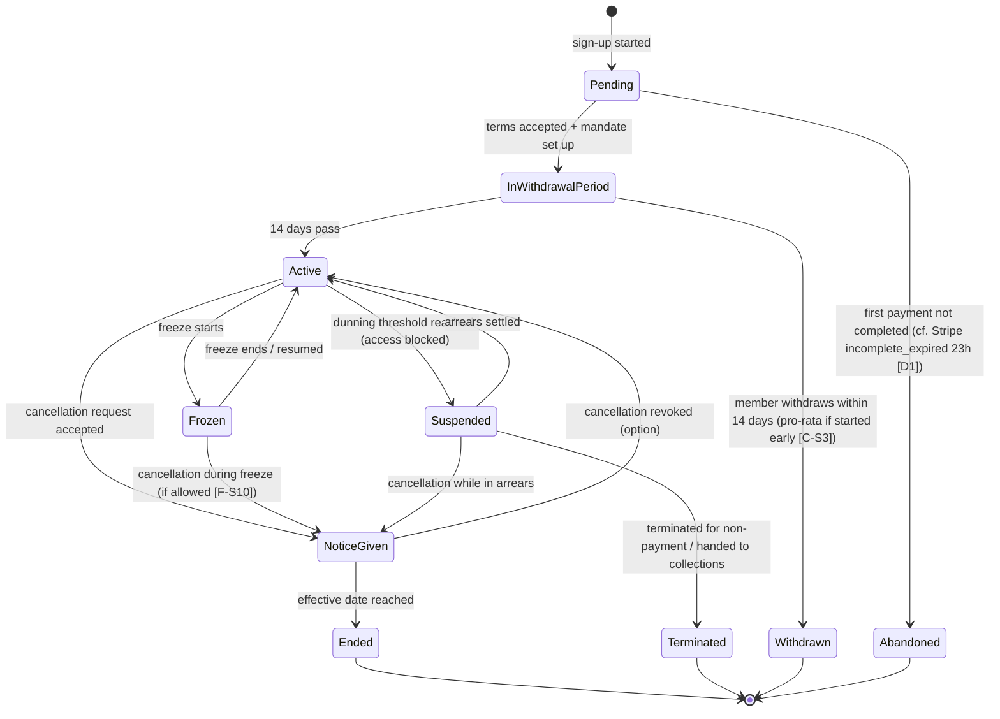
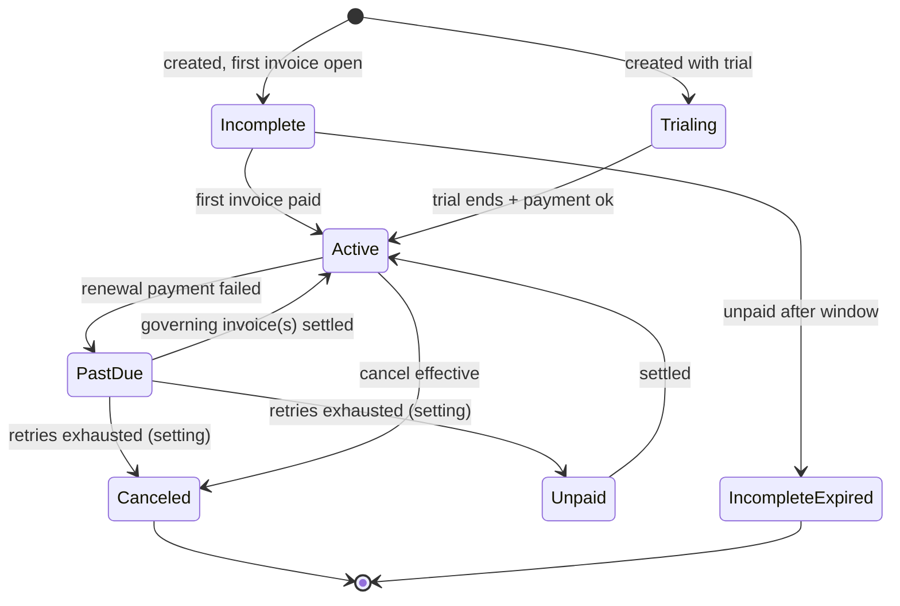
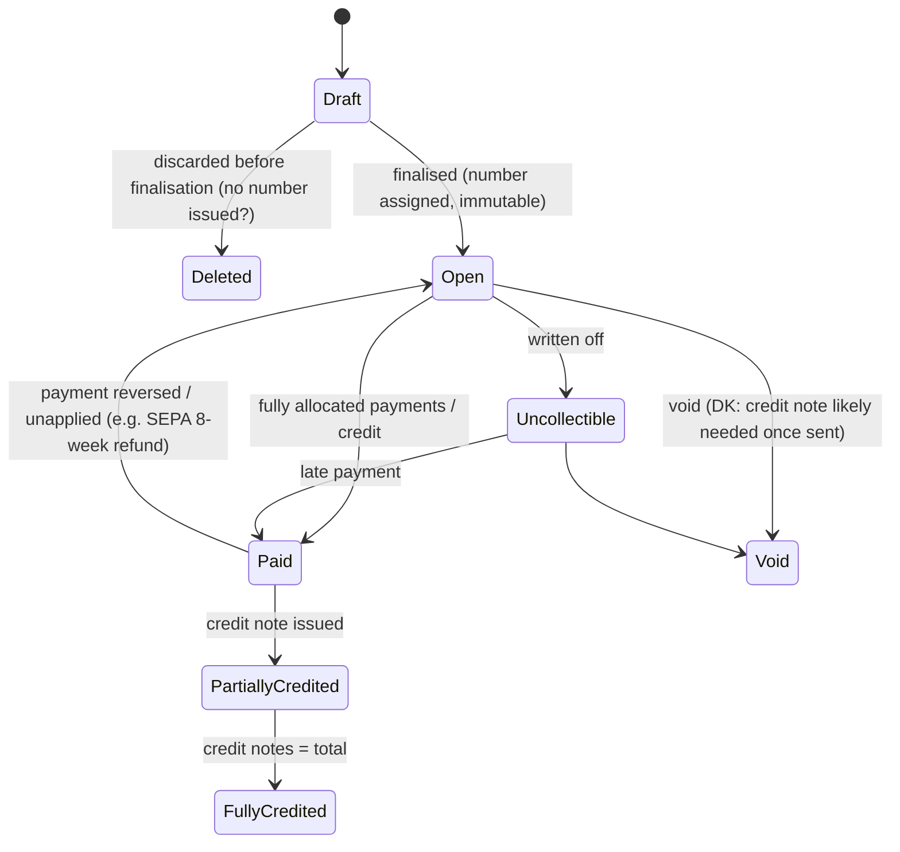
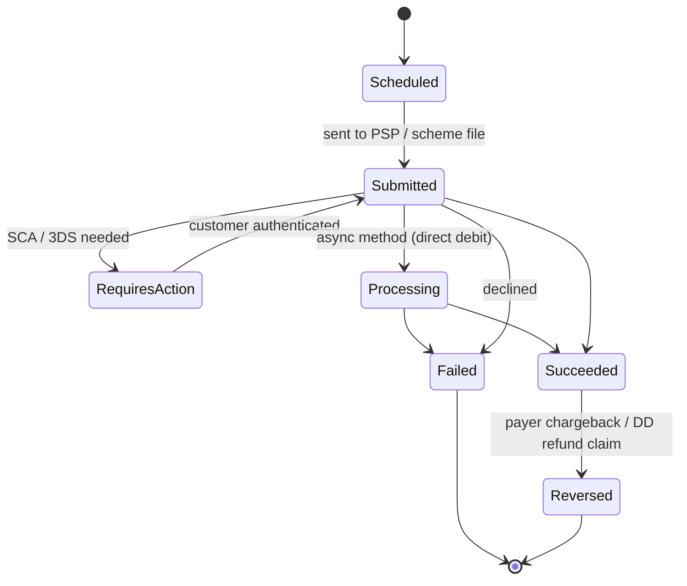
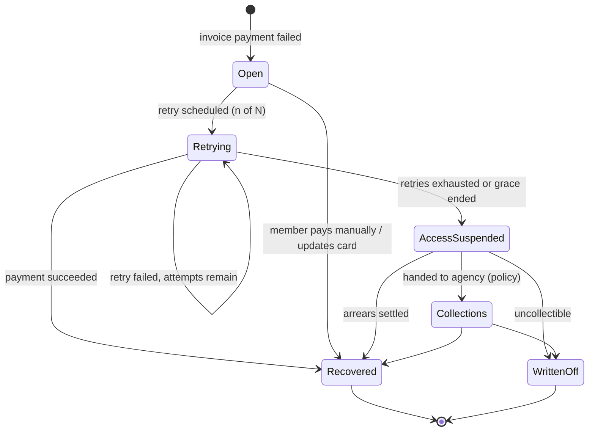
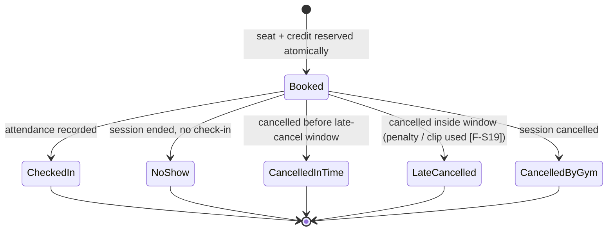

# Domain Modeling and Domain Design: Research

**Status:** Research only. Nothing here is a decision. Options, trade-offs and questions are listed for the project owner.
**Date:** 2026-11-12
**Scope:** The hardest data-modelling areas of a fitness-center system:
1. subscription/membership billing
2. the staff domain
3. bookings
4. audit, event sourcing and GDPR erasure

**Assumed jurisdiction:** Denmark/EU. This is **not confirmed**.

**Conventions**
- `[D#]` refers to the [Sources](#sources) list at the end of this document.
- `[F-S#]` refers to sources in `fitness-domain-operations.md`, `[C-S#]` to `compliance-legal-security.md`, and `[I-S#]` to `integrations-and-architecture.md`.
- **UNVERIFIED** marks a claim that could not be traced to a primary source. It also marks claims seen only in a search-result snippet, or my own inference stated as fact.
- **Analysis** marks my reasoning, as opposed to a sourced fact. Analysis is never a decision.
- Vendor documentation (Stripe, Kill Bill, Lago, Chargebee) is cited as **evidence of how mature billing systems model things**. It is not a recommendation to use any of them.

---

## 1. Executive summary

1. **Danish VAT on fitness changed on 1 Jan 2026, and the change reaches into the data model.**
   - Commercial operators must now charge VAT on *instruction* (classes, PT, yoga, spinning, crossfit…) to recipients **aged 30 and over** [D28][D29].
   - Commercial gym *access* (strength training) was already VAT-liable before 2026 [D30].
   - Non-commercial operators (associations, self-governing institutions) are exempt on access, according to a binding Skatterådet ruling [D31].
   - Skat says "Det er udelukkende alderen på modtageren af undervisningen, der afgør" [D28]. The VAT treatment of a line therefore depends on three things: **who the beneficiary is** (their date of birth), **what component** is supplied (access or instruction), and **the operator's legal status**. It does not depend on the payer.
   - The standard rate is 25% of the taxable amount (ML § 33), which equals 20% of a VAT-inclusive price [D33].
   - Skat does not say *when* age is measured, or how a mixed access+class subscription is split. Both are **open questions for an accountant**.
2. **Mature billing systems separate catalog, subscription, invoice and payment, and treat prices as immutable versions.**
   - Stripe: "After you create a price, you can only update its `metadata`, `nickname`, and `active` fields". To change a price you create a new one and archive the old [D5].
   - Kill Bill versions the whole catalog by `effectiveDate`. Its `effectiveDateForExistingSubscriptions` lets a price change reach existing subscribers later than new ones [D11].
   - This is Fowler's **Effectivity** / **Temporal Property** pattern [D14][D15].
3. **Access ("entitlement") and billing should be modelled as related but separate timelines.** Kill Bill: "the entitlement operation has an impact on billing, so the two are connected, but they are not necessarily aligned" [D11]. Freezes, notice periods, dunning suspensions and immediate-access cancellations all make the two timelines diverge.
4. **Finalised invoices are immutable. Corrections are new documents.**
   - Stripe: after finalisation "You can no longer change most details" [D6].
   - Danish practice: "En virksomhed har ikke annulleret en afsendt faktura blot ved internt at annullere fakturaen. Skal en faktura annulleres skal der udstedes en kreditnota" [D34, snippet].
   - Danish BEK 205 (if the system keeps the books itself) forbids deleting or changing posted transactions [C-S15].
   - Together these point to **append-only financial records** with reversal-style corrections [D16][D18].
5. **Webhooks arrive duplicated and out of order.**
   - Stripe retries for up to three days. It "doesn't guarantee the delivery of events in the order that they're generated", and endpoints "might occasionally receive the same event more than once" [D7].
   - An idempotent inbox (unique on provider + event ID), monotonic state transitions and a reconciliation job are the standard answer [D7][D27].
6. **Money as integer minor units (øre).** Stripe expects amounts "in the currency's minor unit" [D10]. Floats "introduce subtle and unavoidable errors" [D19]. Rounding rules (per line or per invoice) must be chosen explicitly [D5].
7. **Booking overbooking is a concurrency problem.** Row locks (`SELECT … FOR UPDATE`) [D21] or `SERIALIZABLE` with retry [D22] both work. Recurring schedules map naturally to RFC 5545 RRULE + TZID, with per-instance overrides via RECURRENCE-ID [D20].
8. **Event sourcing conflicts with GDPR erasure.** Crypto-shredding (deleting a per-person key) is a common workaround [D26]. Its legal sufficiency is **contested**: "Encrypted personal data is still personal data, regardless of whether anyone has the key" [D26, quoting a reader]. GDPR Recital 26 says pseudonymised data is still personal data [D24]. A simpler **CRUD + append-only audit log + append-only financial ledger** may meet the same audit needs with less risk. This is a trade-off for the owner.

---

## 2. Billing: core concepts and how mature systems model them

### 2.1 Vocabulary used in this document (proposed, not decided)

| Concept | Meaning here | Analogue in vendors |
|---|---|---|
| **Product / Plan** | What is sold: "Monthly All-Access", "10-class punch card" | Stripe Product [D1]; Kill Bill Product/Plan [D11] |
| **Plan version / Price** | An immutable, effective-dated price and term set for a plan | Stripe Price (amount immutable) [D5]; Kill Bill catalog version + phases [D11] |
| **Contract (Agreement)** | The *legal* relationship: accepted terms version, binding period, notice rule, channel, 14-day withdrawal deadline | No direct Stripe analogue. Chargebee "contract term" [D13] |
| **Subscription** | The *billing* mechanics: anchor, interval, items, status | Stripe Subscription [D1]; Kill Bill subscription in a bundle [D11] |
| **Subscription phase** | A time-boxed configuration (intro price, binding phase, evergreen) | Stripe Subscription Schedule phases [D9]; Kill Bill TRIAL/DISCOUNT/FIXEDTERM/EVERGREEN [D11] |
| **Entitlement** | What the person may *use* (door access, class booking) and when | Stripe entitlements [D1]; Kill Bill entitlement state [D11] |
| **Billing account / Payer** | Who pays (holds the mandate/token) | Stripe Customer |
| **Member / Beneficiary** | Who trains. May differ from the payer (family, corporate) | Kill Bill bundle with base + add-ons is the nearest analogue [D11] |
| **Invoice / Invoice line** | Immutable once finalised; lines carry period, proration flag and tax | Stripe Invoice [D6]; proration flag [D2] |
| **Payment / Payment attempt** | A money movement attempt via a PSP/scheme | Stripe PaymentIntent [D1] |
| **Refund** | Money returned against a payment | — |
| **Credit note** | A document reducing a finalised invoice | Stripe credit notes [D6]; DK *kreditnota* [D34] |
| **Credit/wallet ledger** | Prepaid units (punch-card clips) or money balance | Lago wallets [D12] |

**Plan vs contract vs subscription: the options.**
- **Option A: one `Membership` entity holds both legal and billing fields.** Simpler. Most gym products appear to do this (UNVERIFIED: no vendor schema seen).
- **Option B: separate `Contract` (legal) and `Subscription` (billing).** Cleaner when one contract spans several subscriptions, or the PSP owns the subscription (Stripe Billing), while the legal facts (binding, notice, § 28 earliest-termination date [C-S16]) must live in our system regardless.
- **Option C: contract + subscription + explicit `Entitlement` timeline**, following Kill Bill's separation [D11]. Most flexible, and most code.

### 2.2 Price versioning and price changes

- **Sourced pattern:** never mutate a price. Create a new price/version, switch subscribers to it, and archive the old one [D5]. Kill Bill does the same at catalog level, ranked by `effectiveDate`, with a separate date for existing subscriptions [D11].
- **Fowler:** a Temporal Property is "A property that changes over time". Accessors take a time point, and updates can be "retroactive, current, or scheduled" [D14]. Effectivity attaches a date range to each fact. "Supporting retroactive changes is often important, since people do make mistakes" [D15].
- **Bitemporal caution:** Fowler notes that tracking both *actual* time and *record* time is needed when retroactive changes interact with already-run billing. Day-granularity record dates can make a 2pm change hard to recover after a 3pm billing run [D14].
- **Danish consumer-law constraint (UNVERIFIED for fitness specifically):**
  - Search results show Forbrugerombudsmanden assessing a subscription price change that required at least 30 days' notice [D35, snippet only].
  - A court found a clause allowing unannounced price rises invalid (Tryg) [D36, snippet only].
  - No fitness-specific ruling on price increases was found.
  - *Implication (analysis):* a price-change workflow probably needs a "notice sent at" record and a cancellation window per affected contract.
- **Options:**
  1. **Grandfathering:** existing contracts keep their plan version until an explicit migration.
  2. **Scheduled migration:** a future-dated phase per subscription. This is how Stripe Subscription Schedules model it [D9].
  3. **Catalog-level effective date for existing subscribers:** the Kill Bill style [D11].

### 2.3 Billing anchors and periods

- **Stripe:** the anchor sets the day of month. A 31st anchor bills "the last day of the month closest to the anchor date", so Feb 28/29, then Mar 31, Apr 30 [D3]. Anchors are stored in UTC [D3]. *Analysis:* Danish local midnight differs by 1–2 hours from UTC midnight, so a date-based anchor needs an explicit time zone.
- **Kill Bill alignment options** [D11]:
  - `ACCOUNT`: all subscriptions on the account's billing day.
  - `BUNDLE`: add-ons follow the base.
  - `SUBSCRIPTION`: each its own.
- **Payment scheme constraint:** Betalingsservice via GoCardless needs the payment created 8 working days before the start of the month [I-S13]. This favours a **fixed 1st-of-month anchor** for direct-debit members.
- **First period:** with a future anchor, Stripe creates a prorated first invoice by default. `proration_behavior=none` makes the gap free [D3].
- **Options:**
  1. Anniversary billing, where the anchor is the sign-up date.
  2. Fixed day for everyone (e.g. the 1st), with a prorated first period.
  3. Fixed day per payment method.

### 2.4 Proration (upgrade/downgrade, mid-period start/stop)

- **Stripe's model** [D2]:
  - A credit line for unused time on the old price, plus a debit line for the remaining time on the new price.
  - Proration is to the second by default. Customisations allow day, week or month granularity.
  - `proration_behavior` is `create_prorations` (default; the items wait for the next invoice), `always_invoice` (invoice now) or `none`.
  - "Negative prorations aren't automatically refunded and positive prorations aren't immediately billed."
- **Pitfall** [D2]: "If a customer changes their subscription while having an unpaid invoice for the current period, they might receive a credit for unused time on the higher-priced plan, even if they haven't paid for that time yet."
  - Stripe's newer `billing_mode=flexible` credits "based on the last price billed" instead [D2].
  - *Implication (analysis):* proration credits should be computed from **what was actually invoiced** (invoice lines), not from the current price.
- **Preview consistency:** pass the same `proration_date` to the preview and the update, so the amounts match [D2].
- **Kill Bill change policies** [D11]:
  - `IMMEDIATE` ("the change should happen when requested")
  - `END_OF_TERM` ("at the end of the current billed period")
  - `ILLEGAL` (blocks the change)
  - Policies can be configured per product category.
- **Gym-specific gap:** no source was found on how gyms prorate upgrades or downgrades [F §15]. Whether an upgrade restarts a binding period is **unknown** and probably a legal question (§ 28 limits [C-S16]).
- **Options:**
  1. No proration; changes take effect at the next period. Simplest, and matches `END_OF_TERM`.
  2. Day-granularity proration for upgrades only; downgrades at end of term.
  3. Full proration both ways, with credits to a customer balance.

### 2.5 Freezes / pauses

- **Three vendor models:**
  - **Stripe `pause_collection`:** the subscription "remains `active` and invoices continue to generate, but Stripe doesn't collect payment. Your customer retains access". Invoices are kept as draft, marked uncollectible, or voided [D4]. This is a *billing* pause, not an access pause. Stripe documents a separate "Pause subscriptions" feature for pausing access too [D4].
  - **Chargebee:** a `paused` status ("will not renew while in this state"), with `pause_date` and `resume_date`. An indefinite pause has no `resume_date` [D13].
  - **Kill Bill:** pause/resume on the entitlement API, plus overdue "blocking states" that can disable both entitlement and billing [D11].
- **Gym practice:**
  - Freezes may be paid (e.g. £10/month) or free with medical proof [F-S10].
  - A freeze may extend the minimum term [F-S10].
  - Some gyms disallow freezes during the notice period [F-S10].
- **Modelling options (analysis):**
  1. **Freeze as an effectivity-dated record** (`Freeze{from, to?, reason, fee_plan_version, evidence_ref}`). Billing, entitlement and binding-end calculations all *read* it.
  2. **Freeze as a subscription phase:** a zero-price or fee-price phase, in the Stripe-schedule style [D9].
  3. **Freeze as a status** on the subscription, in the Chargebee style [D13]. Simple, but it loses history unless status changes are themselves effectivity-dated.

### 2.6 Binding periods, notice and cancellation effective dates

- **Danish rules** (from `compliance-legal-security.md`):
  - Forbrugeraftaleloven § 28: the consumer may cancel with 1 month's notice to the end of a month once 5 months have passed [C-S16].
  - Cancellation must be possible in the channel or medium where the contract was made [C-S17].
  - Cancellation must not be restricted to in-person or letter [F-S11].
- **Vendor models:**
  - Stripe: `cancel_at_period_end`, which needs no proration, or `cancel_at`, which can create prorations [D2].
  - Chargebee: `non_renewing`, meaning "canceled at the end of the current term" [D13].
  - Kill Bill cancellation policies: `END_OF_TERM`, which avoids credits, or `IMMEDIATE`, which refunds unused time. Entitlement can end on a different date from billing [D11].
- **Proposed data captured on a cancellation request (analysis):**
  - `requested_at`: a timestamp, because the notice period starts when the member notifies [F-S10]
  - `channel` and evidence (e.g. the email message ID)
  - `rule_version_applied`
  - `computed_effective_date`
  - `entitlement_end`
  - `billing_end`
  - `withdrawal_right_applies` (the 14-day withdrawal right [C-S3])
  - Store the *computed* date **and** the inputs, so the computation can be audited later even if the rules change.

### 2.7 Family / shared memberships

- No sourced gym data on family plan mechanics was found [F §3.3 marks it UNVERIFIED].
- **Analysis, based on the VAT rule:** the VAT on instruction depends on each **recipient's** age [D28]. A family subscription therefore probably needs **one invoice line per beneficiary**, or at least a per-beneficiary tax determination. A single family price is not enough.
- **Options:**
  1. **One payer account with N beneficiary subscriptions**, as in Kill Bill bundles [D11].
  2. **One subscription with a quantity**, as in Stripe items/quantities [D2]. Cannot carry per-person VAT or per-person freezes.
  3. **A "household" group entity** with its own pricing rules, such as "second adult −20%".
- Minors: digital consent is valid from age 15 in DK; under 15, a parent consents [C §8].

### 2.8 Punch cards / class packs / credits

- **Lago's wallet model** [D12]:
  - A wallet holds prepaid credits in a currency at a rate, e.g. 1 credit = $5.
  - Purchased credits are added when payment is confirmed. Free credits are granted instantly.
  - On an expiration date, remaining credits are "automatically voided".
- **Gym practice:** late cancels may be "counted as used" [F-S19].
- **Danish expiry law (UNVERIFIED for punch cards):**
  - The default limitation period for vouchers is 3 years [D37, consumer-organisation source].
  - A 3-month validity on a credit voucher was set aside as unreasonably short. A 1-year validity was upheld [D37, snippet].
  - Whether a gym punch card is treated like a voucher here is **not confirmed**.
- **VAT on punch cards:** when VAT arises for a multi-use card, and at which recipient age, is **UNVERIFIED**. It could arise at sale or at use. The skat.dk page ties VAT to the time of supply and to the recipient's age [D28]. The EU voucher rules were not researched.
- **Modelling options (analysis):**
  1. **Balance column on a pass:** simple, but loses how the balance arose. Modern Treasury: "Mutating balances directly creates a system that is prone to errors" [D18].
  2. **Credit ledger:** append-only `CreditEntry{lot_id, +/-units, reason: purchase|consume|late_cancel|expire|refund|reversal, booking_id?}`, with balance = sum. Lots carry their own expiry, consumed FIFO by expiry.
  3. **Lots only:** each purchase is a lot with `remaining`. Simpler than a ledger, but reversals are awkward.

### 2.9 Invoices vs payments vs refunds vs credit notes

- **Stripe invoice statuses** [D6]:
  - `draft`: freely editable
  - `open`: finalised, and most details can no longer change
  - `paid`
  - `void`: "maintains a paper trail"; only open or uncollectible invoices can be voided
  - `uncollectible`: bad debt
  - Stripe adds: "Consult with local regulations to determine whether and how an invoice might be amended, canceled, or voided … You might need to issue another invoice or credit note instead" [D6].
- **Danish rules:**
  - The full-invoice content requirements (momsbekendtgørelsen § 58, stk. 1) also apply to credit notes.
  - A document that "specifikt og utvetydigt ændrer eller henviser til den oprindelige faktura" counts as an invoice.
  - An invoice is cancelled by issuing a credit note, not by an internal void [D34, snippet].
  - *Implication (analysis):* a "void" status may not be legally sufficient in DK once an invoice has been sent. Credit notes are needed, with sequential numbering (UNVERIFIED whether a separate number series is allowed).
- **Stripe credit notes** reduce an open, paid or uncollectible invoice. For a paid invoice the credited amount goes to a refund, to the customer balance, or "outside of Stripe" [D6].
- **Direct debit refunds:** SEPA Core allows an unconditional 8-week refund, and Betalingsservice has scheme refund rights [C-S20]. A *payer-initiated reversal* is therefore a distinct event from a merchant refund. *Analysis:* it should not be modelled as a merchant refund.
- **Proposed separation (analysis):**
  - `Invoice` (what is owed) is distinct from `Payment` (money in) and `Refund` (money out against a payment).
  - `CreditNote` (a document reducing an invoice) is distinct from both.
  - `Allocation` links payments to invoices, many-to-many: partial payments, one payment covering several invoices.

### 2.10 Dunning

- **Stripe sequence** [D1]:
  - A failed renewal makes the subscription `past_due`.
  - After the retries, settings decide `past_due`, `unpaid` (no further attempts; "Revoke access") or `canceled`.
  - Smart Retries do not retry the *initial* payment while the subscription is `incomplete` [D1].
  - With delayed-confirmation methods such as direct debit, a later failure voids the invoice while the subscription stays `active` [D1]. *Analysis:* access control cannot just read "subscription active".
- **Gym practice:**
  - A failed direct-debit membership may go straight to "abandoned" [F-S12].
  - Auto-billing may be switched off after N failures [F-S12].
- **Kill Bill** overdue states can block changes and disable entitlement [D11].
- See the state machine in §7.6.

### 2.11 Idempotent webhook handling and integration reliability

- **Sourced facts:**
  - Stripe retries delivery "for up to three days with an exponential back off" [D7].
  - Ordering is not guaranteed. Do not use `created` for ordering; track event IDs [D7].
  - Duplicates happen: log the processed event IDs [D7].
  - Two different Event objects can describe the same change. Dedupe on `data.object` ID + `event.type` [D7].
  - Return 2xx quickly and process asynchronously. Renewals cluster at the start of the month [D7].
  - Verify signatures, and use a timestamp tolerance against replay (5 minutes by default) [D7].
- **Outgoing idempotency:**
  - Stripe idempotency keys can be pruned after 24h, and reuse with different parameters errors [D8].
  - *Analysis:* derive keys deterministically from our own IDs, e.g. `invoice:{id}:attempt:{n}`. Retries then stay safe within the window.
- **Outbox:** store outgoing messages in the same DB transaction as the state change, and relay them later. "a message consumer must be idempotent" [D27].
- **Proposed pattern (analysis):**
  1. Inbox table `WebhookEvent{provider, provider_event_id UNIQUE, type, object_id, received_at, payload, processed_at, outcome}`.
  2. The handler re-fetches the authoritative object from the provider rather than trusting the order of events [D7].
  3. State transitions are guarded: e.g. ignore "payment_failed" if the invoice is already `paid`.
  4. A nightly reconciliation compares local state with the provider's.

### 2.12 Money representation and VAT

- **Minor units:**
  - Store integer øre plus an ISO 4217 currency code [D10][D19].
  - DKK is a two-decimal currency at Stripe. It is not in the special-case list [D10].
  - Stripe's minimum DKK charge is 2.50 DKK [D10]. This matters for tiny prorations.
- **Rounding:**
  - Stripe rounds per line item before summing [D5].
  - Tax rounding can be per line or on the subtotal (a setting) [D5].
  - *Analysis:* pick one rule and store the tax amount per line explicitly. Never recompute historic VAT from current rules.
- **VAT-inclusive pricing:** consumer prices are typically shown including VAT. Whether this is a Danish legal requirement was **UNVERIFIED** in this pass. The arithmetic: VAT = 20% of the gross amount when the rate is 25% of net [D33].
- **Danish fitness VAT facts** (2026; practice "still unclear" per BDO [D31]):

| Supplier | Component | Recipient | VAT (as sourced) | Source |
|---|---|---|---|---|
| Commercial | Access (strength training) | any age | VAT-liable (also before 2026) | [D30] |
| Commercial | Instruction: classes, PT, yoga, spinning, pilates, crossfit… | ≥ 30 years | VAT-liable since 1 Jan 2026 | [D28][D29] |
| Commercial | Instruction | < 30 years | Exempt | [D28] |
| Commercial | Family class where the child is the main recipient | — | Exempt | [D28] |
| Association / self-governing institution (non-profit) | Access | any | Exempt (binding ruling) | [D31][D30] |
| Non-profit | Instruction | — | Not stated in sources (UNVERIFIED) | — |
| Any | Registration threshold | — | 50,000 kr taxable turnover per calendar year | [D28] |

  - **General exemption basis:** ML § 13, stk. 1, nr. 5 covers services closely linked to sport or physical training "der præsteres af virksomheder, der ikke drives med gevinst for øje". Exemptions are read narrowly ("fortolkes indskrænkende") [D32].
  - **Time of supply:** the invoice date if the invoice is issued before or promptly after the service; the payment date if payment comes first [D28]. Skat's example: an annual 2026 subscription invoiced in Dec 2025 and paid in Jan 2026 carried no VAT [D28]. *Analysis:* the tax-determination date is a stored fact per invoice line.
  - **Partial deduction:** input-VAT deduction becomes partial, and capital-goods adjustments over 5/10 years may be triggered [D29]. This is an accountant matter, but it may require the system to report the taxable vs exempt turnover split.
  - **Member-side relief:** members aged 30+ can deduct up to 1,750 kr (2026) or 1,800 kr (2027) [D28]. *Analysis:* members may request annual statements of what they paid. This is UNVERIFIED as a reporting obligation on the gym.
- **Modelling implications (analysis):**
  - Tax rules must be **versioned and effective-dated**. The 2026 change proves rates and rules change mid-contract.
  - Each invoice line stores:
    - `tax_category` (access / instruction / retail / …)
    - `beneficiary_id` and the beneficiary's age at the determination date
    - `supplier_vat_status`
    - `tax_rule_version`, `tax_rate` and `tax_amount`
  - A **mixed subscription** (access + unlimited classes) needs an allocation rule for splitting one price into components. No source gives the method: **open question for an accountant**.

### 2.13 Immutable ledgers and double-entry

- **Fowler:**
  - An account is a "pot of money" whose balance is derived from entries; transactions group entries.
  - Corrections come in three forms. *Replacement* loses history. *Reversal* posts an "opposite Accounting Entry to cancel it out" and then the correct one. *Difference* posts only the delta and "keeps history" with fewer transactions, but is more complex [D16].
- **Modern Treasury:**
  - A transaction needs two or more entries.
  - The invariant: "the sum of all credit normal balances always equals the sum of all debit normal balances".
  - "store immutable transactions and always compute balances from those transactions" [D18].
- **Danish BEK 205 (route B, the custom bookkeeping system)** [C-S15]:
  - no deletion, change or backdating of posted transactions
  - sequential IDs
  - logged changes
  - 5-year retention
  - SAF-T export
- **Options:**
  1. **No internal ledger.** Invoices, payments and credit notes are immutable documents, and the accounting system (e-conomic/Dinero/Billy) holds the general ledger (route A [C-S15]). Least work. Member balances are derived from documents.
  2. **Internal double-entry sub-ledger** for member receivables, customer credit balance, deferred revenue (prepaid annual memberships) and punch-card liability, exported as summarised journals. Better auditability and reconciliation. Whether revenue deferral is required for this business is **UNVERIFIED** (an accountant question).
  3. **Full general ledger in-system:** BEK 205 route B in full (Peppol e-invoicing, SAF-T, backups, security standard) [C-S15]. Heaviest.

---

## 3. Staff domain

### 3.1 Roles and permissions: RBAC vs ABAC

- **ABAC (NIST SP 800-162):** "authorization to perform a set of operations is determined by evaluating attributes associated with the subject, object, requested operations, and, in some cases, environment" [D23].
- **RBAC** is already the baseline in the compliance requirements (SEC-01: owner/admin, manager, reception, trainer, bookkeeper, self-service roles) [C §10].
- **Why pure RBAC may not suffice (analysis):** the rules that matter in a gym are often *relational* or *contextual*:
  - a trainer sees the health-flag summary only for members booked into **their** session today
  - reception sees payment status but not health data
  - a manager acts only within **their** site
- **Options:**

| Option | For | Against |
|---|---|---|
| RBAC only (roles → permissions) | Simple; auditable; easy to explain to staff | Role explosion for site- or relationship-scoped rules |
| RBAC + scopes (role assignment carries `site_id`, plus a few hard-coded ownership checks) | Covers multi-site and "own sessions" with little machinery | Ownership rules are scattered in code |
| ABAC / policy engine | Expressive; policies are separate from code | More moving parts; policies are harder to test and review (analysis) |

  - Relationship-based models (ReBAC, Zanzibar-style) were not researched (UNVERIFIED).
- **Data shape (analysis):** `RoleAssignment{person_id, role, site_id?, valid_from, valid_to}` uses Effectivity [D15]. Granting and revoking permissions is audited (SEC-08 [C-S15]).

### 3.2 Shifts, availability, time entries

- **DK working-time recording** [C §4]:
  - daily recording
  - employee self-view
  - corrections audited
  - 5-year retention
  - rest and 48-hour warnings optional
- **Planday's open API** covers shifts, punch clock and timesheets [I-S32]. Build vs integrate is an open decision.
- **Proposed entities (analysis):**
  - `Availability`: recurring, RRULE-like, plus exceptions
  - `Shift`: planned work, with role, site and time range
  - `ShiftAssignment`
  - `TimeEntry`: actual work; clock-in/out or manual
  - `TimeEntryCorrection`: append-only, keeping the original retrievable
  - `PayPeriod`: lockable
- **Fowler's bitemporal point applies** [D14]. A correction made after the payroll export must be visible as a correction against a locked period, not as a silent edit.

### 3.3 Pay rules

- **Sourced pay models** [F-S21–S24, F-S45]:
  - hourly via time clock
  - per class (~65% of group instructors are paid per class)
  - per session (PT)
  - per attendee / headcount tiers (UNVERIFIED prevalence)
  - commission on sales
  - revenue split (40–60%, UNVERIFIED)
  - freelance trainers paying *rent* to the gym
  - "payroll-ready" usually means a CSV export only
- **Proposed model (analysis):**
  - `PayRule` (effective-dated, versioned): type `hourly | per_session | per_attendee_tier | commission_pct | revenue_split | rent_charge`, with parameters and scope (person, role, class type, site).
  - **Source facts:** TimeEntry, delivered ClassSession (instructor, headcount at a defined cut-off), PT Appointment status, Sale.
  - `PayLine`: computed, referencing the rule version and the source facts.
  - `PayrollExport`: an immutable snapshot per period.
- **Key decision:** what counts as an "attendee" for per-attendee pay: booked, checked in, or including no-shows? This is a **business rule** for the owner.
- **Rent / revenue split** makes the freelance trainer a *creditor or debtor* of the gym. It possibly belongs in billing (an invoice to the trainer), not payroll (analysis).
- **Out of scope here:** collective agreements, holiday pay and overtime premiums were not researched (UNVERIFIED). See the open questions.

### 3.4 Certifications with expiry

- **Sourced needs:**
  - type, issuer, expiry and renewal reminders [F §7.3]
  - Les Mills programme certifications become inactive after 12 months without teaching [F-S24], which is an expiry driven by *activity*, not just by date
- **Model (analysis):** `Certification{person, type, issuer, issued_on, valid_from, valid_to?, evidence_document, status}` plus `CertificationRequirement{class_type|role|site, cert_type}`.
- **Options when a requirement is not met:**
  1. Warn only.
  2. Block assigning the instructor to sessions after the expiry date.
  3. Block check-in to unsafe activities.

---

## 4. Bookings

### 4.1 Recurring schedules (RRULE) and exceptions

- **RFC 5545** [D20]:
  - RRULE defines the recurrence; COUNT/UNTIL bound it.
  - `DTSTART;TZID=Europe/Copenhagen` binds clock times to the zone's DST rules.
  - For a skipped local time, the UTC offset before the gap is used. For a repeated local time, the first occurrence is used.
  - A RECURRENCE-ID override affects a single instance by default. `RANGE=THISANDFUTURE` covers it and all later instances.
  - EXDATE (excluded dates) and RDATE (extra dates) are defined in RFC 5545 §3.8.5.1–2. Their exact wording was not quoted in this pass.
- **Options:**
  1. **Store the rule; compute instances on the fly.** Overrides are stored as exception rows. Compact, but bookings need a stable session identity: (series_id, original_start) is the RFC's RECURRENCE-ID idea.
  2. **Materialise sessions** N weeks ahead from the rule. Each `ClassSession` is a real row that bookings, capacity locks and pay lines can reference. Editing the rule means regenerating only the *future, unbooked* sessions (analysis).
  3. **Hybrid:** the rule is the template, sessions are materialised, and edits create a new series version ("this and future" = split the series at a date).
- *Analysis:* option 2 or 3 fits concurrency control (§4.2) and payroll (§3.3) because each session has a lockable row.

### 4.2 Capacity and overbooking prevention

- **PostgreSQL primitives:**
  - `FOR UPDATE` row locks "prevent [rows] from being locked, modified or deleted by other transactions until the current transaction ends" [D21].
  - Advisory locks give "application-defined meanings" [D21].
  - `SERIALIZABLE` "emulates serial transaction execution", but "applications using this level must be prepared to retry" on SQLSTATE 40001 [D22].
- **Options (analysis):**

| Option | Mechanism | Trade-off |
|---|---|---|
| A | Lock the session row (`SELECT … FOR UPDATE`), count active bookings, insert | Simple and correct; serialises bookings per session (fine at gym scale, UNVERIFIED load) |
| B | Conditional counter: `UPDATE session SET booked = booked + 1 WHERE id = ? AND booked < capacity` and check rows affected | Fast, but the counter can drift from the booking rows unless both change in one transaction |
| C | `SERIALIZABLE` + generic retry | Covers complex rules (credit balance + capacity + member's overlapping bookings) but needs retry plumbing |
| D | Pre-created seat rows with a unique constraint | Natural for numbered spots (bikes, reformers); heavier for plain headcount |

- **Multi-resource checks:** booking may also need the credit ledger (§2.8), entitlement and no-show bans [F-S19]. *Analysis:* these should commit in the **same transaction** as the booking, or a member could book with a credit that another booking consumed concurrently.

### 4.3 Waitlists

- **Sourced practice** [F-S19]:
  - Auto-promotion is common, but can cause unwanted no-shows. Mitigations are confirmation steps or waived fees for last-minute promotions.
  - Late-cancel windows are 4–24h.
  - Penalties are fees, a deducted session, or a temporary booking ban.
- **Options:**
  1. Auto-promote immediately.
  2. **Offer with expiry:** hold the spot for X minutes, then move to the next person.
  3. Auto-promote outside the late-cancel window, offer-only inside it.
- **Implementation notes (analysis):**
  - Promotion runs as an idempotent job triggered by a cancellation event. It is keyed by (session_id, freed_seat_seq) to avoid double promotion.
  - Waitlist order is by `joined_at` plus a tie-breaker ID.
  - Credit consumption happens at promotion, not when the member joins the waitlist (an option).

---

## 5. Audit logs, event sourcing and GDPR erasure

### 5.1 Event sourcing vs CRUD + audit trail

- **Fowler on event sourcing** [D17]:
  - Definition: "Capture all changes to an application state as a sequence of events".
  - Benefits: complete rebuild, temporal query, event replay.
  - Costs:
    - replays re-trigger external systems unless gateways suppress them
    - evolving code makes things "very messy, don't go down this path unless you really need to"
    - external query results must be recorded for replays to stay consistent
- **Audit needs already identified:**
  - SEC-08: an append-only audit log of logins, sensitive reads, exports, permission changes, erasures, financial postings and time-record edits [C §10]
  - BEK 205 change logging [C-S15]
  - auditable time-record corrections [C §4]
- **Options:**

| Option | Description | For | Against |
|---|---|---|---|
| 1. CRUD + append-only audit log | Mutable tables; a separate immutable log of who changed what, when, before and after | Familiar; easy queries; erasure means editing a row plus redacting log payloads | History must be reconstructed from the log; the log can drift from the truth if writes bypass it |
| 2. CRUD + immutable domain records where history matters | Financial documents, ledger entries, time corrections, consents, cancellations and freezes are append-only or effectivity-dated (§2) | Puts immutability exactly where law and audit need it (analysis) | Two styles in one codebase |
| 3. Full event sourcing | Every aggregate is an event stream; state is a projection | Complete history; temporal queries [D17] | Erasure conflict (§5.2); replay side-effects; schema evolution [D17] |

### 5.2 Soft delete vs GDPR erasure

- **Legal anchors:**
  - Art. 17(3)(b): erasure does not apply where processing is needed "for compliance with a legal obligation", e.g. bookkeeping for 5 years [D25][C-S15].
  - Art. 17(3)(e): it also does not apply where data is needed "for the establishment, exercise or defence of legal claims" [D25].
  - Recital 26: pseudonymised data linkable via additional information "should be considered to be information on an identifiable natural person". The principles do not apply to anonymous information [D24].
  - EDPB Guidelines 01/2025 on pseudonymisation went to consultation (17 Jan – 14 Mar 2025). Final status not confirmed in this pass [D38].
- **Soft delete** (an `is_deleted` flag) **is not erasure.** The data still exists (analysis, consistent with Recital 26 [D24]).
- **Options:**
  1. **Field-level erasure / anonymisation with legal holds.** Each data category has a retention rule (PRIV-02 [C §10]). On erasure, PII fields are nulled or replaced. Records under legal hold (invoices) keep only the fields the law requires. Which buyer fields a Danish consumer invoice must contain is **UNVERIFIED** (§ 58 content not fetched).
  2. **Pseudonymisation split:** an `Identity` table (name, email, CPR if any, DOB) is separate from operational tables keyed by a surrogate `person_id`. Erasure deletes or anonymises the identity row. *Caveat:* while any re-linking information exists, the data is still personal [D24].
  3. **Crypto-shredding** (per-person key; destroy the key to erase) [D26]:
     - Fits event sourcing.
     - Per Verraes, key deletion "effectively makes all copies and backups of the sensitive data unusable" [D26]. This would address the backup problem (SEC-11 [C §10]).
     - Its legal sufficiency is disputed in the same source [D26].
     - No regulator guidance was found. **UNVERIFIED / lawyer question.**
- **Erasure must reach every copy:** backups, the payment provider, the accounting system and email tools [C §10 SEC-11]. Kafka-style logs are rarely the only copy (secondary, UNVERIFIED [search result: Conduktor blog]).

---

## 6. Candidate conceptual ER sketch

> **DRAFT FOR DISCUSSION.** This is a conceptual sketch to provoke questions. It is not a schema and not a decision. Names, cardinalities and boundaries are all open. Entities marked `(opt)` exist only under some options above.

```mermaid
erDiagram
    PERSON ||--o| IDENTITY_PII : "identified by (erasable)"
    PERSON ||--o{ MEMBER_ROLE : "acts as member"
    PERSON ||--o{ EMPLOYMENT : "acts as staff"
    PERSON ||--o{ CONSENT_RECORD : gives
    PERSON ||--o{ HEALTH_DECLARATION : submits

    BILLING_ACCOUNT ||--o{ PAYMENT_METHOD : holds
    BILLING_ACCOUNT ||--o{ CONTRACT : "pays for"
    PERSON ||--o{ BILLING_ACCOUNT : "owns / is guardian of"

    PRODUCT ||--o{ PLAN_VERSION : "versioned as (effective-dated)"
    PLAN_VERSION ||--o{ PLAN_COMPONENT : "split into (access / instruction)"
    TAX_RULE_VERSION ||--o{ PLAN_COMPONENT : "classifies"

    CONTRACT ||--o{ CONTRACT_BENEFICIARY : covers
    PERSON ||--o{ CONTRACT_BENEFICIARY : "is beneficiary"
    CONTRACT }o--|| TERMS_VERSION : "accepted"
    CONTRACT ||--o{ SUBSCRIPTION_PHASE : "billed via"
    SUBSCRIPTION_PHASE }o--|| PLAN_VERSION : uses
    CONTRACT ||--o{ FREEZE : "paused by"
    CONTRACT ||--o| CANCELLATION_REQUEST : "ended by"
    CONTRACT ||--o{ ENTITLEMENT_PERIOD : grants

    BILLING_ACCOUNT ||--o{ INVOICE : receives
    INVOICE ||--|{ INVOICE_LINE : contains
    INVOICE_LINE }o--o| CONTRACT_BENEFICIARY : "for beneficiary"
    INVOICE_LINE }o--|| TAX_RULE_VERSION : "taxed under"
    INVOICE ||--o{ CREDIT_NOTE : "corrected by"
    PAYMENT ||--o{ PAYMENT_ALLOCATION : allocated
    INVOICE ||--o{ PAYMENT_ALLOCATION : settled
    PAYMENT_METHOD ||--o{ PAYMENT_ATTEMPT : "charged via"
    PAYMENT_ATTEMPT ||--o| PAYMENT : "results in"
    PAYMENT ||--o{ REFUND : "refunded by"
    INVOICE ||--o| DUNNING_CASE : "chased by"

    LEDGER_ACCOUNT ||--o{ LEDGER_ENTRY : "balance derived from"
    LEDGER_TRANSACTION ||--|{ LEDGER_ENTRY : "balances to zero (opt)"

    BILLING_ACCOUNT ||--o{ CREDIT_LOT : "buys punch cards"
    CREDIT_LOT ||--o{ CREDIT_ENTRY : "ledger of clips"

    CLASS_TYPE ||--o{ CLASS_SERIES : "scheduled as (RRULE)"
    CLASS_SERIES ||--o{ CLASS_SESSION : materialises
    CLASS_SERIES ||--o{ SERIES_EXCEPTION : "overridden by"
    ROOM ||--o{ CLASS_SESSION : hosts
    CLASS_SESSION ||--o{ BOOKING : has
    CLASS_SESSION ||--o{ WAITLIST_ENTRY : queues
    PERSON ||--o{ BOOKING : makes
    BOOKING ||--o| CREDIT_ENTRY : "consumes (opt)"
    BOOKING ||--o| ATTENDANCE : "checked in as"

    EMPLOYMENT ||--o{ ROLE_ASSIGNMENT : "has (site-scoped)"
    EMPLOYMENT ||--o{ CERTIFICATION : holds
    EMPLOYMENT ||--o{ AVAILABILITY : declares
    SHIFT ||--o{ SHIFT_ASSIGNMENT : staffed
    EMPLOYMENT ||--o{ SHIFT_ASSIGNMENT : works
    EMPLOYMENT ||--o{ TIME_ENTRY : records
    TIME_ENTRY ||--o{ TIME_ENTRY_CORRECTION : "corrected by (append-only)"
    CLASS_SESSION }o--o{ EMPLOYMENT : "instructed by"
    EMPLOYMENT ||--o{ PAY_RULE : "paid under (effective-dated)"
    PAY_RULE ||--o{ PAY_LINE : produces
    PAYROLL_PERIOD ||--|{ PAY_LINE : "locks"

    WEBHOOK_EVENT }o--o| PAYMENT_ATTEMPT : "updates"
    OUTBOX_MESSAGE }o--|| PERSON : "about (opt)"
    AUDIT_LOG_ENTRY }o--|| PERSON : "actor"
    ERASURE_REQUEST }o--|| PERSON : "for"

    PLAN_VERSION {
        uuid id
        date effective_from
        date effective_to
        int price_minor
        string currency
        string interval
        int binding_months
        string notice_rule
    }
    INVOICE_LINE {
        uuid id
        date period_start
        date period_end
        int amount_minor
        int tax_minor
        string tax_category
        date tax_point
        bool proration
    }
    CREDIT_ENTRY {
        uuid id
        int units
        string reason
        timestamp occurred_at
    }
```

**Design ideas embedded in the sketch (all analysis, all open):**
- `PERSON` is separate from `IDENTITY_PII`, so erasure has one main place to act (§5.2 option 2).
- `BILLING_ACCOUNT` (payer) is separate from `CONTRACT_BENEFICIARY` (trainee). This supports family, corporate and guardian cases, plus the recipient-age VAT rule [D28].
- `PLAN_COMPONENT` lets one plan carry access and instruction parts with different tax treatment. The allocation method is an open question.
- `ENTITLEMENT_PERIOD` is separate from the billing phases [D11].
- Financial documents, credit entries, time corrections and ledger entries are append-only [D16][D18][C-S15].

---

## 7. State machines (draft)

All of these are **drafts for discussion**, synthesised from the cited vendor models and gym practice. States and transitions are open.

### 7.1 Contract / membership (legal + entitlement view)

Transitions carry `effective_at` (when it applies) and `recorded_at` (when we learned of it). This is the bitemporal point from Fowler [D14].

### 7.2 Subscription billing status (aligned with Stripe's vocabulary [D1])

States, in Stripe's vocabulary:
- `incomplete`
- `incomplete_expired`
- `trialing`
- `active`
- `past_due`
- `unpaid`
- `canceled`
- `paused`

In Stripe, `paused` only covers a trial that ended without a payment method [D1]. A gym freeze is better modelled as §7.8 or as Stripe `pause_collection` [D4] (analysis).

### 7.3 Invoice (Stripe statuses [D6], plus the Danish credit-note rule [D34])

`PartiallyCredited` and `FullyCredited` are derived views, not Stripe statuses (analysis).

### 7.4 Payment attempt

Outcomes like Stripe's PaymentIntent: `requires_payment_method`, `requires_action`, `processing`, `succeeded` [D1]. Direct debit adds a late failure after an apparent success [D1][C-S20].

### 7.5 Refund

Requested → Pending (at PSP) → Succeeded | Failed. Optionally preceded by Approval for staff-initiated refunds above a threshold (analysis).

### 7.6 Dunning case

Gym variants: direct-debit failures may go straight to "abandoned", and auto-billing may switch off after N failures [F-S12].

### 7.7 Cancellation request

Received (timestamp, channel) → Acknowledged (receipt sent) → Scheduled (effective date computed under rule version) → Effective → Closed.
- Side branches: Revoked (member withdraws the request; option) and Disputed.
- *Analysis:* Danish practice requires that cancellation cannot be refused because of the channel used [F-S11]. There is therefore no "Rejected-for-channel" state.

### 7.8 Freeze

Requested → Approved | Rejected (e.g. evidence missing, or during notice [F-S10]) → Scheduled → Active → Ended.
- Active → EndedEarly when the member resumes.
- On Ended, recompute the binding end, if the freeze extends binding [F-S10].

### 7.9 Class session

Scheduled → Open for booking → Closed for booking (cut-off) → InProgress → Completed → PayrollLocked.
- From Scheduled or Open: → Cancelled by gym. This triggers refund or re-credit of all bookings, and waitlist release.

### 7.10 Booking

### 7.11 Waitlist entry

Waiting → Offered (hold expires at T; option) → Accepted → becomes Booking. Also:
- Offered → Expired → next person.
- Waiting → AutoPromoted, for the auto-promotion option [F-S19].
- Waiting → Left.
- Waiting → SessionStarted (closed).

### 7.12 Credit lot (punch card)

PendingPayment → Active (credits granted on payment confirmation, as in Lago [D12]) → Depleted | Expired (remaining voided [D12]) | Refunded.

### 7.13 Shift and time entry

- **Shift:** Draft → Published → Assigned → (SwapRequested → Assigned) → Worked | NoShow | Cancelled.
- **Time entry:** Open (clocked in) → Submitted → Approved → Locked (payroll period exported).
- **Corrections:** Locked → *Corrected by a new append-only correction entry*. The original stays retrievable [C §4].

### 7.14 Certification

Pending verification → Valid → ExpiringSoon (reminder window) → Expired. Also Valid → Revoked, and Expired → Valid on renewal (as a new record) [F §7.3]. There is also an activity-based lapse (Les Mills 12-month rule [F-S24]).

### 7.15 Webhook inbox event

Received (signature verified) → Queued → Processed | Ignored-duplicate | Failed (retry) → DeadLettered [D7][D27].

### 7.16 Erasure request (GDPR)

Received → Identity verified → Assessed (legal holds found: bookkeeping 5 years, legal claims [D25]) → Executed (fields erased or anonymised; keys shredded if option 3) → Propagated (processors notified; backup expiry window tracked) → Closed (response sent).

---

## 8. Edge-case catalog

Each case states the problem and which model choices it stresses. None has a decided answer.

**Price, VAT and time**

1. **A freeze spans a price change.** The member freezes Nov–Jan and the price rises 1 Dec. On resume, is the old or new version billed? Is the price-change notice [D35] sent during a freeze valid? Stresses: effectivity on plan versions [D15]; the grandfathering option (§2.2).
2. **The member turns 30 mid-subscription.** Instruction VAT starts at 30 [D28]. Is age measured at invoice date, period start or each lesson? Skat's page does not say. Stresses: storing `tax_point` and the age basis per line.
3. **A family plan has members on both sides of 30**, or a family class where the child is the main recipient (exempt [D28]). Stresses: per-beneficiary lines (§2.7).
4. **A mixed access + classes subscription** needs a price split between taxable access and age-dependent instruction. The allocation method is unsourced.
5. **An annual prepaid subscription crosses the 1 Jan 2026 rule change.** Skat's example: invoiced Dec 2025, paid Jan 2026, no VAT [D28]. Similar future rule changes need versioned tax rules and a stored tax point.
6. **Billing anchor on the 29th–31st.** February billing is clamped to month-end [D3]. Does a 1-month notice "to end of month" interact with the anchor?
7. **DST at class times.** A 02:30 class on the spring-forward day doesn't exist. RFC 5545 uses the pre-gap offset [D20]. Mostly irrelevant for gyms, but it matters for 24/7 access windows and night shifts (analysis).
8. **Proration below the PSP minimum.** A 1.20 DKK prorated debit is below Stripe's 2.50 DKK minimum [D10]. Carry it forward, waive it, or fold it into the next invoice?

**Changes, freezes and cancellations**

9. **Upgrade while the current invoice is unpaid** can credit unpaid time [D2].
10. **Downgrade during the binding period.** Allowed? Does it restart binding? Unknown (§2.4).
11. **A cancellation request arrives during a freeze, or a freeze request during the notice period** [F-S10]. Which dates win, and is the § 28 earliest-termination date affected [C-S16]?
12. **Cancellation via an unexpected channel** (email to a staff member's private address, or a social-media message). Danish practice treats email as valid [F-S11]. When does the notice clock start?
13. **Withdrawal within 14 days after the member asked to start immediately and has trained.** A proportionate payment is due [C-S3]. This needs usage or time-based pro-rata.
14. **Mid-period cancellation with an immediate access stop but end-of-term billing**, or the reverse. Entitlement and billing diverge [D11].
15. **Price increase notified, then the member cancels in response.** Does the old price apply through the notice period? Legal question [D35][D36].

**Payments and dunning**

16. **Late direct-debit failure after access was granted.** The invoice is voided but the subscription stays active (the Stripe delayed-method behaviour [D1]). Access control must not trust subscription status alone.
17. **SEPA 8-week refund claimed months later on a paid invoice** [C-S20]. The invoice reopens, dunning restarts, and access may be revoked retroactively?
18. **Duplicate or out-of-order webhooks:** `invoice.paid` arrives before `invoice.created` [D7]. The handler must re-fetch and must not regress state.
19. **Our charge request times out and is retried after the PSP has pruned the idempotency key (>24h)** [D8]. Risk of a double charge. Reconciliation is needed.
20. **A member pays an old open invoice after it was voided and replaced** [D2]. Double payment, so a refund or credit is needed.
21. **A member's payment method is a parent's, and the parent is not a member** (payer ≠ beneficiary). Who receives dunning notices? Consent for a minor under 15 [C §8].

**Bookings and credits**

22. **Two members book the last spot simultaneously** (§4.2).
23. **The same member books on two devices at once with one remaining clip.** The credit and capacity checks must be atomic together (§4.2).
24. **The gym reduces capacity (room change) after bookings exceed the new capacity.** Who is bumped? By booking time? Refund or credit?
25. **Waitlist promotion inside the late-cancel window.** Does the promoted member face a penalty if they then cancel? [F-S19]
26. **A series edit "this and future" when future sessions have bookings.** Keep the booked sessions or migrate them? (RECURRENCE-ID / THISANDFUTURE [D20])
27. **A punch card expires while a booking against it is pending**, or is refunded after partial use. Lot-level ledger reversal (§2.8).
28. **The gym cancels a class:** re-credit clips to the original lot (possibly already expired) or to a new lot?

**Staff and payroll**

29. **Instructor substitution after the payroll export.** Pay lines are locked, so a correction is needed in the next period (§3.2/§3.3).
30. **Per-attendee pay when attendance is corrected after the period closes.**
31. **A certification expires between scheduling and delivery** of a session (§3.4).
32. **A time entry spans midnight or a DST change.** Daily working-time recording is per day [C §4].

**GDPR**

33. **Erasure request from a former member with invoices less than 5 years old.** Keep the invoice data and erase the rest [D25][C-S15]. Which invoice fields must stay is UNVERIFIED.
34. **Erasure when PII is inside the immutable audit log or event store.** Crypto-shredding vs redaction (§5.2).
35. **A restored backup brings erased data back.** Erasure must be re-applied after restore (SEC-11 [C §10]).

---

## 9. Options summary (cross-cutting decisions)

| ID | Decision | Options (sections) |
|---|---|---|
| M1 | Who owns the billing engine | PSP billing (Stripe Billing/Frisbii) mirrored locally; own engine with PSP for charges only; hybrid per payment method [I §3.7]; §2 |
| M2 | Contract vs subscription split | Single Membership; Contract + Subscription; plus a separate Entitlement timeline (§2.1) |
| M3 | Price-change policy | Grandfather; scheduled migration; catalog effective date for existing subscribers (§2.2) |
| M4 | Billing anchor | Anniversary; fixed day; fixed day per payment method (§2.3) |
| M5 | Proration | None; upgrades only; both ways; granularity (§2.4) |
| M6 | Freeze model | Effectivity record; phase; status (§2.5) |
| M7 | Family model | Payer + N beneficiary subscriptions; quantity; household entity (§2.7) |
| M8 | Credits model | Balance column; ledger; lots (§2.8) |
| M9 | Ledger depth | None (export to accounting); sub-ledger; full GL under BEK 205 (§2.13) |
| M10 | Authorisation | RBAC; RBAC + scopes; ABAC (§3.1) |
| M11 | Schedule storage | Rule + computed; materialised; hybrid (§4.1) |
| M12 | Overbooking control | Row lock; conditional counter; serializable; seat rows (§4.2) |
| M13 | Waitlist promotion | Auto; offer with expiry; window-dependent (§4.3) |
| M14 | Persistence style | CRUD + audit; CRUD + selective immutability; event sourcing (§5.1) |
| M15 | Erasure technique | Field erasure with holds; pseudonymisation split; crypto-shredding (§5.2) |

---

## 10. Open questions for the project owner

1. **Legal status of the operator:** commercial company (ApS/A/S, sole proprietorship) or non-profit association / self-governing institution? This flips the VAT treatment of access [D30][D31].
2. **Which services are sold:** access only, classes/PT (instruction), or both? Are classes included in the membership price or sold separately? This determines whether the age-30 instruction VAT [D28] applies and whether a price split is needed.
3. **Accountant questions to forward:**
   - At what moment is a member's age measured for instruction VAT?
   - How is a mixed access + instruction price split?
   - When does VAT arise on punch cards: at sale or at use?
   - Is revenue deferral needed for prepaid annual memberships?
   - Which buyer details must a consumer invoice or credit note contain?
   - Can credit notes have their own number series?
4. **Who owns billing:** should the PSP (e.g. Stripe Billing/Frisbii) run the subscription schedule, or should our system (needed if Betalingsservice or MobilePay Recurring are used directly [I-S11][I-S2])?
5. **Billing date:** anniversary or a fixed day (e.g. the 1st)? Should the first partial month be prorated, free, or charged in full?
6. **Price increases for existing members:** grandfather, or migrate with notice? How much notice? Has a lawyer reviewed the price-change clause [D35][D36]?
7. **Upgrades/downgrades:** allowed mid-period? Prorated? Does an upgrade or downgrade restart a binding period?
8. **Freezes:**
   - free or paid?
   - minimum/maximum length, and how many per year?
   - evidence required for medical freezes?
   - does a freeze extend binding?
   - allowed during the notice period?
   - does the member keep any access during a freeze?
9. **Cancellation:** may a member revoke a cancellation? On a mid-period cancellation, does access end immediately or at the effective date?
10. **Family/household memberships:** needed? Who can be on one (adults, children, partners)? Is the payer always a member?
11. **Punch cards:** needed? Expiry length? Do late cancels and no-shows consume a clip? Refundable?
12. **Dunning:**
    - how many retries, and over what period?
    - when is door access blocked?
    - late fees?
    - collections agency or write-off?
    - different rules for card vs direct debit?
13. **Ledger depth:** is "export to e-conomic/Dinero/Billy" enough, or do you want internal double-entry balances (route A vs B [C-S15])?
14. **Staff permissions:** which roles exist? Should trainers see *any* member health information, and only for their own sessions? Is multi-site scoping needed?
15. **Pay rules:**
    - Which are used (hourly, per class, per attendee, commission, revenue split, rent)?
    - For per-attendee pay, what counts: booked, checked in, or no-shows too?
    - Are there collective agreements, holiday-pay or overtime rules to model?
16. **Shifts and time:** build scheduling and time clock in-house, or integrate (e.g. Planday [I-S32])?
17. **Certifications:** which ones? On expiry, should the system warn only, or block scheduling?
18. **Waitlists:** auto-promote, or offer with a time limit? Do different rules apply close to class start?
19. **Capacity changes:** when a class is moved to a smaller room, who loses their spot?
20. **Audit and persistence style:** is full event sourcing wanted (e.g. as a learning goal), or is CRUD + audit log + immutable financial records acceptable?
21. **GDPR erasure:** is a lawyer available to confirm whether crypto-shredding or pseudonymisation counts as erasure, and which invoice fields must survive erasure for 5 years?
22. **Time zone and multi-country:** is Denmark (Europe/Copenhagen, DKK) the only jurisdiction, or must the model support other countries, currencies and VAT regimes from day one?

---

## 11. Gaps and follow-up research

- The full text of momsbekendtgørelsen § 58 (invoice and credit-note content); only a snippet was seen [D34].
- The official Skat/Juridisk Vejledning section on fitness VAT after 2026. tax.dk is a mirror, and the official source is info.skat.dk. The Skatterådet binding ruling cited by BDO (info.skat.dk oid=2461472) was not read directly [D30].
- The EU voucher rules (single- vs multi-purpose vouchers) as they apply to punch cards.
- Danish consumer rules on unilateral price increases in fitness subscriptions [D35][D36] (snippets only).
- Danish collective agreements and holiday pay for gym staff.
- The final status of the EDPB pseudonymisation guidelines [D38]; any Datatilsynet view on crypto-shredding.
- RFC 5545 EXDATE/RDATE exact wording [D20].
- Gym-industry practice for upgrade/downgrade proration (also a gap in [F §15]).

---

## Sources

Accessed 2026-11-12 unless noted. Items marked *(snippet)* were seen only in a search-result summary, not fetched in full. Treat them as UNVERIFIED until read.

**Billing systems (vendor documentation)**
- [D1] Stripe: How subscriptions work (statuses, lifecycle, payment statuses): https://docs.stripe.com/billing/subscriptions/overview
- [D2] Stripe: Prorations: https://docs.stripe.com/billing/subscriptions/prorations
- [D3] Stripe: Set the subscription billing renewal date (billing cycle anchor): https://docs.stripe.com/billing/subscriptions/billing-cycle
- [D4] Stripe: Pause payment collection: https://docs.stripe.com/billing/subscriptions/pause-payment
- [D5] Stripe: Manage products and prices (price immutability, lookup keys, rounding): https://docs.stripe.com/products-prices/manage-prices
- [D6] Stripe: How invoicing works (statuses, credit notes): https://docs.stripe.com/invoicing/overview
- [D7] Stripe: Receive Stripe events in your webhook endpoint (retries, ordering, duplicates): https://docs.stripe.com/webhooks
- [D8] Stripe API: Idempotent requests: https://docs.stripe.com/api/idempotent_requests
- [D9] Stripe: Subscription schedules: https://docs.stripe.com/billing/subscriptions/subscription-schedules
- [D10] Stripe: Supported currencies (minor units, minimum charge amounts): https://docs.stripe.com/currencies
- [D11] Kill Bill: Subscription user guide (entitlement vs billing, catalog versions, alignment, change/cancel policies): https://docs.killbill.io/latest/userguide_subscription.html
- [D12] Lago: Wallets and prepaid credits overview: https://getlago.com/docs/guide/wallet-and-prepaid-credits/overview
- [D13] Chargebee API: Subscriptions (statuses, pause_date/resume_date, contract terms): https://apidocs.chargebee.com/docs/api/subscriptions

**Patterns**
- [D14] Martin Fowler: Temporal Property: https://martinfowler.com/eaaDev/TemporalProperty.html
- [D15] Martin Fowler: Effectivity: https://martinfowler.com/eaaDev/Effectivity.html
- [D16] Martin Fowler: Accounting patterns narrative (Account, Accounting Entry, adjustments): https://martinfowler.com/eaaDev/AccountingNarrative.html
- [D17] Martin Fowler: Event Sourcing: https://martinfowler.com/eaaDev/EventSourcing.html
- [D18] Modern Treasury: Accounting for Developers, Part I: https://www.moderntreasury.com/journal/accounting-for-developers-part-i
- [D19] Modern Treasury: Floats don't work for storing cents: https://www.moderntreasury.com/journal/floats-dont-work-for-storing-cents
- [D20] IETF RFC 5545: iCalendar (RRULE, TZID, RECURRENCE-ID, RANGE): https://www.rfc-editor.org/rfc/rfc5545
- [D21] PostgreSQL docs: Explicit Locking: https://www.postgresql.org/docs/current/explicit-locking.html
- [D22] PostgreSQL docs: Transaction Isolation: https://www.postgresql.org/docs/current/transaction-iso.html
- [D23] NIST SP 800-162: Guide to Attribute Based Access Control (Jan 2014, updated 2019): https://csrc.nist.gov/pubs/sp/800/162/upd2/final
- [D26] Mathias Verraes: Eventsourcing Patterns: Crypto-Shredding (2019): https://verraes.net/2019/05/eventsourcing-patterns-throw-away-the-key/
- [D27] microservices.io: Transactional outbox: https://microservices.io/patterns/data/transactional-outbox.html

**GDPR**
- [D24] GDPR Recital 26 (via gdpr-info.eu mirror): https://gdpr-info.eu/recitals/no-26/
- [D25] GDPR Art. 17 (via gdpr-info.eu mirror): https://gdpr-info.eu/art-17-gdpr/
- [D38] EDPB: Guidelines 01/2025 on Pseudonymisation (public consultation page): https://www.edpb.europa.eu/our-work-tools/documents/public-consultations/2025/guidelines-012025-pseudonymisation_en

**Danish VAT, invoicing and consumer law**
- [D28] Skat.dk (official): Moms på motions- og musikundervisning, tankesport og andre aktiviteter: https://skat.dk/erhverv/moms/andre-momsemner/moms-paa-motions-og-musikundervisning-tankesport-og-andre-aktiviteter-1
- [D29] BDO Denmark: Moms på fitness (published 5 Oct 2026; secondary, advisory firm): https://www.bdo.dk/da-dk/faglig-info/skat-og-moms/skat-og-moms-2026/moms-pa-fitness
- [D30] BDO Denmark: Ikke moms på al fitness (published 1 Jul 2026; secondary; cites Skatterådet ruling info.skat.dk oid=2461472): https://www.bdo.dk/da-dk/faglig-info/depechen/depechen-artikler-2026/ikke-moms-pa-al-fitness
- [D31] BDO Denmark: Momsfri udbud af fitness? (published 17 Jun 2026; secondary): https://www.bdo.dk/da-dk/faglig-info/skat-og-moms/skat-og-moms-2026/momsfri-udbud-af-fitness
- [D32] Den Juridiske Vejledning 2026-2, D.A.5.5.1 Lovgrundlag (sport exemption, ML § 13, stk. 1, nr. 5) via the tax.dk mirror (official source is info.skat.dk): https://tax.dk/jv/da/D_A_5_5_1.htm
- [D33] Den Juridiske Vejledning, D.A.9 (ML § 33, 25% rate) via the tax.dk mirror *(snippet)*: https://tax.dk/jv/da/D_A_9.htm
- [D34] Den Juridiske Vejledning, A.B.3.3.1.4 (invoice requirements, credit notes, momsbekendtgørelsen § 58) via the tax.dk mirror *(snippet)*: https://tax.dk/jv/ab/A_B_3_3_1_4.htm
- [D35] Forbrugerombudsmanden: vurderingsbrev Verisure (13 Jun 2024; price change in a subscription) *(snippet)*: https://forbrugerombudsmanden.dk/media/oc1e13jz/20240613-vurderingsbrev-verisure.pdf
- [D36] Lovguiden: BS-14227/2022 SHR, Forbrugerombudsmanden v. Tryg (unannounced price increases invalid) *(snippet)*: https://www.lovguiden.dk/dokument/soe-og-handelsretten/bs-14227-2022-shr-ugyldigt-aftalevilkår-om-uvarslede-prisstigninger-i-privatforsikringer-forbrugerombudsmanden-mod-tryg-forsikring-a-s
- [D37] Tænk (Forbrugerrådet): Gavekort og tilgodebeviser gælder i 3 år (secondary, consumer organisation) *(snippet)*: https://taenk.dk/raadgivning-og-rettigheder/gavekort-og-tilgodebeviser-gaelder-i-3-aar

**Cross-references to existing project research** (see the Sources sections of those files)
- `[F-S#]`: /home/gafion/Work/FitnessCenterSystem/docs/research/fitness-domain-operations.md
- `[C-S#]`: /home/gafion/Work/FitnessCenterSystem/docs/research/compliance-legal-security.md
- `[I-S#]`: /home/gafion/Work/FitnessCenterSystem/docs/research/integrations-and-architecture.md
