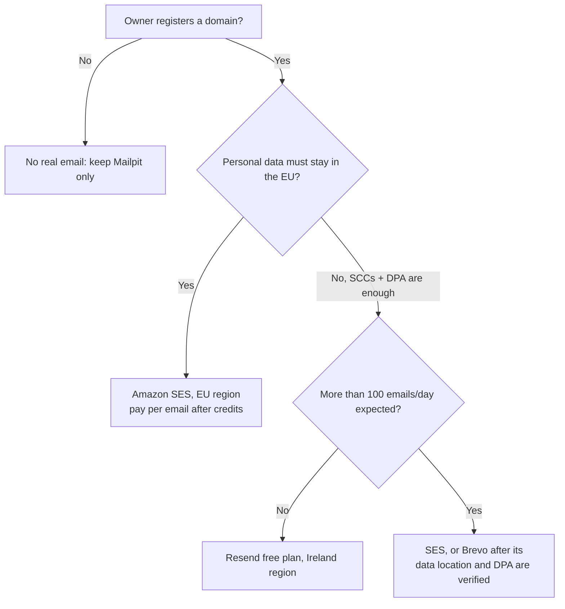

# Email Provider for Real Emails (AU9)

- **Topic:** Which service sends the app's real emails: confirmation links now, and booking confirmations, receipts and missing-payment emails later.
- **Date:** 2026-11-25 (all sources accessed this date)
- **Brief:** Linear FIT-52, section "Brief (orchestrator, 2026-11-25): research only". Compare Amazon SES, Postmark and Resend on price and free tier, EU region and data location, GDPR DPA, SMTP support, DNS setup and domain requirement, and sending limits. Add one more only if a source shows a clearly better free tier (Brevo is included for that reason).
- **Scope:** Transactional email only. Locally, Mailpit keeps catching all email (D-038). The center is out of the picture (D-047), and the owner pays nothing for hosting (D-050).
- **Status:** Research. No decisions. The owner picks.
- **Convention:** Every claim has an official URL. Statements that are this document's own reasoning are labelled **[Synthesis]**. Claims that could not be checked against an official page are labelled **UNVERIFIED**.

---

## 1. Executive summary

1. **Every candidate needs a domain we control.** Resend requires a verified domain [EM-301]. Postmark rejects public domains as senders [EM-205]. SES can verify a single address, but a custom MAIL FROM is impossible on a domain you don't own, such as gmail.com [EM-107], so DMARC alignment fails. No domain is registered for the project today: `SmtpEmailSender` uses the placeholder `no-reply@fitnesscenter.invalid`. **A domain is a cost the owner has to decide on** (open question O1).
2. **Resend has the best verified free tier among the three**: 3,000 emails/month, capped at 100/day, free forever [EM-302]. Postmark's free tier is 100 emails/month [EM-201]. SES has no fixed free email count. New AWS accounts get up to USD 200 in credits on a 6-month free plan [EM-102].
3. **Brevo's free tier is larger (300 emails/day) per Brevo's own pages** [EM-401]. Its data location and DPA could not be verified: its legal and help pages could not be read [EM-404].
4. **Only SES offers EU sending with EU data.** SES runs in five EU regions with SMTP endpoints (Frankfurt, Ireland, London, Paris, Stockholm) [EM-104]. Resend offers an Ireland sending region, but "Resend stores customer data in the United States" [EM-303]. Postmark is hosted in the US and has no EU plans [EM-203].
5. **All three verified providers have a GDPR DPA that is part of their terms**, with Standard Contractual Clauses for transfers [EM-105][EM-204][EM-304].
6. **All support SMTP**, so `SmtpEmailSender` (MailKit) needs only configuration: host, port, username and password [EM-106][EM-206][EM-305][EM-403].
7. **SES has the most start-up friction.** New accounts start in a sandbox: 200 emails per 24 hours, only to verified addresses. Leaving it needs a request that AWS answers "within 96 hours" [EM-103].
8. **Labelled recommendation [Synthesis]:** **Resend on the free plan, sending region Ireland**, for the MVP. **Alternative: Amazon SES in an EU region** if the owner wants personal data kept in the EU or expects more than 100 emails a day. Both need a domain (O1).

## 2. Findings

### 2.1 Amazon SES

- [EM-101] Outbound email costs "$0.10 / 1,000 emails", plus "$0.12 per GB of attachment data sent". Source: https://aws.amazon.com/ses/pricing/. Confidence: High. (Primary)
- [EM-101a] The same page lists plans ("Essentials" at $0.16 per 1,000) and says new accounts with no SES activity since June 1, 2025 "will start on the Essentials plan beginning July 21, 2026." Source: https://aws.amazon.com/ses/pricing/. Confidence: Medium (the page is clear, but how the plan and the à la carte price combine for a new account was not confirmed). (Primary)
- [EM-102] Free tier: "New AWS customers will receive up to $200 in AWS Free Tier credits, which can be applied towards eligible AWS services, including Amazon Simple Email Service." The free plan lasts "6 months after account creation". There is no fixed monthly free SES email count. Sources: https://aws.amazon.com/ses/pricing/, https://aws.amazon.com/free/. Confidence: High. (Primary)
- [EM-103] Sandbox: "You can only send mail to verified email addresses and domains, or to the Amazon SES mailbox simulator", with "a maximum of 200 messages per 24-hour period" and "a maximum of 1 message per second". Production access is requested in the console, and "The AWS Support team provides an initial response to your request within 96 hours." Source: https://docs.aws.amazon.com/ses/latest/dg/request-production-access.html. Confidence: High. (Primary)
- [EM-104] SMTP endpoints exist in Europe (Frankfurt) eu-central-1, Europe (Ireland) eu-west-1, Europe (London) eu-west-2, Europe (Paris) eu-west-3 and Europe (Stockholm) eu-north-1, for example `email-smtp.eu-north-1.amazonaws.com`. Source: https://docs.aws.amazon.com/general/latest/gr/ses.html. Confidence: High. (Primary)
- [EM-105] The AWS Service Terms "incorporate the AWS Data Processing Addendum ("DPA"), when you use AWS Services to process Customer Data", and "The AWS Service Terms include the SCCs". Sources: https://aws.amazon.com/service-terms/ (section 1.14.1), https://aws.amazon.com/compliance/gdpr-center/. Confidence: High. (Primary)
- [EM-106] SMTP: STARTTLS on ports "25, 587, or 2587", TLS wrapper on "465 or 2465". "All connections require Transport Layer Security (TLS)." SMTP credentials are made in the console and are "unique to each AWS Region". Source: https://docs.aws.amazon.com/ses/latest/dg/smtp-credentials.html. Confidence: High. (Primary)
- [EM-107] DNS: Easy DKIM adds "three CNAME records" ([creating identities](https://docs.aws.amazon.com/ses/latest/dg/creating-identities.html)). A custom MAIL FROM needs one MX record (`10 feedback-smtp.<region>.amazonses.com`) and an SPF TXT record (`v=spf1 include:amazonses.com ~all`). You "can't set up a custom MAIL FROM domain for addresses on a domain that you don't own (for example... gmail.com)" ([MAIL FROM](https://docs.aws.amazon.com/ses/latest/dg/mail-from.html)). "A message passes DMARC if one or both of the described SPF or DKIM checks pass", and DKIM alignment needs the signing domain to match the From domain ([DMARC](https://docs.aws.amazon.com/ses/latest/dg/send-email-authentication-dmarc.html)). Confidence: High. (Primary)
- [EM-108] The default sending quota after leaving the sandbox is **not stated** on the pages read. The quotas page says only that you "can request additional quota increases at any time". Source: https://docs.aws.amazon.com/ses/latest/dg/manage-sending-quotas.html. Confidence: n/a (gap).

### 2.2 Postmark

- [EM-201] Free plan: "100 emails/month", "No overages allowed in this plan", and "it doesn't expire". Cheapest paid plan: Basic, "$15.00/mo", "Starting at 10,000 emails/month", "Extra emails @ $1.80 / 1,000". Source: https://postmarkapp.com/pricing. Confidence: High. (Primary)
- [EM-202] While an account is pending approval, "all recipient addresses must share the same domain as the From address" (API error 412). Source: https://postmarkapp.com/developer/api/overview. Confidence: High. (Primary)
- [EM-203] "Postmark's primary data and servers are hosted at Deft's data center (located outside of Chicago), and Amazon Web Services (AWS)." "We currently don't have plans to add servers in the EU." Source: https://postmarkapp.com/eu-privacy. Confidence: High. (Primary)
- [EM-204] The DPA is part of the Terms of Service, so "it is therefore no longer necessary to obtain a signed copy". "Our DPA includes the new Standard Contractual Clauses (SCCs)". Sources: https://postmarkapp.com/eu-privacy, https://postmarkapp.com/dpa. Confidence: High. (Primary)
- [EM-205] Senders: a Sender Signature per From address, or a verified domain ([getting started](https://postmarkapp.com/support/article/1002-getting-started-with-postmark)). Public domains are rejected: "You can't use public domain emails or public domains" (API error 503, [API overview](https://postmarkapp.com/developer/api/overview)). DNS: a DKIM TXT record and a Return-Path CNAME to `pm.mtasv.net`, with DMARC starting at `p=none` ([verify a domain](https://postmarkapp.com/support/article/1046-how-do-i-verify-a-domain)). Confidence: High. (Primary)
- [EM-206] SMTP: host `smtp.postmarkapp.com`, ports "25, 2525, or 587" with STARTTLS. The server API token is both username and password, or an SMTP token pair is used. SMTP must be enabled per server. Source: https://postmarkapp.com/developer/user-guide/send-email-with-smtp. Confidence: High. (Primary)
- [EM-207] Limits: total message size "can be 10 MB" ([size limits](https://postmarkapp.com/support/article/1056-what-are-the-attachment-and-email-size-limits)). "Up to 500 messages in a single batched request" ([API overview](https://postmarkapp.com/developer/api/overview)). No numeric rate limit was found. Confidence: High. (Primary)

### 2.3 Resend

- [EM-301] "You must add and verify at least one domain to send emails with Resend." Resend sends "using a domain you own (i.e., not a shared or public domain)". Source: https://resend.com/docs/dashboard/domains/introduction. Confidence: High. (Primary)
- [EM-302] Free plan: 3,000 emails/month, "100 emails per day", 3 domains. Expiry: "No, but we provide a free-forever plan." Cheapest paid plan: Pro, $20/month for 50,000 emails, overage $0.90 per 1,000. Source: https://resend.com/pricing. Confidence: High. (Primary)
- [EM-303] Sending regions: North Virginia (us-east-1), Ireland (eu-west-1), São Paulo (sa-east-1) and Tokyo (ap-northeast-1). "Region selection controls where your emails are routed and sent from. It does not control where customer data is stored." "Resend stores customer data in the United States", and "there is no setting today that moves stored data to the EU". Sources: https://resend.com/docs/dashboard/domains/regions, https://resend.com/security/gdpr. Confidence: High. (Primary)
- [EM-304] "A GDPR Article 28 Data Processing Addendum is in force for every Resend account." It includes EU SCCs, and Resend claims EU-U.S. Data Privacy Framework participation. Sources: https://resend.com/security/gdpr, https://resend.com/legal/dpa. Confidence: High. (Primary)
- [EM-305] SMTP: host `smtp.resend.com`, ports 25, 465, 587, 2465 and 2587 (465 and 2465 are implicit TLS, the rest STARTTLS). The username is `resend` and the password is the API key. Source: https://resend.com/docs/send-with-smtp. Confidence: High. (Primary)
- [EM-306] DNS: SPF and DKIM records go on the `send` subdomain and `resend._domainkey`. Resend generates the values, and "Domains created after August 2026 may show `CNAME` records instead" of TXT and MX ([domain not verifying](https://resend.com/docs/knowledge-base/what-if-my-domain-is-not-verifying)). DMARC: "we suggest starting with a policy of `p=none;`" ([DMARC](https://resend.com/docs/dashboard/domains/dmarc)). Confidence: High. (Primary)
- [EM-307] Limits: "All accounts start with a rate limit of 10 requests per second", per team. A batch call sends "up to 100 emails". Over-quota sends return HTTP 429 and are not queued or retried. Keep bounces "under 4%" and spam complaints "under 0.08%". Source: https://resend.com/docs/knowledge-base/account-quotas-and-limits. Confidence: High. (Primary)

### 2.4 Brevo (added for its free tier)

- [EM-401] "On the forever free plan you can send up to 300 emails a day", and "paid plans start at $9/month" ([free SMTP server](https://www.brevo.com/free-smtp-server)). "Once we approve your account for sending, you can start sending up to 300 emails per day", and "Free forever, no credit card needed" ([pricing](https://www.brevo.com/pricing/)). Confidence: Medium (official, but marketing pages). (Primary)
- [EM-402] The pricing page lists "No Brevo logo" ("Remove the 'Sent with Brevo' footer") as a feature of paid plans. Whether the footer is added to transactional SMTP email on the free plan is **UNVERIFIED**. Source: https://www.brevo.com/pricing/. Confidence: Low. (Primary)
- [EM-403] SMTP: ports 587 or 2525, or 465 with SSL/TLS. The login is an SMTP key ("Use an SMTP key, not an API key"). The sender "must be registered and verified". Sources: https://developers.brevo.com/docs/smtp-integration, https://developers.brevo.com/docs/send-a-transactional-email. Confidence: High. (Primary)
- [EM-404] Data location, DPA and DNS requirements: **UNVERIFIED**. See section 5.

## 3. Comparison table

| | Amazon SES | Postmark | Resend | Brevo |
|---|---|---|---|---|
| Free tier | Credits only: up to USD 200, 6-month free plan [EM-102] | 100/month, never expires [EM-201] | 3,000/month, max 100/day, never expires [EM-302] | 300/day, never expires [EM-401] |
| Cheapest paid | USD 0.10 per 1,000 [EM-101] | USD 15/month for 10,000 [EM-201] | USD 20/month for 50,000 [EM-302] | From USD 9/month [EM-401] |
| EU sending region | Yes, 5 with SMTP [EM-104] | No [EM-203] | Ireland [EM-303] | **UNVERIFIED** |
| Data stored in | The chosen region (**UNVERIFIED** as a stated guarantee; see section 5) | US [EM-203] | US [EM-303] | **UNVERIFIED** |
| GDPR DPA | In the Service Terms, with SCCs [EM-105] | In the ToS, with SCCs [EM-204] | In force for every account, with SCCs [EM-304] | **UNVERIFIED** |
| SMTP | Yes, TLS required [EM-106] | Yes, STARTTLS [EM-206] | Yes, TLS or STARTTLS [EM-305] | Yes [EM-403] |
| Own domain needed | In practice yes: no DMARC alignment on gmail.com [EM-107] | Yes, public domains rejected [EM-205] | Yes [EM-301] | **UNVERIFIED** |
| DNS records | 3 DKIM CNAMEs, MX + SPF TXT for MAIL FROM, DMARC [EM-107] | DKIM TXT, Return-Path CNAME, DMARC [EM-205] | SPF + DKIM on `send` / `resend._domainkey`, DMARC [EM-306] | **UNVERIFIED** |
| Start-up limits | Sandbox: 200/24 h, verified recipients, up to 96 h for production access [EM-103] | Recipients on own domain until approved [EM-202] | None beyond the plan limits found | Account approval before sending [EM-401] |
| Rate / size limits | Sandbox 1/s; production quota not stated [EM-108] | 10 MB per message, 500 per batch [EM-207] | 10 requests/s, 100 per batch [EM-307] | Not found |

**[Synthesis] What this means for the MVP:** confirmation emails go out once per signup or staff invite. 100 emails a day (Resend) is well above what a single-site MVP in test use is likely to send. This is an estimate: no traffic figures exist yet.

## 4. Options and trade-offs [Synthesis]

| Option | Benefits | Costs and risks |
|---|---|---|
| **A. Resend free (recommended)** | Free for 3,000/month; no sandbox; simple SMTP login (API key); DPA in force | Data stored in the US (SCCs, DPF); 100/day cap and no overage on the free plan, so mail over the cap is refused, not queued [EM-307] |
| B. Amazon SES, EU region | Data processed in an EU region; very low per-email price; scales far | Not free after the credits run out; sandbox and a production request (up to 96 h); AWS account setup and IAM; credit card for AWS (**UNVERIFIED**) |
| C. Brevo free | Largest free tier (300/day) | Data location, DPA and branding **UNVERIFIED**; account approval needed; a marketing-first platform |
| D. Postmark | Strong deliverability reputation (**UNVERIFIED**, not researched) | Free tier only 100/month; US-only hosting; USD 15/month afterwards |

**Labelled recommendation: Option A, Resend on the free plan with the Ireland sending region.** It is the only verified option that is free with no time limit at the volume the MVP needs, and it works with the existing `SmtpEmailSender` through configuration alone. If the owner wants personal data stored in the EU, choose **Option B (SES in eu-north-1 or eu-central-1)** instead; its cost after the credits is USD 0.10 per 1,000 emails [EM-101].

Whichever is chosen, the code change is small: SMTP settings in configuration (user-secrets locally, never git) and a configurable From address in place of the hard-coded `no-reply@fitnesscenter.invalid`.

## 5. Conflicts between sources

- **Postmark Return-Path hostname.** Article 1002 says alias `pm-bounces`. Article 1046 says "By default the hostname is `pm_bounces`". The Postmark UI shows the value to use. Sources: https://postmarkapp.com/support/article/1002-getting-started-with-postmark, https://postmarkapp.com/support/article/1046-how-do-i-verify-a-domain.
- **SES default quota.** The service-quota table lists "200 per 24 hours" and "1 per second" as defaults. Those equal the sandbox limits, so they do not show the production quota. Sources: https://docs.aws.amazon.com/general/latest/gr/ses.html, https://docs.aws.amazon.com/ses/latest/dg/request-production-access.html.
- **The earlier secondary figures** in `integrations-and-architecture.md` row 8 (SES ~$0.10/1,000; Postmark from $15/month for 10k; Resend free 3k/month) agree with the primary pages above [EM-101][EM-201][EM-302].

## 6. Evidence gaps and UNVERIFIED items

- **SES data location.** No page read states that SES stores message data only in the chosen region. AWS's general region model suggests it, but that is **UNVERIFIED** here.
- **SES production quota** after leaving the sandbox: not stated on the pages read [EM-108].
- **SES needs a credit card** at signup: **UNVERIFIED** (not searched).
- **Brevo data location, DPA, DNS rules and free-plan footer:** brevo.com legal and GDPR pages returned only titles or 404, and help.brevo.com returned 403 to automated fetches. A raw download of https://www.brevo.com/gdpr/ contained no hosting statement.
- **Resend `onboarding@resend.dev` test sender** limits: not found.
- **Postmark deliverability** and any provider's inbox-placement rates: not researched (out of scope).
- **Domain prices:** not researched (O1).

## 7. Open questions for the owner

- **O1. Will the project register a domain?** Every option needs one for real email [EM-107][EM-205][EM-301]. It is a yearly cost, which D-050 ("no paid hosting") does not cover either way. A subdomain of a domain the owner already has would also work.
- **O2. Must personal data (email addresses, message content) be stored in the EU?** If yes, SES is the only verified option. If an EU sending region plus a DPA with SCCs is enough, Resend fits.

## 8. Sources

All accessed 2026-11-25. All primary (vendor's own pages).

| URL | Title / content | Publisher |
|---|---|---|
| https://aws.amazon.com/ses/pricing/ | Amazon SES pricing | AWS |
| https://aws.amazon.com/free/ | AWS Free Tier | AWS |
| https://docs.aws.amazon.com/ses/latest/dg/request-production-access.html | Request production access | AWS |
| https://docs.aws.amazon.com/ses/latest/dg/manage-sending-quotas.html | Managing sending quotas | AWS |
| https://docs.aws.amazon.com/general/latest/gr/ses.html | SES endpoints and quotas | AWS |
| https://docs.aws.amazon.com/ses/latest/dg/smtp-credentials.html | SMTP credentials | AWS |
| https://docs.aws.amazon.com/ses/latest/dg/creating-identities.html | Creating identities (Easy DKIM records) | AWS |
| https://docs.aws.amazon.com/ses/latest/dg/mail-from.html | Custom MAIL FROM domain | AWS |
| https://docs.aws.amazon.com/ses/latest/dg/send-email-authentication-dmarc.html | DMARC with SES | AWS |
| https://aws.amazon.com/service-terms/ | AWS Service Terms (§1.14.1) | AWS |
| https://aws.amazon.com/compliance/gdpr-center/ | AWS GDPR Center | AWS |
| https://postmarkapp.com/pricing | Pricing | Postmark |
| https://postmarkapp.com/eu-privacy | EU privacy and GDPR | Postmark |
| https://postmarkapp.com/dpa | Data Processing Addendum | Postmark |
| https://postmarkapp.com/developer/user-guide/send-email-with-smtp | Send email with SMTP | Postmark |
| https://postmarkapp.com/developer/api/overview | API overview (error codes) | Postmark |
| https://postmarkapp.com/support/article/1002-getting-started-with-postmark | Getting started | Postmark |
| https://postmarkapp.com/support/article/1046-how-do-i-verify-a-domain | Verify a domain | Postmark |
| https://postmarkapp.com/support/article/1056-what-are-the-attachment-and-email-size-limits | Size limits | Postmark |
| https://resend.com/pricing | Pricing | Resend |
| https://resend.com/docs/knowledge-base/account-quotas-and-limits | Quotas and limits | Resend |
| https://resend.com/docs/send-with-smtp | Send with SMTP | Resend |
| https://resend.com/docs/dashboard/domains/introduction | Domains | Resend |
| https://resend.com/docs/dashboard/domains/regions | Regions | Resend |
| https://resend.com/docs/knowledge-base/what-if-my-domain-is-not-verifying | Domain not verifying | Resend |
| https://resend.com/docs/dashboard/domains/dmarc | DMARC | Resend |
| https://resend.com/security/gdpr | GDPR | Resend |
| https://resend.com/legal/dpa | DPA | Resend |
| https://www.brevo.com/free-smtp-server | Free SMTP server | Brevo |
| https://www.brevo.com/pricing/ | Pricing | Brevo |
| https://developers.brevo.com/docs/smtp-integration | SMTP integration | Brevo |
| https://developers.brevo.com/docs/send-a-transactional-email | Send a transactional email | Brevo |
