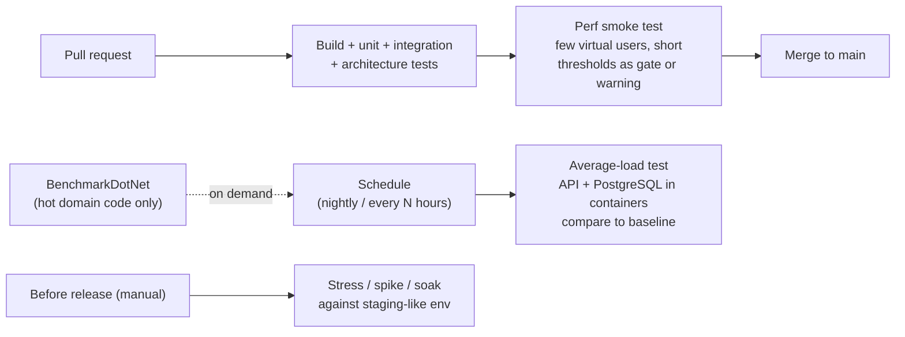

# Performance testing: tools, targets, schedule, environment

- **Date:** 2026-11-13
- **Brief:** Linear [FIT-38](https://linear.app/fitnesscenter/issue/FIT-38/research-performance-testing-tools-and-targets-d-016-q14). Answers open question **Q14** and feeds the open tool and threshold choices in **D-016** and `docs/testing.md` (FIT-37).
- **Scope:** automated load and response-time testing of an ASP.NET Core (.NET 10) + PostgreSQL API, run in CI. Out of scope: functional test frameworks (S11), E2E/browser tools, frontend performance (Lighthouse / Core Web Vitals, pointer only), RFID hardware, general CI design.
- **Status:** research. **No decisions.** Claim prefix `PERF`. Budget used: 25 search/fetch calls.

## 1. Executive summary

1. **All six named tools are free for this project's use except possibly NBomber.** k6 (AGPL-3.0), JMeter (Apache-2.0), Locust (MIT), Gatling Community (Apache-2.0) and Artillery (MPL-2.0) are open source. NBomber's free tier is "for personal use only"; business use is listed at $1,500/year per company ([PERF-010](#3-findings)).
2. **k6 has the most direct CI story of the tools checked:** thresholds such as `p(95)<200` and `rate<0.01` fail the run with a non-zero exit code, and `.ts` scripts run without a build step ([PERF-002], [PERF-003]).
3. **NBomber is the only .NET-native load tool on the list** (C#/F#, xUnit/NUnit runners). It would let the owner write load tests in C#, but the licence question must be settled first.
4. **JMeter is maintained but its last release is 5.6.3 (January 2024)**. It needs Java and uses XML test plans; a C# DSL (jmeter-dotnet-dsl) exists and is listed by Microsoft ([PERF-006], [PERF-001]).
5. **BenchmarkDotNet is a different tool for a different job:** micro-benchmarks of single methods in Release builds, not load on the whole API ([PERF-015]).
6. **Aspire's testing builder starts the whole AppHost, PostgreSQL included**, so the same AppHost could boot the system for a CI performance run. Testcontainers is the lighter alternative ([PERF-017], [PERF-019]).
7. **Targets should be percentiles plus error rate, chosen from user needs, not from today's numbers** (Google SRE). Generic reference points exist (Nielsen's 0.1 s / 1 s / 10 s), but nothing authoritative for "small business apps" was found ([PERF-021]–[PERF-024]).
8. **Grafana's guide: smoke tests on code changes, larger tests on a schedule, not in deployment pipelines.** Shared GitHub runners are noisy; relative comparisons (baseline vs candidate in the same job) are the documented workaround ([PERF-025]–[PERF-032]).

## 2. Where performance tests could sit [Inference]

This shows the pattern from the sources (smoke per change, larger tests on a schedule). It is not a decision.

## 3. Findings

### 3.1 Tools (Q1)

- [PERF-001] Microsoft Learn's ASP.NET Core load/stress page (default view `aspnetcore-10.0`, content dated 2019, metadata updated 2026-11-03) lists Azure Load Testing and these third-party tools: Apache JMeter, ApacheBench, Gatling, jmeter-dotnet-dsl, k6, Locust, West Wind WebSurge, Netling, Vegeta and NBomber. Source: https://learn.microsoft.com/en-us/aspnet/core/test/load-tests. Confidence: High. (Primary)
- [PERF-002] k6 is under AGPL-3.0, scripts are JavaScript, and the latest release is v2.4.0 (2026-11-12; a v1.8.2 maintenance release came out in October). Source: https://github.com/grafana/k6 and GitHub releases API for grafana/k6 (https://github.com/grafana/k6/releases). Confidence: High. (Primary)
- [PERF-003] k6 "uses esbuild to transpile TypeScript (TS) code for all files that have the `.ts` extension", enabled by default since v0.57. Support is partial: it "strips the type information but doesn't provide type safety." Source: https://grafana.com/docs/k6/latest/using-k6/javascript-typescript-compatibility-mode/. Confidence: High. (Primary)
- [PERF-004] k6 thresholds are "the pass/fail criteria that you define for your test metrics". Failing one gives a non-zero exit code; examples include `http_req_duration: ['p(95)<200']` and `http_req_failed: ['rate<0.01']`. `abortOnFail` stops a run early. Source: https://grafana.com/docs/k6/latest/using-k6/thresholds/. Confidence: High. (Primary)
- [PERF-005] **UNVERIFIED:** an official k6 GitHub Action exists. Not read; the threshold exit code alone is enough for any CI system ([PERF-004]).
- [PERF-006] JMeter: latest version 5.6.3 ("Requires Java 8+"), published as a GitHub release on 2024-01-09; licence Apache-2.0 (GitHub repo metadata); repo still receives pushes (last 2026-11-05). JMeter has a "CLI mode (… headless mode)" for load runs. Sources: https://jmeter.apache.org/download_jmeter.cgi, https://jmeter.apache.org/, GitHub API for apache/jmeter. Confidence: High. (Primary)
- [PERF-007] **UNVERIFIED:** how JMeter turns results into a CI pass/fail (assertions, plugins or the jmeter-dotnet-dsl). Not researched within budget.
- [PERF-008] Locust: MIT licence, tests in "plain Python", can run "without the UI, making it easy to use for CI/CD testing". Latest release 2.47.0 (2026-10-21). `--exit-code-on-error` "Sets the process exit code to use when a test result contain any failure or error." The configuration page documents no exit code based on response time. Sources: https://github.com/locustio/locust, https://docs.locust.io/en/stable/configuration.html, GitHub API. Confidence: High. (Primary)
- [PERF-009] Gatling Community Edition is Apache-2.0 and free including commercially. Scripts in Java, Kotlin, Scala, or JavaScript/TypeScript (separate gatling-js SDK). gRPC, MQTT, GraphQL and JDBC components are capped in the Community Edition (5 concurrent users, 5-minute tests); HTTP is not in that list. Gatling Enterprise is the paid product. Latest: gatling v3.16.0 (2026-09-29), gatling-js v3.16.4 (2026-11-04). Sources: https://github.com/gatling/gatling, GitHub API. Confidence: High. (Primary)
- [PERF-010] NBomber: tests in C#/F#; "xUnit and NUnit runners are supported" for CI/CD. Pricing: Personal "$0 … Free, for personal use only"; Business $1,500/year per company; Enterprise $2,500/year per company. Cluster (distributed load) is Enterprise-only; reports are in all tiers. Latest release v6.7.1 (2026-10-16); GitHub shows no recognised open-source licence. Sources: https://nbomber.com/pricing/, https://nbomber.com/docs/getting-started/overview/, GitHub API for PragmaticFlow/NBomber. Confidence: High for prices; the full licence agreement PDF was **not read**. (Primary)
- [PERF-011] **UNVERIFIED:** NBomber's threshold API. The thresholds docs page returned 404 (https://nbomber.com/docs/nbomber/thresholds/).
- [PERF-012] Artillery: MPL-2.0, latest artillery-2.0.34 (2026-08-14). Its `ensure` checks (e.g. `p95: 200`, `maxErrorRate: 1`) make Artillery "exit with a non-zero exit code" when exceeded. Sources: https://www.artillery.io/docs/reference/extensions/ensure, GitHub API for artilleryio/artillery. Confidence: High. (Primary). **UNVERIFIED:** whether `ensure` is in the free edition (the page doesn't say).
- [PERF-013] Azure Load Testing is a managed service that can run existing JMeter scripts ([PERF-001]). [Inference] It ties the tests to Azure, while hosting is still open (SA4).
- [PERF-014] Evidence gap: Microsoft's own `crank` benchmarking tool, `bombardier`, and `wrk` were not researched.

### 3.2 Micro-benchmarks vs load tests (Q2)

- [PERF-015] BenchmarkDotNet benchmarks individual methods marked `[Benchmark]` and reports Mean, Error and StdDev. It "will only run benchmarks if the application is built in the Release configuration" to "prevent unoptimized code from being benchmarked". Latest release v0.16.0-preview.2 (2026-09-23), MIT. Sources: https://benchmarkdotnet.org/articles/overview.html, GitHub API. Confidence: High. (Primary)
- [PERF-016] [Inference] Load tests measure the whole system (HTTP, ASP.NET Core, EF Core, PostgreSQL) under concurrent users. Micro-benchmarks measure one code path in isolation. For this project, load tests answer D-016's "response time under load"; micro-benchmarks only help if a specific domain calculation (e.g. pay or notice-period rules) turns out hot.

### 3.3 Starting the system in CI (Q3)

- [PERF-017] Aspire's `DistributedApplicationTestingBuilder` "launches your AppHost project in a background thread and manages its lifecycle". The AppHost "orchestrates all dependent app resources—regardless of their type", including "a PostgreSQL database". It is "designed specifically for closed-box integration testing". Mocking is not supported. It disables the dashboard and randomises proxied ports by default. Source: https://aspire.dev/testing/overview/ (redirected from learn.microsoft.com). Confidence: High. (Primary)
- [PERF-018] Evidence gap: the Aspire page links to a "Testing in CI/CD pipelines" section that was not read, and it says nothing about the app's environment name (Development/Production) under the testing builder.
- [PERF-019] Testcontainers for .NET starts PostgreSQL from code (`new PostgreSqlBuilder("postgres:15.1").Build()`, then `GetConnectionString()`). Latest 4.16.0 (2026-10-09), MIT. Sources: https://dotnet.testcontainers.org/modules/postgres/, GitHub API. Confidence: High. (Primary)
- [PERF-020] Microsoft: load and stress tests "should be done in release and production mode and not in debug and development mode", because Development mode logs more and Debug is not optimised. Source: https://learn.microsoft.com/en-us/aspnet/core/test/load-tests. Confidence: High. (Primary). [Inference] Whatever starts the API for a perf run must use a Release build and a non-Development environment; that needs checking for the Aspire testing builder ([PERF-018]).

### 3.4 Metrics and how to pick targets (Q4)

- [PERF-021] Google SRE: "Most metrics are better thought of as distributions rather than averages"; a "simple average can obscure these tail latencies"; a high percentile "such as the 99th or 99.9th, shows you a plausible worst-case value". Source: https://sre.google/sre-book/service-level-objectives/. Confidence: High. (Primary, established engineering book)
- [PERF-022] Google SRE target-setting rules: "Don't pick a target based on current performance", "Keep it simple", "Have as few SLOs as possible", "Avoid absolutes", "Perfection can wait" (start loose, tighten later). Same source. Confidence: High.
- [PERF-023] Standard threshold shape in tool docs: a latency percentile plus an error rate (k6 `p(95)<200` + `http_req_failed rate<0.01` [PERF-004]; Artillery `p95` + `maxErrorRate` [PERF-012]). These numbers are the docs' examples, **not recommendations**. Confidence: High.
- [PERF-024] Nielsen (1993, web update 2014): 0.1 s feels instantaneous; 1.0 s keeps "the user's flow of thought" uninterrupted; 10 s is the limit for keeping attention. Source: https://www.nngroup.com/articles/response-times-3-important-limits/. Confidence: High. (Primary, old but widely cited). [Inference] These are user-perceived end-to-end times, not API server times; the API budget has to be smaller.
- Evidence gap: no authoritative published target values for small-business admin apps were found. No targets are proposed here.

### 3.5 When to run (Q5)

- [PERF-025] Grafana k6 guide: smoke tests can run "on project changes"; "we advise not to run larger tests in pipelines meant for automatic deployment"; for pre-release, schedule tests "every 4 hours or 8 hours". Source: https://grafana.com/docs/k6/latest/testing-guides/automated-performance-testing/ (undated). Confidence: Medium (vendor guide, but not ranking a product). (Primary)
- [PERF-026] Same guide: compare runs with "the same workload, running the same scenario with the same test data against the same environment"; "do not rely entirely on Pass/Fail results"; if unsure, use thresholds "to warn about possible issues" and tune over time; "Start small". Confidence: Medium.
- [PERF-027] k6 test types: smoke (minimal load, run on code changes), average-load (expected normal conditions, run often), stress, soak, spike, breakpoint (run only a few times). Source: https://grafana.com/docs/k6/latest/testing-guides/test-types/. Confidence: Medium. (Primary)
- [PERF-028] GitHub-hosted standard Linux runners: 4 CPUs / 16 GB RAM for public repos, 2 CPUs / 8 GB RAM for private repos. Source: https://docs.github.com/en/actions/reference/runners/github-hosted-runners. Confidence: High. (Primary). [Inference] On a private repo, the load generator, API and PostgreSQL would share 2 CPUs, so absolute numbers measure the runner as much as the app.
- [PERF-029] Reichelt, Jung, van Hoorn (arXiv, 2024): bare metal had lower runtime and standard deviation for multi-threaded runs, but "performance changes up to 4.41% are detectable by GitHub actions … as long as only sequential workloads are examined." Source: https://arxiv.org/abs/2411.05491. Confidence: Medium (preprint, one benchmark). (Primary)
- [PERF-030] Quansight Labs (2021, engineering blog): comparing identical commits on GitHub Actions gave ratios from 0.51 to 1.36 (mean 1.00, SD 0.05), and 3.7% false positives at a 1.2 threshold. Recommendation: relative benchmarking, running both commits "in the same CI job", and triggering runs on demand (PR label) rather than on every push. Source: https://dev.to/quansightlabs/is-github-actions-suitable-for-running-benchmarks-111h. Confidence: Medium. (Secondary, established engineering blog, older than 2024)
- [PERF-031] [Inference] Combined: on shared runners, a per-PR gate on absolute milliseconds will be flaky. Options: (a) per-PR smoke test with generous thresholds that catch only gross regressions or errors; (b) nightly/scheduled comparison against a stored baseline; (c) a self-hosted or dedicated runner for steadier numbers (costs money).
- [PERF-032] Vendor data (CodSpeed) on runner noise was seen only in search results, not read, and is excluded.

### 3.6 Environment (Q6)

- [PERF-033] Grafana's guide: development env is "great for verifying the basic functionality of our tests by running smoke tests"; a shared QA env is "unsuitable for assessing the performance and scalability"; staging is "generally suitable for assessing performance changes"; "Testing production with minimal load is safe." Source: [PERF-025] URL. Confidence: Medium.
- [PERF-034] [Inference] Trade-offs for a solo developer on a tight budget:

| Environment | Cost | Realism | Noise | Notes |
|---|---|---|---|---|
| Ephemeral containers on GitHub-hosted runner (Aspire testing builder or Testcontainers/Compose) | Included in Actions minutes | Low: 2–4 shared CPUs, not the production host | High | Good for smoke + relative trends. Needs Release/Production mode ([PERF-020]) |
| Self-hosted runner on own machine | Electricity / hardware | Medium | Lower, if nothing else runs | Security care needed for runners on a repo; not researched |
| Staging copy of production hosting (SA4) | A second server/plan | High | Low–medium | Only meaningful once hosting is chosen |
| Production, minimal load | None extra | Highest | n/a | Synthetic check only; never synthetic heavy load during opening hours [Inference] |

### 3.7 Domain scenarios worth testing (Q7) [Inference]

All from `docs/architecture.md`; none backed by an external source.

- **RFID check-in burst** (§6.2): many swipes in a short window (class start, after work). Path: Access → Members.Contracts → Booking.Contracts → write attendance. Response time matters because a person waits at the door.
- **Concurrent booking of the last class spot** (§6.1): booking uses a row lock or serializable transaction with retry. Test many users booking one session at once: check no overbooking, waitlist order, and p95/p99 under lock contention. This is both a correctness and a performance test.
- **Staff list/search screens** (members, shifts): typical read load during opening hours.
- **Login** (Identity, MFA for staff): password hashing is CPU-heavy by design; useful to know its cost, not to "optimise" it.
- Size of all scenarios depends on member count (F4) and peak usage, which are unknown.

## 4. Options and trade-offs (load tool)

| Tool | Script language | Licence / cost | CI pass/fail | Activity | Fit notes [Inference] |
|---|---|---|---|---|---|
| **k6** | JavaScript, TypeScript (types stripped) | AGPL-3.0, free; Grafana Cloud paid (not researched) | Built-in thresholds → exit code | v2.4.0, 2026-11-12 | TS matches the frontend skill set; single binary |
| **NBomber** | C# / F# | Free only "for personal use"; business $1,500/yr | xUnit/NUnit runners; threshold API UNVERIFIED | v6.7.1, 2026-10-16 | Same language as backend; licence is the blocker |
| **JMeter** | XML test plans (GUI); C# via jmeter-dotnet-dsl | Apache-2.0, free | UNVERIFIED (plugins/assertions) | Last release 5.6.3, Jan 2024 | Owner has heard of it; needs Java; heavier |
| **Gatling** | Java/Kotlin/Scala, JS/TS | Apache-2.0 Community; Enterprise paid | UNVERIFIED (assertions not read) | v3.16.x, Sep–Nov 2026 | Needs JVM/Node toolchain |
| **Locust** | Python | MIT, free | Exit code on any error; latency gate not documented on config page | 2.47.0, 2026-10-21 | Adds Python to the stack |
| **Artillery** | YAML + JS | MPL-2.0 | `ensure` → exit code (free-edition status UNVERIFIED) | 2.0.34, 2026-08-14 | Node toolchain |
| Azure Load Testing | JMeter scripts | Paid managed service | Not researched | — | Ties tests to Azure while SA4 is open |

Environment options are in §3.6; schedule options in [PERF-031].

## 5. Conflicts between sources

- None direct. The only tension: the arXiv study ([PERF-029]) finds GitHub Actions usable for detecting ~4% changes in sequential workloads, while the Quansight data ([PERF-030]) shows ±40–50% outliers. Possible explanation: different workloads (single-threaded benchmark vs a Python suite), different years (2024 vs 2021), and the arXiv authors' own caveat that multi-threaded runs were noisier. A load test is multi-threaded, so the noisier end is the safer assumption [Inference].

## 6. Evidence gaps and UNVERIFIED items

- NBomber threshold API (docs URL 404) and full licence agreement PDF.
- Whether the owner's use of NBomber counts as "personal use" (a real business uses the system).
- JMeter and Gatling CI pass/fail mechanisms (not read).
- Artillery `ensure` availability in the free edition.
- Official k6 GitHub Action (not read).
- Aspire testing builder: CI section and environment name (not read / not stated).
- crank, bombardier, wrk not researched.
- No authoritative target values for small business web apps found (searched implicitly via SRE and NN/g sources only; no dedicated search).

## 7. Open questions for the owner

1. **Language for load tests:** C# (NBomber, needs a licence check or $1,500/yr), TypeScript/JavaScript (k6, free), or JMeter (free, Java, XML/GUI)?
2. **Gate or signal:** should a per-PR performance smoke test **block** merging, or only **warn**, given shared-runner noise?
3. **Schedule:** is a nightly/scheduled average-load run plus a manual pre-release stress run acceptable, instead of full load tests on every PR?
4. **Repo visibility:** public or private GitHub repo? It changes runner size (4 vs 2 CPUs) and Actions minutes.
5. **Targets:** after the center meeting (F4: member count, peak hours), can the owner supply expected peak check-ins and bookings per minute, so targets can be set from user needs rather than measured numbers?
6. **Staging:** is a staging environment in the hosting budget (SA4), or will performance runs be CI-container-only for now?

## 8. Sources

| URL | Title | Publisher | Accessed | Type |
|---|---|---|---|---|
| https://learn.microsoft.com/en-us/aspnet/core/test/load-tests | ASP.NET Core load/stress testing | Microsoft Learn | 2026-11-13 | Primary |
| https://grafana.com/docs/k6/latest/using-k6/thresholds/ | Thresholds | Grafana k6 docs | 2026-11-13 | Primary |
| https://grafana.com/docs/k6/latest/using-k6/javascript-typescript-compatibility-mode/ | JavaScript and TypeScript compatibility mode | Grafana k6 docs | 2026-11-13 | Primary |
| https://grafana.com/docs/k6/latest/testing-guides/automated-performance-testing/ | Automated performance testing | Grafana k6 docs | 2026-11-13 | Primary (vendor guide) |
| https://grafana.com/docs/k6/latest/testing-guides/test-types/ | Load test types | Grafana k6 docs | 2026-11-13 | Primary (vendor guide) |
| https://github.com/grafana/k6 (+ /releases, GitHub API) | grafana/k6 | GitHub | 2026-11-13 | Primary |
| https://nbomber.com/pricing/ | Pricing | NBomber | 2026-11-13 | Primary |
| https://nbomber.com/docs/getting-started/overview/ | Overview | NBomber | 2026-11-13 | Primary |
| https://jmeter.apache.org/ , https://jmeter.apache.org/download_jmeter.cgi | Apache JMeter | Apache Software Foundation | 2026-11-13 | Primary |
| https://github.com/locustio/locust | locustio/locust | GitHub | 2026-11-13 | Primary |
| https://docs.locust.io/en/stable/configuration.html | Configuration | Locust docs | 2026-11-13 | Primary |
| https://github.com/gatling/gatling | gatling/gatling | GitHub | 2026-11-13 | Primary |
| https://www.artillery.io/docs/reference/extensions/ensure | ensure | Artillery docs | 2026-11-13 | Primary |
| https://benchmarkdotnet.org/articles/overview.html | Overview | BenchmarkDotNet | 2026-11-13 | Primary |
| https://aspire.dev/testing/overview/ | Testing overview | Aspire docs (Microsoft) | 2026-11-13 | Primary |
| https://dotnet.testcontainers.org/modules/postgres/ | PostgreSQL module | Testcontainers for .NET | 2026-11-13 | Primary |
| https://sre.google/sre-book/service-level-objectives/ | Service Level Objectives | Google SRE book | 2026-11-13 | Primary |
| https://www.nngroup.com/articles/response-times-3-important-limits/ | Response Times: The 3 Important Limits | Nielsen Norman Group | 2026-11-13 | Primary |
| https://docs.github.com/en/actions/reference/runners/github-hosted-runners | GitHub-hosted runners | GitHub Docs | 2026-11-13 | Primary |
| https://arxiv.org/abs/2411.05491 | Overhead Measurement Noise in Different Runtime Environments | arXiv (Reichelt, Jung, van Hoorn) | 2026-11-13 | Primary (preprint) |
| https://dev.to/quansightlabs/is-github-actions-suitable-for-running-benchmarks-111h | Is GitHub Actions suitable for running benchmarks? | Quansight Labs (DEV) | 2026-11-13 | Secondary (engineering blog) |
| GitHub REST API `repos/{owner}/{repo}/releases` for apache/jmeter, locustio/locust, gatling/gatling, gatling/gatling-js, artilleryio/artillery, PragmaticFlow/NBomber, dotnet/BenchmarkDotNet, testcontainers/testcontainers-dotnet | Latest release tags, dates, licences | GitHub | 2026-11-13 | Primary |
