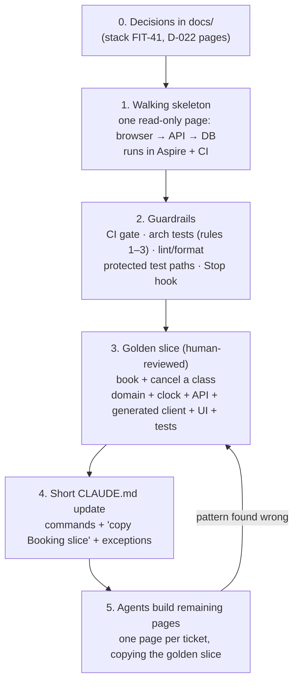
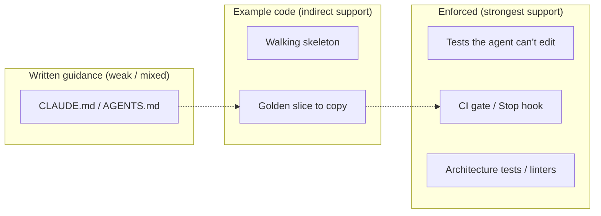

# Scaffolding before agent coding: evidence and what to scaffold

- **Date:** 2026-11-13
- **Brief:** Linear [FIT-49](https://linear.app/fitnesscenter/issue/FIT-49). Check whether hand-built scaffolding (structure, conventions, an example slice, tests, CI gates) improves agent coding results, and turn the evidence into a prioritised list of what to build by hand before agents build the six MVP pages (D-022). Feeds FIT-31 (scaffold ticket).
- **Scope:** the practice of scaffolding for agent coding, applied to this project. Out of scope: backend language (FIT-41), test framework (S11), auth provider (AU5).
- **Builds on (not repeated):** `agentic-project-planning.md` (§ failure table, "scaffold first" row), `agentic-workflows.md` (§2.5 CI gates, §3 workflows A–D, §4 repo checklist), `testing-strategy.md` (§2.2 agents gaming tests, read-only tests).
- **Status:** research. **No decisions.** Claim prefix `SCAF`. Budget used: about 29 search/fetch calls plus read-only `gh api` calls.

Evidence labels: **[Study]** measured paper or benchmark; **[Vendor]** tool-maker docs or engineering blog; **[Practitioner]** blog or trade-press opinion/experience; **[Synthesis]** / **[Inference]** this agent's reasoning.

---

## 1. Executive summary

1. **No study found that compares "human scaffolds first" with "agent scaffolds first".** The owner's claim is not directly tested anywhere I could find. What exists is indirect: studies on code quality and on context files, vendor guidance, and practitioner reports ([SCAF-001], §6).
2. **Indirect evidence supports "the existing code shapes what agents write".** Anthropic's docs say Claude learns layout, conventions and "how existing components are built" by reading the code, and recommend prompts like "follow the pattern in X" ([SCAF-010], [SCAF-011]). Snyk showed Copilot copying a SQL injection from open files ([SCAF-013]). A FORGE 2026 paper found healthier code is associated with more reliable AI refactoring ([SCAF-014]). So a clean first slice is worth more than usual, and a bad one spreads.
3. **Written instructions are weaker than code and checks.** An ICLR 2026 study found AGENTS.md-style context files did "not generally improve task success rates" and raised cost by over 20%. They help mainly for non-standard practices ([SCAF-020]). Anthropic says to keep CLAUDE.md short and to move zero-exception rules into hooks ([SCAF-012]).
4. **Enforced checks are the strongest-supported layer.** Anthropic: give the agent a pass/fail check; testing tools "dramatically improved performance" ([SCAF-030], [SCAF-031]). OpenAI's harness-engineering team relied on custom linters and structural tests for layering ([SCAF-032], [SCAF-033]). Tests must be protected from the agent (`testing-strategy.md` §2.2).
5. **Evidence against "by hand":** both vendor showcases let the *agent* type the scaffold. OpenAI's team used "no manually typed code at all"; Anthropic's harness uses an "initializer agent" ([SCAF-040], [SCAF-041]). **[Inference]** What the evidence supports is that the structure is *human-designed, reviewed and enforced*, not that a human typed it.
6. **Walking skeleton / tracer bullet:** a minimal end-to-end implementation linking all main architectural components, kept and grown, unlike a throw-away prototype ([SCAF-050]–[SCAF-052]). Agent-era practitioners reuse it as a human-owned "skeleton" that agents fill in ([SCAF-055]).
7. **Recommended order [Synthesis]:** decisions, then a walking skeleton (one read-only page end to end), then CI and architecture tests, then one hand-reviewed golden slice, then agents on the rest. Candidate golden slice: **book and cancel a class** (§4.3).
8. **Templates exist for both backends.** .NET: `aspire new aspire-ts-cs-starter`, `ardalis/modulith` (`dotnet new modulith`, includes an ArchUnitNET test per module), `jasontaylordev/CleanArchitecture` (React + PostgreSQL + Aspire options). Reference only: `evolutionary-architecture-by-example` (a fitness-domain modular monolith). TS: `acme-corp` (very new) ([SCAF-060]–[SCAF-066]).

---

## 2. Order of work (diagram)

Scaffold layers by strength of evidence:

---

## 3. Findings

### 3.1 Q1: Evidence that pre-built structure improves agent output

- [SCAF-001] **Evidence gap.** No controlled study or benchmark was found that compares agent results on a hand-scaffolded repo with an agent-scaffolded or empty repo. Searches: "AGENTS.md evaluation", "code smells replicated from context", "walking skeleton/vertical slice reference implementation agents". A search summary reported the same for pattern-copying research. Confidence: n/a.
- [SCAF-014] **[Study]** Borg, Hagatulah, Tornhill, Söderberg (FORGE 2026): on 5,000 Python competitive-programming files, they found "a meaningful association between CodeHealth … and semantic preservation after AI refactoring", and conclude "human-friendly code is also more compatible with AI tooling." Source: https://arxiv.org/abs/2601.02200v1. Confidence: Medium. (Primary; refactoring task on small files, not feature building; the abstract gives no effect size; Tornhill is a CodeScene founder, so there is a possible vendor interest; affiliation not stated on the arXiv page, **UNVERIFIED**.)
- [SCAF-013] **[Vendor]** Snyk (Degges, 2024-02-22): Copilot uses "neighboring tabs" (open files) as context; with a vulnerable file open, "We've just gone from one SQL injection in our project to two", and "Copilot is less likely to suggest insecure code in projects without security issues." Source: https://labs.snyk.io/resources/copilot-amplifies-insecure-codebases-by-replicating-vulnerabilities/. Confidence: Low–Medium. (Single constructed demo by a security vendor; IDE completion, not an agent.)
- [SCAF-020] **[Study]** Gloaguen et al., "Evaluating AGENTS.md" (arXiv 2602.11988, ICLR 2026): "providing context files does not generally improve task success rates, while increasing inference cost by over 20% on average." It holds for LLM-generated and developer-written files. Instructions are well followed, but repository overviews do not help. Files are useful for non-standard practices. Source: https://arxiv.org/abs/2602.11988. Confidence: High. (Primary. Per-condition percentages appear only in secondary summaries and are not repeated here.)
- [SCAF-055] **[Practitioner]** Farry, "Working with Code Assistants: the Skeleton Architecture" (InfoQ, 2026-02-03): humans own a "skeleton" (base classes, interfaces, template methods that own logging/errors/auth, schema validation, architecture tests). Agents write the "vertical tissue". "Prompts are soft, architecture is hard." He reports Claude once tried to disable authentication to make code work. Evidence is one author's project, with no measurements. Source: https://www.infoq.com/articles/skeleton-architecture/. Confidence: Low. (Practitioner.)
- **Evidence against / caveats:**
  - [SCAF-021] Farry acknowledges a critique that rigid skeletons might "stifle innovation by restricting the AI's freedom", and calls the rigidity "a feature, not a bug." Source: https://www.infoq.com/articles/skeleton-architecture/. Confidence: Low.
  - [SCAF-022] Anthropic warns against over-enforcement: "keep the enforced set small … If you ever find yourself at forty of them, most are probably preferences." Source: https://code.claude.com/docs/en/best-practices. Confidence: High. (Vendor primary.)
  - [SCAF-023] Böckeler (Thoughtworks) on OpenAI's harness: "What I am missing in the write-up is verification of functionality and behaviour". She also notes OpenAI has "a vested interest in us believing in AI-maintainable code", and asks whether harnesses become "the new service templates" with the same forking and sync problems. Source: https://www.martinfowler.com/articles/exploring-gen-ai/harness-engineering-memo.html (2026-02-17). Confidence: Medium. (Practitioner, well known.)
  - The TDAD preprint (generic TDD instructions *raised* regressions) is in `testing-strategy.md` §2.2. It warns that "tests first" written only as an instruction is not automatically better.

### 3.2 Q2: What agents benefit from most

| Scaffold element | What sources say | IDs |
|---|---|---|
| Existing code patterns / reference slice | Claude finds "your file layout, your conventions, your test framework, and how existing components are built" by reading code. Docs recommend "follow the pattern in HotDogWidget.php". CLAUDE.md should flag "an old pattern that's everywhere but that new code must not copy". **[Vendor]** | SCAF-010, SCAF-011 |
| CLAUDE.md / AGENTS.md | Keep it short. Include what Claude can't find in code: test/typecheck/lint commands, misleading spots. Measured benefit is small or none (SCAF-020). | SCAF-012, SCAF-020 |
| Pass/fail checks (tests, build, linter) | "Give Claude something it can run that comes back pass or fail." "The single most useful line in your CLAUDE.md is the command that runs it." **[Vendor]** | SCAF-030 |
| E2E / browser testing tools | "Providing Claude with these kinds of testing tools dramatically improved performance." **[Vendor anecdote]** | SCAF-031 |
| Architecture tests / custom linters | OpenAI enforced the layering with deterministic custom linters and structural tests (secondary reports). Farry adds architecture tests to the skeleton. | SCAF-032, SCAF-033, SCAF-055 |
| Hooks / deny rules | Zero-exception rules belong in hooks, not CLAUDE.md. | SCAF-012 |
| Feature list / init script / progress file | Anthropic's initializer sets these up to stop "one-shotting" and premature "done". | SCAF-041 |
| Types/interfaces first | Farry's skeleton is interfaces and base classes. No measured source found. | SCAF-055; gap |
| Generators / templates | No agent-specific evidence found. Böckeler raises template drift as a risk. | SCAF-023; gap |

- [SCAF-010] **[Vendor]** "Claude starts every task by reading your code … They'll find your file layout, your conventions, your test framework, and how existing components are built". Source: https://code.claude.com/docs/en/best-practices. Confidence: High (as a vendor statement).
- [SCAF-011] **[Vendor]** Example prompt: "follow the pattern in HotDogWidget.php and build a calendar widget …". CLAUDE.md example line: "src/legacy/ is still live but don't copy its patterns into new code." Source: https://code.claude.com/docs/en/best-practices. Confidence: High. **[Inference]** The vendor expects agents to copy nearby patterns, both good and bad.
- [SCAF-012] **[Vendor]** Keep CLAUDE.md short. It holds only what Claude can't work out from code. "If something has to happen every time, make it a hook, a deny rule, or a managed setting." Source: https://code.claude.com/docs/en/best-practices. Confidence: High.
- [SCAF-030] **[Vendor]** "Give Claude something it can run that comes back pass or fail. Once it has that, it can keep going on its own". Source: https://code.claude.com/docs/en/best-practices. Confidence: High.
- [SCAF-031] **[Vendor]** Anthropic harness post (2025-11-26): Claude "mostly did well at verifying features end-to-end once explicitly prompted to use browser automation tools", and "Providing Claude with these kinds of testing tools dramatically improved performance." Source: https://www.anthropic.com/engineering/effective-harnesses-for-long-running-agents. Confidence: Medium. (Vendor anecdote, not quantified.)
- [SCAF-032] **[Practitioner, secondary]** InfoQ (2026-02-21) on OpenAI's post: "Dependencies flow in a controlled sequence from Types → Config → Repo → Service → Runtime → UI". Structural tests check that modular layering isn't violated. Docs are enforced by "linters and CI validation." Source: https://www.infoq.com/news/2026/02/openai-harness-engineering-codex/. Confidence: Medium. (The OpenAI primary page returned HTTP 403 and was not read: **UNVERIFIED** at primary level.)
- [SCAF-033] **[Practitioner]** Böckeler: constraints are "Monitored not only by the LLM-based agents, but also deterministic custom linters and structural tests". "Garbage collection" means agents run periodically to find documentation inconsistencies or architecture violations. Source: https://www.martinfowler.com/articles/exploring-gen-ai/harness-engineering-memo.html. Confidence: Medium.

### 3.3 Q3: Walking skeleton, tracer bullet, vertical slice

- [SCAF-050] **Walking skeleton.** "A Walking Skeleton is a minimal, end-to-end implementation of the system that links together all the main architectural components." Advice: "Start with a Walking Skeleton, keep it running, and grow it incrementally." The term is credited to Alistair Cockburn. Source: Clint Shank, *97 Things Every Software Architect Should Know* (CC BY 3.0), https://yoshi389111.github.io/kinokobooks/soft_en/Start_with_a_Walking_Skeleton.htm. Confidence: Medium. (Secondary to Cockburn. Cockburn's own page returned 404 and the web archive could not be fetched, so his exact wording is **UNVERIFIED**.)
- [SCAF-051] **Tracer bullets** (Hunt & Thomas). Interview by Bill Venners, Artima, 2003-04-21. Hunt describes a skeleton application with one thin line of execution end to end through UI, business logic and database. Features are then added one by one and the code is kept. Thomas: "The more quickly you can get feedback, the less change you need to get back on target." Source: https://www.artima.com/articles/tracer-bullets-and-prototypes. Confidence: High. (Primary interview.)
- [SCAF-052] **Tracer code vs prototype.** "Prototypes are for your learning" (Hunt). "Prototypes by their nature are not designed to be long lasting code" (Thomas). Tracer code is kept and grown. Source: https://www.artima.com/articles/tracer-bullets-and-prototypes. Confidence: High.
- [SCAF-053] **Freeman & Pryce (GOOS) definition: UNVERIFIED.** A search for the book's wording ("thinnest possible slice of real functionality that we can automatically build, deploy, and test end-to-end") returned no page with the text. Not cited.
- [SCAF-054] **Agent era.** Anthropic's initializer sets up `init.sh`, a progress file, an initial commit and a feature list marked "failing". It does this because agents "tended to try to do too much at once—essentially to attempt to one-shot the app", and later sessions would "declare the job done" ([SCAF-041]). Farry splits the work into a human-owned skeleton and agent "vertical tissue", and warns that slices alone cause "governance drift" when each slice implements its own auth or caching ([SCAF-055]). **[Synthesis]** The walking skeleton's goal is unchanged, but its audience is new: it is now also the example the agent copies.

### 3.4 Q4: How much by hand vs agent under supervision

- [SCAF-040] **[Practitioner on vendor]** OpenAI's harness team used "no manually typed code at all" as a forcing function, and fixes were made by "having Codex itself write the fix". Source: https://www.martinfowler.com/articles/exploring-gen-ai/harness-engineering-memo.html. Confidence: Medium. (A search summary also said Codex generated the initial scaffold and AGENTS.md. That was not read on a fetched page: **UNVERIFIED**.)
- [SCAF-041] **[Vendor]** Anthropic's harness uses an *initializer agent* for the first session's setup. Source: https://www.anthropic.com/engineering/effective-harnesses-for-long-running-agents. Confidence: High.
- **Pattern copying, good and bad:** SCAF-011 and SCAF-013 (bad patterns spread), SCAF-014 (healthier code, more reliable AI edits). No study measured an agent copying a *reference slice* in a full repo (gap).
- **[Synthesis]** The evidence does not support "type it by hand" as such. It does support three things:
  1. A human decides and reviews the structure, because the agent copies whatever is there.
  2. The first slice is kept clean, because errors spread.
  3. Rules are enforced by checks, not prose.

  That leaves two workable modes. The owner can type the skeleton and golden slice by hand, which is slow but builds learning, and this is a learning project. Or the owner can have an agent generate them in small steps (workflow A in `agentic-workflows.md` §3) and review every line before anything is copied from them.

### 3.5 Q5: Prioritised checklist for this project

Items are ordered. "Source" means the reason is backed; otherwise **[Synthesis]**. Stack-specific examples cover both backend options from FIT-41.

| # | Item (build/review by hand before agents do pages) | Pages served | Project rule | Basis |
|---|---|---|---|---|
| 1 | **Solution layout + one module's folders**: .NET `src/Modules/Booking/{Domain,Application,Infrastructure,Contracts}`, or TS `packages/booking/{domain,app,infra,contracts}` | all | arch §4.2 rules 1–2 | SCAF-010, SCAF-032 (structure is read and copied); exact layout [Synthesis] |
| 2 | **Walking skeleton**: the classes list page (read-only) going browser → API → PostgreSQL (`booking` schema) → back. Runs via Aspire (or `bun dev`) and in CI | Classes | D-009, D-014 | SCAF-050, SCAF-051 |
| 3 | **CI gate**: build `-warnaserror` / `tsc`, unit + integration tests, lint, format. Branch protection | all | D-010 | SCAF-030; `agentic-workflows.md` §2.5 |
| 4 | **Architecture tests for rules 1–3**: NetArchTest/ArchUnitNET (.NET), or dependency-cruiser / Turborepo boundaries (TS; Turborepo's is Experimental, `stack-comparison-acme-corp.md` [ACME-040]) | all | arch §4.2 | SCAF-032, SCAF-033, SCAF-055; tool choice open (S11) |
| 5 | **OpenAPI → generated client pipeline** and a check that `frontend/src/api/` is never hand-edited (deny rule/hook + CI diff check) | all FE pages | rule 6 | SCAF-012 (zero-exception rule → hook) |
| 6 | **Shared kernel minimum**: `Money` (øre, `long`), injected clock (`TimeProvider`/NodaTime `IClock`; TS: a `Clock` interface), Europe/Copenhagen helper | Classes, Payment, Account | CLAUDE.md conventions | [Synthesis]: the agent would otherwise invent its own |
| 7 | **Test harness**: fake clock, synthetic-data builders (no real data), DB integration fixture, one E2E test, one perf smoke test. Protect acceptance tests (deny `Edit`) | all | D-010, D-016, personal-data rule | SCAF-031; `testing-strategy.md` §2.2 (M1) |
| 8 | **Golden slice**: book + cancel a class, end to end (domain rules with clock, endpoint, generated client, form, unit + property + integration + E2E tests) | Classes | all of the above | SCAF-011 ("follow the pattern in …"); choice [Synthesis] §4.3 |
| 9 | **Dev auth stub** (fixed synthetic member/staff identity) behind a seam, so pages can be built before AU5 is decided | Login, Account, Classes | D-011/AU5 open | [Synthesis] |
| 10 | **Short CLAUDE.md update**: real commands, "copy `Booking` as the reference slice", known exceptions. Stop hook for typecheck/tests | all | — | SCAF-012, SCAF-020 |
| 11 | Feature list per page (D-022) with pass flags, plus a Linear ticket per page | all | D-017 | SCAF-041 |

Left to agents after that **[Synthesis]**: landing page, account/profile, payment history, simulated payment, simulated check-in, and the real login once AU5 is decided. Each is a ticket that says "copy the Booking slice".

### 3.6 Golden slice choice [Synthesis]

| Candidate | Exercises | Against |
|---|---|---|
| **Book + cancel a class** (recommended) | Domain rules (capacity, cancellation cutoff) that need the injected clock and property tests; write path; schema-per-module; generated client; form + error states; E2E | Needs a member identity → use dev auth stub (#9) |
| Simulated check-in | Small write path, clock (opening hours) | Fewer rules; staff-side UI, less representative of member pages |
| Login/signup | Needed by everything | Depends on the AU5 decision; identity code is framework-specific and a poor general pattern |
| Landing | Trivial | No backend, no domain rules; teaches the agent nothing |
| Account + payment history | Read path across modules (Payments) | Cross-module read is the hard boundary case. Better as a deliberate second reference after the first golden slice |

Reasoning: the golden slice should touch every layer and every rule the agent must follow (SCAF-011, SCAF-055). Booking is the only MVP flow that combines time rules, a write, validation and tests in one module.

### 3.7 Q6: Templates and generators (checked 2026-11-13 via GitHub API / docs)

| Option | What it gives | Status | Fit | ID |
|---|---|---|---|---|
| `aspire new aspire-ts-cs-starter` | "Starter App (ASP.NET Core/React)": AppHost, ServiceDefaults, minimal API, React frontend | Official CLI template | Walking-skeleton base for .NET; no modules | SCAF-060 |
| `ardalis/modulith` (`dotnet new modulith`, `--add basic-module`) | Modular monolith solution + per-module projects; module isolation "enforced by an ArchUnit test" | 187★, MIT, last push 2026-06-08, .NET 10 PR merged 2025-10 | Closest to D-008 + arch tests; small community | SCAF-061 |
| `jasontaylordev/CleanArchitecture` (`dotnet new ca-sln -cf react -db postgresql`) | Clean Architecture, React or Angular, PostgreSQL, Aspire, .NET 10 SDK | 20.7k★, MIT, pushed 2026-11-13 | Mature, but layered rather than modular | SCAF-062 |
| `ardalis/CleanArchitecture` | Clean Architecture template for ASP.NET Core 10 | 18.5k★, MIT, template repo, pushed 2026-11-12 | Same caveat | SCAF-063 |
| `evolutionary-architecture-by-example` | Reference (not a template): modular monolith "Fitnet" in a **Fitness** domain, 4 chapters, mentions Aspire | 3.6k★, MIT, pushed 2026-10-26 | Good reading for module/contract shape | SCAF-064 |
| `kgrzybek/modular-monolith-with-ddd` | Reference DDD modular monolith | 14.1k★, MIT, last push 2024-06-04 (stale) | Reference only | SCAF-065 |
| `Pallepadehat/acme-corp` (TS) | Full TS starter (React/TanStack/Tailwind/shadcn, Fastify, Drizzle, Better Auth) | 1★, 2 commits, template repo | See `stack-comparison-acme-corp.md`; no module boundaries | SCAF-066 |

- [SCAF-060] Source: https://aspire.dev/reference/cli/commands/aspire-new/ (lists `aspire-starter`, `aspire-ts-cs-starter`, `aspire-py-starter`, `aspire-ts-starter`, `aspire-empty`, `aspire-ts-empty`). Confidence: High.
- [SCAF-061] Source: https://github.com/ardalis/modulith (README: `dotnet new install Ardalis.Modulith`; "enforced by an ArchUnit test"; GitHub API metadata). Confidence: High.
- [SCAF-062] Source: https://github.com/jasontaylordev/CleanArchitecture (README: `dotnet new ca-sln --client-framework [angular|react|none] --database [postgresql|sqlite|sqlserver]`, "powered by ASP.NET Core and Aspire"). Confidence: High.
- [SCAF-063] Source: https://github.com/ardalis/CleanArchitecture (API metadata). Confidence: High.
- [SCAF-064] Source: https://github.com/evolutionary-architecture/evolutionary-architecture-by-example (README: "Analysis of a representative business domain (Fitness)", project `Fitnet`). Confidence: High.
- [SCAF-065] Source: https://github.com/kgrzybek/modular-monolith-with-ddd (API metadata). Confidence: High.
- [SCAF-066] Source: https://github.com/Pallepadehat/acme-corp; details in `stack-comparison-acme-corp.md` [ACME-001]–[ACME-003]. Confidence: High.
- **[Synthesis]** Templates cut typing, but a template's patterns become the patterns agents copy (SCAF-011). Whatever template is chosen, its example code needs the same review as a golden slice, or should be deleted (acme-corp's README itself says to replace its todo example).

---

## 4. Options and trade-offs

| Option | For | Against |
|---|---|---|
| **A. Type skeleton + golden slice by hand** | Maximum learning; owner knows every line agents copy | Slowest; owner is new to parts of the stack and may write non-idiomatic patterns that then spread (SCAF-013 logic) |
| **B. Agent generates them in small steps, owner reviews every line (workflow A)** | Matches what both vendors do (SCAF-040, SCAF-041); faster; idiomatic code | Review fatigue; risk of accepting patterns not understood |
| **C. Start from a template, then hand-review and trim** | Fastest skeleton; arch tests may come built in (modulith) | Template's conventions may clash with D-008/D-014; template drift (SCAF-023) |
| **D. Skip scaffolding; agents build page by page** | Least upfront effort | Each page invents its own patterns ("governance drift", SCAF-055); no evidence supports it |

---

## 5. Conflicts between sources

- **"By hand" vs agent-written scaffolds.** Practitioners (Farry) say humans own the skeleton. OpenAI and Anthropic had agents write the scaffold under human direction (SCAF-040, SCAF-041). **Possible explanation:** "own" means design and enforce, not type. The vendor teams are expert and have a stake in agent-written code (SCAF-023).
- **Context files.** Vendor docs treat CLAUDE.md as a core lever. The ICLR study finds little or no success gain (SCAF-020). **Possible explanation:** the study measured general repo overviews on existing benchmarks. Both sources agree that short, non-obvious, project-specific instructions are the useful part.

## 6. Evidence gaps and UNVERIFIED items

- No controlled comparison of human- vs agent-scaffolded repos (searched: AGENTS.md evaluation, pattern-copying studies, walking-skeleton/vertical-slice + agents).
- No measured effect of a "golden slice", types-first, architecture tests or generators on agent output.
- OpenAI "Harness engineering" primary page: HTTP 403. Claims rest on InfoQ and Böckeler (**UNVERIFIED** at primary level, including "Codex wrote the initial scaffold/AGENTS.md").
- Cockburn's own definition page: 404. GOOS wording not found (**UNVERIFIED**).
- Borg et al.: effect size and author affiliation not read (**UNVERIFIED**).

## 7. Open questions for the project owner

1. **Who types the skeleton and golden slice:** you by hand (A), an agent in small steps with your line-by-line review (B), or a trimmed template (C)? This is learning vs speed.
2. **Golden slice:** do you accept "book + cancel a class" as the reference flow, or prefer another (§3.6)?
3. **Template:** start from `aspire-ts-cs-starter`, `ardalis/modulith`, `jasontaylordev/CleanArchitecture` or acme-corp, or start blank? This depends on FIT-41.
4. **Auth before AU5:** is a dev-only fake identity acceptable in the skeleton, so pages can be built before the login decision?
5. **Enforcement set:** which rules become hooks or architecture tests (generated client, test files, module boundaries), and which stay as CLAUDE.md lines?

## 8. Sources (accessed 2026-11-13)

| URL | Title / publisher | Date | Type |
|---|---|---|---|
| https://arxiv.org/abs/2602.11988 | Gloaguen et al., Evaluating AGENTS.md (ICLR 2026) | 2026-02-12 (v1) | Primary study |
| https://arxiv.org/abs/2601.02200v1 | Borg et al., Code for Machines, Not Just Humans (FORGE 2026) | 2026-01-05 | Primary study |
| https://code.claude.com/docs/en/best-practices | Anthropic, Best practices for Claude Code | current | Primary vendor |
| https://www.anthropic.com/engineering/effective-harnesses-for-long-running-agents | Anthropic, Effective harnesses for long-running agents | 2025-11-26 | Primary vendor |
| https://www.martinfowler.com/articles/exploring-gen-ai/harness-engineering-memo.html | Böckeler, Harness Engineering – first thoughts | 2026-02-17 | Secondary/practitioner |
| https://www.infoq.com/news/2026/02/openai-harness-engineering-codex/ | InfoQ, OpenAI harness engineering | 2026-02-21 | Secondary |
| https://www.infoq.com/articles/skeleton-architecture/ | Farry, The Skeleton Architecture (InfoQ) | 2026-02-03 | Practitioner |
| https://labs.snyk.io/resources/copilot-amplifies-insecure-codebases-by-replicating-vulnerabilities/ | Snyk Labs, Copilot amplifies insecure codebases | 2024-02-22 | Vendor |
| https://yoshi389111.github.io/kinokobooks/soft_en/Start_with_a_Walking_Skeleton.htm | Shank, Start with a Walking Skeleton (97 Things, CC BY 3.0) | n/a | Secondary |
| https://www.artima.com/articles/tracer-bullets-and-prototypes | Venners, interview with Hunt & Thomas | 2003-04-21 | Primary |
| https://aspire.dev/reference/cli/commands/aspire-new/ | Aspire CLI `aspire new` | current | Primary |
| https://github.com/ardalis/modulith | Ardalis.Modulith | pushed 2026-06-08 | Primary |
| https://github.com/jasontaylordev/CleanArchitecture | Clean Architecture Solution Template | pushed 2026-11-13 | Primary |
| https://github.com/ardalis/CleanArchitecture | Ardalis Clean Architecture template | pushed 2026-11-12 | Primary |
| https://github.com/evolutionary-architecture/evolutionary-architecture-by-example | Evolutionary Architecture by Example | pushed 2026-10-26 | Primary |
| https://github.com/kgrzybek/modular-monolith-with-ddd | Modular Monolith with DDD | pushed 2024-06-04 | Primary |
| https://github.com/Pallepadehat/acme-corp | acme-corp starter | 2026-10-15 | Primary |
