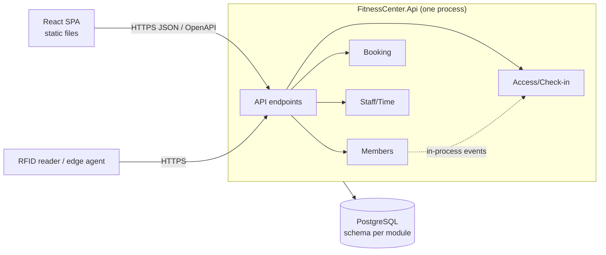
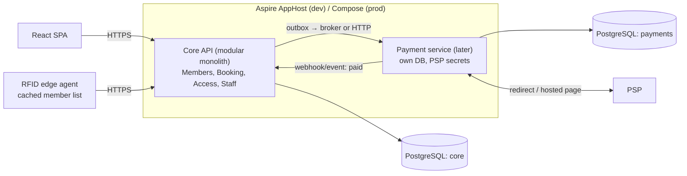
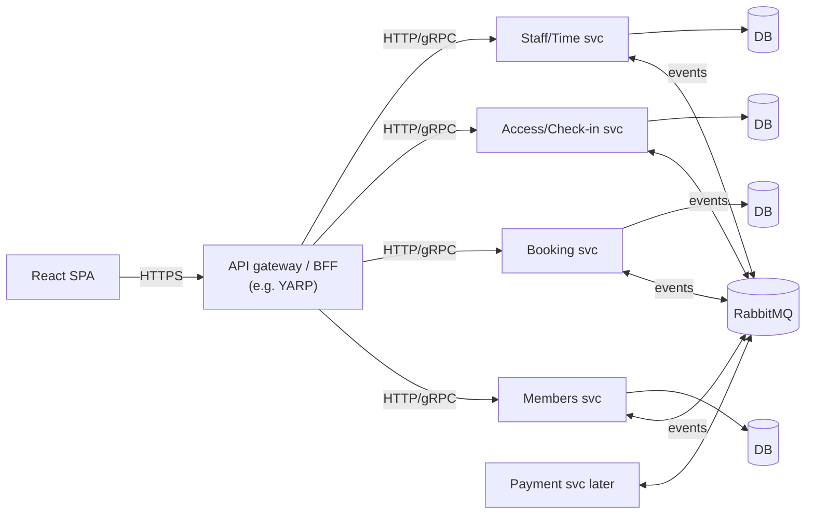

# Service Architecture: Separate Services vs Modular Monolith — Research

**Status:** Research only. Nothing here is a decision. This file feeds [D-008](../decisions.md#d-008-architecture-direction-separated-components).
**Date of research:** 2026-11-12
**Builds on:** [integrations-and-architecture.md](integrations-and-architecture.md) §3.1 (incl. Errata), §3.5, §3.8; [tech-stack.md](tech-stack.md) §2.3, §5.1; [compliance-legal-security.md](compliance-legal-security.md) §5.1, §10. Those findings are not repeated here.

**Conventions**
- `[A#]` refers to the Sources list at the end.
- **UNVERIFIED** means I could not confirm the claim against a primary source in this pass.
- **Anecdote** means practitioner opinion or vendor claim.
- **Inference** means my own reasoning from the cited facts, with no direct source.

---

## 1. Executive summary

1. **"Frontend → API → logic → DB" is normally a layering pattern inside one process, not a set of services.** Microsoft's .NET architecture guide says *layers* are logical separation, and *tiers* are what you get when logic is "physically distributed to separate servers or processes". It adds that "it's possible, and quite common, to have an N-Layer application that is deployed to a single tier" [A1]. Its multi-project example "uses several projects for organizational purposes, [but] it's still deployed as a single unit" [A1]. The React SPA is a separate deployable either way, because it runs in the browser.
2. **Splitting API and logic into separate processes is the distribution Fowler warns against.** His "First Law of Distributed Object Design" is "don't distribute your objects". Remote calls are "orders of magnitude slower" and can fail, and "you can't encapsulate the remote/in-process distinction" [A2]. Microservices are normally split **by business capability** (each owning its data [A12]), not by technical layer.
3. **The "independence" the owner wants can mostly be had inside one deployable.** Fowler: "it's perfectly possible to have firm module boundaries with a monolith, but it requires discipline" [A3]. In .NET, separate projects plus `internal` plus architecture tests (NetArchTest [A15], ArchUnitNET [A16]) turn that discipline into CI failures (tech-stack §2.3).
4. **The payment service is the one component with a strong, specific reason to be a separate deployable:** PCI scope isolation (compliance §5.1). With a hosted payment page or redirect, though, card data never touches the system at all, so the gain is smaller than it looks (compliance §5.1; [A20]).
5. **A distributed design adds whole problem classes that a single deployable does not have:** sagas and compensations [A9], outbox plus idempotent consumers [A10], contract drift (Pact [A18]), service-to-service auth, and multi-store GDPR erasure. Each is a good learning topic but a cost for a solo developer on a token budget.
6. **Credible middle ground:** a modular monolith with **.NET Aspire** as the local orchestrator and dashboard [A7]. Payment comes later as a second deployable, connected through an **outbox** [A10]. Aspire can publish to Docker Compose [A8], which fits a single EU VPS. Microsoft's own eShop reference app uses this tooling, but in a fully services-based form [A6].
7. **Evidence-weighted ranking (not a decision):** (1) Shape B, modular monolith + Aspire + payment as a separate deployable later; (2) Shape A, plain modular monolith; (3) Shape C, separate API/logic/domain services. See §5.

---

## 2. Findings

### 2.1 Layers vs tiers vs services: what the chain normally means

- **Layers vs tiers.** Microsoft defines layers as logical, and tiers as the physical deployment targets when logic is distributed [A1]. The traditional N-Layer split is UI → BLL (business logic layer) → DAL (data access layer), where "the UI layer shouldn't make any requests to the DAL directly" [A1].
- **Clean Architecture in one process.** Microsoft's guide: "For monolithic applications, the Application Core, Infrastructure, and UI projects are all run as a single application" [A1]. That is the C# version of "API → logic → DB": `Api` (UI layer) → `Application/Core` (logic) → `Infrastructure` (EF Core/Npgsql).
- **Monolith definition.** A monolith runs "within its own process", and "the entire application is typically deployed as a single unit". It may still be "organized into several libraries, components, or layers" [A1].
- **When Microsoft says to split.** Microsoft gives these reasons not to split yet: the app "might not yet need to scale features independently"; "early in the development of an application, you might not have a clear idea where the natural functional boundaries are"; and "separating an application into many discrete processes also introduces overhead" (event bus, retries, eventual consistency) [A1].
- **Microservices split by domain.** In a microservice design, "each microservice must own its domain data and logic", aligned to a DDD Bounded Context. The Bounded Context pattern itself "doesn't specify whether [it] is a distributed service or … simply a logical boundary … within a monolithic-deployment application" [A12].
- **Sam Newman.** *Monolith to Microservices* (O'Reilly) is about evolving existing systems. It has chapters titled "When Might Microservices Be A Bad Idea?" and "To Change The Monolith, Or Not?" [A19]. I did not read the book text in this pass, so any specific Newman advice on modular monoliths is **UNVERIFIED** here.
- **eShop.** Microsoft's current reference app is "a services-based architecture with Aspire" on .NET 10, with PostgreSQL, Redis and RabbitMQ as containers [A6]. *Inference:* eShop is a teaching sample for distributed .NET, not a sizing recommendation for a ~10-staff, single-site system. Microsoft's own guide also points to the "much simpler" monolithic eShopOnWeb [A1].

**Plain answer:** the owner's chain is, by these sources, a description of **layers**. Making each layer its own process turns layers into **tiers**. Microservices are a third thing: they are split by **business capability**, not by layer.

### 2.2 Communication options (only relevant if services are split)

| Option | Fit here | Evidence |
|---|---|---|
| In-process calls / interfaces / in-process events | Default inside a modular monolith | [A1], tech-stack §2.3 |
| HTTP/JSON + OpenAPI | Required anyway for React → API. Reuses the OpenAPI→TS client pipeline (tech-stack §2.10) | — |
| gRPC | Service-to-service only. "It's not possible to directly call a gRPC service from a browser", so React would need gRPC-Web or JSON transcoding [A14] | [A14] |
| Messaging (RabbitMQ etc.) + outbox | Async, decoupled. Needs a broker to host plus an outbox and idempotent consumers. The relay "might publish a message more than once" [A10] | [A10] |

### 2.3 Data: shared DB vs database-per-service

- **Shared database.** "familiar and straightforward ACID transactions" and "simpler to operate". The cost is development-time and runtime coupling [A11].
- **Database-per-service.** "you can't make a single ACID transaction across microservices … you must use eventual consistency", and you lose cross-store integrity constraints and joins [A12].
- **Sagas** replace ACID with local transactions plus compensations. Microsoft lists "complexity of debugging sagas", the fact that compensations "might not always succeed", and anomalies (lost updates, dirty reads) [A9]. On choreography: "integration testing is difficult because all services must run" [A9].
- **Middle ground inside a monolith:** one PostgreSQL instance with **one schema per module**, each module having its own `DbContext` (tech-stack §2.3). This keeps ACID and gives ownership boundaries that can later become separate databases. *Inference.*
- **Concrete flows that cross modules here:** membership status → access/check-in, booking ↔ membership entitlement, staff schedule ↔ time registration, and later payment → membership status. In one DB these are single transactions. Split up, each needs a saga or eventual consistency. *Inference.*

### 2.4 Failure isolation and check-in latency

- **Isolation is the main argument for separate services** (integrations §3.1). The BFF guide says isolating services "contain[s] malfunctions" [A13].
- **But the likely outage at a single-site gym is the internet or the one host,** not one module crashing. Separate containers on the **same VPS** share that failure. *Inference.* The offline answer is the **edge/door component** and vendor offline locks (integrations §3.8), and it applies to every shape below.
- **Extra hop latency.** Microsoft: a new service "introduces an extra network hop" and "increased latency might occur" [A13]. Fowler: remote calls are "orders of magnitude slower" than in-process ones [A2].
  - The absolute added time for one same-host HTTP hop (likely low milliseconds) is **UNVERIFIED**. I found no measurement in this pass.
  - *Inference:* for an RFID tap, one extra hop is unlikely to be noticeable. Chatty, fine-grained calls between the API and logic services could be. Fowler's advice to "batch all that into a single call" [A2] is the mitigation.
- **Middle ground:** run the check-in endpoint as its own process from the same codebase (same modules, separate host). Or rely on the on-site edge agent's cached member list (integrations §3.8 option b). *Inference.*

### 2.5 Testing

- **Monolith.** `WebApplicationFactory` integration tests against a real PostgreSQL via Testcontainers. Testcontainers needs "a Docker-API compatible container runtime" and is tested on Docker on Linux. Podman is not mentioned on its page (**UNVERIFIED** for Podman) [A17]. One process means one test host, which suits an agent's test command loop (testing-strategy.md).
- **Services.**
  - Each service needs its own integration tests, plus contract tests between consumer and provider. Pact is "consumer-driven contract testing for HTTP and message integrations" [A18].
  - End-to-end tests need all services running. For choreographed sagas this is called out as hard [A9].
  - PactNet's .NET support was not confirmed on the fetched page (**UNVERIFIED**).
- **Architecture tests** run in the plain unit test run. NetArchTest: "enforce architectural rules in unit tests", e.g. `ShouldNot().HaveDependencyOn(...)` [A15]. ArchUnitNET supports xUnit, xUnit v3, NUnit and MSTest [A16]. Neither repo page showed a latest release date, so maintenance status is **UNVERIFIED** [A15][A16].

### 2.6 AI-agent friendliness

- **Context.** One repo and one solution means the agent can grep, compile and test the whole system in one loop (integrations §3.1). With separate services, a cross-cutting change touches several projects, several DTO copies and contracts. *Inference.*
- **Contract drift.** In a monolith, the compiler catches a changed method signature. Across services, it is caught only by contract tests or generated clients, and only if the agent runs them. *Inference*, consistent with agentic-workflows.md §1.2 (enforced checks beat instructions).
- **Monorepo vs multi-repo.** Every shape here can live in **one monorepo**. eShop holds all its services in one repository [A6]. Multi-repo would multiply agent sessions and context reloads. *Inference;* no source fetched.
- **Boundary enforcement.** Agents tend to take shortcuts (testing-strategy.md §2.2). Architecture tests make a forbidden cross-module reference a red test, which gives the same pressure as a network boundary at much lower cost. *Inference.*

### 2.7 Local development on Arch Linux

- **docker compose:** works for every shape. The Docker engine on Linux is the tested runtime for Testcontainers [A17].
- **Aspire:**
  - Aspire is "a code-first orchestration and observability layer for distributed applications". It provides a dashboard ("all logs in one place") and service discovery [A7].
  - It is explicitly *not* "a cloud provider or production runtime" [A7].
  - It lists Linux install commands [A7]. eShop's README says it needs an OCI container runtime, with "Docker Desktop … the recommended default" and Podman also supported [A6].
  - *Inference:* Aspire is useful even for a monolith (AppHost wires API + PostgreSQL + later payment service). It becomes more valuable the more processes there are.
- Arch-specific packaging of the .NET SDK and Aspire CLI was not checked (**UNVERIFIED**, as in tech-stack §5.2).

### 2.8 Hosting cost and operations (small EU)

- **Single VPS (Hetzner, ≈ €11–13/mo, tech-stack §5.1).** Extra containers cost little extra compute, but each adds patching, logs, health checks and a deploy unit. A broker (RabbitMQ) adds another stateful service to back up. *Inference.*
- **PaaS (Render).** Pricing is per web service (≈ $7 each, tech-stack §5.1), so 3–4 services cost roughly 3–4× the compute line. *Inference from those prices.*
- **Aspire publish.** Aspire can publish or deploy to Docker Compose, Kubernetes, Azure Container Apps and Azure App Service [A8], so the dev orchestration can produce a Compose file for a VPS.
- **Operations.** Fowler: "you need a mature operations team to manage lots of services" [A3].

### 2.9 Security

- **Service-to-service auth** is needed only once there is more than one backend process. The usual options are a private network or Docker network only, OAuth2 client-credentials tokens, or mTLS. *Not researched in this pass* (**UNVERIFIED**). In a monolith, the only boundary is browser → API.
- **PCI.** A hosted payment page or redirect keeps card data out of every service, which reduces scope to SAQ A (compliance §5.1).
  - Iframe embeds carry script-integrity eligibility criteria, while a plain redirect is reported as exempt [A20].
  - Vendor sources disagree on whether the page's own redirect-initiating scripts are in scope. **UNVERIFIED** against PCI SSC text [A20].
  - *Inference:* a separate payment deployable still helps by isolating PSP secrets, webhooks and their attack surface.
- **Segmentation.** Microsoft notes that separation "can reduce the API's surface area and limit lateral movement" [A13].

### 2.10 GDPR erasure across services

- Erasure has to respect legal holds: bookkeeping and time records are kept 5 years, and erasure must reach backups (compliance §10, SEC-11, PRIV-06).
- **One DB:** one erasure or anonymisation routine plus one backup policy.
- **Database-per-service:** an erasure command has to reach every store, plus broker queues and outbox tables that may hold personal data. Each service needs its own retention rules and an audit that erasure finished. *Inference* from [A10][A12] and compliance §10; no GDPR-specific source on microservices was fetched.

### 2.11 Learning value

- **Modular monolith:** teaches DDD boundaries, Clean Architecture [A1], architecture tests, EF Core per-module schemas, Testcontainers.
- **Distributed:** additionally teaches sagas [A9], outbox [A10], brokers, contract testing [A18], distributed tracing (Aspire dashboard [A7]), service auth.
- *Inference:* Shape B below gets most of the distributed curriculum (outbox, broker, a second service, Aspire, contract test between core and payment) without making every feature distributed.

---

## 3. Comparison table

Ratings are relative, for this project. ✓ = favourable, ~ = mixed, ✗ = unfavourable. Most cells are *Inference* from the cited findings.

| Criterion | A: Modular monolith | B: Modular monolith + Aspire + separate payment (outbox) | C: Separate services (API/BFF + logic/domain services) |
|---|---|---|---|
| Solo effort / complexity | ✓ lowest [A1][A3] | ~ low core, one distributed seam later | ✗ highest: premium [A3], sagas [A9] |
| Agent context / drift | ✓ one compile unit | ✓ core; ~ one contract (payment) | ✗ many contracts; drift only caught by tests [A18] |
| Testing | ✓ Testcontainers + arch tests [A15][A17] | ✓ + one contract/outbox test | ✗ per-service + contract + E2E; choreography hard [A9] |
| Local dev (Arch) | ✓ `dotnet run` + PG container | ✓ Aspire AppHost [A7] | ~ needs Aspire/compose for N services [A6] |
| Hosting cost / ops | ✓ 1 app + PG | ~ +1 app (+ broker if used) | ✗ N apps + broker; ×N on PaaS (§2.8) |
| Failure isolation | ✗ one process (mitigate via edge, §2.4) | ~ payment isolated; check-in via edge | ✓ per-service, but same-host/internet failures shared |
| Check-in latency | ✓ in-process | ✓ in-process | ~ +1–2 hops (absolute **UNVERIFIED**) [A2][A13] |
| Data consistency | ✓ ACID | ✓ ACID core; outbox at payment seam [A10] | ✗ eventual consistency/sagas [A9][A12] |
| Security / PCI | ~ PSP secrets in main app | ✓ PSP secrets isolated; SAQ A via redirect [A20] | ~ isolation, but S2S auth everywhere |
| GDPR erasure | ✓ one store | ~ two stores + outbox | ✗ N stores + queues |
| Learning value | ~ boundaries, clean arch | ✓ boundaries + outbox + Aspire + one real service | ✓ most, at highest cost |
| Later extraction | ~ possible if boundaries held [A3] | ✓ pattern already exercised once | n/a |

---

## 4. Candidate shapes

### Shape A: Modular monolith (layers in one process)



Repo layout (monorepo):
```
/frontend                      React + TS (Vite)
/src/FitnessCenter.Api         host, endpoints, composition root
/src/Modules/Members/{Members.Contracts, Members}   internal types, own DbContext/schema
/src/Modules/Booking/...  /Access/...  /Staff/...
/src/BuildingBlocks            shared kernel (small)
/tests/ArchitectureTests       NetArchTest/ArchUnitNET rules
/tests/IntegrationTests        WebApplicationFactory + Testcontainers
docker-compose.yml             api + postgres
```

### Shape B: Modular monolith + Aspire + payment service later (middle ground)



Repo layout: Shape A, plus:
```
/src/FitnessCenter.AppHost          Aspire orchestration
/src/FitnessCenter.ServiceDefaults  OpenTelemetry, health checks
/src/Payments/{Payments.Api, Payments.Contracts}   added when D-006 is reopened
/tests/ContractTests                Core ↔ Payments (Pact or schema snapshot)
```
Optional variant: add a separate `CheckIn` host that reuses the `Access` module, if the owner wants check-in on its own process (§2.4).

### Shape C: Separate deployables (the literal chain, or split by domain)


- **Literal variant:** `SPA → Api process → Logic process → DB`, with one logic service. This is a *physical tier split* of layers. It pays the remote-call cost [A2] without any domain independence, and no fetched source recommends it.
- **Repo layout:** a monorepo with `/services/<name>/{Api, Domain, Infrastructure, Tests}` per service, plus `/gateway`, `/contracts` (OpenAPI/proto), an Aspire AppHost and `/tests/e2e`. Each service needs its own Dockerfile, migrations, health checks and auth config.
- YARP as the gateway was **not researched** in this pass (**UNVERIFIED**).

---

## 5. Evidence-weighted ranking (NOT a decision)

1. **Shape B: modular monolith + Aspire + separate payment deployable later.**
   - Keeps ACID and one compile unit for the core [A1][A12].
   - Meets the owner's "independent" goal through enforced module boundaries [A3][A15][A16].
   - Puts the one well-justified separate service (payment, PCI and secret isolation) behind the outbox pattern [A10].
   - Aspire gives distributed-systems learning and a dashboard [A7], and can publish to Compose for a VPS [A8].
2. **Shape A: plain modular monolith.** Cheapest and simplest. It loses little against B until payments arrive, and it can grow into B.
3. **Shape C: separate services.** Its benefits (independent scaling and deploys, team autonomy [A3][A13]) mostly do not apply to one developer and one site. Its costs (sagas, contract drift, multi-store GDPR, N× hosting) all do [A9][A12][A3]. The literal layer-per-process variant is weakest, because it pays the distribution cost without domain independence [A2].

Confidence: medium. The sources are general architecture guidance, not studies of solo or agent-built systems. Agent-friendliness claims are *Inference*.

---

## 6. Risks

- **Boundary erosion (A/B).** Without architecture tests, agents may add cross-module references, and the monolith degrades into the "spaghetti" Microsoft describes [A1]. *Mitigation:* architecture tests as a CI gate from day 1.
- **Premature distribution (C).** The microservice premium [A3] and saga debugging [A9] may use up the token budget (D-005) before features ship.
- **False isolation.** Containers on one VPS do not protect check-in from host or internet failure (§2.4). The edge/offline design (integrations §3.8) is needed in every shape.
- **Outbox done wrong (B).** Duplicate delivery must be handled by idempotent consumers [A10]. Payment events are where duplicates cost money.
- **Aspire churn.** The docs moved from learn.microsoft.com to aspire.dev (301 redirect seen in this pass) and the product name dropped ".NET". Expect API and tooling changes. Aspire's Podman support on Arch is **UNVERIFIED**.
- **Unmaintained test libraries.** NetArchTest and ArchUnitNET release cadence is unconfirmed (**UNVERIFIED**) [A15][A16].
- **PCI interpretation.** The redirect vs iframe scope details rest on vendor blogs [A20]. Confirm against PCI SSC text when payments are reopened.

---

## 7. Open questions for the project owner

1. When you say "independent services", do you mean **independently deployable processes**, or **independent code modules with enforced boundaries**? (§2.1: the chain you described is normally layers in one process.)
2. Is **learning distributed-systems techniques** (outbox, broker, sagas, contract tests) a goal in itself, worth slower feature delivery? If so, is one real seam (payment) enough, or do you want more?
3. Should **check-in** run in its own process (Shape B variant) even before payment exists, or is an on-site edge agent or vendor offline lock enough for outages (integrations §3.8)?
4. Hosting: **one EU VPS with Docker Compose**, or PaaS where each service is billed separately (§2.8)?
5. Do you want **.NET Aspire** in local development from the start, given it is a dev-time orchestrator, not a production runtime [A7]?
6. Within one PostgreSQL instance: **one schema per module** now (easier later extraction), or one shared schema (simpler)?
7. For the future payment component: will you require a **redirect/hosted page** (smallest PCI scope), so that the separate payment service is mainly about secret/webhook isolation (§2.9)?

---

## Sources

- [A1] Microsoft, *Common web application architectures* (Architect Modern Web Applications with ASP.NET Core and Azure) — https://learn.microsoft.com/en-us/dotnet/architecture/modern-web-apps-azure/common-web-application-architectures
- [A2] Martin Fowler, *Microservices and the First Law of Distributed Objects* — https://martinfowler.com/articles/distributed-objects-microservices.html
- [A3] Martin Fowler, *Microservice Trade-Offs* (1 Jul 2015) — https://martinfowler.com/articles/microservice-trade-offs.html
- [A4] Martin Fowler, *MonolithFirst* — https://www.martinfowler.com/bliki/MonolithFirst.html (already cited as S41 in integrations file)
- [A5] Martin Fowler, *MicroservicePremium* — https://martinfowler.com/bliki/MicroservicePremium.html (S42)
- [A6] dotnet/eShop reference application (README) — https://github.com/dotnet/eShop
- [A7] Aspire, *What is Aspire* — https://aspire.dev/get-started/what-is-aspire/ (redirected from https://learn.microsoft.com/en-us/dotnet/aspire/get-started/aspire-overview)
- [A8] Aspire, *Deploy with Aspire* — https://aspire.dev/deployment/deploy-with-aspire/
- [A9] Microsoft Azure Architecture Center, *Saga design pattern* — https://learn.microsoft.com/en-us/azure/architecture/patterns/saga
- [A10] Chris Richardson, *Pattern: Transactional outbox* — https://microservices.io/patterns/data/transactional-outbox.html
- [A11] Chris Richardson, *Pattern: Shared database* — https://microservices.io/patterns/data/shared-database.html
- [A12] Microsoft, *Data sovereignty per microservice* (.NET Microservices Architecture eBook) — https://learn.microsoft.com/en-us/dotnet/architecture/microservices/architect-microservice-container-applications/data-sovereignty-per-microservice
- [A13] Microsoft Azure Architecture Center, *Backends for Frontends pattern* — https://learn.microsoft.com/en-us/azure/architecture/patterns/backends-for-frontends
- [A14] Microsoft, *Use gRPC in browser apps* (ASP.NET Core 10) — https://learn.microsoft.com/en-us/aspnet/core/grpc/browser
- [A15] NetArchTest (MIT) — https://github.com/BenMorris/NetArchTest
- [A16] ArchUnitNET (Apache 2.0) — https://github.com/TNG/ArchUnitNET
- [A17] Testcontainers for .NET — https://dotnet.testcontainers.org/
- [A18] Pact documentation — https://docs.pact.io/
- [A19] Sam Newman, *Monolith to Microservices* (O'Reilly), book page — https://samnewman.io/books/monolith-to-microservices/
- [A20] PCI SAQ A update, secondary sources (vendor blogs; **not** PCI SSC text) — https://chat.securitymetrics.com/blog/guidance-on-saq-a-updates ; https://blog.report-uri.com/pci-dss-4-0-1-saq-a-and-client-side-security-a-plain-english-faq/ ; https://www.compassitc.com/blog/saq-a-requirements-6.4.3-11.6.1-what-the-eligibility-change-means

### Known gaps (not researched in this pass)
- Measured latency of a same-host HTTP/gRPC hop in ASP.NET Core.
- Service-to-service auth patterns in .NET (client credentials, mTLS) and YARP as gateway.
- PactNet current status; Testcontainers and Aspire on Podman under Arch.
- Sam Newman's book text and kgrzybek/modular-monolith-with-ddd (not fetched).
- GDPR-specific guidance on erasure in distributed systems.
