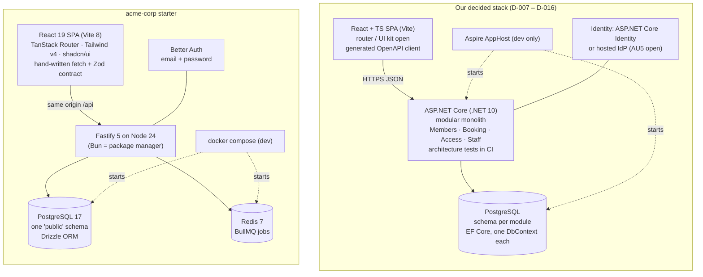
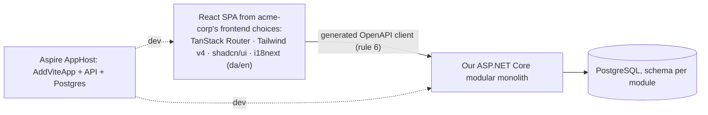

# Stack comparison: recommended `acme-corp` starter vs our decided stack

- **Date:** 2026-11-13
- **Brief:** Linear [FIT-40](https://linear.app/fitnesscenter/issue/FIT-40/research-compare-recommended-acme-corp-typescript-stack-with-our). Compare the recommended starter [Pallepadehat/acme-corp](https://github.com/Pallepadehat/acme-corp) part by part with D-007 to D-016. Show what keeping ours, adopting it, or a hybrid would mean.
- **Scope:** stack and tooling only. Payments (D-006), hosting (SA4) and mobile tech (FIT-34) are out of scope.
- **Status:** research. **No decisions.** Claim prefix `ACME`. Budget used: about 27 tool calls (repo read once from a shallow clone at commit `c93fc6d`, plus GitHub API and official docs).
- **Repo links** below point at `main`. At the time of reading, `main` = `c93fc6d` (2026-10-15).

## 1. Executive summary

1. **acme-corp is a fresh, single-author template with a todo-list example, not a product base.** It has 2 commits, both on 2026-10-15, by one author. It has 1 star and 0 forks, and it is flagged as a GitHub template ([ACME-001]–[ACME-003]). It is well wired: CI passes, and it has Vitest, PGlite integration tests, a Playwright E2E test, Drizzle migrations and Danish i18n. But it is very new and has no track record.
2. **Its backend runs on Node.js 24, not Bun.** Bun is the package manager and script runner only. The API is started with `node src/main.ts` using Node's type stripping ([ACME-005], [ACME-020]).
3. **Auth: Better Auth covers Google + email/password + TOTP 2FA, but not our staff-MFA rule out of the box.** Its 2FA plugin does not gate OAuth/social sign-in by default. Making MFA mandatory for staff needs custom hooks ([ACME-030], [ACME-031]). The template enables only email/password, with no 2FA, no email verification and no password reset wired ([ACME-010]).
4. **Module boundaries (D-008) are the biggest gap.** The template has a single `db` package that exposes every table to every route, and no architecture tests. Turborepo's `boundaries` can restrict package-to-package imports, but it is labelled **Experimental** ([ACME-040]). Nothing found matches NetArchTest's layer rules without extra tools (evidence gap).
5. **Schema per module (D-014) is possible in Drizzle** through `pgSchema` and drizzle-kit's `schemaFilter` ([ACME-041], [ACME-042]). The template does not use it. Drizzle is still **pre-1.0** (0.45.4, with 1.0 RC since April 2026) ([ACME-051]).
6. **The frontend pieces fit inside D-007 as it stands:** React 19, Vite, TanStack Router, Tailwind v4 and shadcn/ui. D-007 leaves the router and styling open, and architecture.md already lists shadcn/ui as a candidate. The parts that do **not** fit our rules are its hand-written `fetch` client and its shared Zod contract package, because rule 6 requires a generated OpenAPI client.
7. **Switching fully would supersede at least D-007 (C# backend), and change how D-008, D-009, D-010 and D-014/D-015 are implemented.** It would close AU5 and S11 by default rather than by research. It gives up the owner's C# expertise on the riskiest code. The earlier stack research ranked full-stack TS last, as a baseline only (tech-stack.md §6).
8. **Performance testing (D-016) is not in the template.** The leading candidate from our own research (k6, TS scripts) is stack-agnostic, so this does not favour either side ([performance-testing.md](performance-testing.md) PERF-002/003).

## 2. The two architectures side by side

A hybrid that stays inside the current decisions [Inference]:

## 3. Findings

### 3.1 What acme-corp is (Q1)

- [ACME-001] The repo was created 2026-10-15 and last pushed 2026-10-15. Its metadata `updated_at` is 2026-10-22. It has 1 star, 0 forks and 0 open issues, it is owned by a personal account, and it is marked `is_template: true`. Source: GitHub API `repos/Pallepadehat/acme-corp` (https://github.com/Pallepadehat/acme-corp). Confidence: High. (Primary)
- [ACME-002] The history has 2 commits by one author (Patrick Jakobsen): "Initial commit: Acme Corp full-stack TypeScript starter" and "ci: update GitHub Actions to current major versions", both 2026-10-15. Source: repo git log (https://github.com/Pallepadehat/acme-corp/commits/main). Confidence: High. (Primary)
- [ACME-003] It is a template, not a product base. The README tells you to "Click **Use this template**" and run `bun run rename my-app`, and says "The todo list is the example feature … Replace it with your own." Source: https://github.com/Pallepadehat/acme-corp/blob/main/README.md. Confidence: High. (Primary)
- [ACME-004] The licence is MIT ("Copyright (c) 2026 Acme Corp contributors"). Source: https://github.com/Pallepadehat/acme-corp/blob/main/LICENSE. Confidence: High. (Primary)
- [ACME-005] Component versions, pinned exactly in package files:
  - **Root:** `packageManager: bun@1.4.0`, `engines.node >=24`, Biome 2.5.15, Playwright 1.64.1, Knip 6.41.0, Lefthook 2.2.2, Turbo 2.11.8, TypeScript 7.0.2.
  - **API:** Fastify 5.12.7, better-auth 1.7.10, bullmq 6.3.15, ioredis 6.0.0, drizzle-orm 0.45.4, pino 10.4.0, zod 4.6.7, vitest 5.0.5.
  - **Web:** react 19.3.1, @tanstack/react-router 1.170.44, tailwindcss 4.3.3, shadcn 4.21.5, radix-ui 1.8.1, i18next 26.4.5, vite 8.3.4, babel-plugin-react-compiler 1.0.0.
  - **DB:** postgres (postgres.js) 3.4.9, drizzle-kit 0.31.11, @electric-sql/pglite 0.5.10.

  Sources: [package.json](https://github.com/Pallepadehat/acme-corp/blob/main/package.json), [apps/api/package.json](https://github.com/Pallepadehat/acme-corp/blob/main/apps/api/package.json), [apps/web/package.json](https://github.com/Pallepadehat/acme-corp/blob/main/apps/web/package.json), [packages/db/package.json](https://github.com/Pallepadehat/acme-corp/blob/main/packages/db/package.json). Confidence: High. (Primary)
- [ACME-006] The structure is `apps/web` (React), `apps/api` (Fastify), `packages/db` (Drizzle schema, migrations, test DB), `packages/contract` (Zod schemas shared by the app and the API) and `e2e/` (Playwright). Source: README "Project structure". Confidence: High. (Primary)
- [ACME-007] CI (GitHub Actions) has two jobs. `check` runs `bun run check`, which is lint, typecheck, test, build and knip. `e2e` installs Chromium and runs Playwright. The two runs on record both succeeded on 2026-10-15. Sources: [.github/workflows/ci.yml](https://github.com/Pallepadehat/acme-corp/blob/main/.github/workflows/ci.yml); GitHub API `actions/runs`. Confidence: High. (Primary)
- [ACME-008] Test count: 15 `it`/`test` cases in total. That is 4 API route tests, 3 web-serving tests, 4 component tests, 2 schema tests and 2 E2E tests. Source: repo files `apps/api/src/**/*.test.ts`, `apps/web/src/components/todo-list.test.tsx`, `packages/db/src/schema.test.ts`, [e2e/todos.spec.ts](https://github.com/Pallepadehat/acme-corp/blob/main/e2e/todos.spec.ts) (counted with grep). Confidence: High. (Primary)
- [ACME-009] API integration tests run against PGlite, an in-process Postgres. A migrated database is built once per worker, dumped, and restored per test. Source: [packages/db/src/testing.ts](https://github.com/Pallepadehat/acme-corp/blob/main/packages/db/src/testing.ts). Confidence: High. (Primary)
- [ACME-010] Auth config enables only `emailAndPassword: { enabled: true }`. Sessions are cached in a signed cookie for 5 minutes, and the code comments that "a session revoked on another device keeps working here until the cookie is next refreshed". No social provider, 2FA plugin, email verification or password-reset sender is configured. Source: [apps/api/src/auth.ts](https://github.com/Pallepadehat/acme-corp/blob/main/apps/api/src/auth.ts). Confidence: High. (Primary)
- [ACME-011] Migrations: two drizzle-kit SQL migrations, all tables in `public`. Timestamp columns are `timestamp` (**without** time zone), for example `"created_at" timestamp DEFAULT now()`. The Better Auth `session` table stores `ip_address` and `user_agent`. Source: [packages/db/drizzle/0000_init.sql](https://github.com/Pallepadehat/acme-corp/blob/main/packages/db/drizzle/0000_init.sql). Confidence: High. (Primary)
- [ACME-012] Local services come from `compose.yaml`: `postgres:17-alpine`, and `redis:7-alpine` with persistence turned off (`--save "" --appendonly no`). There is no Dockerfile for the app. The README deploys as one Node process that serves the built SPA. Sources: [compose.yaml](https://github.com/Pallepadehat/acme-corp/blob/main/compose.yaml); README "Deploying". Confidence: High. (Primary)
- [ACME-013] Background jobs: one BullMQ queue and worker run inside the API process. Routes depend on a `Jobs` interface so that tests pass a fake. Source: [apps/api/src/jobs.ts](https://github.com/Pallepadehat/acme-corp/blob/main/apps/api/src/jobs.ts). Confidence: High. (Primary)
- [ACME-014] The frontend calls the API through a hand-written `api<T>(path)` wrapper around `fetch`. Request and response shapes are shared as Zod schemas in `packages/contract`. There is no OpenAPI document. Sources: [apps/web/src/lib/api.ts](https://github.com/Pallepadehat/acme-corp/blob/main/apps/web/src/lib/api.ts), [packages/contract/src/index.ts](https://github.com/Pallepadehat/acme-corp/blob/main/packages/contract/src/index.ts). Confidence: High. (Primary)
- [ACME-015] Translations for English and Danish are included, with type-checked keys. Source: README "What's inside" and `apps/web/src/i18n/da.ts`. Confidence: High. (Primary)

### 3.2 Runtime and tooling

- [ACME-020] Node.js type stripping is **stable** as of v25.2.0 / v24.12.0 and on by default since v22.18.0. It does no type checking. It rejects enums, namespaces with runtime code, parameter properties and decorators, and it ignores `tsconfig.json` (so `paths` aliases fail). Source: https://nodejs.org/api/typescript.html. Confidence: High. (Primary)
- [ACME-021] "Bun itself is MIT-licensed". It statically links JavaScriptCore/WebKit, which is LGPL-2. Source: https://bun.com/docs/project/licensing. Confidence: High. (Primary)
- [ACME-022] Bun's latest release is v1.4.4 (2026-10-22). 1.4.0 was released 2026-08-20, and the template pins 1.4.0. Source: GitHub releases API, https://github.com/oven-sh/bun/releases. Confidence: High. (Primary)
- [ACME-023] The template pins TypeScript 7.0.2. The `microsoft/typescript-go` repo published `typescript/v7.0.2` on 2026-07-08 and is now **archived**. Why it was archived (for example, merged into the main TypeScript repo) is **UNVERIFIED**, because I did not fetch an announcement. Source: GitHub API `repos/microsoft/typescript-go`. Confidence: Medium. (Primary, incomplete)
- [ACME-024] Turborepo is MIT-licensed. Its latest stable release is v2.11.11 (2026-11-11). Source: https://github.com/vercel/turborepo/releases. Confidence: High. (Primary)

### 3.3 Fit with our accepted requirements (Q3)

- [ACME-030] Better Auth's two-factor plugin supports TOTP, OTP by email or phone, backup codes and trusted devices (30 days). Enforcement applies to the credential sign-in endpoints. For other methods you must "add custom hook handling for those endpoints". Source: https://www.better-auth.com/docs/plugins/2fa. Confidence: High. (Primary)
- [ACME-031] On the same page: "OAuth/social, passkey, anonymous, and similar passwordless flows are not gated by 2FA by default." No built-in per-role "MFA required" setting is described. Source: https://www.better-auth.com/docs/plugins/2fa. Confidence: High. (Primary)
  - [Inference] With Better Auth, D-013 ("MFA mandatory for staff", with Google login also offered) needs custom code. Either staff are blocked from Google sign-in, or a hook gates staff sessions on 2FA. That code is security-critical and would need its own tests.
- [ACME-032] Google sign-in in Better Auth is set up with `socialProviders.google` (clientId, clientSecret), and `baseURL` must be set to avoid `redirect_uri_mismatch`. Source: https://www.better-auth.com/docs/authentication/google. Confidence: High. (Primary)
- [ACME-040] `turbo boundaries` reports imports of files outside a package's directory and imports of packages not declared as dependencies. Tag-based allow, deny and dependents rules apply transitively. It is labelled **"This feature is experimental."** Source: https://turborepo.dev/docs/reference/boundaries. Confidence: High. (Primary)
  - [Inference] This could cover rule 1 (only `*.Contracts` packages may be referenced) if each module were its own workspace package. It does not cover rule 2 (Domain has no I/O and no clock) or rule 3 (no access to another module's tables). Those would need lint rules or a tool such as dependency-cruiser. That tool was **not researched** (evidence gap).
  - [Inference] In the template, `packages/db` exports one `Database` type over the whole schema ([client.ts](https://github.com/Pallepadehat/acme-corp/blob/main/packages/db/src/client.ts)), so any route can query any table. Rule 3 would need a restructure, for example one db package per module.
- [ACME-041] Drizzle supports PostgreSQL schemas through `pgSchema("my_schema")`: "query builder will prepend schema names in queries". Source: https://orm.drizzle.team/docs/schemas. Confidence: High. (Primary)
- [ACME-042] drizzle-kit `schemaFilter` is a glob filter on schema names (for example `["public", "auth"]`), and push/pull "manage all schemas" by default. The migrations log table defaults to `{ table: "__drizzle_migrations", schema: "drizzle" }`. Source: https://orm.drizzle.team/docs/drizzle-config-file. Confidence: High. (Primary)
  - [Inference] There is one migrations log per drizzle-kit config. Per-module migration histories (as D-014 plans with EF Core) would mean one config per module, and run order handled by scripts. Whether drizzle-kit handles cross-config FKs cleanly is **UNVERIFIED**.
- [ACME-043] [Inference] Cross-module transactions (D-015) are simpler in the template's shape than in EF Core with several DbContexts, because there is a single Drizzle `db` object over one connection pool. I did not fetch the Drizzle transactions docs, so the exact API is **UNVERIFIED** here.
- [ACME-044] BullMQ needs "Redis™ 6.2 or newer (the default)". It now also supports "PostgreSQL 13 or newer" (not for the Rust and PHP SDKs), as well as Valkey and Dragonfly. Source: https://docs.bullmq.io/. Confidence: High. (Primary)
  - [Inference] The template's Redis is an extra service to run and back up in production. Its dev Redis has persistence turned off ([ACME-012]). For billing-style jobs (tech-stack.md §2.6), the Postgres backend or a durable Redis would be needed.
- [ACME-045] Performance testing: the template has none. Our research found k6 runs `.ts` scripts and fails CI through thresholds, independent of the server stack ([performance-testing.md](performance-testing.md) PERF-002–004). NBomber is the only .NET-native option and has a licence question (PERF-010). [Inference] D-016 favours neither side.
- [ACME-046] Time convention: our CLAUDE.md requires `timestamptz` and NodaTime business rules in Europe/Copenhagen. The template generates `timestamp` without time zone ([ACME-011]). [Inference] Drizzle can probably declare `withTimezone`, but this is **UNVERIFIED** (not fetched). The TS side has no NodaTime equivalent in the template. Npgsql's recommended NodaTime support was one reason for D-007 (tech-stack.md §1 item 6).
- [ACME-047] GDPR/data minimisation, only where the stack matters [Inference]:
  - Better Auth and ASP.NET Core Identity both keep auth data in our own database, unlike hosted IdPs, which become processors (authentication.md, "Hosted IdPs and our processors").
  - Better Auth's default `session` table stores IP address and user agent ([ACME-011]). That needs a retention decision either way.

### 3.4 Library maturity (Q5)

| Library | Licence | Version in template | Latest seen (2026-11-13) | Notes | Source |
|---|---|---|---|---|---|
| Better Auth | MIT | 1.7.10 | 1.7.22 stable (2026-11-12); 1.8.0-beta.9 | Stable releases almost daily (1.7.19–1.7.22 in 3 days). A 1.8 line is in beta | [releases](https://github.com/better-auth/better-auth/releases) |
| Drizzle ORM | Apache-2.0 | 0.45.4 | 0.45.4 stable; **1.0.0-rc.5** (2026-10-21) | **Pre-1.0.** RCs since 2026-04-30, so a 0.x → 1.0 upgrade is ahead | [releases](https://github.com/drizzle-team/drizzle-orm/releases) |
| Bun | MIT (+LGPL JSC) | 1.4.0 | 1.4.4 (2026-10-22) | Only package manager/scripts here | [ACME-021], [ACME-022] |
| TanStack Router | MIT | 1.170.44 | multiple 1.16x–1.17x package releases 2026-11-08 | v1, very frequent package releases | [releases](https://github.com/TanStack/router/releases) |
| BullMQ | MIT | 6.3.15 | 6.7.6 (2026-11-12) | Template already 4 minor versions behind | [releases](https://github.com/taskforcesh/bullmq/releases) |
| PGlite | Apache-2.0 | 0.5.10 | active (extension packages 2026-11-10) | **Pre-1.0**. Postgres version and connection limits not stated on the about page (UNVERIFIED) | [pglite.dev/docs/about](https://pglite.dev/docs/about) |

- [ACME-051] These licences and release dates come from the GitHub API for each repo, read 2026-11-13. Confidence: High. (Primary)
- [ACME-052] PGlite is "a WASM Postgres build packaged into a TypeScript/JavaScript client library" that runs in the browser, Node.js and Bun. Source: https://pglite.dev/docs/about. Confidence: High. (Primary)
  - Whether PGlite behaves like server Postgres for concurrent transactions and locking is **UNVERIFIED**. This matters for D-015 tests. Our .NET plan uses Testcontainers with real Postgres (D-010).

### 3.5 Aspire and the hybrid (Q4)

- [ACME-060] Aspire hosts JavaScript apps with `AddJavaScriptApp` and a Vite-specific `AddViteApp`. npm is the default, and Yarn, pnpm and **Bun** are opt-in (`WithBun`). Only `AddNextJsApp` is marked experimental. Source: https://aspire.dev/integrations/frameworks/javascript/. Confidence: High. (Primary)
  - [Inference] A frontend built on acme-corp's choices could run under our Aspire AppHost (D-009) without compose.
- [ACME-061] D-007 fixes React + TS (Vite) and leaves the router, styling and UI kit open. architecture.md §3 lists "UI library candidate shadcn/ui". ux-patterns.md notes that shadcn switched its default primitives to Base UI in July 2026 (U23). The template uses the `radix-ui` package ([ACME-005]). Sources: [decisions.md D-007](../decisions.md), [architecture.md](../architecture.md), [ux-patterns.md](ux-patterns.md) §10. Confidence: High. (Primary, internal)

## 4. Component-by-component comparison (Q2)

| Area | acme-corp | Our stack (decision) | Compatible with current decisions? |
|---|---|---|---|
| Frontend framework | React 19 + React Compiler, Vite 8 | React + TS, Vite (D-007) | **Yes** |
| Router | TanStack Router, file-based | Open | **Yes** (fills an open slot) |
| Styling / UI kit | Tailwind v4 + shadcn/ui (Radix) | Open; shadcn/ui candidate | **Yes** (Radix vs Base UI to choose) |
| i18n | i18next, da + en, typed keys | Not decided (UNVERIFIED whether an open question exists) | Yes |
| API client | Hand-written fetch + shared Zod contract | Generated OpenAPI client (rule 6) | **No.** Conflicts with rule 6 |
| Backend framework | Fastify 5 (TS) | ASP.NET Core .NET 10 (D-007) | **No** |
| Runtime | Node 24 (type stripping); Bun as package manager | .NET 10 | No |
| ORM / migrations | Drizzle 0.45 (pre-1.0) + drizzle-kit; one `public` schema | EF Core, DbContext per schema (D-014) | Concept yes (pgSchema), implementation no |
| Cross-module transactions | Single `db` object (inference) | Shared connection across DbContexts (D-015) | Concept yes |
| Auth | Better Auth, email/password only wired | Google + local; staff MFA mandatory (D-013); impl open (AU5) | Feasible with custom hooks ([ACME-031]) |
| Background jobs | BullMQ + Redis (in-process worker) | Not decided (Quartz.NET / Hangfire / BackgroundService in tech-stack.md §2.6) | n/a; adds Redis unless BullMQ's Postgres backend is used |
| Monorepo | Bun workspaces + Turborepo | .NET solution + `frontend/` | Turborepo only relevant for the frontend |
| Unit / integration tests | Vitest; PGlite in-process Postgres | Open (S11); Testcontainers + WebApplicationFactory in research | Frontend: Vitest compatible. Backend: no |
| E2E | Playwright | Playwright (D-010 research) | **Yes** |
| Performance tests | None | Required (D-016); k6 a candidate | Neither side has it; k6 works for both |
| Architecture tests | None | NetArchTest/ArchUnitNET (D-008) | **No**; Turbo boundaries is experimental |
| Lint / format | Biome, Knip, Lefthook | Not decided (.NET analyzers in research) | Frontend: compatible |
| Local orchestration | docker compose (Postgres + Redis) | Aspire AppHost (D-009) | Aspire can run the Vite app ([ACME-060]) |

## 5. Options and trade-offs (Q6)

| Option | What it means | For | Against | Decisions affected |
|---|---|---|---|---|
| **1. Keep ours** | No change | Uses the owner's professional C# for billing, payroll and time logic (D-007). Architecture tests and per-schema EF Core already planned. NodaTime fit | More setup to write. Frontend router/UI kit still to choose | None |
| **2. Adopt acme-corp entirely** | Fork the template and build the modules in TS | Working skeleton today, with CI, E2E, auth, migrations and Danish i18n. One language. Fast tooling | One-author template, 4 weeks old. Drizzle and PGlite pre-1.0. Staff-MFA and module-boundary rules need custom work. Adds Redis. Gives up C# strength. Tech-stack research ranked full-stack TS last (tech-stack.md §6) | **Supersedes D-007** (backend). Changes the implementation of D-008 (no NetArchTest), D-009 (compose or Aspire JS), D-010 toolchain, D-014/D-015 (Drizzle instead of EF Core). Closes AU5 (Better Auth) and S11 (Vitest) by default. Opens: TS boundary tooling, job backend, timestamptz/time-zone library |
| **3a. Hybrid: frontend choices only** | Use TanStack Router + Tailwind v4 + shadcn/ui + i18next in our `frontend/`, keep the C# backend | Fits D-007 unchanged. Fills open slots with a set that is known to work together. Aspire can host it | Template code built around Better Auth and its fetch wrapper must be replaced by the generated client and our auth flow. Copying gives little beyond `npm create` + shadcn init [Inference] | None superseded. Records frontend library choices (new decision) |
| **3b. Hybrid: frontend tooling too** | 3a plus Biome, Knip, Lefthook, Vitest, Playwright config for `frontend/` | Fast frontend gate | Two lint ecosystems in one repo (Biome + .NET analyzers) [Inference] | Feeds S11 for the frontend only |

[Inference] A "partial backend" hybrid (for example Better Auth as a separate TS auth service in front of the C# API) would add a second deployable and language at the security boundary. D-008 accepted only payments as a separate deployable, so this option is not developed further.

## 6. Conflicts between sources

- **"Bun" vs Node as runtime.** The repo description lists Bun first under tooling. The code runs the API with `node` ([apps/api/package.json](https://github.com/Pallepadehat/acme-corp/blob/main/apps/api/package.json)), and the README says the backend runs "on Node.js 24's built-in TypeScript support". The likely explanation is that Bun is used only as the package manager and script runner.
- **Last updated.** The ticket says 2026-10-22, which is the GitHub `updated_at` metadata. The last push and commit are 2026-10-15. `updated_at` also changes on non-code events such as description edits or stars [Inference].

## 7. Evidence gaps and UNVERIFIED items

- Tooling for TS architecture rules 2 and 3 (dependency-cruiser, eslint-plugin-boundaries, Nx module boundaries): **not researched** (budget).
- Drizzle transactions API, and `timestamp({ withTimezone: true })`: not fetched.
- Whether drizzle-kit supports multiple configs with cross-schema FKs and ordered migrations: UNVERIFIED.
- PGlite's Postgres version and its concurrency/locking fidelity: not stated on the about page.
- Why `microsoft/typescript-go` is archived: UNVERIFIED.
- Better Auth security track record (advisories): not checked.
- The author's other projects and maintenance intent: not checked beyond the account (34 public repos, created 2022).

## 8. Open questions for the project owner

1. Do you want to reopen D-007 (C# backend) at all? Or should acme-corp be judged only as a source of frontend choices (option 3a/3b)?
2. If frontend only: should TanStack Router + Tailwind v4 + shadcn/ui become the frontend decision now? And Radix (as in the template) or Base UI (shadcn's default since July 2026)?
3. Is Danish + English UI (i18n from day one) a requirement for the center? The template includes it, but no decision covers it.
4. Who recommended the repo, and why? Does that person have experience with this stack that would change the learning-goal argument in D-007?

## 9. Sources

| Source | Publisher | Accessed | Type |
|---|---|---|---|
| https://github.com/Pallepadehat/acme-corp (README, package files, compose.yaml, ci.yml, auth.ts, jobs.ts, app.ts, client.ts, testing.ts, drizzle SQL, e2e) | Pallepadehat (GitHub) | 2026-11-13 | Primary |
| GitHub REST API: repo metadata, `actions/runs`, releases for better-auth, drizzle-orm, bun, TanStack/router, bullmq, pglite, turborepo, typescript-go | GitHub | 2026-11-13 | Primary |
| https://www.better-auth.com/docs/plugins/2fa | Better Auth | 2026-11-13 | Primary |
| https://www.better-auth.com/docs/authentication/google | Better Auth | 2026-11-13 | Primary |
| https://orm.drizzle.team/docs/schemas | Drizzle | 2026-11-13 | Primary |
| https://orm.drizzle.team/docs/drizzle-config-file | Drizzle | 2026-11-13 | Primary |
| https://turborepo.dev/docs/reference/boundaries | Vercel / Turborepo | 2026-11-13 | Primary |
| https://docs.bullmq.io/ | Taskforce.sh | 2026-11-13 | Primary |
| https://bun.com/docs/project/licensing | Oven | 2026-11-13 | Primary |
| https://nodejs.org/api/typescript.html | Node.js | 2026-11-13 | Primary |
| https://pglite.dev/docs/about | ElectricSQL | 2026-11-13 | Primary |
| https://aspire.dev/integrations/frameworks/javascript/ | Microsoft / Aspire | 2026-11-13 | Primary |
| [tech-stack.md](tech-stack.md) §1, §2.6, §2.7, §6 | Project research | 2026-11-13 | Internal |
| [performance-testing.md](performance-testing.md) §1, §3.1 | Project research | 2026-11-13 | Internal |
| [authentication.md](authentication.md) | Project research | 2026-11-13 | Internal |
| [ux-patterns.md](ux-patterns.md) §10 | Project research | 2026-11-13 | Internal |
