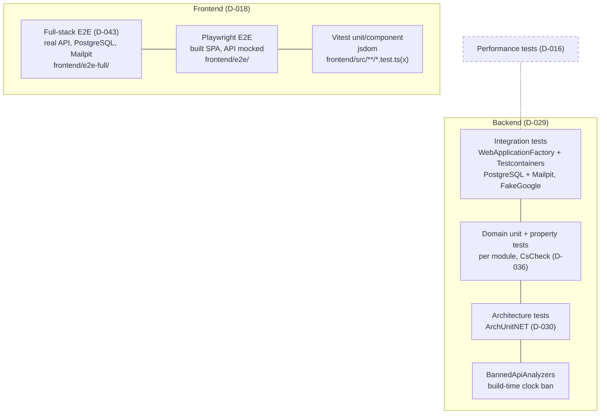
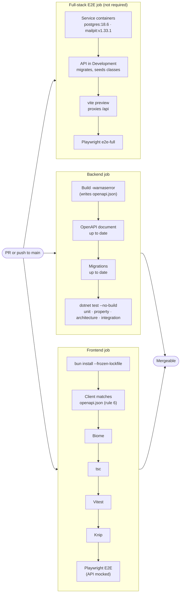
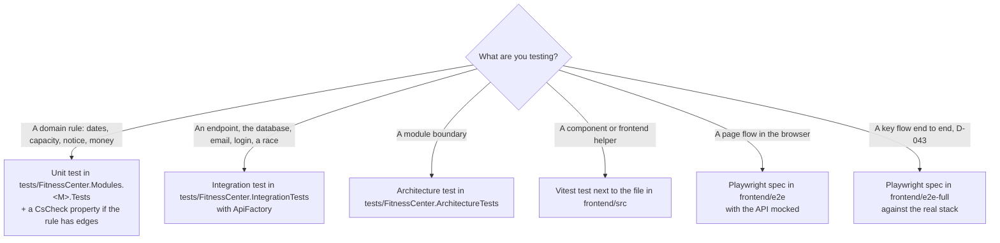

# Testing

How this repo tests itself **today**, which project rule each automated check guards, and what is planned but not built. It follows the skeleton in [research/testing-strategy.md](research/testing-strategy.md) §5, but only keeps the sections that describe something real or decided. Policies that are still open are listed in [§7](#7-planned-not-built) with their question IDs.

Decisions this page rests on: D-010 (all automatable tests in CI), D-016 (performance tests), D-018 (Vitest + Playwright), D-028 (which rules are enforced), D-029 (MSTest), D-030 (ArchUnitNET), D-036 (CsCheck), D-043 (full-stack E2E). All are in [decisions.md](decisions.md).

## 1. Test levels

Dashed boxes are planned and not built yet ([§7](#7-planned-not-built)).

| Level | Project / folder | What it covers | Real or doubled dependencies |
|---|---|---|---|
| Domain unit tests | [`tests/FitnessCenter.Modules.Members.Tests`](../tests/FitnessCenter.Modules.Members.Tests), [`tests/FitnessCenter.Modules.Booking.Tests`](../tests/FitnessCenter.Modules.Booking.Tests) | Domain rules with example values, e.g. `MemberSignUpTests.cs`, `MoneyTests.cs`, `ClassSessionTests.cs` | None: the domain is pure and gets the current instant as an argument (architecture.md §4.2 rule 2) |
| Property tests | [`ClassSessionProperties.cs`](../tests/FitnessCenter.Modules.Booking.Tests/ClassSessionProperties.cs) | The booking rules (D-039) for any time and any order of bookings and cancellations | None; inputs come from CsCheck generators (D-036) |
| Integration tests | [`tests/FitnessCenter.IntegrationTests`](../tests/FitnessCenter.IntegrationTests) | The real API over HTTP: signup, email confirmation, login, Google login, booking, health | Real: PostgreSQL 18.6 and Mailpit in containers ([`PostgresDatabase.cs`](../tests/FitnessCenter.IntegrationTests/PostgresDatabase.cs), [`TestMailbox.cs`](../tests/FitnessCenter.IntegrationTests/TestMailbox.cs)). Doubled: Google ([`FakeGoogle.cs`](../tests/FitnessCenter.IntegrationTests/FakeGoogle.cs)), and any service a test swaps through [`ApiFactory`](../tests/FitnessCenter.IntegrationTests/ApiFactory.cs) |
| Architecture tests | [`tests/FitnessCenter.ArchitectureTests`](../tests/FitnessCenter.ArchitectureTests) | Module boundary rules ([§2](#2-which-rule-each-check-enforces)) | Inspects the compiled assemblies |
| Build-time analyzer | [`src/Modules/BannedSymbols.txt`](../src/Modules/BannedSymbols.txt), wired in [`src/Modules/Directory.Build.props`](../src/Modules/Directory.Build.props) | No reading the system clock in module code | Build fails under `-warnaserror` |
| Frontend unit/component | `frontend/src/**/*.test.{ts,tsx}` ([`vitest.config.ts`](../frontend/vitest.config.ts)) | Components and helpers, e.g. `money.test.ts`, `signup-form.test.tsx`, `schedule.test.tsx` | jsdom; Testing Library ([`src/test/setup.ts`](../frontend/src/test/setup.ts)) |
| Frontend E2E | [`frontend/e2e/`](../frontend/e2e) ([`playwright.config.ts`](../frontend/playwright.config.ts)) | Landing, signup, Google login, classes pages in Chromium | Built SPA served by `vite preview`; **the API is mocked** with `page.route` (e.g. `signup.spec.ts`, `classes.spec.ts`) |
| Full-stack E2E | [`frontend/e2e-full/`](../frontend/e2e-full) ([`playwright.full.config.ts`](../frontend/playwright.full.config.ts)) | Signup → confirmation link from Mailpit → login → account page; book a class → spots go down → cancel → spots go back up; swipe your own card at the simulated reader → welcome; pay only for a past month → the reader refuses → one reminder email (D-043, D-042) | All real: the API in Development, PostgreSQL, Mailpit. Uses the seeded development schedule (`Booking:SeedDevelopmentSchedule`) and the simulated card reader (`Simulation:Enabled`, on in Development). Nothing mocked, except that Google login is off |

Notes on how the integration tests run:
- One PostgreSQL container and one Mailpit container serve the whole run. They start together in `[AssemblyInitialize]`, and the API migrates the database once there, so parallel tests don't race on migrations ([`PostgresDatabase.cs`](../tests/FitnessCenter.IntegrationTests/PostgresDatabase.cs)).
- Each test starts its own in-memory API with `new ApiFactory()`. The factory empties the Google client ID, turns off the development class schedule and points SMTP at Mailpit ([`ApiFactory.cs`](../tests/FitnessCenter.IntegrationTests/ApiFactory.cs)).
- The API sends real SMTP to Mailpit, and tests read the emails back through Mailpit's HTTP API, e.g. to follow a confirmation link (D-038, [`TestMailbox.cs`](../tests/FitnessCenter.IntegrationTests/TestMailbox.cs)).
- All four C# test projects run tests in parallel at method level (`MSTestSettings.cs` in each project).

Notes on how the full-stack E2E tests run:
- The config starts nothing. It reads `E2E_BASE_URL` (the frontend, with `/api` reaching the API; default `http://localhost:5173`, Aspire's port) and `MAILPIT_URL` (Mailpit's web address, required). So the same suite runs in CI and against `aspire run`.
- Each test signs up its own synthetic member (`e2e-…@example.com`). Shared steps are in [`member.ts`](../frontend/e2e-full/member.ts); a new flow starts from `signUpAndLogIn`.
- The database is not reset between runs. The booking test picks the latest class that still has a spot, reads its count and checks that it moves by one, so earlier bookings don't matter. Tests run one at a time (`workers: 1`) so they don't change each other's counts.
- The test opens the confirmation link's path and query on its own base URL, whatever host the API put in the link.

## 2. Which rule each check enforces

D-028 decides which rules are enforced by a check and which stay with review. This is how each enforced rule is checked today.

| Rule (CLAUDE.md, architecture.md §4.2) | Check | Where |
|---|---|---|
| 1: a module uses only another module's `*.Contracts` | `Modules_do_not_depend_on_other_modules_internals`, `Contracts_do_not_depend_on_any_module_internals` | [`ModuleBoundaryTests.cs`](../tests/FitnessCenter.ArchitectureTests/ModuleBoundaryTests.cs) |
| 2: `Domain` depends only on the shared kernel, no I/O | `Domain_depends_only_on_itself_and_the_shared_kernel` (bans the module's outer layers, other modules, EF Core, Npgsql, ASP.NET Core, `System.IO`, `System.Net`) | [`ModuleBoundaryTests.cs`](../tests/FitnessCenter.ArchitectureTests/ModuleBoundaryTests.cs) |
| 2: no reading system time | BannedApiAnalyzers bans `DateTime.Now`, `DateTime.UtcNow`, `DateTime.Today`, `DateTimeOffset.Now`, `DateTimeOffset.UtcNow` in all module code | [`BannedSymbols.txt`](../src/Modules/BannedSymbols.txt), [`Directory.Build.props`](../src/Modules/Directory.Build.props) |
| 3: no module touches another module's tables | `DbContexts_are_internal`, plus the rule 1 tests (each `DbContext` lives in its module's internal assembly) | [`ModuleBoundaryTests.cs`](../tests/FitnessCenter.ArchitectureTests/ModuleBoundaryTests.cs) |
| 5: the shared kernel stays tiny | Partly: `Shared_kernel_does_not_depend_on_any_module`. Keeping business rules out of it is still review (D-028) | [`ModuleBoundaryTests.cs`](../tests/FitnessCenter.ArchitectureTests/ModuleBoundaryTests.cs) |
| 6: the frontend uses only the generated API client | CI regenerates `frontend/src/api/` and fails on a diff; a second step fails if the backend build changed the committed `openapi.json` (D-028, D-033) | [`ci.yml`](../.github/workflows/ci.yml), steps "OpenAPI document is up to date" and "Generated API client matches the OpenAPI document" |
| Migrations match the data model | `dotnet ef migrations has-pending-model-changes` for every module | [`ci.yml`](../.github/workflows/ci.yml), step "Migrations are up to date" |
| Build, tests, lint, format, unused code | `-warnaserror` build, `dotnet test`, Biome, `tsc`, Vitest, Knip, Playwright | [`ci.yml`](../.github/workflows/ci.yml) |

`At_least_two_modules_are_found` guards the tests themselves: if module discovery in [`Modules.cs`](../tests/FitnessCenter.ArchitectureTests/Modules.cs) broke, every boundary test would pass trivially.

Rule 4 (integration events), money in øre, synthetic data and Danish law stay with review (D-028).

D-028 also lists "agents may not edit acceptance tests" as enforced by an agent permission setting. **Not found in the repo:** there is no `.claude/settings.json` with deny rules and no acceptance-test folder. How test protection is enforced is still open (Q2, Q3 in [open-questions.md](open-questions.md)).

## 3. Commands

From the repo root (CLAUDE.md, "Commands"). Docker must run for the backend tests.

| What | Command |
|---|---|
| Backend gate: build, unit, property, architecture, integration | `dotnet build FitnessCenter.sln -warnaserror && dotnet test FitnessCenter.sln` |
| One C# test project | `dotnet test tests/<Project>` |
| Frontend gate: lint, typecheck, unit, unused code | `bun run --cwd frontend lint && bun run --cwd frontend typecheck && bun run --cwd frontend test && bun run --cwd frontend knip` |
| Frontend E2E (builds and serves the app itself) | `bun run --cwd frontend e2e` (first time: `bunx playwright install chromium` in `frontend/`) |
| Full-stack E2E against `aspire run` | `MAILPIT_URL=http://localhost:<port> bun run --cwd frontend e2e:full` (Mailpit's port: the 8025 mapping in `docker ps`) |
| After an endpoint change | `bun run --cwd frontend api:generate`, then commit `frontend/src/api/` |
| After a data model change | `dotnet ef migrations add <Name> --project src/Modules/<M>/<M> --context <M>DbContext --output-dir Infrastructure/Migrations` |

## 4. What CI runs

[`.github/workflows/ci.yml`](../.github/workflows/ci.yml) runs three jobs on every pull request and every push to `main`. Branch protection on `main` requires the backend and frontend jobs (comment at the top of `ci.yml`; CLAUDE.md). The full-stack E2E job is not a required check; making it one is a branch-protection change for the owner.

- **Docs-only PRs skip the tests (D-045).** A first `changes` job checks the PR's diff. If every changed file is `.md`, the backend, frontend and full-stack E2E jobs are skipped; GitHub reports them as passing, so the PR stays mergeable. Any other file runs everything, and pushes to `main` always run everything.
- Each job has a 15-minute timeout. The full-stack E2E job uploads the Playwright report, the API log and the preview log when it fails. A newer push to the same ref cancels the running workflow.
- Playwright in CI: `forbidOnly` is on, failed tests are retried up to 2 times, and a trace is kept on the first retry ([`playwright.config.ts`](../frontend/playwright.config.ts)). The HTML report is uploaded as an artifact when the job fails.
- Nothing runs on a schedule yet: there is no nightly job.

## 5. Conventions

### Synthetic data only
Never real member or employee data in tests, fixtures or logs (CLAUDE.md, "Personal data"; research/testing-strategy.md §2.8). Today:
- Emails are unique addresses on the reserved `example.com` domain, e.g. `SyntheticEmail()` in [`SignupTests.cs`](../tests/FitnessCenter.IntegrationTests/SignupTests.cs).
- Names are placeholders such as `"Test"`, `"Member"`, `"Test Instructor"`.
- D-028 keeps this rule with review; no CI check scans fixtures yet.

### The clock
Instants are stored as UTC and business rules run in Europe/Copenhagen with NodaTime; code never reads system time (CLAUDE.md, "Time"; research/testing-strategy.md §2.5).
- **Domain:** domain methods take the current instant as an argument, e.g. `ClassSession.Book(account, now)` and `Member.SignUp(…, now, CenterTime.Zone)`. Unit and property tests pass fixed instants such as `Instant.FromUtc(2027, 1, 12, 17, 0)`, so they need no fake clock object.
- **Integration:** the API resolves NodaTime's `IClock` from DI. A test swaps it through `ApiFactory`'s `configureServices`. Example: `FailingClock` in [`SignupTests.cs`](../tests/FitnessCenter.IntegrationTests/SignupTests.cs) throws, to prove that signup rolls back the account (D-015, D-034).
- **Browser:** Playwright fixes the time with `page.clock.setFixedTime` and sets a non-Danish `timezoneId` to check that the page still shows Copenhagen times ([`classes.spec.ts`](../frontend/e2e/classes.spec.ts), D-039).
- D-010 names NodaTime `FakeClock` and `FakeTimeProvider` as the tools for time in tests. Neither is used in the repo yet.

### Property tests aim at the rule edges
Uniformly random times over a month almost never land on a rule's edge. The generators in [`ClassSessionProperties.cs`](../tests/FitnessCenter.Modules.Booking.Tests/ClassSessionProperties.cs) mix a wide range with samples within ±10 minutes and ±1 second of each edge: the class start, the cancellation cut-off and the opening of the booking window (D-036, D-039). A further property runs random sequences of bookings and cancellations and checks that a class is never overfilled and never holds two active bookings for one member. New property tests should follow the same pattern: name the edges in the rule, and weight the generator towards them.

### Background jobs
A hosted job keeps its work in a separate class that reads the time only from the injected clock, so tests run the work directly instead of waiting for a timer. Example: the payment reminders (D-042). [`PaymentReminderJob`](../src/Modules/Members/Members/Application/PaymentReminderJob.cs) only runs [`PaymentReminders.SendDueAsync`](../src/Modules/Members/Members/Application/PaymentReminders.cs) on a timer.
- `ApiFactory` turns the job off (`Members:PaymentReminders:Enabled=false`), so it doesn't email other tests' members on its own.
- [`MissingPaymentTests.cs`](../tests/FitnessCenter.IntegrationTests/MissingPaymentTests.cs) fixes the clock, calls `SendDueAsync` from a scope and reads the email back from Mailpit. "Never twice" is tested by running it again on a new `ApiFactory` (a restart) and from five scopes at once.
- The work scans the whole shared database, so every test that runs it uses the same fixed day. Tests that would disturb other tests' reminders (a failing mail server, the job on its own timer) are `[DoNotParallelize]`.
- One test turns the job on with a 1-second interval, to prove the timer runs the work. In Development the interval is 30 seconds, so the full-stack E2E test can wait for the reminder email.

### Concurrency tests
Rules that must hold under simultaneous requests get an integration test that fires the requests at once against real PostgreSQL. Example: `Simultaneous_bookings_never_overfill_a_class` in [`BookingTests.cs`](../tests/FitnessCenter.IntegrationTests/BookingTests.cs) signs up 12 members, has them all book a 3-spot class with `Task.WhenAll`, and asserts exactly 3 `204` and 9 `409` responses and 0 spots left. It guards the row lock in the booking handler (D-039). A unit test can't catch this, because the race is in the database.

### Prove a test by watching it fail
A new test for a fix should fail without the fix and pass with it. Otherwise it may not test anything. This is the practice the FIT-37 brief asks for. **UNVERIFIED as a project rule:** no decision records it and no check enforces it. Mutation testing would be the automated form (research/testing-strategy.md §2.2 M4, §2.3); its policy is open (Q4).

### Never weaken a test
Never delete, skip or weaken a test, or change its expected values, to make code pass. The same holds for the architecture tests, the analyzer and performance thresholds (CLAUDE.md, "Tests" and "Module boundary rules"). Research on why: research/testing-strategy.md §2.2.

## 6. Writing a new test: where it goes

This follows what the repo does today (§1). The research advice is the same: pure calculation logic fits fast unit and property tests, and the database and access control fit integration tests (research/testing-strategy.md §1, finding 1).

## 7. Planned, not built

| What | Status | Source |
|---|---|---|
| **Performance tests:** load and response-time tests, on demand and in CI | Required by D-016. Tool, schedule and environment undecided (FIT-39, Q14). Tests for booking and check-in: FIT-60 | D-016 |
| **Definition of Done:** what evidence a task must produce | Open | W15 in [open-questions.md](open-questions.md) |
| Test protection (who writes acceptance tests, how edits are blocked) | Open | Q2, Q3; D-028 |
| Mutation testing (Q4), coverage policy (Q5), requirement→test traceability (Q7) | Open | [open-questions.md](open-questions.md); research/testing-strategy.md §2.3, §2.11, §2.12 |
| Accessibility (axe) and security scanning | Named in D-010 and architecture.md §11; not built | D-010; research/testing-strategy.md §2.9, §2.10 |
| Payment and webhook tests | Payments are out of scope for now | D-006; research/testing-strategy.md §2.6 |
